[« 二次型](../linear-algebra/06-quadratic-forms.md)　　[数列极限与求和极限 »](02-sequences.md)

# 高等数学 · 函数极限与无穷小

> **本章共 27 题**
> 
> - **核心必做（建议按顺序攻克关键方法）**：  
>   [第 15 题](#q15)（无穷小阶数） → [第 01 题](#q01)（展开消项定参数） → [第 06 题](#q06)（幂指极限先取对数） → [第 02 题](#q02)（通分处理相减） → [第 17 题](#q17)（完整写出等价展开）
> 
> - **分流与刷题建议**：  
>   - **较难挑战**：[第 16 题](#q16)（消到四阶的幂指极限）  
>   - **重在看思路**：[第 14 题](#q14)（带参积分先换元或夹逼）  
>   - **首轮可跳过**：[第 19 题](#q19)、[第 20 题](#q20)、[第 27 题](#q27)（技巧较偏或综合度高，首轮不必死磕）  
> 
> - **过关目标**：会判断展开到几阶；相减式不能逐项乱用等价替换。

---

### 01 · 2026年

> *等价无穷小含参定系数。把 $\arcsin x$ 和三次根式分别用泰勒展开到 $x^2$，对照同阶系数，不用多次洛必达。*

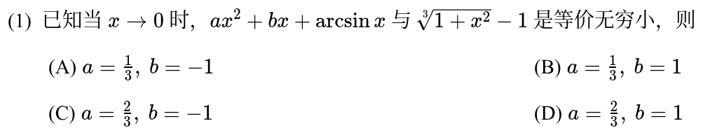

答案与解析

**第一步与完整推演**

- **触发条件**：右侧不含参数且为标准幂函数减 $1$，左侧含一次项与二次项参数，立即以右侧定目标阶数。
- **第一步落笔**：先算右侧主项。当 $x\to 0$ 时，
  $$\sqrt[3]{1+x^2} - 1 = (1+x^2)^{\frac{1}{3}} - 1 \sim \frac{1}{3}x^2.$$
  由此锁定目标：左侧必须是 **二阶无穷小**，且 $x^2$ 项系数为 **$\frac{1}{3}$**。
- **展开左侧到 $x^2$ 阶**：利用 $\arcsin x = x + o(x^2)$（实际 $\arcsin x = x + \frac{1}{6}x^3 + o(x^3)$，不含 $x^2$ 项），得
  $$ax^2 + bx + \arcsin x = (b + 1)x + ax^2 + o(x^2).$$
- **匹配系数**：由 $\lim_{x\to 0}\frac{(b+1)x + ax^2 + o(x^2)}{\frac{1}{3}x^2} = 1$，必须同时满足：
  $$\begin{cases} b + 1 = 0, \\ a = \dfrac{1}{3}, \end{cases} \implies a = \frac{1}{3},\quad b = -1.$$
  故选 **（A）**。

**选择题关键干扰项拆解**

- **（B）$a = \frac{1}{3}, b = 1$**：把消去一次项的方程 $b+1=0$ 错解成 $b=1$，此时左侧主项为 $2x$（一阶），与右侧二阶根本不同阶。
- **（C）$a = \frac{2}{3}, b = -1$**：把 $(1+x^2)^{\frac{1}{3}}-1 \sim \frac{1}{3}x^2$ 误乘内部指数 $2$，错写成 $\frac{2}{3}x^2$。
- **（D）$a = \frac{2}{3}, b = 1$**：同时犯了系数错乘与符号错误。

---

### 02 · 2026年

答案与解析

- **第一步（$\infty-\infty$ 先通分）**：
  $$\frac{1}{x} - \frac{\ln(1+x)}{x\sin x} = \frac{\sin x - \ln(1+x)}{x\sin x}.$$
- **防踩坑（禁止对分子局部等价）**：$\sin x$ 与 $\ln(1+x)$ 的一阶主项都是 $x$，相减抵消，不能直接换成 $x-x=0$！
- **展开到首个非零阶（二阶）**：分母 $x\sin x \sim x^2$；分子
  $$\sin x - \ln(1+x) = \big(x + o(x^2)\big) - \left(x - \frac{1}{2}x^2 + o(x^2)\right) = \frac{1}{2}x^2 + o(x^2).$$
- **答案**：$\dfrac{1}{2}$。

---

### 03 · 2025年

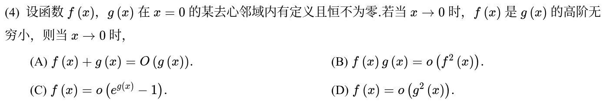

答案与解析

**按仓库题图，A、C 都成立，需核对独立原卷 A 的量级符号。** 由 $f/g\to0$ 得 $(f+g)/g\to1$，所以若 A 写的是大 $O$，A 成立。又 $g\to0$，$e^g-1\sim g$，故 C 也成立。若原卷 A 写作小 $o$，A 即为假，单选 C。B 中 $fg/f^2=g/f$ 不趋于零；D 取 $f=g^2$ 即可反驳。

---

### 04 · 2023年

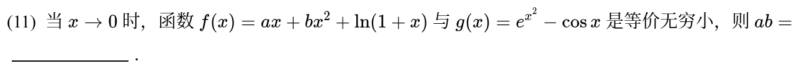

答案与解析

**答案 $-2$。** $g(x)=\tfrac32x^2+o(x^2)$，$f(x)=(a+1)x+(b-\tfrac12)x^2+o(x^2)$。等价要求一阶项为零、二阶项系数相等，故 $a=-1,b=2$。

---

### 05 · 2022年

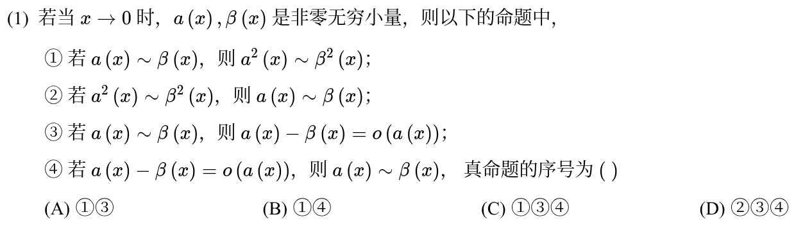

答案与解析

**答案 C，①③④。** 令 $u=a/\beta$，① 由 $u\to1\Rightarrow u^2\to1$。③④ 等价于 $1-\beta/a\to0$ 与 $a/\beta\to1$ 互推。② 会丢失符号，取 $a=-\beta$ 即可排除。

---

### 06 · 2022年

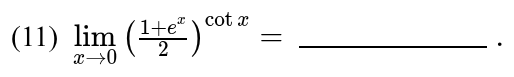

答案与解析

**第一步与完整推演**

- **触发条件**：当 $x\to 0$ 时，底数 $\frac{1+e^x}{2}\to 1$（且恒正），指数 $\cot x = \frac{1}{\tan x}\to \infty$，属于标准 $1^\infty$ 型。
- **第一步落笔**：计算指数部分 $v(x)[u(x)-1]$ 的极限：
  $$u(x) - 1 = \frac{1+e^x}{2} - 1 = \frac{e^x - 1}{2}.$$
- **完整推演**：
  $$\lim_{x\to 0} \cot x \cdot \left(\frac{1+e^x}{2} - 1\right) = \lim_{x\to 0} \frac{e^x - 1}{2\tan x} = \lim_{x\to 0} \frac{x}{2x} = \frac{1}{2}.$$
  因此原极限为
  $$\lim_{x\to 0} \left(\frac{1+e^x}{2}\right)^{\cot x} = e^{\frac{1}{2}} \quad (\text{或写 }\sqrt{e}).$$

---

### 07 · 2021年

答案与解析

**答案 C。** $e^{t^3}-1=t^3+O(t^6)$，所以积分为 $x^8/4+O(x^{14})$。除以 $x^7$ 趋于 0。积分多引入一次 $t$ 的幂，再代上限 $x^2$。

---

### 08 · 2021年

> *含变上限积分的 0/0 极限。分子分母同时展开，把变上限积分 $\int_0^x e^{t^2}dt$ 泰勒展开成 $x + x^3/3 + o(x^3)$，比硬用洛必达快三倍。*

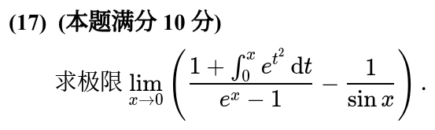

答案与解析

**答案 $\tfrac12$。** $\int_0^x e^{t^2}dt=x+O(x^3)$，而 $1/(e^x-1)=1/x-1/2+O(x)$。故第一分式为 $1/x+1/2+O(x)$，$1/\sin x=1/x+O(x)$。抵消主项后读出常数。

---

### 09 · 2020年

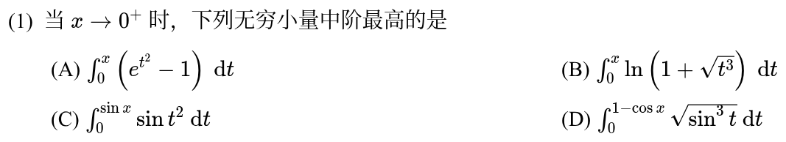

答案与解析

**答案 D。** 被积函数的首项分别为 $t^2,t^{3/2},t^2,t^{3/2}$；积分后次数加 1。再用 $\sin x\sim x,\ 1-\cos x\sim x^2/2$，四个选项关于 $x$ 的阶分别为 $3,5/2,3,5$。

---

### 10 · 2019年

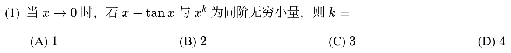

答案与解析

**答案 C。** $\tan x=x+x^3/3+o(x^3)$，差为 $-\tfrac13x^3+o(x^3)$，同阶但系数不同。只展开到一次会把差的首项抵消掉。

---

### 11 · 2019年

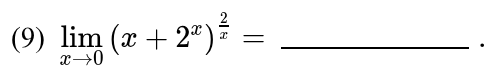

答案与解析

**答案 $4e^2$。** 取对数得 $\frac2x\ln(x+2^x)$。由 $x+2^x=1+(1+\ln2)x+o(x)$ 可得对数极限 $2(1+\ln2)$，恢复指数即得。

---

### 12 · 2018年

答案与解析

**答案 B。** 取对数后要求 $\ln[e^x+ax^2+bx]/x^2\to0$。底数展开为 $1+(1+b)x+(1/2+a)x^2+o(x^2)$，先消一次项得到 $b=-1$，再消二次项得到 $a=-1/2$。

---

### 13 · 2018年

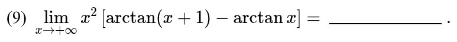

答案与解析

**答案 $1$。** 对 $\arctan$ 在 $[x,x+1]$ 用中值定理，差值为 $1/(1+\xi^2)$，其中 $\xi/x\to1$，乘 $x^2$ 即得。

---

### 14 · 2017年

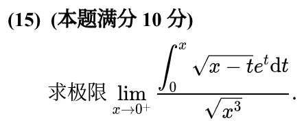

答案与解析

**答案 $2/3$。** 在 $0\le t\le x$ 有 $1\le e^t\le e^x$，而 $\int_0^x\sqrt{x-t}\,dt=2x^{3/2}/3$，除以 $x^{3/2}$ 用夹逼。也可先换元 $t=xu$，把积分区间固定在 $[0,1]$。

---

### 15 · 2016年

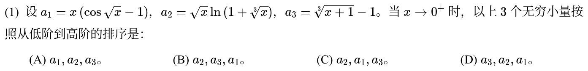

答案与解析

**第一步与触发条件**

- **触发条件**：三项均为乘积或单个常见结构减 $1$，项内没有同主项抵消，可直接逐个用基本等价无穷小定主项。
- **第一步落笔**：分别写出 $a_1, a_2, a_3$ 在 $x\to 0^+$ 时的主项：
  1. 对 $a_1 = x(\cos\sqrt{x} - 1)$：因为 $x\to 0^+$ 时 $\sqrt{x}\to 0$，由 $1 - \cos u \sim \frac{1}{2}u^2$ 得
     $$a_1 = -x(1 - \cos\sqrt{x}) \sim -x \cdot \frac{1}{2}(\sqrt{x})^2 = -\frac{1}{2}x^2,$$
     主项非零，阶数为 **$2$**。
  2. 对 $a_2 = \sqrt{x}\ln(1+\sqrt[3]{x})$：因为 $\sqrt[3]{x}\to 0$，由 $\ln(1+u)\sim u$ 得
     $$a_2 \sim x^{\frac{1}{2}} \cdot x^{\frac{1}{3}} = x^{\frac{5}{6}},$$
     阶数为 **$\frac{5}{6}$**。
  3. 对 $a_3 = \sqrt[3]{x+1} - 1$：由 $(1+u)^\alpha - 1 \sim \alpha u$ 得
     $$a_3 = (1+x)^{\frac{1}{3}} - 1 \sim \frac{1}{3}x,$$
     阶数为 **$1$**。
- **按“从低阶到高阶”排序**：比较幂次 $\frac{5}{6} < 1 < 2$，故顺序为 $a_2, a_3, a_1$，选 **（B）**。

**选择题关键干扰项拆解**

- **（C）$a_2, a_1, a_3$**：错把 $1 - \cos\sqrt{x}$ 漏平方（写成 $\frac{1}{2}\sqrt{x}$），导致误判 $a_1$ 为 $\frac{3}{2}$ 阶或更低。
- **（D）$a_3, a_2, a_1$**：把 $\frac{1}{2}+\frac{1}{3}=\frac{5}{6}$ 错算成 $\frac{1}{2}+\frac{1}{3}$ 大于 $1$，或误把 $a_3$ 的阶数看成 $\frac{1}{3}$。
- **（A）$a_1, a_2, a_3$**：未实际比较，或把“高阶”误当成“数值更大”（$x\to 0^+$ 时 $x^2$ 反而最小，阶数最高）。

---

### 16 · 2016年

答案与解析

**答案 $e^{1/3}$。** $\cos2x=1-2x^2+\tfrac23x^4+o(x^4)$，$2x\sin x=2x^2-\tfrac13x^4+o(x^4)$。二次项抵消，底数为 $1+x^4/3+o(x^4)$，取对数再除 $x^4$ 即得。

---

### 17 · 2015年

> *极限反求参数。看到 $x\to 0$ 且有三角函数和对数，全员展开到 $x^3$ 项，对比对应项系数直接列出方程组。*

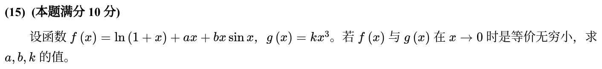

答案与解析

**解。** 展开 $f(x)=(1+a)x+(b-1/2)x^2+x^3/3+o(x^3)$，其中 $x\sin x=x^2+O(x^4)$。与 $kx^3$ 等价要求前两项为零、三次系数等于 $k$，故 $a=-1,b=1/2,k=1/3$。

---

### 18 · 2014年

答案与解析

**答案 B，$1<\alpha<2$。** $\ln(1+2x)\sim2x$，$1-\cos x\sim x^2/2$，故两式关于 $x$ 的阶分别是 $\alpha$ 与 $2/\alpha$。都要严格大于 1，交集即所求范围。

---

### 19 · 2014年

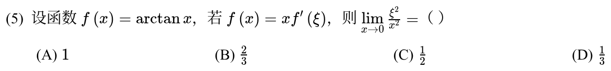

答案与解析

**答案 D，$1/3$。** 由 $\arctan x/x=1/(1+\xi^2)$ 得 $\xi^2=x/\arctan x-1$。而 $\arctan x/x=1-x^2/3+o(x^2)$，倒数展开即得。

---

### 20 · 2014年

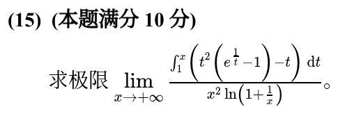

答案与解析

**答案 $1/2$。** $t\to\infty$ 时，被积函数为 $t^2(1/t+1/(2t^2)+O(t^{-3}))-t=1/2+O(1/t)$，所以分子为 $x/2+O(\ln x)$。分母 $x^2\ln(1+1/x)\sim x$，取比值得结果。

---

### 21 · 2013年

答案与解析

**答案 C。** $\sin\alpha(x)=(\cos x-1)/x\sim-x/2$。由 $|\alpha|<\pi/2$ 且正弦趋 0 得 $\alpha\to0$，故 $\alpha\sim\sin\alpha$，与 $x$ 的比值趋于 $-1/2$。

---

### 22 · 2013年

答案与解析

**答案 $1$。** 底数趋于 2，故近无穷远为正，取对数得到 $\ln[2-\ln(1+x)/x]/x\to0$，恢复指数即为 1。

---

### 23 · 2013年

答案与解析

**答案 $n=2,a=7$。** $\cos(kx)=1-k^2x^2/2+o(x^2)$，三个因子相乘时二阶系数相加，交叉项从四阶起。故 $1-\cos x\cos2x\cos3x\sim(1+4+9)x^2/2$。

---

### 24 · 2012年

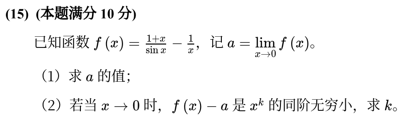

答案与解析

**解。** $\sin x=x-x^3/6+O(x^5)$，所以 $1/\sin x=1/x+x/6+O(x^3)$。代入得 $f(x)=1+x/6+O(x^2)$。故 $a=1$，且 $f-a$ 的首项为 $x/6$，同阶指数 $k=1$。

---

### 25 · 2011年

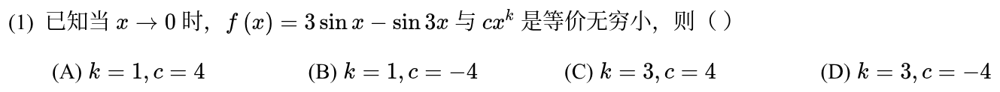

答案与解析

**答案 C，$k=3,c=4$。** 一次项 $3x$ 抵消。三次项为 $-3x^3/6+27x^3/6=4x^3$，这是首个非零项。

---

### 26 · 2011年

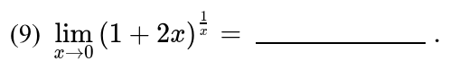

答案与解析

**答案 $e^2$。** 取对数得 $\ln(1+2x)/x\to2$，再恢复指数。

---

### 27 · 2011年

答案与解析

**答案 $1<a<3$。** 在 $0^+$，$\ln(1+t^2)\sim t^2$，分子 $\sim x^3/3$，故要求 $a<3$。在无穷远，分部积分得分子为 $x\ln(1+x^2)-2x+2\arctan x\sim2x\ln x$，故要求 $a>1$。两个端点都须满足。

---

[« 二次型](../linear-algebra/06-quadratic-forms.md)　　[数列极限与求和极限 »](02-sequences.md)
