[« 二次型](../linear-algebra/06-quadratic-forms.md)　　[数列极限与求和极限 »](02-sequences.md)

# 高等数学 · 函数极限与无穷小

> **本章共 27 题**
> 
> - **核心必做（建议按顺序攻克关键方法）**：  
>   [第 15 题](#q15)（无穷小阶数） → [第 01 题](#q01)（展开消项定参数） → [第 06 题](#q06)（幂指极限先取对数） → [第 02 题](#q02)（通分处理相减） → [第 17 题](#q17)（完整写出等价展开）
> 
> - **分流与刷题建议**：  
>   - **较难挑战**：[第 16 题](#q16)（消到四阶的幂指极限）  
>   - **重在看思路**：[第 14 题](#q14)（带参积分先换元或夹逼）  
>   - **首轮可跳过**：[第 19 题](#q19)、[第 20 题](#q20)、[第 27 题](#q27)（技巧较偏或综合度高，首轮不必死磕）  
> 
> - **过关目标**：会判断展开到几阶；相减式不能逐项乱用等价替换。

---

### 01 · 2026年

> *等价无穷小含参定系数。把 $\arcsin x$ 和三次根式分别用泰勒展开到 $x^2$，对照同阶系数，不用多次洛必达。*

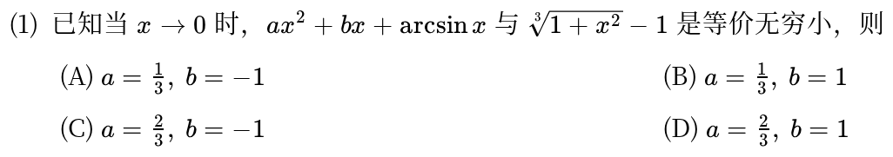

---

### 02 · 2026年

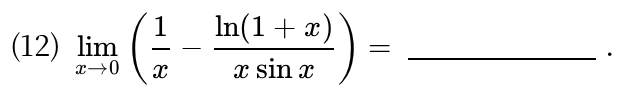

---

### 03 · 2025年

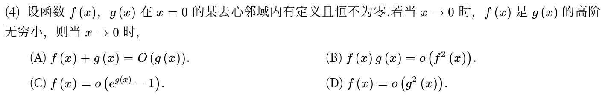

---

### 04 · 2023年

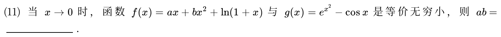

---

### 05 · 2022年

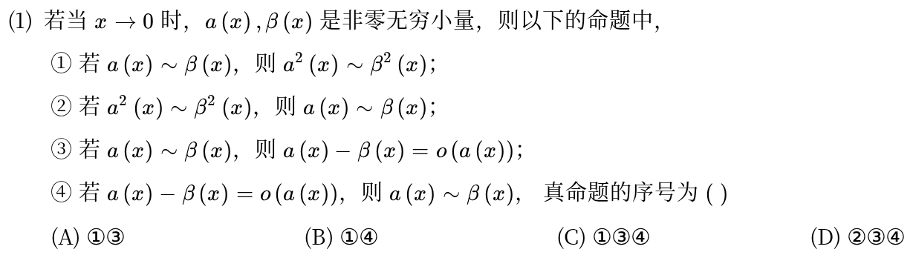

---

### 06 · 2022年

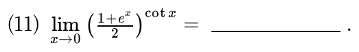

---

### 07 · 2021年

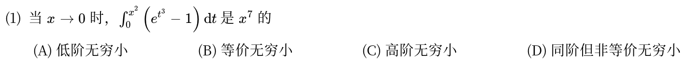

---

### 08 · 2021年

> *含变上限积分的 0/0 极限。分子分母同时展开，把变上限积分 $\int_0^x e^{t^2}dt$ 泰勒展开成 $x + x^3/3 + o(x^3)$，比硬用洛必达快三倍。*

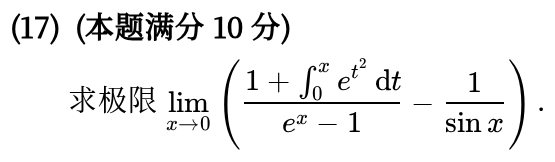

---

### 09 · 2020年

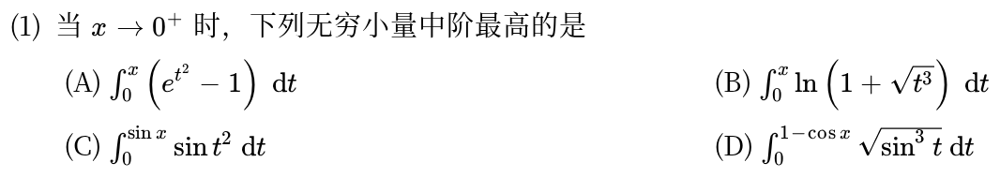

---

### 10 · 2019年

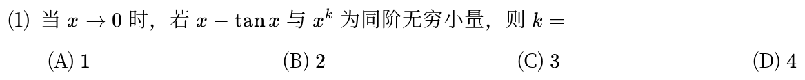

---

### 11 · 2019年

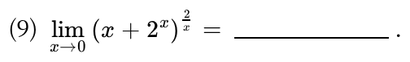

---

### 12 · 2018年

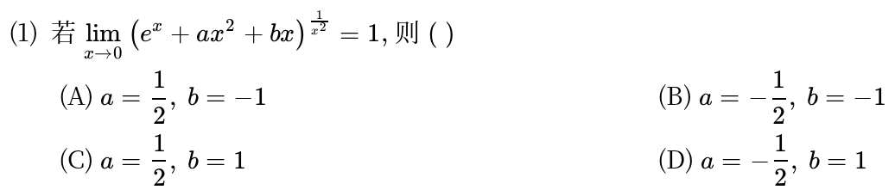

---

### 13 · 2018年

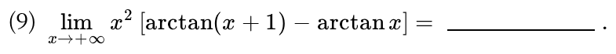

---

### 14 · 2017年

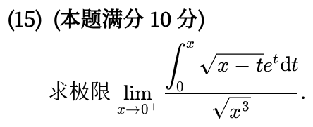

---

### 15 · 2016年

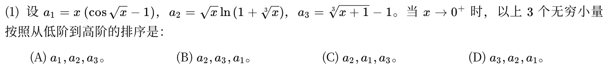

---

### 16 · 2016年

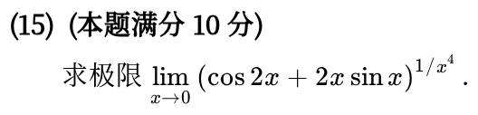

---

### 17 · 2015年

> *极限反求参数。看到 $x\to 0$ 且有三角函数和对数，全员展开到 $x^3$ 项，对比对应项系数直接列出方程组。*

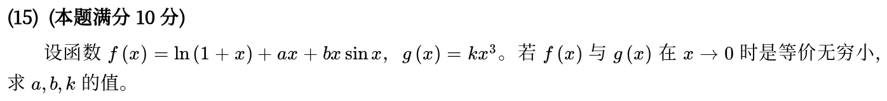

---

### 18 · 2014年

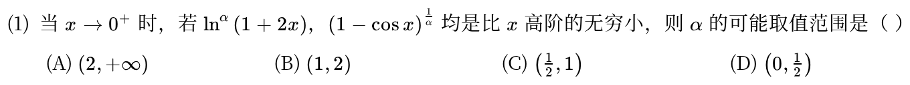

---

### 19 · 2014年

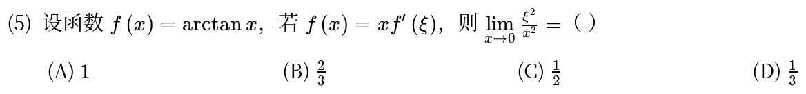

---

### 20 · 2014年

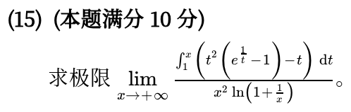

---

### 21 · 2013年

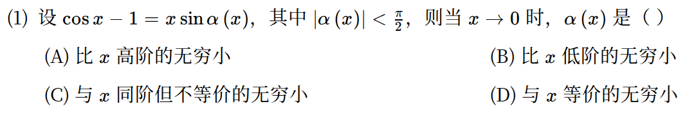

---

### 22 · 2013年

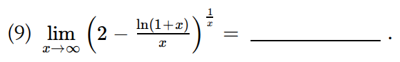

---

### 23 · 2013年

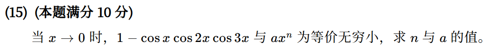

---

### 24 · 2012年

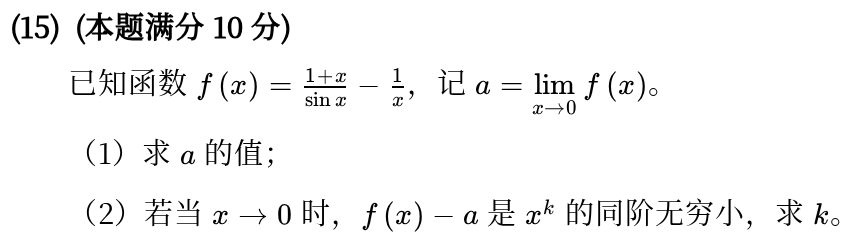

---

### 25 · 2011年

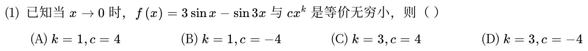

---

### 26 · 2011年

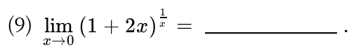

---

### 27 · 2011年

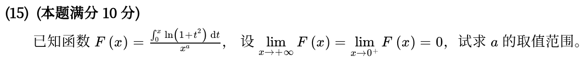

---

[« 二次型](../linear-algebra/06-quadratic-forms.md)　　[数列极限与求和极限 »](02-sequences.md)
