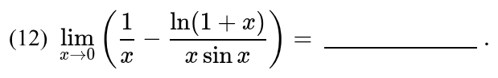
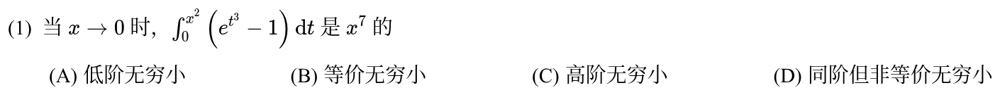
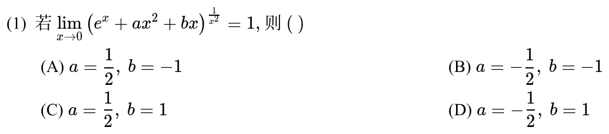
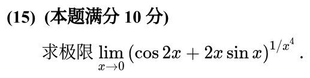
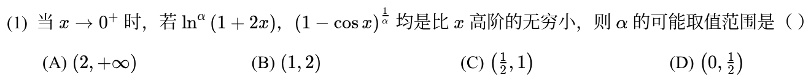
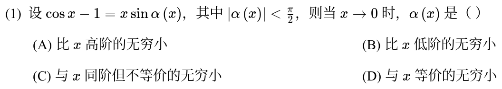
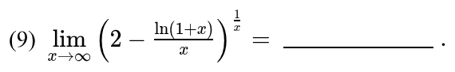
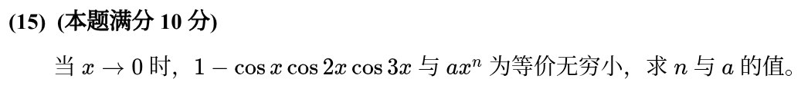
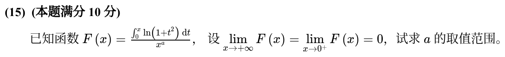

[« 二次型](../linear-algebra/06-quadratic-forms.md)　　[数列极限与求和极限 »](02-sequences.md)

# 高等数学 · 函数极限与无穷小

> **本章共 27 题**
> 
> - **核心必做（建议按顺序攻克关键方法）**：  
>   [第 15 题](#q15)（无穷小阶数） → [第 01 题](#q01)（展开消项定参数） → [第 06 题](#q06)（幂指极限先取对数） → [第 02 题](#q02)（通分处理相减） → [第 17 题](#q17)（完整写出等价展开）
> 
> - **分流与刷题建议**：  
>   - **较难挑战**：[第 16 题](#q16)（消到四阶的幂指极限）  
>   - **重在看思路**：[第 14 题](#q14)（带参积分先换元或夹逼）  
>   - **首轮可跳过**：[第 19 题](#q19)、[第 20 题](#q20)、[第 27 题](#q27)（技巧较偏或综合度高，首轮不必死磕）  
> 
> - **过关目标**：会判断展开到几阶；相减式不能逐项乱用等价替换。

---

### 01 · 2026年

> *等价无穷小含参定系数。把 $\arcsin x$ 和三次根式分别用泰勒展开到 $x^2$，对照同阶系数，不用多次洛必达。*

答案与解析

**第一步与完整推演**

- **触发条件**：右侧不含参数且为标准幂函数减 $1$，左侧含一次项与二次项参数，立即以右侧定目标阶数。
- **第一步落笔**：先算右侧主项。当 $x\to 0$ 时，
  $$\sqrt[3]{1+x^2} - 1 = (1+x^2)^{\frac{1}{3}} - 1 \sim \frac{1}{3}x^2.$$
  由此锁定目标：左侧必须是 **二阶无穷小**，且 $x^2$ 项系数为 **$\frac{1}{3}$**。
- **展开左侧到 $x^2$ 阶**：利用 $\arcsin x = x + o(x^2)$（实际 $\arcsin x = x + \frac{1}{6}x^3 + o(x^3)$，不含 $x^2$ 项），得
  $$ax^2 + bx + \arcsin x = (b + 1)x + ax^2 + o(x^2).$$
- **匹配系数**：由 $\lim_{x\to 0}\frac{(b+1)x + ax^2 + o(x^2)}{\frac{1}{3}x^2} = 1$，必须同时满足：
  $$\begin{cases} b + 1 = 0, \\ a = \dfrac{1}{3}, \end{cases} \implies a = \frac{1}{3},\quad b = -1.$$
  故选 **（A）**。

**选择题关键干扰项拆解**

- **（B）$a = \frac{1}{3}, b = 1$**：把消去一次项的方程 $b+1=0$ 错解成 $b=1$，此时左侧主项为 $2x$（一阶），与右侧二阶根本不同阶。
- **（C）$a = \frac{2}{3}, b = -1$**：把 $(1+x^2)^{\frac{1}{3}}-1 \sim \frac{1}{3}x^2$ 误乘内部指数 $2$，错写成 $\frac{2}{3}x^2$。
- **（D）$a = \frac{2}{3}, b = 1$**：同时犯了系数错乘与符号错误。

---

### 02 · 2026年

答案与解析

**答案**：$\dfrac{1}{2}$

- **切入点与推演**：当 $x\to 0$ 时原式为 $\infty-\infty$ 型，先通分合并为 $\frac{0}{0}$ 型：
  $$\frac{1}{x} - \frac{\ln(1+x)}{x\sin x} = \frac{\sin x - \ln(1+x)}{x\sin x}.$$
  分母 $x\sin x \sim x^2$；分子两项一阶主项均为 $x$，相减抵消，需泰勒展开到二阶：
  $$\sin x - \ln(1+x) = \bigl(x + o(x^2)\bigr) - \left(x - \frac{1}{2}x^2 + o(x^2)\right) = \frac{1}{2}x^2 + o(x^2).$$
  故原极限为
  $$\lim_{x\to 0}\frac{\frac{1}{2}x^2 + o(x^2)}{x^2} = \frac{1}{2}.$$
- **易错点**：切忌在加减法中直接局部等价替换（误将 $\sin x - \ln(1+x)$ 写成 $x-x=0$），一阶抵消后必须展开至首个非零阶。

---

### 03 · 2025年

答案与解析

**题面待核**：按仓库当前题图与转录，选项 A 写作大 $O$ 记号 $f(x)+g(x)=O(g(x))$，此时 **（A）与（C）均成立**；若独立原卷选项 A 实为小 $o$ 记号 $f(x)+g(x)=o(g(x))$，则唯一正确答案为 **（C）**。

- **切入点与推演**：由题意，当 $x\to 0$ 时 $f(x),g(x)$ 均为非零无穷小量（即 $f(x)\to 0,\ g(x)\to 0$）且 $f(x)=o(g(x))$，即 $\lim\limits_{x\to 0}\dfrac{f(x)}{g(x)}=0$。逐项检验：
  - **（A）**：计算比值
    $$\lim_{x\to 0}\frac{f(x)+g(x)}{g(x)} = \lim_{x\to 0}\left(\frac{f(x)}{g(x)}+1\right) = 1.$$
    故 $f(x)+g(x)\sim g(x)$，从而 $f(x)+g(x)=O(g(x))$ 成立；若原卷此处为小 $o$，因极限为 $1\ne 0$，则 $f(x)+g(x)=o(g(x))$ 不成立。
  - **（B）**：$\dfrac{f(x)g(x)}{f^2(x)} = \dfrac{g(x)}{f(x)} \to \infty$，不趋于 $0$，故错误。
  - **（C）**：因 $g(x)\to 0$ 且 $g(x)\ne 0$，有 $e^{g(x)}-1 \sim g(x)$，于是
    $$\lim_{x\to 0}\frac{f(x)}{e^{g(x)}-1} = \lim_{x\to 0}\frac{f(x)}{g(x)}\cdot\frac{g(x)}{e^{g(x)}-1} = 0\cdot 1 = 0,$$
    故 $f(x)=o(e^{g(x)}-1)$ 恒成立。
  - **（D）**：取 $g(x)=x,\ f(x)=x^2$，满足 $f(x)=o(g(x))$，但 $\dfrac{f(x)}{g^2(x)}=1\ne 0$，故错误。
- **干扰项 / 易错提示**：大 $O$ 表示“同阶或更高阶（比值有界）”，小 $o$ 表示“严格高阶（比值趋于 $0$）”，审题时务必区分两者定义。

---

### 04 · 2023年

答案与解析

**答案**：$-2$

- **切入点与推演**：先将不含参数的 $g(x)$ 在 $x\to 0$ 处泰勒展开至首个非零项（二阶）：
  $$g(x) = e^{x^2} - \cos x = \bigl(1 + x^2 + o(x^2)\bigr) - \left(1 - \frac{1}{2}x^2 + o(x^2)\right) = \frac{3}{2}x^2 + o(x^2).$$
  再将 $f(x)$ 展开至 $x^2$ 阶：
  $$f(x) = ax + bx^2 + \left(x - \frac{1}{2}x^2 + o(x^2)\right) = (a+1)x + \left(b - \frac{1}{2}\right)x^2 + o(x^2).$$
  由 $f(x)\sim g(x)$，需使一阶项系数为 $0$ 且二阶项系数与 $g(x)$ 相等：
  $$\begin{cases} a+1 = 0, \\ b - \dfrac{1}{2} = \dfrac{3}{2}, \end{cases} \implies a = -1,\quad b = 2,$$
  因此 $ab = -2$。
- **易错点**：容易漏掉 $\ln(1+x)$ 展开式中的二次项 $-\frac{1}{2}x^2$，或把 $\cos x = 1-\frac{1}{2}x^2+o(x^2)$ 减号后的正负号算反。

---

### 05 · 2022年

答案与解析

**答案**：**（C）** $①③④$

- **切入点与推演**：记 $u(x)=\dfrac{a(x)}{\beta(x)}$，由等价无穷小定义，$a(x)\sim \beta(x) \iff \lim\limits_{x\to 0} u(x) = 1$。逐条验证：
  - **① 正确**：若 $u(x)\to 1$，则 $\dfrac{a^2(x)}{\beta^2(x)} = u^2(x) \to 1$，即 $a^2(x)\sim \beta^2(x)$。
  - **② 错误**：平方会丢失符号信息。取 $a(x)=x,\ \beta(x)=-x$，则 $a^2(x)=\beta^2(x)$ 满足 $a^2(x)\sim\beta^2(x)$，但 $\dfrac{a(x)}{\beta(x)}=-1\ne 1$。
  - **③ 与 ④ 均正确**：直接化简比值可得充要关系：
    $$\lim_{x\to 0}\frac{a(x)-\beta(x)}{a(x)} = 0 \iff \lim_{x\to 0}\left(1 - \frac{\beta(x)}{a(x)}\right) = 0 \iff \lim_{x\to 0}\frac{\beta(x)}{a(x)} = 1 \iff a(x)\sim \beta(x).$$
  综上，真命题为 ①③④，选 **（C）**。
- **干扰项 / 易错提示**：② 是最常见陷阱，由 $u^2\to 1$ 只能推出 $|u|\to 1$，不能保证 $u\to 1$（甚至 $u$ 可以正负震荡）。

---

### 06 · 2022年

答案与解析

**第一步与完整推演**

- **触发条件**：当 $x\to 0$ 时，底数 $\frac{1+e^x}{2}\to 1$（且恒正），指数 $\cot x = \frac{1}{\tan x}\to \infty$，属于标准 $1^\infty$ 型。
- **第一步落笔**：计算指数部分 $v(x)[u(x)-1]$ 的极限：
  $$u(x) - 1 = \frac{1+e^x}{2} - 1 = \frac{e^x - 1}{2}.$$
- **完整推演**：
  $$\lim_{x\to 0} \cot x \cdot \left(\frac{1+e^x}{2} - 1\right) = \lim_{x\to 0} \frac{e^x - 1}{2\tan x} = \lim_{x\to 0} \frac{x}{2x} = \frac{1}{2}.$$
  因此原极限为
  $$\lim_{x\to 0} \left(\frac{1+e^x}{2}\right)^{\cot x} = e^{\frac{1}{2}} \quad (\text{或写 }\sqrt{e}).$$

---

### 07 · 2021年

答案与解析

**答案**：**（C）** 高阶无穷小

- **切入点与推演**：计算所给变限积分与 $x^7$ 的比值极限。当 $x\to 0$ 时分子分母均趋于 $0$，用洛必达法则求导：
  $$\lim_{x\to 0}\frac{\displaystyle\int_0^{x^2}\left(e^{t^3}-1\right)\mathrm{d}t}{x^7} = \lim_{x\to 0}\frac{\left(e^{x^6}-1\right)\cdot 2x}{7x^6} = \lim_{x\to 0}\frac{2x^7}{7x^6} = 0.$$
  （也可直接估算主项：被积函数 $e^{t^3}-1\sim t^3$，积分后得 $\frac{1}{4}t^4\big|_0^{x^2}=\frac{1}{4}x^8$，阶数为 $8 > 7$。）故为 $x^7$ 的高阶无穷小，选 **（C）**。
- **干扰项 / 易错提示**：变限积分求导时切忌漏乘上限 $x^2$ 的导数 $2x$；若直接套口诀“被积函数阶数加 $1$ 再乘上限阶数”，应为 $(3+1)\times 2 = 8$，不要误算成 $3\times 2 + 1 = 7$ 而错选（D）。

---

### 08 · 2021年

> *含变上限积分的 0/0 极限。分子分母同时展开，把变上限积分 $\int_0^x e^{t^2}dt$ 泰勒展开成 $x + x^3/3 + o(x^3)$，比硬用洛必达快三倍。*

答案与解析

**结论速览**：$\dfrac{1}{2}$

- **完整解答**：原式为 $\infty-\infty$ 型，先通分合并为 $\frac{0}{0}$ 型：
  $$\frac{1+\displaystyle\int_0^x e^{t^2}\,\mathrm{d}t}{e^x-1} - \frac{1}{\sin x} = \frac{\sin x + \sin x\displaystyle\int_0^x e^{t^2}\,\mathrm{d}t - (e^x-1)}{(e^x-1)\sin x}.$$
  当 $x\to 0$ 时，分母满足
  $$(e^x-1)\sin x \sim x\cdot x = x^2.$$
  将分子各项泰勒展开至 $x^2$ 阶：
  - $\sin x = x + o(x^2)$；
  - 由 $e^{t^2} = 1 + O(t^2)$，积分得 $\displaystyle\int_0^x e^{t^2}\,\mathrm{d}t = x + O(x^3)$，故 $\sin x\displaystyle\int_0^x e^{t^2}\,\mathrm{d}t = x^2 + o(x^2)$；
  - $e^x - 1 = x + \dfrac{1}{2}x^2 + o(x^2)$。

  代入分子合并同类项：
  $$\sin x + \sin x\int_0^x e^{t^2}\,\mathrm{d}t - (e^x-1) = x + x^2 - \left(x + \frac{1}{2}x^2\right) + o(x^2) = \frac{1}{2}x^2 + o(x^2).$$
  因此原极限为
  $$\lim_{x\to 0}\frac{\frac{1}{2}x^2 + o(x^2)}{x^2} = \frac{1}{2}.$$
- **核心思路与避坑**：$\infty-\infty$ 型先通分再按分母阶数（本题为 $2$ 阶）统一展开分子，比直接洛必达两次更简洁且不易算错乘积项导数。

---

### 09 · 2020年

答案与解析

**答案**：**（D）** $\displaystyle\int_{0}^{1-\cos x}\sqrt{\sin^{3} t}\,\mathrm{d}t$

- **切入点与推演**：对变限积分 $F(x)=\displaystyle\int_0^{\varphi(x)}f(t)\,\mathrm{d}t$（$x\to 0^+$），若 $f(t)\sim c_1 t^p$ 且 $\varphi(x)\sim c_2 x^q$，则 $F(x)$ 的主项阶数为 $(p+1)q$（也可通过 $F'(x)=f(\varphi(x))\varphi'(x)$ 的阶数加 $1$ 验证）。逐项定阶：
  - **（A）**：$e^{t^2}-1 \sim t^2$（$p=2$），上限 $x$（$q=1$），阶数为 $(2+1)\times 1 = 3$。
  - **（B）**：$\ln(1+\sqrt{t^3}) \sim t^{\frac{3}{2}}$（$p=\frac{3}{2}$），上限 $x$（$q=1$），阶数为 $(\frac{3}{2}+1)\times 1 = \frac{5}{2}$。
  - **（C）**：$\sin t^2 \sim t^2$（$p=2$），上限 $\sin x \sim x$（$q=1$），阶数为 $(2+1)\times 1 = 3$。
  - **（D）**：$\sqrt{\sin^3 t} \sim t^{\frac{3}{2}}$（$p=\frac{3}{2}$），上限 $1-\cos x \sim \frac{1}{2}x^2$（$q=2$），阶数为
    $$\left(\frac{3}{2}+1\right)\times 2 = 5.$$
  比较阶数 $\frac{5}{2} < 3 < 5$，阶最高的是 **（D）**。
- **干扰项 / 易错提示**：计算（D）的阶数时，务必先对被积函数积分加 $1$ 阶再代入上限 $x^2$，切勿误算为 $\frac{3}{2}\times 2 + 1 = 4$。

---

### 10 · 2019年

答案与解析

**答案**：**（C）** $3$

- **切入点与推演**：因为 $\tan x$ 与 $x$ 的一阶主项相同，相减后一次项抵消，将 $\tan x$ 在 $x=0$ 处泰勒展开至三阶：
  $$\tan x = x + \frac{1}{3}x^3 + o(x^3).$$
  代入得
  $$x - \tan x = -\frac{1}{3}x^3 + o(x^3).$$
  于是 $\lim\limits_{x\to 0}\dfrac{x-\tan x}{x^3} = -\dfrac{1}{3} \ne 0$，即与 $x^3$ 为同阶无穷小，故 $k=3$，选 **（C）**。
- **干扰项 / 易错提示**：$\tan x$ 为奇函数，展开式中不含 $x^2$ 项；切记常见差值主项 $x-\sin x \sim \frac{1}{6}x^3$、$\tan x - x \sim \frac{1}{3}x^3$、$\tan x - \sin x \sim \frac{1}{2}x^3$。

---

### 11 · 2019年

答案与解析

**答案**：$4e^2$

- **切入点与推演**：当 $x\to 0$ 时，底数 $x+2^x \to 1$，指数 $\dfrac{2}{x}\to \infty$，属于 $1^\infty$ 型极限。利用标准公式 $\lim u^v = e^{\lim v(u-1)}$ 计算指数部分：
  $$\lim_{x\to 0}\frac{2}{x}\left(x + 2^x - 1\right) = \lim_{x\to 0} 2\left(1 + \frac{2^x - 1}{x}\right) = 2(1 + \ln 2).$$
  还原为指数形式并化简：
  $$e^{2(1+\ln 2)} = e^2 \cdot e^{\ln 4} = 4e^2.$$
- **易错点**：$a^x - 1 \sim x\ln a$，不要漏掉因子 $\ln 2$；最终结果应化简 $e^{2\ln 2}=4$，不要停留在 $e^{2+2\ln 2}$。

---

### 12 · 2018年

答案与解析

**答案**：**（B）** $a=-\dfrac{1}{2},\ b=-1$

- **切入点与推演**：当 $x\to 0$ 时，底数 $e^x+ax^2+bx \to 1$，指数 $\dfrac{1}{x^2}\to\infty$，属于 $1^\infty$ 型极限。极限等于 $1 = e^0$ 等价于指数部分极限为 $0$：
  $$\lim_{x\to 0}\frac{e^x + ax^2 + bx - 1}{x^2} = 0.$$
  将 $e^x$ 展开至二阶：$e^x = 1 + x + \dfrac{1}{2}x^2 + o(x^2)$，代入分子得
  $$e^x + ax^2 + bx - 1 = (1+b)x + \left(\frac{1}{2}+a\right)x^2 + o(x^2).$$
  要使除以 $x^2$ 后极限为 $0$，一次项与二次项系数均须为 $0$：
  $$\begin{cases} 1+b = 0, \\ \dfrac{1}{2}+a = 0, \end{cases} \implies a = -\frac{1}{2},\quad b = -1.$$
  故选 **（B）**。
- **干扰项 / 易错提示**：注意目标极限是 $1$（对应对数极限为 $0$），而非 $e$（对数极限为 $1$），若误把 $\frac{1}{2}+a=1$ 当作条件会错选（A）。

---

### 13 · 2018年

答案与解析

**答案**：$1$

- **切入点与推演**：函数差值 $\arctan(x+1)-\arctan x$ 具有 $f(b)-f(a)$ 结构，直接对 $f(t)=\arctan t$ 在区间 $[x, x+1]$（$x>0$）上应用拉格朗日中值定理，存在 $\xi \in (x, x+1)$ 使得
  $$\arctan(x+1) - \arctan x = \frac{1}{1+\xi^2}.$$
  由 $x < \xi < x+1$，两边同乘 $x^2$ 得夹逼不等式：
  $$\frac{x^2}{1+(x+1)^2} < x^2\bigl[\arctan(x+1)-\arctan x\bigr] < \frac{x^2}{1+x^2}.$$
  当 $x\to+\infty$ 时，左右两端极限均为 $1$，由夹逼准则得原极限为 $1$。
- **易错点**：中值点 $\xi$ 依赖于 $x$，不能直接写成常数，必须利用 $x<\xi<x+1$ 配合夹逼准则（或由 $\frac{\xi}{x}\to 1$）严谨求极限。

---

### 14 · 2017年

答案与解析

**结论速览**：$\dfrac{2}{3}$

- **完整解答**：当 $x > 0$ 且 $t \in [0, x]$ 时，有 $1 \le e^t \le e^x$ 且 $\sqrt{x-t} \ge 0$，故
  $$\int_0^x \sqrt{x-t}\,\mathrm{d}t \le \int_0^x \sqrt{x-t}\,e^t\,\mathrm{d}t \le e^x\int_0^x \sqrt{x-t}\,\mathrm{d}t.$$
  计算中间积分（令 $u=x-t$）：
  $$\int_0^x \sqrt{x-t}\,\mathrm{d}t = \int_0^x u^{\frac{1}{2}}\,\mathrm{d}u = \frac{2}{3}x^{\frac{3}{2}}.$$
  因为 $x>0$ 时 $\sqrt{x^3}=x^{\frac{3}{2}}>0$，将不等式同除以 $x^{\frac{3}{2}}$ 得
  $$\frac{2}{3} \le \frac{\displaystyle\int_0^x \sqrt{x-t}\,e^t\,\mathrm{d}t}{\sqrt{x^3}} \le \frac{2}{3}e^x.$$
  由于 $\lim\limits_{x\to 0^+}\dfrac{2}{3}e^x = \dfrac{2}{3}$，由夹逼准则得
  $$\lim_{x\to 0^+}\frac{\displaystyle\int_0^x \sqrt{x-t}\,e^t\,\mathrm{d}t}{\sqrt{x^3}} = \frac{2}{3}.$$
- **核心思路与避坑**：本题被积函数含参数 $x$，不能直接对上限 $x$ 用洛必达法则求导；用夹逼准则（或先令 $t=xu$ 将变限转化为定限 $\int_0^1 \sqrt{1-u}\,e^{xu}\,\mathrm{d}u$）均可避开此坑。

---

### 15 · 2016年

答案与解析

**第一步与触发条件**

- **触发条件**：三项均为乘积或单个常见结构减 $1$，项内没有同主项抵消，可直接逐个用基本等价无穷小定主项。
- **第一步落笔**：分别写出 $a_1, a_2, a_3$ 在 $x\to 0^+$ 时的主项：
  1. 对 $a_1 = x(\cos\sqrt{x} - 1)$：因为 $x\to 0^+$ 时 $\sqrt{x}\to 0$，由 $1 - \cos u \sim \frac{1}{2}u^2$ 得
     $$a_1 = -x(1 - \cos\sqrt{x}) \sim -x \cdot \frac{1}{2}(\sqrt{x})^2 = -\frac{1}{2}x^2,$$
     主项非零，阶数为 **$2$**。
  2. 对 $a_2 = \sqrt{x}\ln(1+\sqrt[3]{x})$：因为 $\sqrt[3]{x}\to 0$，由 $\ln(1+u)\sim u$ 得
     $$a_2 \sim x^{\frac{1}{2}} \cdot x^{\frac{1}{3}} = x^{\frac{5}{6}},$$
     阶数为 **$\frac{5}{6}$**。
  3. 对 $a_3 = \sqrt[3]{x+1} - 1$：由 $(1+u)^\alpha - 1 \sim \alpha u$ 得
     $$a_3 = (1+x)^{\frac{1}{3}} - 1 \sim \frac{1}{3}x,$$
     阶数为 **$1$**。
- **按“从低阶到高阶”排序**：比较幂次 $\frac{5}{6} < 1 < 2$，故顺序为 $a_2, a_3, a_1$，选 **（B）**。

**选择题关键干扰项拆解**

- **（C）$a_2, a_1, a_3$**：错把 $1 - \cos\sqrt{x}$ 漏平方（写成 $\frac{1}{2}\sqrt{x}$），导致误判 $a_1$ 为 $\frac{3}{2}$ 阶或更低。
- **（D）$a_3, a_2, a_1$**：把 $\frac{1}{2}+\frac{1}{3}=\frac{5}{6}$ 错算成 $\frac{1}{2}+\frac{1}{3}$ 大于 $1$，或误把 $a_3$ 的阶数看成 $\frac{1}{3}$。
- **（A）$a_1, a_2, a_3$**：未实际比较，或把“高阶”误当成“数值更大”（$x\to 0^+$ 时 $x^2$ 反而最小，阶数最高）。

---

### 16 · 2016年

答案与解析

**结论速览**：$e^{\frac{1}{3}}$

- **完整解答**：当 $x\to 0$ 时，底数 $\cos 2x + 2x\sin x \to 1$，指数 $\dfrac{1}{x^4}\to +\infty$，属于 $1^\infty$ 型极限。利用公式 $\lim u^v = e^{\lim v(u-1)}$，先求指数部分极限：
  $$L = \lim_{x\to 0}\frac{\cos 2x + 2x\sin x - 1}{x^4}.$$
  将分子各项泰勒展开至 $x^4$ 阶：
  $$\cos 2x = 1 - \frac{(2x)^2}{2!} + \frac{(2x)^4}{4!} + o(x^4) = 1 - 2x^2 + \frac{2}{3}x^4 + o(x^4),$$
  $$2x\sin x = 2x\left(x - \frac{x^3}{6} + o(x^3)\right) = 2x^2 - \frac{1}{3}x^4 + o(x^4).$$
  两式相加再减 $1$，二次项抵消：
  $$\cos 2x + 2x\sin x - 1 = \left(\frac{2}{3} - \frac{1}{3}\right)x^4 + o(x^4) = \frac{1}{3}x^4 + o(x^4).$$
  于是
  $$L = \lim_{x\to 0}\frac{\frac{1}{3}x^4 + o(x^4)}{x^4} = \frac{1}{3},$$
  从而原极限为 $e^{\frac{1}{3}}$。
- **核心思路与避坑**：展开 $\cos 2x$ 时 $4!=24$ 且 $2^4=16$，系数为 $\frac{16}{24}=\frac{2}{3}$，务必仔细核对阶乘与幂次；最后不要忘记还原 $e^L$。

---

### 17 · 2015年

> *极限反求参数。看到 $x\to 0$ 且有三角函数和对数，全员展开到 $x^3$ 项，对比对应项系数直接列出方程组。*

答案与解析

**结论速览**：$a=-1,\ b=\dfrac{1}{2},\ k=\dfrac{1}{3}$

- **完整解答**：当 $x\to 0$ 时，因 $g(x)=kx^3$ 为三阶无穷小，将 $f(x)$ 泰勒展开至 $x^3$ 阶：
  $$\ln(1+x) = x - \frac{1}{2}x^2 + \frac{1}{3}x^3 + o(x^3), \qquad bx\sin x = bx\bigl(x + o(x^2)\bigr) = bx^2 + o(x^3).$$
  合并同类项得
  $$f(x) = (1+a)x + \left(b - \frac{1}{2}\right)x^2 + \frac{1}{3}x^3 + o(x^3).$$
  由 $f(x)$ 与 $g(x)=kx^3$ 在 $x\to 0$ 时为等价无穷小，即
  $$\lim_{x\to 0}\frac{f(x)}{kx^3} = \lim_{x\to 0}\frac{(1+a)x + \left(b-\frac{1}{2}\right)x^2 + \frac{1}{3}x^3 + o(x^3)}{kx^3} = 1,$$
  必须使低于三阶的各项系数均为 $0$，且三阶项系数等于 $k$：
  $$\begin{cases} 1+a = 0, \\ b - \dfrac{1}{2} = 0, \\ \dfrac{1}{3} = k, \end{cases} \implies a = -1,\quad b = \frac{1}{2},\quad k = \frac{1}{3}.$$
- **核心思路与避坑**：$bx\sin x$ 的次高项为 $-\frac{b}{6}x^4$，属于 $o(x^3)$，不影响 $x^3$ 项系数；此类“等价定参”题用泰勒展开一次对齐所有低阶与目标阶系数最不易漏项。

---

### 18 · 2014年

答案与解析

**答案**：**（B）** $(1,2)$

- **切入点与推演**：当 $x\to 0^+$ 时，由基本等价无穷小 $\ln(1+2x)\sim 2x$ 与 $1-\cos x \sim \dfrac{1}{2}x^2$，得两个无穷小量的主项阶数分别为：
  $$\ln^\alpha(1+2x) \sim (2x)^\alpha = 2^\alpha x^\alpha \quad (\text{阶数为 }\alpha),$$
  $$(1-\cos x)^{\frac{1}{\alpha}} \sim \left(\frac{1}{2}x^2\right)^{\frac{1}{\alpha}} = 2^{-\frac{1}{\alpha}} x^{\frac{2}{\alpha}} \quad \left(\text{阶数为 }\frac{2}{\alpha}\right).$$
  两者均是比 $x$ 高阶的无穷小，当且仅当阶数均严格大于 $1$：
  $$\begin{cases} \alpha > 1, \\ \dfrac{2}{\alpha} > 1 \end{cases} \iff 1 < \alpha < 2.$$
  故选 **（B）**。
- **干扰项 / 易错提示**：注意“高阶”要求严格大于 $1$（取等号时为同阶而非高阶），且 $x\to 0^+$ 保证了 $\ln(1+2x)>0$ 使任意实数次幂有意义。

---

### 19 · 2014年

答案与解析

**答案**：**（D）** $\dfrac{1}{3}$

- **切入点与推演**：由 $f(x)=\arctan x$ 得 $f'(x)=\dfrac{1}{1+x^2}$，代入 $f(x)=xf'(\xi)$ 有
  $$\arctan x = \frac{x}{1+\xi^2} \implies \xi^2 = \frac{x}{\arctan x} - 1 = \frac{x - \arctan x}{\arctan x}.$$
  当 $x\to 0$ 时，展开 $\arctan x = x - \dfrac{1}{3}x^3 + o(x^3)$ 且分母 $\arctan x \sim x$，故
  $$\lim_{x\to 0}\frac{\xi^2}{x^2} = \lim_{x\to 0}\frac{x - \arctan x}{x^2 \arctan x} = \lim_{x\to 0}\frac{\frac{1}{3}x^3 + o(x^3)}{x^3} = \frac{1}{3}.$$
  故选 **（D）**。
- **干扰项 / 易错提示**：不要盲目设 $\xi=\theta x$ 试图先求 $\theta$，直接利用等式反解出 $\xi^2$ 再泰勒展开一步到位；记住 $x-\arctan x \sim \frac{1}{3}x^3$（与 $\tan x - x$ 同系数）。

---

### 20 · 2014年

答案与解析

**结论速览**：$\dfrac{1}{2}$

- **完整解答**：当 $x\to+\infty$ 时，由 $\ln\left(1+\dfrac{1}{x}\right)\sim\dfrac{1}{x}$，有
  $$\lim_{x\to+\infty}\frac{x}{x^2\ln\left(1+\frac{1}{x}\right)} = \lim_{x\to+\infty}\frac{1}{x\ln\left(1+\frac{1}{x}\right)} = 1.$$
  因此先将分母中的等价因子提取出来：
  $$\lim_{x\to+\infty}\frac{\displaystyle\int_1^x\left[t^2\left(e^{\frac{1}{t}}-1\right)-t\right]\mathrm{d}t}{x^2\ln\left(1+\frac{1}{x}\right)} = \lim_{x\to+\infty}\frac{\displaystyle\int_1^x\left[t^2\left(e^{\frac{1}{t}}-1\right)-t\right]\mathrm{d}t}{x}.$$
  记被积函数 $h(t)=t^2(e^{\frac{1}{t}}-1)-t$，令 $u=\dfrac{1}{t}\to 0^+$，得
  $$\lim_{t\to+\infty} h(t) = \lim_{u\to 0^+}\frac{e^u - 1 - u}{u^2} = \lim_{u\to 0^+}\frac{\frac{1}{2}u^2 + o(u^2)}{u^2} = \frac{1}{2} > 0.$$
  由此可知当 $x\to+\infty$ 时分子积分趋于 $+\infty$，分母 $x\to+\infty$，属 $\frac{\infty}{\infty}$ 型。应用洛必达法则：
  $$\lim_{x\to+\infty}\frac{\displaystyle\int_1^x h(t)\,\mathrm{d}t}{x} = \lim_{x\to+\infty} h(x) = \frac{1}{2}.$$
- **核心思路与避坑**：先用非零因子等价替换简化分母 $x^2\ln(1+\frac{1}{x})\sim x$，再用洛必达法则，可避免直接对复杂分母求导；使用洛必达前须确认分母（及分子）趋于无穷。

---

### 21 · 2013年

答案与解析

**答案**：**（C）** 与 $x$ 同阶但不等价的无穷小

- **切入点与推演**：当 $x\to 0$（$x\ne 0$）时，由等式解出 $\sin\alpha(x)$：
  $$\sin\alpha(x) = \frac{\cos x - 1}{x} \sim \frac{-\frac{1}{2}x^2}{x} = -\frac{1}{2}x \to 0.$$
  因为 $|\alpha(x)| < \dfrac{\pi}{2}$，正弦函数在 $(-\frac{\pi}{2},\frac{\pi}{2})$ 上严格单调连续，故 $\alpha(x) = \arcsin\bigl(\sin\alpha(x)\bigr) \to 0$。从而 $\alpha(x) \sim \sin\alpha(x)$，于是
  $$\lim_{x\to 0}\frac{\alpha(x)}{x} = \lim_{x\to 0}\frac{\sin\alpha(x)}{x} = -\frac{1}{2}.$$
  比值极限为非零常数且不等于 $1$，故 $\alpha(x)$ 与 $x$ 同阶但不等价，选 **（C）**。
- **干扰项 / 易错提示**：条件 $|\alpha(x)|<\frac{\pi}{2}$ 必不可少，它排除了 $\alpha(x)\to k\pi$（$k\ne 0$）的可能，保证 $\sin\alpha(x)\to 0 \implies \alpha(x)\to 0$。

---

### 22 · 2013年

答案与解析

**答案**：$1$

- **切入点与推演**：由定义域 $\ln(1+x)$ 知此处 $x\to +\infty$。先分别考察底数与指数的极限：
  $$\lim_{x\to+\infty}\frac{\ln(1+x)}{x} = \lim_{x\to+\infty}\frac{1}{1+x} = 0,$$
  故底数 $2 - \dfrac{\ln(1+x)}{x} \to 2 > 0$，指数 $\dfrac{1}{x} \to 0$。因此这不是未定式，而是 $2^0$ 型定式：
  $$\lim_{x\to+\infty}\left(2 - \frac{\ln(1+x)}{x}\right)^{\frac{1}{x}} = \exp\left[\lim_{x\to+\infty}\frac{1}{x}\ln\left(2 - \frac{\ln(1+x)}{x}\right)\right] = e^{0\cdot \ln 2} = 1.$$
- **易错点**：切忌惯性把幂指函数都当成 $1^\infty$ 型套用 $e^{\lim v(u-1)}$ 公式——只有底数趋于 $1$ 时才能套用，本题底数趋于 $2$。

---

### 23 · 2013年

答案与解析

**结论速览**：$n=2,\ a=7$

- **完整解答**：当 $x\to 0$ 时，将三个余弦因子分别泰勒展开至 $x^2$ 阶：
  $$\cos x = 1 - \frac{1}{2}x^2 + o(x^2), \quad \cos 2x = 1 - 2x^2 + o(x^2), \quad \cos 3x = 1 - \frac{9}{2}x^2 + o(x^2).$$
  三式相乘，交叉项均为 $o(x^2)$（从 $x^4$ 阶起），故
  $$\cos x\cos 2x\cos 3x = 1 - \left(\frac{1}{2} + 2 + \frac{9}{2}\right)x^2 + o(x^2) = 1 - 7x^2 + o(x^2).$$
  于是
  $$1 - \cos x\cos 2x\cos 3x = 7x^2 + o(x^2) \sim 7x^2.$$
  因当 $x\to 0$ 时该式与 $ax^n$ 为等价无穷小，对比系数与次数得 $n=2,\ a=7$。
- **核心思路与避坑**：乘积型 $1-\prod \cos(k_i x)$ 的二阶主项直接等于 $\frac{1}{2}\left(\sum k_i^2\right)x^2$，比反复拆项 $1-\cos x\cos 2x\cos 3x = (1-\cos x)+\cos x(1-\cos 2x)+\cdots$ 更快捷不易漏项。

---

### 24 · 2012年

答案与解析

**结论速览**：（1）$a=1$；（2）$k=1$

- **（1）求 $a$ 的值**：先通分合并为 $\frac{0}{0}$ 型：
  $$f(x) = \frac{1+x}{\sin x} - \frac{1}{x} = \frac{x + x^2 - \sin x}{x\sin x}.$$
  当 $x\to 0$ 时，分母 $x\sin x \sim x^2$；分子中 $\sin x = x + o(x^2)$，故
  $$x + x^2 - \sin x = x^2 + o(x^2).$$
  因此
  $$a = \lim_{x\to 0} f(x) = \lim_{x\to 0}\frac{x^2 + o(x^2)}{x^2} = 1.$$
- **（2）求同阶指数 $k$**：将 $a=1$ 代入 $f(x)-a$ 并通分：
  $$f(x) - 1 = \frac{x + x^2 - \sin x - x\sin x}{x\sin x}.$$
  将分子展开至 $x^3$ 阶（注意 $\sin x = x - \dfrac{1}{6}x^3 + o(x^3)$，$x\sin x = x^2 + o(x^3)$）：
  $$x + x^2 - \sin x - x\sin x = x + x^2 - \left(x - \frac{1}{6}x^3 + o(x^3)\right) - \bigl(x^2 + o(x^3)\bigr) = \frac{1}{6}x^3 + o(x^3).$$
  分母 $x\sin x \sim x^2$，故
  $$f(x) - 1 \sim \frac{\frac{1}{6}x^3}{x^2} = \frac{1}{6}x.$$
  由此 $\lim\limits_{x\to 0}\dfrac{f(x)-1}{x} = \dfrac{1}{6} \ne 0$，故 $k=1$。
- **核心思路与避坑**：第（2）问分子一阶、二阶项全部抵消，必须把 $\sin x$ 展开到三阶才能露出首个非零项 $\frac{1}{6}x^3$。

---

### 25 · 2011年

答案与解析

**答案**：**（C）** $k=3,\ c=4$

- **切入点与推演**：当 $x\to 0$ 时，将两项分别泰勒展开至三阶：
  $$3\sin x = 3\left(x - \frac{x^3}{6} + o(x^3)\right) = 3x - \frac{1}{2}x^3 + o(x^3),$$
  $$\sin 3x = 3x - \frac{(3x)^3}{6} + o(x^3) = 3x - \frac{9}{2}x^3 + o(x^3).$$
  两式相减，一次项抵消：
  $$f(x) = 3\sin x - \sin 3x = \left(-\frac{1}{2} + \frac{9}{2}\right)x^3 + o(x^3) = 4x^3 + o(x^3).$$
  故与 $4x^3$ 等价，即 $k=3,\ c=4$，选 **（C）**。
- **干扰项 / 易错提示**：展开 $\sin 3x$ 时容易把 $(3x)^3$ 漏立写成 $3x^3$，或者相减时漏变号导致把 $c=4$ 算成 $-4$（误选 D）。

---

### 26 · 2011年

答案与解析

**答案**：$e^2$

- **切入点与推演**：当 $x\to 0$ 时，原式为 $1^\infty$ 型极限。利用 $\lim\limits_{u\to 0}(1+u)^{\frac{1}{u}}=e$（或取对数）：
  $$\lim_{x\to 0}(1+2x)^{\frac{1}{x}} = \lim_{x\to 0}\left[(1+2x)^{\frac{1}{2x}}\right]^2 = e^2.$$
- **易错点**：凑重要极限时指数上的配平因子 $2$ 应放在括号外作为幂次，不要错写成 $2e$。

---

### 27 · 2011年

答案与解析

**结论速览**：$1 < a < 3$

- **完整解答**：分别考察 $x\to 0^+$ 与 $x\to+\infty$ 两个端点的极限条件：
  1. **$x\to 0^+$ 时的条件**：当 $t\to 0^+$ 时，$\ln(1+t^2) \sim t^2$，故分子满足
     $$\int_0^x \ln(1+t^2)\,\mathrm{d}t \sim \int_0^x t^2\,\mathrm{d}t = \frac{1}{3}x^3.$$
     因此
     $$F(x) = \frac{\displaystyle\int_0^x \ln(1+t^2)\,\mathrm{d}t}{x^a} \sim \frac{1}{3}x^{3-a} \quad (x\to 0^+).$$
     要使 $\lim\limits_{x\to 0^+}F(x)=0$，当且仅当 $3-a > 0$，即 $a < 3$。
  2. **$x\to+\infty$ 时的条件**：当 $t\ge 1$ 时 $\ln(1+t^2)\ge\ln 2>0$，故分子 $\displaystyle\int_0^x \ln(1+t^2)\,\mathrm{d}t \to +\infty$。
     - 若 $a\le 0$，则 $x^a \le 1$（$x\ge 1$），从而 $F(x)\to +\infty \ne 0$，不合题意；
     - 若 $a > 0$，则 $x^a\to+\infty$，属 $\frac{\infty}{\infty}$ 型，应用洛必达法则：
       $$\lim_{x\to+\infty}F(x) = \lim_{x\to+\infty}\frac{\ln(1+x^2)}{a x^{a-1}}.$$
       当 $0<a\le 1$ 时，$a-1\le 0$，上式趋于 $+\infty$；当 $a>1$ 时，$a-1>0$，再次用洛必达法则得
       $$\lim_{x\to+\infty}\frac{\ln(1+x^2)}{a x^{a-1}} = \lim_{x\to+\infty}\frac{\frac{2x}{1+x^2}}{a(a-1)x^{a-2}} = \lim_{x\to+\infty}\frac{2}{a(a-1)\left(x^{a-3}+x^{a-1}\right)} = 0.$$
     故 $\lim\limits_{x\to+\infty}F(x)=0 \iff a > 1$。

  综合两个条件，得 $a$ 的取值范围为 $1 < a < 3$。
- **核心思路与避坑**：端点 $a=1$ 与 $a=3$ 必须严格检验：$a=3$ 时 $x\to 0^+$ 极限为 $\frac{1}{3}\ne 0$；$a=1$ 时 $x\to+\infty$ 极限为 $+\infty\ne 0$，故区间两端均为开区间。

---

[« 二次型](../linear-algebra/06-quadratic-forms.md)　　[数列极限与求和极限 »](02-sequences.md)
