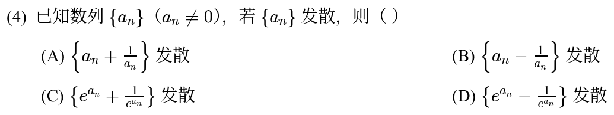
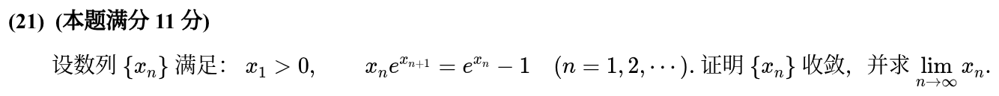
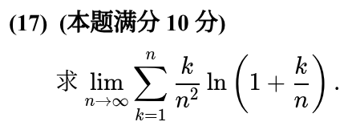
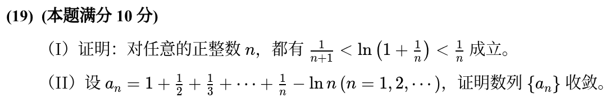
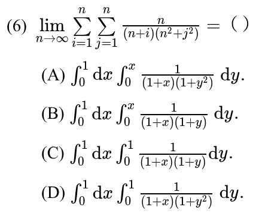

[« 函数极限与无穷小](01-limits.md)　　[连续与间断点 »](03-continuity.md)

# 高等数学 · 数列极限与求和极限

> **本章共 15 题**
> 
> - **核心必做（建议按顺序攻克关键方法）**：  
>   [第 11 题](#q11)（单调有界与反例） → [第 08 题](#q08)（认出黎曼和） → [第 07 题](#q07)（求和化积分并算完） → [第 14 题](#q14)（不等式接单调有界）
> 
> - **分流与刷题建议**：  
>   - **较难挑战**：[第 13 题](#q13)（方程实根组成数列）、[第 05 题](#q05)（隐式递推求极限）  
>   - **重在看思路**：[第 15 题](#q15)（双重求和转积分）  
>   - **首轮可跳过**：[第 03 题](#q03)、[第 09 题](#q09)（技巧较偏或综合度高，首轮不必死磕）  
>   - **题面存疑暂缓**：[第 10 题](#q10)（第二问条件与第一问最小值矛盾，待核）（原卷转写存疑，首轮暂不安排）  
> 
> - **过关目标**：先证明收敛再求极限；能把求和式整理出步长。

---

### 01 · 2025年

> *和式极限填空题。提一个公因子 $\frac{1}{n}$ 出来，里面凑成 $\frac{k}{n}\ln\frac{k}{n}$，直接化成 $\int_0^1 x\ln x\,dx$ 计算。*

---

### 02 · 2024年

> *数列发散性命题。拿最简单的振荡发散数列 $a_n = (-1)^n$ 或极限趋向 0 的数列当特例代入选项，快速排除错误项。*

---

### 03 · 2023年

> *无穷小阶数比较。递推式 $x_{n+1}=\sin x_n$ 是经典的 $O(1/\sqrt{n})$ 级收敛，而平方迭代 $y_{n+1}=y_n^2$ 是双重指数级暴跌，谁快谁慢一眼看穿。*

---

### 04 · 2022年

---

### 05 · 2018年

> *递推数列攻坚大题。证单调有界：利用 $e^x-1>x$ 容易得出递减且有下界 0；求极限时两端取极限解不动点，别漏掉 $x\ge 0$ 的区间讨论。*

---

### 06 · 2017年

---

### 07 · 2017年

> *经典求和极限大题。提 $\frac{1}{n}$ 之后里面全写成 $\frac{k}{n}$ 的函数，转化为定积分 $\int_0^1 x\ln(1+x)\,dx$，分部积分直接拿满分。*

---

### 08 · 2016年

---

### 09 · 2014年

> *迭代函数列与面积极限。先由递推式求出通项 $f_n(x) = \frac{x}{1+nx}$，算定积分求出面积 $S_n$，最后算 $nS_n$ 的极限，本质是考通项化简。*

---

### 10 · 2013年

> *第一问求导直接求最小值；第二问数列条件 $\ln x_n + 1/x_n < 1$ 表面怪异，其实就是利用第一问函数最小值卡住数列范围，用夹逼定理定极限。*

> ⚠️ **题面待核对**：原年度转写稿存在疑点，本次保留题面，作答前请核对独立原题来源。

---

### 11 · 2012年

---

### 12 · 2012年

---

### 13 · 2012年

> *多项式方程唯一实根与极限。第一问连续函数零点定理结合单调性证唯一；第二问利用方程化简 $x_n = 1 - x_n^n$，分析单调有界证收敛。*

---

### 14 · 2011年

> *调和级数与欧拉常数证明。第一问对 $\ln(1+1/n)$ 用拉格朗日；第二问利用第一问不等式直接证明数列递减且有下界，是单调有界的标准样板。*

---

### 15 · 2010年

---

[« 函数极限与无穷小](01-limits.md)　　[连续与间断点 »](03-continuity.md)
