# 高等数学 · 数列极限与求和极限

> 2010—2026年 · 15 道完整真题 · 年份从新到旧（2026→2010）  
> 题型分布：选择题 6 题 · 填空题 3 题 · 解答题 6 题  
> 考查范围：数列收敛、递推、夹逼与单调有界、和式极限

[查看对应网页版](02-sequences.html) · [返回章节总目录](../README.md)

---

## 2025年

### 01 · 2025-13 · 填空题

> *和式极限填空题。提一个公因子 $\frac{1}{n}$ 出来，里面凑成 $\frac{k}{n}\ln\frac{k}{n}$，直接化成 $\int_0^1 x\ln x\,dx$ 计算。*

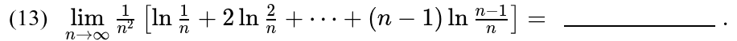

*关联章节：[定积分、变上限积分与积分性质](11-definite-integrals.md)*

---

## 2024年

### 02 · 2024-04 · 选择题

> *数列发散性命题。拿最简单的振荡发散数列 $a_n = (-1)^n$ 或极限趋向 0 的数列当特例代入选项，快速排除错误项。*

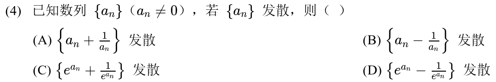

---

## 2023年

### 03 · 2023-03 · 选择题

> *无穷小阶数比较。递推式 $x_{n+1}=\sin x_n$ 是经典的 $O(1/\sqrt{n})$ 级收敛，而平方迭代 $y_{n+1}=y_n^2$ 是双重指数级暴跌，谁快谁慢一眼看穿。*

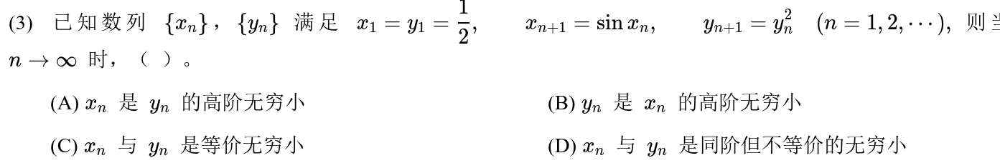

*关联章节：[函数极限与无穷小](01-limits.md)*

---

## 2022年

### 04 · 2022-06 · 选择题

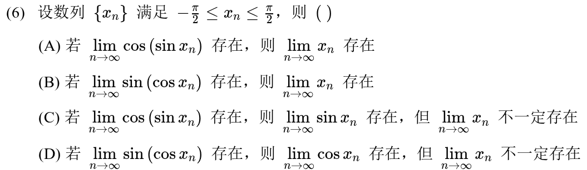

*关联章节：[函数极限与无穷小](01-limits.md)*

---

## 2018年

### 05 · 2018-21 · 解答题

> *递推数列攻坚大题。证单调有界：利用 $e^x-1>x$ 容易得出递减且有下界 0；求极限时两端取极限解不动点，别漏掉 $x\ge 0$ 的区间讨论。*

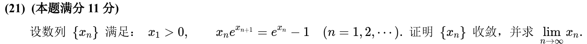

*关联章节：[中值定理、零点与不等式证明](05-mean-value-proofs.md)*

---

## 2017年

### 06 · 2017-03 · 选择题

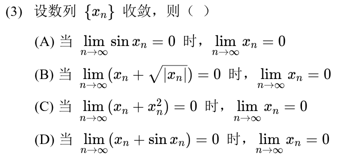

---

### 07 · 2017-17 · 解答题

> *经典求和极限大题。提 $\frac{1}{n}$ 之后里面全写成 $\frac{k}{n}$ 的函数，转化为定积分 $\int_0^1 x\ln(1+x)\,dx$，分部积分直接拿满分。*

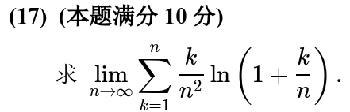

*关联章节：[定积分、变上限积分与积分性质](11-definite-integrals.md)*

---

## 2016年

### 08 · 2016-10 · 填空题

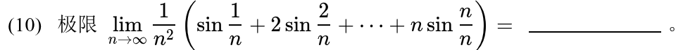

*关联章节：[定积分、变上限积分与积分性质](11-definite-integrals.md)*

---

## 2014年

### 09 · 2014-20 · 解答题

> *迭代函数列与面积极限。先由递推式求出通项 $f_n(x) = \frac{x}{1+nx}$，算定积分求出面积 $S_n$，最后算 $nS_n$ 的极限，本质是考通项化简。*

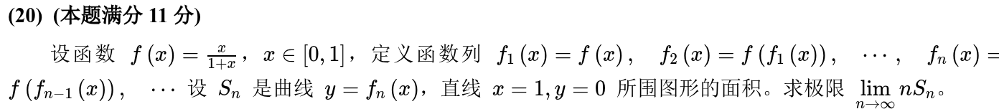

*关联章节：[定积分、变上限积分与积分性质](11-definite-integrals.md) · [定积分应用](13-integral-applications.md)*

---

## 2013年

### 10 · 2013-20 · 解答题

> *第一问求导直接求最小值；第二问数列条件 $\ln x_n + 1/x_n < 1$ 表面怪异，其实就是利用第一问函数最小值卡住数列范围，用夹逼定理定极限。*

> ⚠️ **题面待核对**：原年度转写稿存在疑点，本次保留题面，作答前请核对独立原题来源。

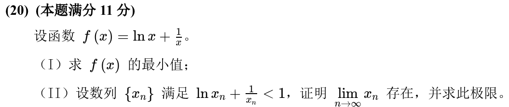

*关联章节：[单调性、极值与零点个数](06-monotonicity-extrema.md)*

---

## 2012年

### 11 · 2012-03 · 选择题

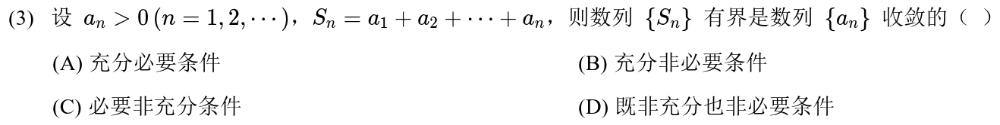

---

### 12 · 2012-10 · 填空题

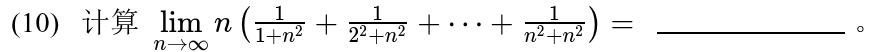

*关联章节：[定积分、变上限积分与积分性质](11-definite-integrals.md)*

---

### 13 · 2012-21 · 解答题

> *多项式方程唯一实根与极限。第一问连续函数零点定理结合单调性证唯一；第二问利用方程化简 $x_n = 1 - x_n^n$，分析单调有界证收敛。*

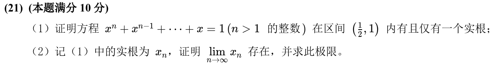

*关联章节：[中值定理、零点与不等式证明](05-mean-value-proofs.md)*

---

## 2011年

### 14 · 2011-19 · 解答题

> *调和级数与欧拉常数证明。第一问对 $\ln(1+1/n)$ 用拉格朗日；第二问利用第一问不等式直接证明数列递减且有下界，是单调有界的标准样板。*

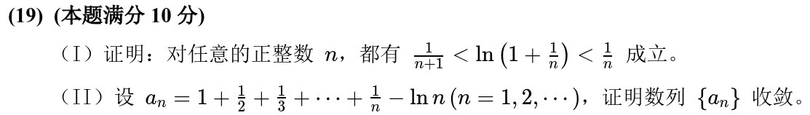

*关联章节：[中值定理、零点与不等式证明](05-mean-value-proofs.md)*

---

## 2010年

### 15 · 2010-06 · 选择题

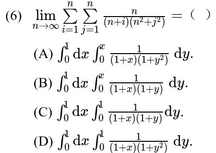

*关联章节：[定积分、变上限积分与积分性质](11-definite-integrals.md) · [二重积分](19-double-integrals.md)*

---

## 交叉考点索引

以下题目主归其他章节，点击跳转到对应章节题目；不计入本章主收录题数：

- [2021年 · 第7题](11-definite-integrals.md)（主章节：定积分、变上限积分与积分性质）
- [2019年 · 第19题](13-integral-applications.md)（主章节：定积分应用）
- [2010年 · 第16题](11-definite-integrals.md)（主章节：定积分、变上限积分与积分性质）
