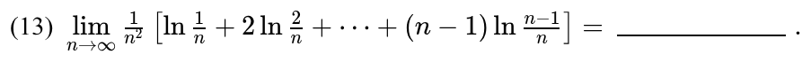
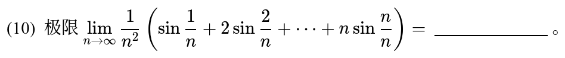
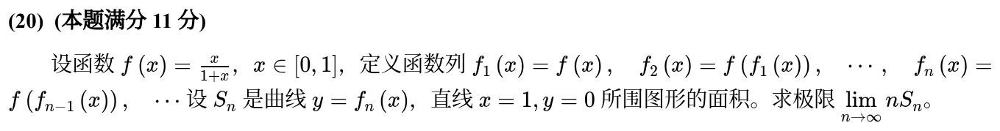
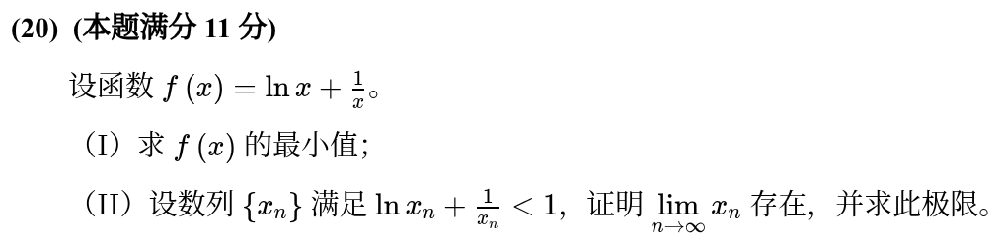
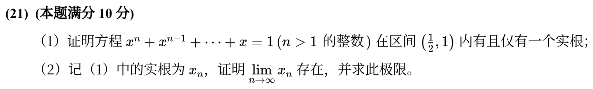

[« 函数极限与无穷小](01-limits.md)　　[连续与间断点 »](03-continuity.md)

# 高等数学 · 数列极限与求和极限

> **本章共 15 题**
> 
> - **核心必做（建议按顺序攻克关键方法）**：  
>   [第 11 题](#q11)（单调有界与反例） → [第 08 题](#q08)（认出黎曼和） → [第 07 题](#q07)（求和化积分并算完） → [第 14 题](#q14)（不等式接单调有界）
> 
> - **分流与刷题建议**：  
>   - **较难挑战**：[第 13 题](#q13)（方程实根组成数列）、[第 05 题](#q05)（隐式递推求极限）  
>   - **重在看思路**：[第 15 题](#q15)（双重求和转积分）  
>   - **首轮可跳过**：[第 03 题](#q03)、[第 09 题](#q09)（技巧较偏或综合度高，首轮不必死磕）  
>   - **题面存疑暂缓**：[第 10 题](#q10)（第二问条件与第一问最小值矛盾，待核）（原卷转写存疑，首轮暂不安排）  
> 
> - **过关目标**：先证明收敛再求极限；能把求和式整理出步长。

---

### 01 · 2025年

> *和式极限填空题。提一个公因子 $\frac{1}{n}$ 出来，里面凑成 $\frac{k}{n}\ln\frac{k}{n}$，直接化成 $\int_0^1 x\ln x\,dx$ 计算。*

答案与解析

**答案 $-\tfrac14$。** 写成 $\frac1n\sum_{k=1}^{n-1}(k/n)\ln(k/n)$。$t\ln t$ 在 $0$ 可连续补为 0，在 $1$ 也等于 0，可直接用黎曼和。分部积分得 $\int_0^1 t\ln t\,dt=-1/4$，下端 $t^2\ln t\to0$。

---

### 02 · 2024年

> *数列发散性命题。拿最简单的振荡发散数列 $a_n = (-1)^n$ 或极限趋向 0 的数列当特例代入选项，快速排除错误项。*

答案与解析

- **先用反证法检验严格单调满射函数**：对选项（D），令 $f(x) = e^x - e^{-x} = 2\sinh x$，它在 $\mathbb{R}$ 上严格递增、值域为整个 $(-\infty,+\infty)$，反函数 $f^{-1}(y) = \ln\!\left(\frac{y+\sqrt{y^2+4}}{2}\right)$ 在 $\mathbb{R}$ 上连续。若 $\{f(a_n)\}$ 收敛于有限数 $L$，则 $a_n = f^{-1}(f(a_n))\to f^{-1}(L)$ 也收敛，与 $\{a_n\}$ 发散矛盾！故（D）必发散。
- **三项反例逐一击破**（注意不要把发散只当成趋于 $\infty$）：
  - （A）取 $a_n = 2^{(-1)^n}$（发散且非零），则 $a_n + \frac{1}{a_n} \equiv \frac{5}{2}$ 收敛；
  - （B）取 $a_n = (-1)^n$，则 $a_n - \frac{1}{a_n} \equiv 0$ 收敛；
  - （C）取 $a_n = (-1)^n$，则 $e^{a_n} + e^{-a_n} \equiv e + e^{-1}$ 收敛。
- **答案**：**（D）**。

---

### 03 · 2023年

> *无穷小阶数比较。递推式 $x_{n+1}=\sin x_n$ 是经典的 $O(1/\sqrt{n})$ 级收敛，而平方迭代 $y_{n+1}=y_n^2$ 是双重指数级暴跌，谁快谁慢一眼看穿。*

答案与解析

- **第一步（先证两列均正且趋于 $0$）**：由 $0<\sin u < u$（$u>0$）与 $0<y_1=\frac{1}{2}<1$，用单调有界准则易知 $x_n>0, y_n>0$ 均严格递减，且由极限方程 $A=\sin A$ 与 $B=B^2$（$0\le B < \frac{1}{2}$）得 $\lim x_n = 0$、$\lim y_n = 0$。
- **第二步（构造商数列 $z_n = \frac{y_n}{x_n}$ 算相邻比）**：
  $$\frac{z_{n+1}}{z_n} = \frac{y_{n+1}/y_n}{x_{n+1}/x_n} = \frac{y_n}{\sin x_n / x_n} \to \frac{0}{1} = 0 < 1.$$
  故存在 $N$ 使 $n\ge N$ 时 $0 < z_{n+1} \le \frac{1}{2}z_n$，从而 $z_n = \frac{y_n}{x_n} \to 0$，即 $y_n$ 是 $x_n$ 的高阶无穷小。
- **答案**：**（B）**。

---

### 04 · 2022年

答案与解析

**答案 D。** $\cos x_n$ 落在 $[0,1]$，而 $\sin$ 在该区间有连续反函数，所以 $\sin(\cos x_n)$ 收敛推出 $\cos x_n$ 收敛。取 $x_n=(-1)^n c$、$0<c<\pi/2$，可看出 $x_n$ 可不收敛，也同时排除 A、B、C。

---

### 05 · 2018年

> *递推数列攻坚大题。证单调有界：利用 $e^x-1>x$ 容易得出递减且有下界 0；求极限时两端取极限解不动点，别漏掉 $x\ge 0$ 的区间讨论。*

答案与解析

**解。** 若 $x_n>0$，则 $(e^{x_n}-1)/x_n$ 是 $e^t$ 在 $[0,x_n]$ 上的平均值，严格介于 $1,e^{x_n}$。取对数得 $0<x_{n+1}<x_n$。故数列收敛至 $L\ge0$。如 $L>0$，递推的极限等式与上述严格上界矛盾，所以 $L=0$。

---

### 06 · 2017年

答案与解析

**答案 D。** 设 $x_n\to L$，由连续性转成关于 $L$ 的方程。A 可有 $L=\pi$，B、C 可有 $L=-1$。D 的 $h(x)=x+\sin x$ 有 $h(0)=0$ 且导数 $1+\cos x$ 非负、只在离散点为零，故严格递增且只有零根。

---

### 07 · 2017年

> *经典求和极限大题。提 $\frac{1}{n}$ 之后里面全写成 $\frac{k}{n}$ 的函数，转化为定积分 $\int_0^1 x\ln(1+x)\,dx$，分部积分直接拿满分。*

答案与解析

**第一步与完整推演**

- **触发条件**：通项 $\frac{k}{n^2}\ln\left(1+\frac{k}{n}\right)$ 天然拆分为 $\frac{1}{n}\cdot \frac{k}{n}\ln\left(1+\frac{k}{n}\right)$。
- **第一步落笔**：
  $$\lim_{n\to\infty}\sum_{k=1}^{n}\frac{k}{n^2}\ln\left(1+\frac{k}{n}\right) = \lim_{n\to\infty}\frac{1}{n}\sum_{k=1}^{n}\frac{k}{n}\ln\left(1+\frac{k}{n}\right).$$
  由于被积函数 $f(x) = x\ln(1+x)$ 在 $[0,1]$ 上连续，由定积分定义得
  $$\text{原式} = \int_0^1 x\ln(1+x)\,dx.$$
- **分部积分（凑 $x^2-1$ 消除分母）**：利用 $x\,dx = \frac{1}{2}d(x^2-1)$，得
  $$\begin{aligned}
  \int_0^1 x\ln(1+x)\,dx &= \frac{1}{2}\int_0^1 \ln(1+x)\,d(x^2-1) \\
  &= \left[\frac{x^2-1}{2}\ln(1+x)\right]_0^1 - \frac{1}{2}\int_0^1 \frac{x^2-1}{1+x}\,dx \\
  &= 0 - \frac{1}{2}\int_0^1 (x-1)\,dx \\
  &= -\frac{1}{2}\left[\frac{x^2}{2} - x\right]_0^1 = -\frac{1}{2}\left(-\frac{1}{2}\right) = \frac{1}{4}.
  \end{aligned}$$

> **技巧注记**：这里凑 $d(x^2-1)$ 而不是 $d(x^2)$，既让边界项在 $x=1$ 和 $x=0$ 处**同时为 $0$**，又让分子 $x^2-1=(x-1)(x+1)$ 与分母 $1+x$ 干净约分，大幅降低计算失误率。

---

### 08 · 2016年

答案与解析

**第一步与完整推演**

- **触发条件**：和式第 $k$ 项为 $k\sin\frac{k}{n}$，外部因子为 $\frac{1}{n^2}$——恰好拆成步长 $\frac{1}{n}$ 与采样系数 $\frac{k}{n}$。
- **第一步落笔**：改写为标准黎曼和：
  $$\frac{1}{n^2}\sum_{k=1}^{n} k\sin\frac{k}{n} = \frac{1}{n}\sum_{k=1}^{n} \frac{k}{n}\sin\frac{k}{n}.$$
- **化为定积分并分部计算**：因为 $f(x) = x\sin x$ 在 $[0,1]$ 上连续，故
  $$\lim_{n\to\infty}\frac{1}{n}\sum_{k=1}^{n}\frac{k}{n}\sin\frac{k}{n} = \int_0^1 x\sin x\,dx.$$
  分部积分（令 $u=x,\ dv=\sin x\,dx$）：
  $$\int_0^1 x\sin x\,dx = \big[-x\cos x\big]_0^1 + \int_0^1 \cos x\,dx = -\cos 1 + \big[\sin x\big]_0^1 = \sin 1 - \cos 1.$$

---

### 09 · 2014年

> *迭代函数列与面积极限。先由递推式求出通项 $f_n(x) = \frac{x}{1+nx}$，算定积分求出面积 $S_n$，最后算 $nS_n$ 的极限，本质是考通项化简。*

答案与解析

**答案 $1$。** 归纳得 $f_n(x)=x/(1+nx)$（也可对 $x>0$ 用倒数，每复合一次倒数加 1）。因此
$$
nS_n=\int_0^1\left(1-\frac1{1+nx}\right)dx
=1-\frac{\ln(1+n)}n\longrightarrow1.
$$

---

### 10 · 2013年

> *第一问求导直接求最小值；第二问数列条件 $\ln x_n + 1/x_n < 1$ 表面怪异，其实就是利用第一问函数最小值卡住数列范围，用夹逼定理定极限。*

> ⚠️ **题面待核对**：原年度转写稿存在疑点，本次保留题面，作答前请核对独立原题来源。

答案与解析

**（I）最小值为 1，在 $x=1$ 取到。** $f'(x)=(x-1)/x^2$ 在 1 左负右正，故对所有 $x>0$ 都有 $f(x)\ge1$。

**（II）题面待核。** 当前条件 $f(x_n)<1$ 与（I）矛盾，不存在满足条件的实数列。若原卷另有 $f(x_n)\to1$ 的前提，才可由 $f$ 在 1 两侧严格单调、并且在 $0^+$ 和 $+\infty$ 都趋于无穷，推出 $x_n\to1$。须以独立原卷为准。

---

### 11 · 2012年

答案与解析

**第一步与完整推演**

- **触发条件**：已知 $a_n > 0$，立刻写出 $S_{n+1} - S_n = a_{n+1} > 0$，即部分和数列 $\{S_n\}$ **严格单调递增**。
- **验证充分性**（$\{S_n\}$ 有界 $\implies \{a_n\}$ 收敛）：
  因为 $\{S_n\}$ 单调递增且有上界，由**单调有界准则**知 $\{S_n\}$ 收敛，设 $\lim_{n\to\infty} S_n = S$。
  由 $a_n = S_n - S_{n-1}$（$n\ge 2$），两边取极限得
  $$\lim_{n\to\infty} a_n = \lim_{n\to\infty} S_n - \lim_{n\to\infty} S_{n-1} = S - S = 0,$$
  故 $\{a_n\}$ 收敛（且极限必为 $0$）。**充分性成立。**
- **验证必要性**（$\{a_n\}$ 收敛 $\implies \{S_n\}$ 有界）：
  取反例 $a_n = 1$（满足 $a_n>0$ 且 $\lim_{n\to\infty} a_n = 1$ 收敛），但 $S_n = n \to +\infty$ 无界（即便要求 $a_n\to 0$，取 $a_n = \frac{1}{n}$ 时 $S_n$ 仍发散无界）。**必要性不成立。**

综合得“充分非必要条件”，选 **（B）**。

**选择题关键干扰项拆解**

- **（A）充分必要条件**：把“数列 $\{a_n\}$ 收敛”与“级数 $\sum a_n$ 收敛”混为一谈；$\{a_n\}$ 收敛只要求通项有极限，甚至可以趋于非零常数 $1$，远推不出部分和有界。
- **（C）必要非充分条件**：把充分与必要的箭头方向读反了（“$P$ 是 $Q$ 的什么条件”中，$P\Rightarrow Q$ 是充分性，$Q\Rightarrow P$ 是必要性）。
- **（D）既非充分也非必要条件**：没有把 $a_n > 0$ 翻译成“$\{S_n\}$ 递增”，从而想不到调用单调有界准则。

---

### 12 · 2012年

答案与解析

**答案 $\pi/4$。** 原式写为 $\frac1n\sum_{k=1}^n \frac1{1+(k/n)^2}$，是 $[0,1]$ 上的右端点黎曼和，极限为 $\int_0^1dt/(1+t^2)$。

---

### 13 · 2012年

> *多项式方程唯一实根与极限。第一问连续函数零点定理结合单调性证唯一；第二问利用方程化简 $x_n = 1 - x_n^n$，分析单调有界证收敛。*

答案与解析

**证明。** （1）$S_n(x)=x+\cdots+x^n$ 在正半轴严格递增，$S_n(1/2)=1-2^{-n}<1$、$S_n(1)=n>1$，故唯一根在 $(1/2,1)$。

（2）$S_{n+1}(x_n)>S_n(x_n)=1$，故 $x_{n+1}<x_n$，且有下界 $1/2$。几何和给 $2x_n-1=x_n^{n+1}$，右边被 $x_2^{n+1}$ 控制并趋 0，故极限为 $1/2$。

---

### 14 · 2011年

> *调和级数与欧拉常数证明。第一问对 $\ln(1+1/n)$ 用拉格朗日；第二问利用第一问不等式直接证明数列递减且有下界，是单调有界的标准样板。*

答案与解析

**第（I）问：用拉格朗日中值定理一步到位**

- **第一步落笔**：把 $\ln\left(1+\frac{1}{n}\right)$ 改写为函数差 $\ln(n+1) - \ln n$，设 $f(x) = \ln x$。
- **推演**：对任意正整数 $n$，$f(x)=\ln x$ 在闭区间 $[n, n+1]$ 上连续、在开区间 $(n, n+1)$ 内可导，且 $f'(x) = \frac{1}{x}$。由拉格朗日中值定理，存在 $\xi \in (n, n+1)$，使得
  $$\ln\left(1+\frac{1}{n}\right) = \ln(n+1) - \ln n = f'(\xi)\cdot\big((n+1)-n\big) = \frac{1}{\xi}.$$
  因为 $n < \xi < n+1$，取倒数即得
  $$\frac{1}{n+1} < \frac{1}{\xi} < \frac{1}{n} \implies \frac{1}{n+1} < \ln\left(1+\frac{1}{n}\right) < \frac{1}{n}.$$

> **等价证法（积分法）**：在 $[n, n+1]$ 上 $\frac{1}{n+1} < \frac{1}{x} < \frac{1}{n}$（仅端点取等），两边积分同样一步得 $\frac{1}{n+1} < \int_n^{n+1}\frac{1}{x}\,dx = \ln\left(1+\frac{1}{n}\right) < \frac{1}{n}$。

**第（II）问：单调性用左半边，下界用右半边累加**

1. **证明单调递减**：对任意正整数 $n$，作差
   $$a_{n+1} - a_n = \frac{1}{n+1} - \big(\ln(n+1) - \ln n\big) = \frac{1}{n+1} - \ln\left(1+\frac{1}{n}\right).$$
   由第（I）问左半边不等式 $\frac{1}{n+1} < \ln\left(1+\frac{1}{n}\right)$，得 $a_{n+1} - a_n < 0$，即数列 $\{a_n\}$ **严格单调递减**。
2. **证明有下界**：由第（I）问右半边不等式，对 $k = 1, 2, \dots, n$ 均有
   $$\frac{1}{k} > \ln\left(1+\frac{1}{k}\right) = \ln(k+1) - \ln k.$$
   将这 $n$ 个不等式相加，右侧裂项相消：
   $$1 + \frac{1}{2} + \frac{1}{3} + \dots + \frac{1}{n} > \sum_{k=1}^{n}\big(\ln(k+1) - \ln k\big) = \ln(n+1) - \ln 1 = \ln(n+1).$$
   两边同减 $\ln n$，得
   $$a_n > \ln(n+1) - \ln n = \ln\left(1+\frac{1}{n}\right) > 0.$$
   因此 $\{a_n\}$ 有下界 $0$。
3. **结论**：数列 $\{a_n\}$ 单调递减且有下界，由**单调有界准则**知 $\{a_n\}$ 收敛。

---

### 15 · 2010年

答案与解析

**答案 D。** 单项化为 $n^{-2}[(1+i/n)(1+(j/n)^2)]^{-1}$。两个指标都独立遍历 $1,\ldots,n$，所以是整个单位正方形上的二重黎曼和。若只有 $j\le i$，才会出现三角形区域。

---

[« 函数极限与无穷小](01-limits.md)　　[连续与间断点 »](03-continuity.md)
