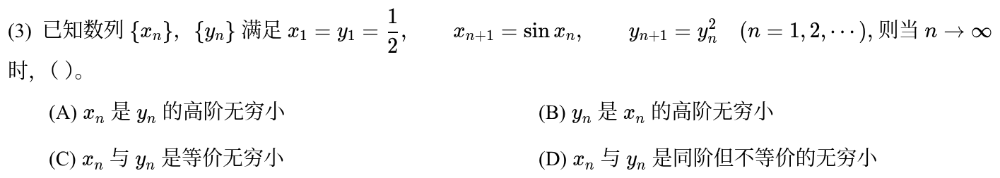
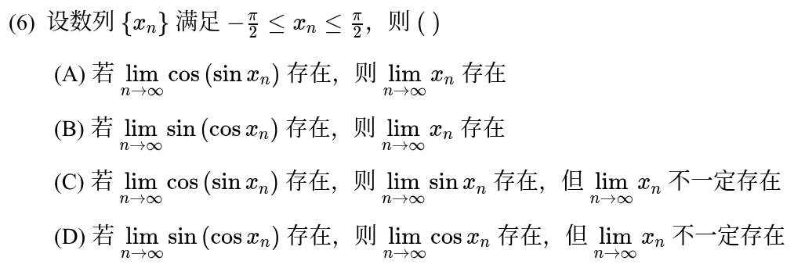
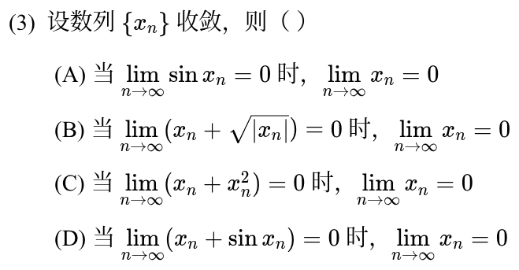
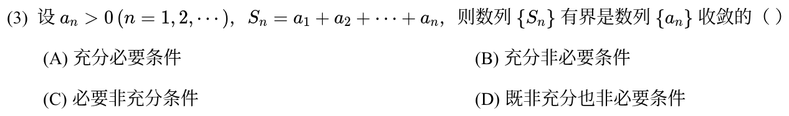
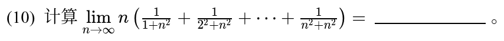

[« 函数极限与无穷小](01-limits.md)　　[连续与间断点 »](03-continuity.md)

# 高等数学 · 数列极限与求和极限

> **本章共 15 题**
> 
> - **核心必做（建议按顺序攻克关键方法）**：  
>   [第 11 题](#q11)（单调有界与反例） → [第 08 题](#q08)（认出黎曼和） → [第 07 题](#q07)（求和化积分并算完） → [第 14 题](#q14)（不等式接单调有界）
> 
> - **分流与刷题建议**：  
>   - **较难挑战**：[第 13 题](#q13)（方程实根组成数列）、[第 05 题](#q05)（隐式递推求极限）  
>   - **重在看思路**：[第 15 题](#q15)（双重求和转积分）  
>   - **首轮可跳过**：[第 03 题](#q03)、[第 09 题](#q09)（技巧较偏或综合度高，首轮不必死磕）  
>   - **题面存疑暂缓**：[第 10 题](#q10)（第二问条件与第一问最小值矛盾，待核）（原卷转写存疑，首轮暂不安排）  
> 
> - **过关目标**：先证明收敛再求极限；能把求和式整理出步长。

---

### 01 · 2025年

> *和式极限填空题。提一个公因子 $\frac{1}{n}$ 出来，里面凑成 $\frac{k}{n}\ln\frac{k}{n}$，直接化成 $\int_0^1 x\ln x\,dx$ 计算。*

答案与解析

**答案**：$-\dfrac{1}{4}$

- **切入点与推演**：将和式提取因子 $\dfrac{1}{n}$ 化为标准黎曼和形式：
  $$\frac{1}{n^2}\sum_{k=1}^{n-1} k\ln\frac{k}{n} = \frac{1}{n}\sum_{k=1}^{n-1}\frac{k}{n}\ln\frac{k}{n}.$$
  令 $f(t)=\begin{cases} t\ln t, & t\in(0,1], \\ 0, & t=0. \end{cases}$ 由 $\lim\limits_{t\to 0^+}t\ln t=0$ 知 $f(t)$ 在 $[0,1]$ 上连续，且右端点 $f(1)=0$（故求和上限 $n-1$ 与 $n$ 仅差 $0$）。由定积分定义：
  $$\text{原式} = \int_0^1 t\ln t\,\mathrm{d}t.$$
  分部积分（将 $t\,\mathrm{d}t=\mathrm{d}\left(\frac{1}{2}t^2\right)$）：
  $$\int_0^1 t\ln t\,\mathrm{d}t = \left[\frac{1}{2}t^2\ln t\right]_{0^+}^1 - \frac{1}{2}\int_0^1 t\,\mathrm{d}t = 0 - \frac{1}{2}\cdot\frac{1}{2} = -\frac{1}{4}.$$
- **易错点**：需确认 $f(t)=t\ln t$ 在 $t=0^+$ 有有限极限 $0$（可连续延拓）才能直接套用黎曼和化定积分，且分部积分后下限 $\lim\limits_{t\to 0^+}t^2\ln t=0$ 不要漏负号。

---

### 02 · 2024年

> *数列发散性命题。拿最简单的振荡发散数列 $a_n = (-1)^n$ 或极限趋向 0 的数列当特例代入选项，快速排除错误项。*

答案与解析

**答案**：**（D）** $\left\{e^{a_n}-\dfrac{1}{e^{a_n}}\right\}$ 发散

- **切入点与推演**：利用逆否命题检验——若某选项对应的函数 $f(x)$ 在定义域上存在连续反函数 $f^{-1}$，则 $\{f(a_n)\}$ 收敛必能反推 $a_n=f^{-1}(f(a_n))$ 收敛，从而由 $\{a_n\}$ 发散必得 $\{f(a_n)\}$ 发散。
  对 **（D）**，令 $f(x)=e^x - e^{-x}$，由于 $f'(x)=e^x+e^{-x}>0$，且 $\lim\limits_{x\to\pm\infty}f(x)=\pm\infty$，故 $f$ 是 $\mathbb{R}\to\mathbb{R}$ 的严格单调连续双射，反函数
  $$f^{-1}(y)=\ln\frac{y+\sqrt{y^2+4}}{2}$$
  在 $\mathbb{R}$ 上连续。若 $\{f(a_n)\}$ 收敛于 $L$，则 $a_n=f^{-1}(f(a_n))\to f^{-1}(L)$ 收敛，与 $\{a_n\}$ 发散矛盾。故 **（D）** 必然发散。
- **干扰项 / 易错提示**：发散不仅包括趋于 $\infty$，还包括有界震荡！取震荡反例即可排除前三项：
  - **（A）**：取 $a_n=2^{(-1)^n}$（发散且非零），则 $a_n+\frac{1}{a_n}\equiv \frac{5}{2}$ 收敛；
  - **（B）**：取 $a_n=(-1)^n$，则 $a_n-\frac{1}{a_n}\equiv 0$ 收敛；
  - **（C）**：取 $a_n=(-1)^n$，则 $e^{a_n}+e^{-a_n}\equiv e+e^{-1}$ 收敛。

---

### 03 · 2023年

> *无穷小阶数比较。递推式 $x_{n+1}=\sin x_n$ 是经典的 $O(1/\sqrt{n})$ 级收敛，而平方迭代 $y_{n+1}=y_n^2$ 是双重指数级暴跌，谁快谁慢一眼看穿。*

答案与解析

**答案**：**（B）** $y_n$ 是 $x_n$ 的高阶无穷小

- **切入点与推演**：先确定两数列的极限均为 $0$：
  - 由 $x_1=\frac{1}{2}\in(0,1)$ 与 $0<\sin u<u$（$u\in(0,1)$），归纳知 $0<x_{n+1}<x_n$，故 $\{x_n\}$ 收敛于 $A\ge 0$；由 $A=\sin A$ 得 $A=0$。
  - 由 $y_1=\frac{1}{2}$ 与 $y_{n+1}=y_n^2$，得 $y_n=\left(\frac{1}{2}\right)^{2^{n-1}}>0$，显然 $\lim\limits_{n\to\infty}y_n=0$。

  再构造商数列 $z_n=\dfrac{y_n}{x_n}>0$，计算相邻项之比：
  $$\lim_{n\to\infty}\frac{z_{n+1}}{z_n} = \lim_{n\to\infty}\frac{y_{n+1}/y_n}{x_{n+1}/x_n} = \lim_{n\to\infty}\frac{y_n}{\frac{\sin x_n}{x_n}} = \frac{0}{1} = 0 < 1.$$
  由比值判别（存在 $N$ 使 $n\ge N$ 时 $0<z_{n+1}\le\frac{1}{2}z_n$），知 $\lim\limits_{n\to\infty}\dfrac{y_n}{x_n}=0$，即 $y_n$ 是 $x_n$ 的高阶无穷小，选 **（B）**。
- **干扰项 / 易错提示**：$\sin x_n \approx x_n - \frac{1}{6}x_n^3$ 收敛极慢（$x_n\sim\sqrt{\frac{3}{n}}$），而 $y_{n+1}=y_n^2$ 呈双指数级衰减，直接作商求相邻比是最快的判阶手段。

---

### 04 · 2022年

答案与解析

**答案**：**（D）** 若 $\lim\limits_{n\to\infty}\sin(\cos x_n)$ 存在，则 $\lim\limits_{n\to\infty}\cos x_n$ 存在，但 $\lim\limits_{n\to\infty}x_n$ 不一定存在

- **切入点与推演**：由 $-\dfrac{\pi}{2}\le x_n\le\dfrac{\pi}{2}$ 知 $\cos x_n \in [0,1] \subset \left[-\dfrac{\pi}{2},\dfrac{\pi}{2}\right]$。因为 $u\mapsto \sin u$ 在 $[0,1]$ 上严格单调递增且连续，其反函数 $\arcsin$ 在 $[0,\sin 1]$ 上连续，所以若 $\lim\limits_{n\to\infty}\sin(\cos x_n)=L$ 存在，则
  $$\lim_{n\to\infty}\cos x_n = \lim_{n\to\infty}\arcsin\bigl(\sin(\cos x_n)\bigr) = \arcsin L$$
  必存在。但 $\cos x$ 是偶函数，在 $[-\frac{\pi}{2},\frac{\pi}{2}]$ 上不单调，取 $x_n=(-1)^n\dfrac{\pi}{4}$，则 $\cos x_n\equiv\dfrac{\sqrt{2}}{2}$ 收敛，$\sin(\cos x_n)$ 收敛，而 $\{x_n\}$ 发散。故 **（D）** 正确。
- **干扰项 / 易错提示**：同一个反例 $x_n=(-1)^n\dfrac{\pi}{4}$ 同时推翻（A）（B）（C）：此时 $\sin x_n=(-1)^n\dfrac{\sqrt{2}}{2}$ 发散，但 $\cos(\sin x_n)\equiv\cos\dfrac{\sqrt{2}}{2}$ 收敛（因 $\cos$ 为偶函数），故（C）前半句即错。

---

### 05 · 2018年

> *递推数列攻坚大题。证单调有界：利用 $e^x-1>x$ 容易得出递减且有下界 0；求极限时两端取极限解不动点，别漏掉 $x\ge 0$ 的区间讨论。*

答案与解析

**结论速览**：$\{x_n\}$ 单调递减收敛，且 $\lim\limits_{n\to\infty}x_n = 0$

- **完整解答**：
  1. **证明 $x_n > 0$ 且单调递减**：用数学归纳法与拉格朗日中值定理。已知 $x_1 > 0$；设 $x_n > 0$，对函数 $f(t)=e^t$ 在 $[0, x_n]$ 上应用拉格朗日中值定理，存在 $\xi_n \in (0, x_n)$ 使得
     $$e^{x_n} - 1 = e^{\xi_n}\cdot x_n.$$
     代入递推式 $x_n e^{x_{n+1}} = e^{x_n}-1$（$x_n>0$ 两边约去 $x_n$），得
     $$e^{x_{n+1}} = e^{\xi_n} \implies x_{n+1} = \xi_n.$$
     由于 $0 < \xi_n < x_n$，立得 $0 < x_{n+1} < x_n$。由归纳法知对一切 $n\ge 1$ 均有 $0 < x_{n+1} < x_n$。
  2. **证明收敛**：数列 $\{x_n\}$ 单调递减且有下界 $0$，由单调有界准则知 $\lim\limits_{n\to\infty}x_n = A$ 存在，且 $A \ge 0$。
  3. **求极限 $A$**：对递推式 $x_n e^{x_{n+1}} = e^{x_n}-1$ 两边令 $n\to\infty$，得
     $$A e^A = e^A - 1 \iff (A-1)e^A + 1 = 0.$$
     令 $\varphi(x)=(x-1)e^x+1$（$x\ge 0$），则 $\varphi'(x)=x e^x > 0$（$x>0$），故 $\varphi(x)$ 在 $[0,+\infty)$ 上严格递增。又 $\varphi(0)=0$，故 $A=0$ 是 $\varphi(A)=0$ 在 $[0,+\infty)$ 上的唯一根，从而 $\lim\limits_{n\to\infty}x_n = 0$。
- **核心思路与避坑**：利用中值定理把 $\frac{e^{x_n}-1}{x_n}$ 写成 $e^{\xi_n}$，一步同时完成“正性”与“单调递减”的证明；解极限方程 $(A-1)e^A+1=0$ 时，务必用导数说明 $A=0$ 是唯一非负根，不能只靠目测代入。

---

### 06 · 2017年

答案与解析

**答案**：**（D）** 当 $\lim\limits_{n\to\infty}(x_n+\sin x_n)=0$ 时，$\lim\limits_{n\to\infty}x_n=0$

- **切入点与推演**：已知数列 $\{x_n\}$ 收敛，设 $\lim\limits_{n\to\infty}x_n = L$。各选项对应的函数均连续，故极限条件直接转化为关于 $L$ 的代数/超越方程：
  - **（A）**：$\sin L = 0$，可取 $L=\pi$（如 $x_n\equiv \pi$），故不推出 $L=0$；
  - **（B）**：$L+\sqrt{|L|}=0$，除 $L=0$ 外还有根 $L=-1$（如 $x_n\equiv -1$），错；
  - **（C）**：$L+L^2=0$，除 $L=0$ 外还有根 $L=-1$（如 $x_n\equiv -1$），错；
  - **（D）**：$L+\sin L=0$。令 $h(x)=x+\sin x$，则 $h'(x)=1+\cos x \ge 0$，且 $h'(x)=0$ 仅在孤立点 $x=(2k+1)\pi$ 处成立，故 $h(x)$ 在 $\mathbb{R}$ 上严格单调递增。又 $h(0)=0$，所以 $h(L)=0$ 必有唯一解 $L=0$。故选 **（D）**。
- **干扰项 / 易错提示**：因为题设已给 $\{x_n\}$ 收敛，本题本质是判断哪一个连续函数 $h(x)$ 在 $\mathbb{R}$ 上以 $x=0$ 为唯一零点，检验负数零点 $L=-1$ 是迅速排除（B）（C）的关键。

---

### 07 · 2017年

> *经典求和极限大题。提 $\frac{1}{n}$ 之后里面全写成 $\frac{k}{n}$ 的函数，转化为定积分 $\int_0^1 x\ln(1+x)\,dx$，分部积分直接拿满分。*

答案与解析

**第一步与完整推演**

- **触发条件**：通项 $\frac{k}{n^2}\ln\left(1+\frac{k}{n}\right)$ 天然拆分为 $\frac{1}{n}\cdot \frac{k}{n}\ln\left(1+\frac{k}{n}\right)$。
- **第一步落笔**：
  $$\lim_{n\to\infty}\sum_{k=1}^{n}\frac{k}{n^2}\ln\left(1+\frac{k}{n}\right) = \lim_{n\to\infty}\frac{1}{n}\sum_{k=1}^{n}\frac{k}{n}\ln\left(1+\frac{k}{n}\right).$$
  由于被积函数 $f(x) = x\ln(1+x)$ 在 $[0,1]$ 上连续，由定积分定义得
  $$\text{原式} = \int_0^1 x\ln(1+x)\,dx.$$
- **分部积分（凑 $x^2-1$ 消除分母）**：利用 $x\,dx = \frac{1}{2}d(x^2-1)$，得
  $$\begin{aligned}
  \int_0^1 x\ln(1+x)\,dx &= \frac{1}{2}\int_0^1 \ln(1+x)\,d(x^2-1) \\
  &= \left[\frac{x^2-1}{2}\ln(1+x)\right]_0^1 - \frac{1}{2}\int_0^1 \frac{x^2-1}{1+x}\,dx \\
  &= 0 - \frac{1}{2}\int_0^1 (x-1)\,dx \\
  &= -\frac{1}{2}\left[\frac{x^2}{2} - x\right]_0^1 = -\frac{1}{2}\left(-\frac{1}{2}\right) = \frac{1}{4}.
  \end{aligned}$$

> **技巧注记**：这里凑 $d(x^2-1)$ 而不是 $d(x^2)$，既让边界项在 $x=1$ 和 $x=0$ 处**同时为 $0$**，又让分子 $x^2-1=(x-1)(x+1)$ 与分母 $1+x$ 干净约分，大幅降低计算失误率。

---

### 08 · 2016年

答案与解析

**第一步与完整推演**

- **触发条件**：和式第 $k$ 项为 $k\sin\frac{k}{n}$，外部因子为 $\frac{1}{n^2}$——恰好拆成步长 $\frac{1}{n}$ 与采样系数 $\frac{k}{n}$。
- **第一步落笔**：改写为标准黎曼和：
  $$\frac{1}{n^2}\sum_{k=1}^{n} k\sin\frac{k}{n} = \frac{1}{n}\sum_{k=1}^{n} \frac{k}{n}\sin\frac{k}{n}.$$
- **化为定积分并分部计算**：因为 $f(x) = x\sin x$ 在 $[0,1]$ 上连续，故
  $$\lim_{n\to\infty}\frac{1}{n}\sum_{k=1}^{n}\frac{k}{n}\sin\frac{k}{n} = \int_0^1 x\sin x\,dx.$$
  分部积分（令 $u=x,\ dv=\sin x\,dx$）：
  $$\int_0^1 x\sin x\,dx = \big[-x\cos x\big]_0^1 + \int_0^1 \cos x\,dx = -\cos 1 + \big[\sin x\big]_0^1 = \sin 1 - \cos 1.$$

---

### 09 · 2014年

> *迭代函数列与面积极限。先由递推式求出通项 $f_n(x) = \frac{x}{1+nx}$，算定积分求出面积 $S_n$，最后算 $nS_n$ 的极限，本质是考通项化简。*

答案与解析

**结论速览**：$\lim\limits_{n\to\infty}nS_n = 1$

- **完整解答**：
  1. **归纳求 $f_n(x)$ 的通项**：已知 $f_1(x)=\dfrac{x}{1+x}$。假设 $f_k(x)=\dfrac{x}{1+kx}$，则
     $$f_{k+1}(x) = f\bigl(f_k(x)\bigr) = \frac{\frac{x}{1+kx}}{1+\frac{x}{1+kx}} = \frac{x}{1+(k+1)x}.$$
     由数学归纳法，对一切 $n\ge 1$ 有 $f_n(x)=\dfrac{x}{1+nx}$（$x\in[0,1]$）。
  2. **计算面积 $S_n$ 与 $nS_n$**：因 $x\in[0,1]$ 时 $f_n(x)\ge 0$，所围图形面积为
     $$S_n = \int_0^1 \frac{x}{1+nx}\,\mathrm{d}x.$$
     两边同乘 $n$ 并拆项积分：
     $$nS_n = \int_0^1 \frac{nx}{1+nx}\,\mathrm{d}x = \int_0^1 \left(1 - \frac{1}{1+nx}\right)\mathrm{d}x = \left[x - \frac{1}{n}\ln(1+nx)\right]_0^1 = 1 - \frac{\ln(1+n)}{n}.$$
  3. **求极限**：因为 $\lim\limits_{n\to\infty}\dfrac{\ln(1+n)}{n}=0$，所以
     $$\lim_{n\to\infty}nS_n = 1 - 0 = 1.$$
- **核心思路与避坑**：也可以通过取倒数 $\frac{1}{f(x)}=\frac{1}{x}+1$（$x>0$）快速看出每复合一次倒数加 $1$，再用归纳法严谨写出通项（补齐 $x=0$ 处 $f_n(0)=0$）。

---

### 10 · 2013年

> *第一问求导直接求最小值；第二问数列条件 $\ln x_n + 1/x_n < 1$ 表面怪异，其实就是利用第一问函数最小值卡住数列范围，用夹逼定理定极限。*

> ⚠️ **题面待核对**：原年度转写稿存在疑点，本次保留题面，作答前请核对独立原题来源。

答案与解析

**结论速览**：（I）最小值为 $1$（在 $x=1$ 处取到）；（II）**题面待核**（当前转录条件与第（I）问矛盾，按原卷常见条件 $\ln x_n+\frac{1}{x_n}<1+\frac{1}{n}$ 极限为 $1$）

- **（I）求 $f(x)$ 的最小值**：函数 $f(x)=\ln x+\dfrac{1}{x}$ 的定义域为 $(0,+\infty)$，求导得
  $$f'(x) = \frac{1}{x} - \frac{1}{x^2} = \frac{x-1}{x^2}.$$
  令 $f'(x)=0$ 得唯一驻点 $x=1$。当 $x\in(0,1)$ 时 $f'(x)<0$，$f(x)$ 严格递减；当 $x\in(1,+\infty)$ 时 $f'(x)>0$，$f(x)$ 严格递增。因此 $f(x)$ 在 $x=1$ 处取得全局最小值
  $$f_{\min} = f(1) = \ln 1 + 1 = 1.$$
- **（II）题面待核**：当前转录条件写作 $\ln x_n+\dfrac{1}{x_n} < 1$，但由第（I）问知对一切 $x>0$ 恒有 $\ln x+\dfrac{1}{x}\ge 1$，二者直接矛盾，不存在满足该条件的实数列 $\{x_n\}$。
  - **按独立原卷常见题面补证**（若原卷条件为 $\ln x_n+\dfrac{1}{x_n} < 1+\dfrac{1}{n}$ 或其他趋于 $1^+$ 的上界）：由第（I）问与该条件得
    $$1 \le f(x_n) < 1 + \frac{1}{n} \implies \lim_{n\to\infty} f(x_n) = 1.$$
    又 $\lim\limits_{x\to 0^+}f(x)=\lim\limits_{x\to+\infty}f(x)=+\infty$，结合 $f(x)$ 在 $(0,1]$ 严格递减、在 $[1,+\infty)$ 严格递增，对任意 $\varepsilon\in(0,1)$，记 $\delta=\min\{f(1-\varepsilon),f(1+\varepsilon)\}-1>0$，当 $n$ 充分大时 $f(x_n)<1+\delta$，必有 $|x_n-1|<\varepsilon$，故 $\lim\limits_{n\to\infty}x_n=1$。（具体条件须以独立原卷核对为准。）
- **核心思路与避坑**：第（II）问的实质是利用 $f(x)$ 的单谷性与边界趋于 $+\infty$ 的性质，由函数值收敛到唯一最小值反推自变量收敛到最小值点。

---

### 11 · 2012年

答案与解析

**第一步与完整推演**

- **触发条件**：已知 $a_n > 0$，立刻写出 $S_{n+1} - S_n = a_{n+1} > 0$，即部分和数列 $\{S_n\}$ **严格单调递增**。
- **验证充分性**（$\{S_n\}$ 有界 $\implies \{a_n\}$ 收敛）：
  因为 $\{S_n\}$ 单调递增且有上界，由**单调有界准则**知 $\{S_n\}$ 收敛，设 $\lim_{n\to\infty} S_n = S$。
  由 $a_n = S_n - S_{n-1}$（$n\ge 2$），两边取极限得
  $$\lim_{n\to\infty} a_n = \lim_{n\to\infty} S_n - \lim_{n\to\infty} S_{n-1} = S - S = 0,$$
  故 $\{a_n\}$ 收敛（且极限必为 $0$）。**充分性成立。**
- **验证必要性**（$\{a_n\}$ 收敛 $\implies \{S_n\}$ 有界）：
  取反例 $a_n = 1$（满足 $a_n>0$ 且 $\lim_{n\to\infty} a_n = 1$ 收敛），但 $S_n = n \to +\infty$ 无界（即便要求 $a_n\to 0$，取 $a_n = \frac{1}{n}$ 时 $S_n$ 仍发散无界）。**必要性不成立。**

综合得“充分非必要条件”，选 **（B）**。

**选择题关键干扰项拆解**

- **（A）充分必要条件**：把“数列 $\{a_n\}$ 收敛”与“级数 $\sum a_n$ 收敛”混为一谈；$\{a_n\}$ 收敛只要求通项有极限，甚至可以趋于非零常数 $1$，远推不出部分和有界。
- **（C）必要非充分条件**：把充分与必要的箭头方向读反了（“$P$ 是 $Q$ 的什么条件”中，$P\Rightarrow Q$ 是充分性，$Q\Rightarrow P$ 是必要性）。
- **（D）既非充分也非必要条件**：没有把 $a_n > 0$ 翻译成“$\{S_n\}$ 递增”，从而想不到调用单调有界准则。

---

### 12 · 2012年

答案与解析

**答案**：$\dfrac{\pi}{4}$

- **切入点与推演**：将外部因子 $n$ 与分母中的 $n^2$ 约分，化为 $[0,1]$ 上的标准黎曼和：
  $$n\sum_{k=1}^{n}\frac{1}{k^2+n^2} = \frac{1}{n}\sum_{k=1}^{n}\frac{1}{1+\left(\frac{k}{n}\right)^2}.$$
  由于 $f(x)=\dfrac{1}{1+x^2}$ 在 $[0,1]$ 上连续，由定积分定义得
  $$\lim_{n\to\infty}\frac{1}{n}\sum_{k=1}^{n}\frac{1}{1+\left(\frac{k}{n}\right)^2} = \int_0^1 \frac{1}{1+x^2}\,\mathrm{d}x = \bigl[\arctan x\bigr]_0^1 = \frac{\pi}{4}.$$
- **易错点**：分子分母同除 $n^2$ 时别把最前面的 $n$ 漏除掉，最终步长因子应为 $\frac{1}{n}$。

---

### 13 · 2012年

> *多项式方程唯一实根与极限。第一问连续函数零点定理结合单调性证唯一；第二问利用方程化简 $x_n = 1 - x_n^n$，分析单调有界证收敛。*

答案与解析

**结论速览**：（1）由零点定理与严格单调性证唯一根；（2）$\{x_n\}$ 单调递减且有下界 $\dfrac{1}{2}$，$\lim\limits_{n\to\infty}x_n = \dfrac{1}{2}$

- **（1）证明唯一实根**：对整数 $n>1$，构造辅助函数
  $$f_n(x) = x^n + x^{n-1} + \cdots + x - 1.$$
  $f_n(x)$ 在 $\left[\dfrac{1}{2},1\right]$ 上连续，且当 $x>0$ 时
  $$f_n'(x) = nx^{n-1} + (n-1)x^{n-2} + \cdots + 1 > 0,$$
  故 $f_n(x)$ 在 $(0,+\infty)$ 上严格单调递增。计算两端点函数值：
  $$f_n\left(\frac{1}{2}\right) = \frac{\frac{1}{2}\left(1-\frac{1}{2^n}\right)}{1-\frac{1}{2}} - 1 = -\frac{1}{2^n} < 0, \qquad f_n(1) = n - 1 > 0.$$
  由零点定理与严格单调性，方程 $f_n(x)=0$ 在 $\left(\dfrac{1}{2},1\right)$ 内有且仅有一个实根 $x_n$。
- **（2）证明极限存在并求极限**：
  1. **单调有界**：由 $f_n(x_n)=0$ 与 $x_n\in\left(\frac{1}{2},1\right)$，得
     $$f_{n+1}(x_n) = x_n^{n+1} + f_n(x_n) = x_n^{n+1} > 0 = f_{n+1}(x_{n+1}).$$
     因 $f_{n+1}(x)$ 在 $(0,+\infty)$ 上严格递增，故 $x_{n+1} < x_n$。又 $x_n > \dfrac{1}{2}$，由单调有界准则知 $\lim\limits_{n\to\infty}x_n = A$ 存在，且 $\dfrac{1}{2}\le A < x_2 < 1$。
  2. **求极限**：因为 $x_n\ne 1$，对等比求和 $x_n+x_n^2+\cdots+x_n^n=1$ 化简得
     $$\frac{x_n(1-x_n^n)}{1-x_n} = 1 \implies 2x_n - 1 = x_n^{n+1}.$$
     由单调递减性，对 $n\ge 2$ 有 $0 < x_n \le x_2 < 1$，故 $0 < x_n^{n+1} \le x_2^{n+1} \to 0$（$n\to\infty$）。对 $2x_n-1=x_n^{n+1}$ 两边取极限，得
     $$2A - 1 = 0 \implies A = \frac{1}{2}.$$
- **核心思路与避坑**：切忌在未证明 $A<1$（或 $x_n\le x_2<1$）之前就直接断言 $x_n^{n+1}\to 0$——若 $A=1$，则 $x_n^{n+1}$ 是 $1^\infty$ 型未定式！利用 $x_n\le x_2<1$ 放缩夹逼是标准满分写法。

---

### 14 · 2011年

> *调和级数与欧拉常数证明。第一问对 $\ln(1+1/n)$ 用拉格朗日；第二问利用第一问不等式直接证明数列递减且有下界，是单调有界的标准样板。*

答案与解析

**第（I）问：用拉格朗日中值定理一步到位**

- **第一步落笔**：把 $\ln\left(1+\frac{1}{n}\right)$ 改写为函数差 $\ln(n+1) - \ln n$，设 $f(x) = \ln x$。
- **推演**：对任意正整数 $n$，$f(x)=\ln x$ 在闭区间 $[n, n+1]$ 上连续、在开区间 $(n, n+1)$ 内可导，且 $f'(x) = \frac{1}{x}$。由拉格朗日中值定理，存在 $\xi \in (n, n+1)$，使得
  $$\ln\left(1+\frac{1}{n}\right) = \ln(n+1) - \ln n = f'(\xi)\cdot\big((n+1)-n\big) = \frac{1}{\xi}.$$
  因为 $n < \xi < n+1$，取倒数即得
  $$\frac{1}{n+1} < \frac{1}{\xi} < \frac{1}{n} \implies \frac{1}{n+1} < \ln\left(1+\frac{1}{n}\right) < \frac{1}{n}.$$

> **等价证法（积分法）**：在 $[n, n+1]$ 上 $\frac{1}{n+1} < \frac{1}{x} < \frac{1}{n}$（仅端点取等），两边积分同样一步得 $\frac{1}{n+1} < \int_n^{n+1}\frac{1}{x}\,dx = \ln\left(1+\frac{1}{n}\right) < \frac{1}{n}$。

**第（II）问：单调性用左半边，下界用右半边累加**

1. **证明单调递减**：对任意正整数 $n$，作差
   $$a_{n+1} - a_n = \frac{1}{n+1} - \big(\ln(n+1) - \ln n\big) = \frac{1}{n+1} - \ln\left(1+\frac{1}{n}\right).$$
   由第（I）问左半边不等式 $\frac{1}{n+1} < \ln\left(1+\frac{1}{n}\right)$，得 $a_{n+1} - a_n < 0$，即数列 $\{a_n\}$ **严格单调递减**。
2. **证明有下界**：由第（I）问右半边不等式，对 $k = 1, 2, \dots, n$ 均有
   $$\frac{1}{k} > \ln\left(1+\frac{1}{k}\right) = \ln(k+1) - \ln k.$$
   将这 $n$ 个不等式相加，右侧裂项相消：
   $$1 + \frac{1}{2} + \frac{1}{3} + \dots + \frac{1}{n} > \sum_{k=1}^{n}\big(\ln(k+1) - \ln k\big) = \ln(n+1) - \ln 1 = \ln(n+1).$$
   两边同减 $\ln n$，得
   $$a_n > \ln(n+1) - \ln n = \ln\left(1+\frac{1}{n}\right) > 0.$$
   因此 $\{a_n\}$ 有下界 $0$。
3. **结论**：数列 $\{a_n\}$ 单调递减且有下界，由**单调有界准则**知 $\{a_n\}$ 收敛。

---

### 15 · 2010年

答案与解析

**答案**：**（D）** $\displaystyle\int_{0}^{1}\mathrm{d}x\int_{0}^{1}\frac{1}{(1+x)(1+y^2)}\,\mathrm{d}y$

- **切入点与推演**：将二重和式的通项分子分母同除 $n^3$，拆出面积微元 $\dfrac{1}{n^2}$ 与归一化变量 $\dfrac{i}{n},\ \dfrac{j}{n}$：
  $$\sum_{i=1}^{n}\sum_{j=1}^{n}\frac{n}{(n+i)(n^2+j^2)} = \frac{1}{n^2}\sum_{i=1}^{n}\sum_{j=1}^{n}\frac{1}{\left(1+\frac{i}{n}\right)\left(1+\left(\frac{j}{n}\right)^2\right)}.$$
  两个求和指标 $i,j$ 均独立地从 $1$ 遍历到 $n$，对应平面区域 $D=[0,1]\times[0,1]$ 的均匀网格分割。由于被积函数 $\dfrac{1}{(1+x)(1+y^2)}$ 在 $D$ 上连续，由二重积分定义得
  $$\text{原式} = \iint_D \frac{1}{(1+x)(1+y^2)}\,\mathrm{d}x\,\mathrm{d}y = \int_0^1\mathrm{d}x\int_0^1\frac{1}{(1+x)(1+y^2)}\,\mathrm{d}y.$$
  故选 **（D）**。
- **干扰项 / 易错提示**：选项（A）（B）的积分区域是三角形 $0\le y\le x\le 1$，只有内层求和上限为 $j\le i$ 时才会出现；选项（C）则漏掉了分母中 $y^2$ 的平方。

---

[« 函数极限与无穷小](01-limits.md)　　[连续与间断点 »](03-continuity.md)
