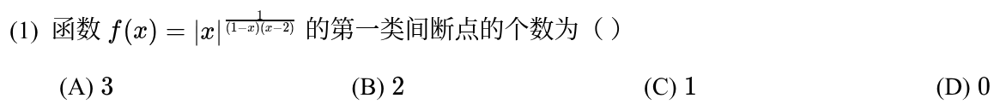
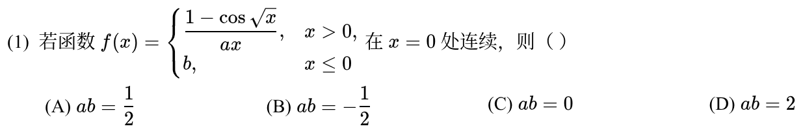

[« 数列极限与求和极限](02-sequences.md)　　[导数、微分与求导法则 »](04-derivatives.md)

# 高等数学 · 连续与间断点

> **本章共 6 题**
> 
> - **核心必做（建议按顺序攻克关键方法）**：  
>   [第 04 题](#q04)（连续条件定参数） → [第 03 题](#q03)（逐处分段接缝） → [第 06 题](#q06)（约分后仍查定义域）
> 
> - **分流与刷题建议**：  
>   - **较难挑战**：[第 01 题](#q01)（幂指函数左右极限）、[第 02 题](#q02)（逐个筛查奇点）  
>   - **重在看思路**：[第 05 题](#q05)（极限定义函数仍须查定义域）  
> 
> - **过关目标**：每个疑点都列左右极限与函数值，再判间断点类别。

---

### 01 · 2024年

> *幂指函数间断点。底数有绝对值，先看无定义的点 $x=0, 1, 2$。分别求各点处的左右极限，只有左右极限都存在且不等的才是第一类间断点。*

答案与解析

**答案**：**（C）** $1$

- **切入点与推演**：将函数改写为指数形式 $f(x)=\exp\left(\dfrac{\ln|x|}{(1-x)(x-2)}\right)$，无定义点（间断点候选）为 $x=0,\ 1,\ 2$。逐点求左右极限分类：
  - **$x=0$**：当 $x\to 0$ 时，$\ln|x|\to -\infty$，分母 $(1-x)(x-2)\to -2$，故指数趋于 $+\infty$，从而 $\lim\limits_{x\to 0}f(x)=+\infty$，为**第二类（无穷）间断点**。
  - **$x=1$**：当 $x\to 1$ 时，$\ln|x|=\ln\bigl(1+(x-1)\bigr)\sim x-1$，故指数极限为
    $$\lim_{x\to 1}\frac{\ln|x|}{(1-x)(x-2)} = \lim_{x\to 1}\frac{x-1}{-(x-1)(x-2)} = 1,$$
    从而 $\lim\limits_{x\to 1}f(x)=e$，左右极限存在且相等，为**第一类（可去）间断点**。
  - **$x=2$**：分子 $\ln|x|\to\ln 2>0$，而分母 $(1-x)(x-2)$ 在 $x\to 2^-$ 时趋于 $0^+$（指数 $\to +\infty$，$f(x)\to +\infty$），在 $x\to 2^+$ 时趋于 $0^-$（指数 $\to -\infty$，$f(x)\to 0$），为**第二类（无穷）间断点**。

  综上，第一类间断点仅有 $x=1$ 这 $1$ 个，选 **（C）**。
- **干扰项 / 易错提示**：第一类间断点要求**左、右极限均存在且有限**；$x=2$ 处虽右极限有限（为 $0$），但左极限为 $+\infty$，仍属第二类间断点。

---

### 02 · 2020年

> *第二类间断点判别。令分母为 0 找出疑点 $x=0, 1, 2$ 以及 $\ln|1+x|$ 的未定义点 $x=-1$。只要单侧极限是无穷大或振荡就归为第二类，逐个排查别漏点。*

答案与解析

**答案**：**（C）** $3$ 个

- **切入点与推演**：函数的无定义点（间断点候选）为 $x=-1,\ 0,\ 1,\ 2$，逐点分析极限：
  - **$x=-1$**：$\ln|1+x|\to -\infty$，其余因子趋于非零常数 $\dfrac{e^{-\frac{1}{2}}}{(e^{-1}-1)(-3)}$，故 $|f(x)|\to +\infty$，属**第二类（无穷）间断点**。
  - **$x=0$**：由 $\ln|1+x|\sim x$、$e^x-1\sim x$，得
    $$\lim_{x\to 0}f(x) = \lim_{x\to 0}\frac{e^{\frac{1}{x-1}}}{x-2}\cdot\frac{\ln|1+x|}{e^x-1} = \frac{e^{-1}}{-2}\cdot 1 = -\frac{1}{2e},$$
    左右极限存在且相等，属**第一类（可去）间断点**。
  - **$x=1$**：当 $x\to 1^+$ 时，$e^{\frac{1}{x-1}}\to +\infty$，其余因子趋于 $\dfrac{\ln 2}{(e-1)(-1)}<0$，故 $f(x)\to -\infty$（而 $x\to 1^-$ 时 $f(x)\to 0$），属**第二类（无穷）间断点**。
  - **$x=2$**：分母 $x-2\to 0$，而分子与 $e^x-1$ 均趋于非零常数，故 $|f(x)|\to +\infty$，属**第二类（无穷）间断点**。

  综上，第二类间断点有 $x=-1,\ 1,\ 2$ 共 $3$ 个，选 **（C）**。
- **干扰项 / 易错提示**：$e^{\frac{1}{x-1}}$ 在 $x=1$ 处单侧趋于 $0$、另一侧趋于 $+\infty$，极易被误判为跳跃间断点——只要有一侧极限不存在（含趋于 $\infty$），就是第二类间断点。

---

### 03 · 2018年

答案与解析

**答案**：**（D）** $a=-3,\ b=2$

- **切入点与推演**：先将 $h(x)=f(x)+g(x)$ 按分界点 $x=-1,\ 0$ 合并写出完整分段表达式：
  $$h(x) = f(x) + g(x) = \begin{cases} 1 - ax, & x \le -1, \\ x - 1, & -1 < x < 0, \\ x + 1 - b, & x \ge 0. \end{cases}$$
  各开区间内均为初等函数且连续，故 $h(x)$ 在 $\mathbb{R}$ 上连续当且仅当在 $x=-1$ 与 $x=0$ 处均连续：
  1. 在 $x=-1$ 处：$h(-1^-) = h(-1) = 1+a$，$h(-1^+) = -2$，故 $1+a = -2 \implies a = -3$；
  2. 在 $x=0$ 处：$h(0^-) = -1$，$h(0^+) = h(0) = 1-b$，故 $1-b = -1 \implies b = 2$。

  因此 $a=-3,\ b=2$，选 **（D）**。
- **干扰项 / 易错提示**：切忌分别要求 $f(x)$ 与 $g(x)$ 各自连续——$f(x)$ 在 $x=0$ 本身有跳跃，必须合并为 $h(x)$ 后用 $g(x)$ 的跳跃将其抵消；计算 $1-ax$ 在 $x=-1$ 处的值时注意负负得正。

---

### 04 · 2017年

答案与解析

**第一步与完整推演**

- **触发条件**：分段函数在分界点 $x=0$ 处连续，且 $x>0$ 支含分母 $ax$（故隐含 $a\neq 0$）。
- **第一步落笔**：写出 $x=0$ 处的左极限、函数值与右极限：
  - 左侧及点值（对应 $x\le 0$ 支）：
    $$\lim_{x\to 0^-} f(x) = f(0) = b.$$
  - 右侧极限（对应 $x>0$ 支，利用 $1-\cos\sqrt{x} \sim \frac{1}{2}(\sqrt{x})^2 = \frac{1}{2}x$）：
    $$\lim_{x\to 0^+} f(x) = \lim_{x\to 0^+} \frac{1-\cos\sqrt{x}}{ax} = \lim_{x\to 0^+} \frac{\frac{1}{2}x}{ax} = \frac{1}{2a}.$$
- **闭合连续条件**：由 $\lim_{x\to 0^+} f(x) = \lim_{x\to 0^-} f(x) = f(0)$，得
  $$\frac{1}{2a} = b \iff ab = \frac{1}{2}.$$
  故选 **（A）**。

**选择题关键干扰项拆解**

- **（B）$ab = -\frac{1}{2}$**：把 $1-\cos u\sim \frac{1}{2}u^2$ 的正负号记反（与 $\cos u - 1 \sim -\frac{1}{2}u^2$ 混淆）。
- **（C）$ab = 0$**：误以为分子 $1-\cos\sqrt{x}$ 是 $x$ 的高阶无穷小，错算出右极限为 $0$ 从而得 $b=0$。
- **（D）$ab = 2$**：把 $1-\cos u\sim \frac{1}{2}u^2$ 的系数 $\frac{1}{2}$ 记成 $2$，或把 $\frac{1}{2a}=b$ 移项出错。

---

### 05 · 2015年

答案与解析

**答案**：**（B）** 有可去间断点

- **切入点与推演**：先求 $f(x)$ 的显式表达式与定义域。
  - 当 $x\ne 0$ 时，固定 $x$ 令 $t\to 0$，原极限为 $1^\infty$ 型：
    $$f(x) = \lim_{t\to 0}\left(1+\frac{\sin t}{x}\right)^{\frac{x^2}{t}} = \exp\left(\lim_{t\to 0}\frac{x^2}{t}\cdot\frac{\sin t}{x}\right) = \exp\left(\lim_{t\to 0} x\cdot\frac{\sin t}{t}\right) = e^x.$$
  - 当 $x=0$ 时，表达式中分母 $\dfrac{\sin t}{x}$ 无意义，故 $x=0$ 不在 $f(x)$ 的定义域内。

  考察间断点 $x=0$ 处的极限：
  $$\lim_{x\to 0}f(x) = \lim_{x\to 0}e^x = 1,$$
  左右极限存在且相等，故 $x=0$ 为可去间断点，选 **（B）**。
- **干扰项 / 易错提示**：切勿因为算出的化简式 $e^x$ 在 $x=0$ 有定义就误选（A）连续——原函数在 $x=0$ 处本身无定义，定义域缺失点只要两侧有限极限相等就是可去间断点。

---

### 06 · 2010年

答案与解析

**答案**：**（B）** $1$

- **切入点与推演**：函数的无定义点（间断点候选）为 $x=-1,\ 0,\ 1$。在定义域内化简表达式（注意 $\sqrt{x^2}=|x|$）：
  $$f(x) = \frac{x(x-1)}{(x-1)(x+1)}\cdot\frac{\sqrt{x^2+1}}{|x|} = \frac{x}{|x|}\cdot\frac{\sqrt{x^2+1}}{x+1}.$$
  逐点判定间断点类型：
  - **$x=1$**：$\lim\limits_{x\to 1}f(x) = 1\cdot\dfrac{\sqrt{2}}{2} = \dfrac{\sqrt{2}}{2}$，为**可去间断点**；
  - **$x=0$**：$\lim\limits_{x\to 0^+}f(x) = 1$，$\lim\limits_{x\to 0^-}f(x) = -1$，为**跳跃间断点**；
  - **$x=-1$**：分子趋于 $-\sqrt{2}\ne 0$，分母 $x+1\to 0$，故 $\lim\limits_{x\to -1}|f(x)| = +\infty$，为**无穷间断点**。

  综上，无穷间断点仅有 $x=-1$ 这 $1$ 个，选 **（B）**。
- **干扰项 / 易错提示**：根号 $\sqrt{1+\frac{1}{x^2}}=\frac{\sqrt{x^2+1}}{|x|}$ 提出分母时必须带绝对值 $|x|$，若漏写绝对值直接约去 $x$ 会把 $x=0$ 误判为可去间断点（虽不影响本题无穷间断点计数，但会影响第一类/跳跃间断点判断）。

---

[« 数列极限与求和极限](02-sequences.md)　　[导数、微分与求导法则 »](04-derivatives.md)
