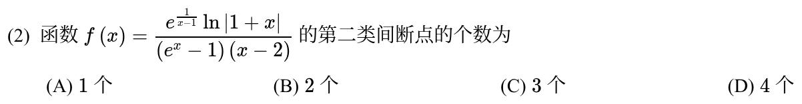
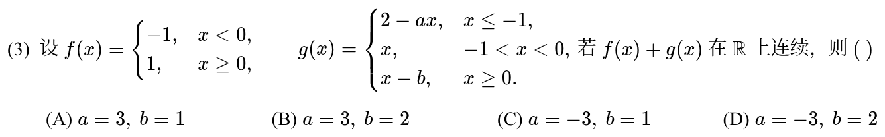
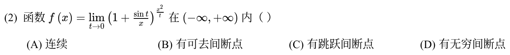
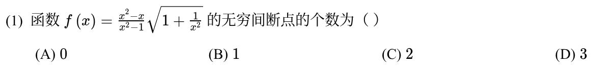

[« 数列极限与求和极限](02-sequences.md)　　[导数、微分与求导法则 »](04-derivatives.md)

# 高等数学 · 连续与间断点

> **本章共 6 题**
> 
> - **核心必做（建议按顺序攻克关键方法）**：  
>   [第 04 题](#q04)（连续条件定参数） → [第 03 题](#q03)（逐处分段接缝） → [第 06 题](#q06)（约分后仍查定义域）
> 
> - **分流与刷题建议**：  
>   - **较难挑战**：[第 01 题](#q01)（幂指函数左右极限）、[第 02 题](#q02)（逐个筛查奇点）  
>   - **重在看思路**：[第 05 题](#q05)（极限定义函数仍须查定义域）  
> 
> - **过关目标**：每个疑点都列左右极限与函数值，再判间断点类别。

---

### 01 · 2024年

> *幂指函数间断点。底数有绝对值，先看无定义的点 $x=0, 1, 2$。分别求各点处的左右极限，只有左右极限都存在且不等的才是第一类间断点。*

答案与解析

**答案 C，1 个。** 在 $x=0$，指数趋于 $-1/2$，函数趋于无穷大。在 $x=1$，把 $\ln |x|$ 除以 $(1-x)(x-2)$，比值趋于 1，故两侧均趋于 $e$，是可去间断点。在 $x=2$，分子趋于 $\ln 2$、分母变号，两侧分别趋于无穷大与 0，属于第二类。只计左右有限极限均存在的点。

---

### 02 · 2020年

> *第二类间断点判别。令分母为 0 找出疑点 $x=0, 1, 2$ 以及 $\ln|1+x|$ 的未定义点 $x=-1$。只要单侧极限是无穷大或振荡就归为第二类，逐个排查别漏点。*

答案与解析

**答案 C，3 个。** 奇点候选为 $-1,0,1,2$。在 $0$ 有 $\ln|1+x|/(e^x-1)\to1$，其余因子给有限极限，是可去间断点。$-1$ 处对数发散，$1$ 处指数的右极限无穷，$2$ 处有未抵消的极点，均属第二类。

---

### 03 · 2018年

答案与解析

- **第一步（先合并写出 $h(x) = f(x)+g(x)$ 的分段表达式）**：不要分别对 $f$ 和 $g$ 单独讨论（$f$ 在 $0$ 处本来就间断，靠 $g$ 的跳跃抵消掉）：
  $$h(x) = f(x)+g(x) = \begin{cases} 1 - ax, & x \le -1, \\ x - 1, & -1 < x < 0, \\ x + 1 - b, & x \ge 0. \end{cases}$$
- **逐个检查两个分段点**：
  1. 在 $x=-1$ 处连续：$h(-1^-) = h(-1) = 1 + a$，$h(-1^+) = -2 \implies 1+a = -2 \implies a = -3$；
  2. 在 $x=0$ 处连续：$h(0^-) = -1$，$h(0^+) = h(0) = 1 - b \implies 1-b = -1 \implies b = 2$。
- **答案**：**（D）** $a = -3,\ b = 2$。

---

### 04 · 2017年

答案与解析

**第一步与完整推演**

- **触发条件**：分段函数在分界点 $x=0$ 处连续，且 $x>0$ 支含分母 $ax$（故隐含 $a\neq 0$）。
- **第一步落笔**：写出 $x=0$ 处的左极限、函数值与右极限：
  - 左侧及点值（对应 $x\le 0$ 支）：
    $$\lim_{x\to 0^-} f(x) = f(0) = b.$$
  - 右侧极限（对应 $x>0$ 支，利用 $1-\cos\sqrt{x} \sim \frac{1}{2}(\sqrt{x})^2 = \frac{1}{2}x$）：
    $$\lim_{x\to 0^+} f(x) = \lim_{x\to 0^+} \frac{1-\cos\sqrt{x}}{ax} = \lim_{x\to 0^+} \frac{\frac{1}{2}x}{ax} = \frac{1}{2a}.$$
- **闭合连续条件**：由 $\lim_{x\to 0^+} f(x) = \lim_{x\to 0^-} f(x) = f(0)$，得
  $$\frac{1}{2a} = b \iff ab = \frac{1}{2}.$$
  故选 **（A）**。

**选择题关键干扰项拆解**

- **（B）$ab = -\frac{1}{2}$**：把 $1-\cos u\sim \frac{1}{2}u^2$ 的正负号记反（与 $\cos u - 1 \sim -\frac{1}{2}u^2$ 混淆）。
- **（C）$ab = 0$**：误以为分子 $1-\cos\sqrt{x}$ 是 $x$ 的高阶无穷小，错算出右极限为 $0$ 从而得 $b=0$。
- **（D）$ab = 2$**：把 $1-\cos u\sim \frac{1}{2}u^2$ 的系数 $\frac{1}{2}$ 记成 $2$，或把 $\frac{1}{2a}=b$ 移项出错。

---

### 05 · 2015年

答案与解析

**答案 B。** 对 $x\ne0$ 固定 $x$，取对数可得 $(x^2/t)\ln(1+\sin t/x)\to x$，故 $f(x)=e^x$。原式在 $x=0$ 无定义，两侧极限均为 1，故为可去间断点。

---

### 06 · 2010年

答案与解析

**答案 B，1 个。** 在定义域内化简为 $\frac{\operatorname{sgn}(x)\sqrt{1+x^2}}{x+1}$。$x=1$ 两侧有限同极限，为可去间断点；$x=0$ 左右分别趋 $-1,1$，为跳跃间断点；仅 $x=-1$ 是无穷间断点。

---

[« 数列极限与求和极限](02-sequences.md)　　[导数、微分与求导法则 »](04-derivatives.md)
