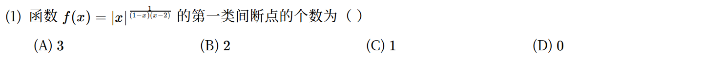
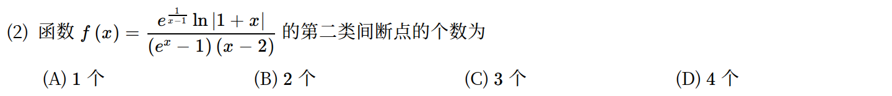
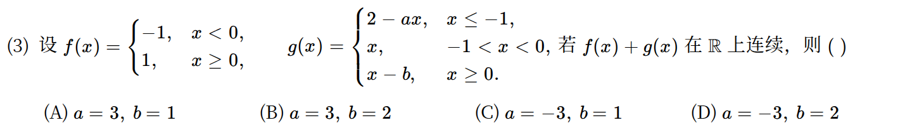
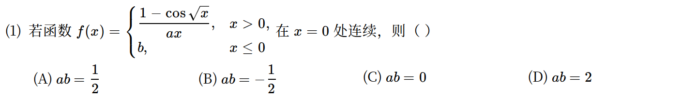
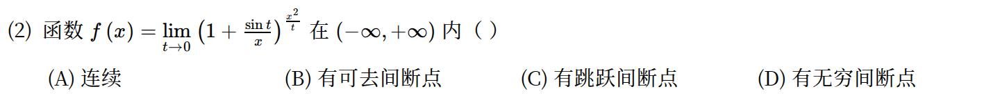
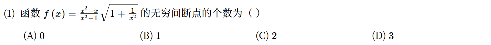

# 高等数学 · 连续与间断点

> 2010—2026年 · 6 道完整真题 · 年份从新到旧（2026→2010）  
> 题型分布：选择题 6 题 · 填空题 0 题 · 解答题 0 题  
> 考查范围：连续条件、分段函数连续性、间断点类型

[查看对应网页版](03-continuity.html) · [返回章节总目录](../README.md)

---

## 2024年

### 01 · 2024-01 · 选择题

> *幂指函数间断点。底数有绝对值，先看无定义的点 $x=0, 1, 2$。分别求各点处的左右极限，只有左右极限都存在且不等的才是第一类间断点。*

---

## 2020年

### 02 · 2020-02 · 选择题

> *第二类间断点判别。令分母为 0 找出疑点 $x=0, 1, 2$ 以及 $\ln|1+x|$ 的未定义点 $x=-1$。只要单侧极限是无穷大或振荡就归为第二类，逐个排查别漏点。*

---

## 2018年

### 03 · 2018-03 · 选择题

---

## 2017年

### 04 · 2017-01 · 选择题

---

## 2015年

### 05 · 2015-02 · 选择题

*关联章节：[函数极限与无穷小](01-limits.md) · [导数、微分与求导法则](04-derivatives.md)*

---

## 2010年

### 06 · 2010-01 · 选择题

---

## 交叉考点索引

以下题目主归其他章节，点击跳转到对应章节题目；不计入本章主收录题数：

- [2026年 · 第18题](11-definite-integrals.md)（主章节：定积分、变上限积分与积分性质）
- [2021年 · 第2题](04-derivatives.md)（主章节：导数、微分与求导法则）
- [2020年 · 第16题](11-definite-integrals.md)（主章节：定积分、变上限积分与积分性质）
- [2016年 · 第2题](10-antiderivatives.md)（主章节：不定积分与原函数）
- [2015年 · 第3题](04-derivatives.md)（主章节：导数、微分与求导法则）
- [2013年 · 第3题](11-definite-integrals.md)（主章节：定积分、变上限积分与积分性质）
