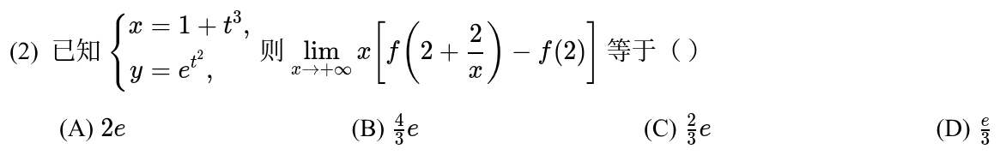
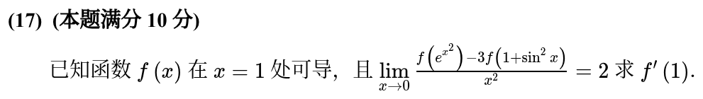
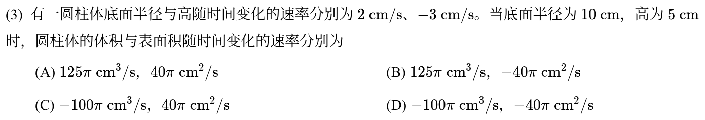
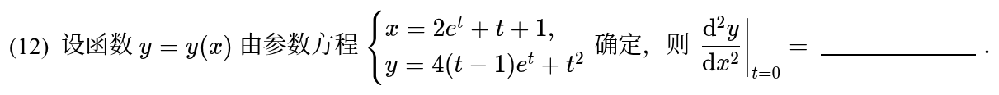
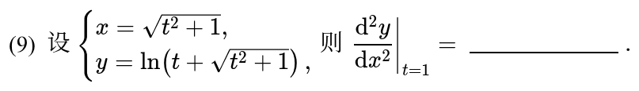
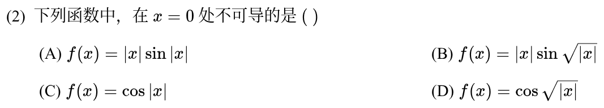
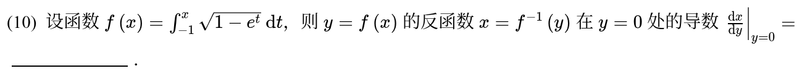
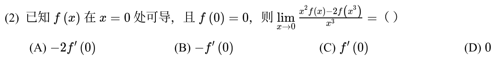

[« 连续与间断点](03-continuity.md)　　[中值定理、零点与不等式证明 »](05-mean-value-proofs.md)

# 高等数学 · 导数、微分与求导法则

> **本章共 23 题**
> 
> - **核心必做（建议按顺序攻克关键方法）**：  
>   [第 22 题](#q22)（导数定义认极限） → [第 09 题](#q09)（分段点从定义求导） → [第 14 题](#q14)（参数方程二阶导） → [第 07 题](#q07)（隐函数连求两次导） → [第 01 题](#q01)（变上限与反函数求导）
> 
> - **分流与刷题建议**：  
>   - **较难挑战**：[第 04 题](#q04)（由极限反推可导）、[第 10 题](#q10)（相关变化率列式）  
>   - **重在看思路**：[第 06 题](#q06)（含绝对值的参数曲线光滑性）  
>   - **首轮可跳过**：[第 16 题](#q16)（技巧较偏或综合度高，首轮不必死磕）  
> 
> - **过关目标**：分清对谁求导；二阶参数导数还要再除一次横坐标的导数。

---

### 01 · 2026年

答案与解析

- **第一步（找准原函数与反函数的对应点）**：令积分上限等于下限，即 $x^3 = 1 \implies x = 1$，此时 $f(1) = \int_1^1 \frac{e^t}{1+t^2}\,dt = 0$。由反函数定义立刻得 $g(0) = 1$（先排除 C、D）。
- **第二步（变上限积分求导，勿漏乘上限导数 $3x^2$）**：
  $$f'(x) = \frac{e^{x^3}}{1 + x^6}\cdot (x^3)' = \frac{3x^2 e^{x^3}}{1 + x^6}.$$
  代入 $x = 1$ 得 $f'(1) = \frac{3e}{2} \neq 0$。
- **第三步（反函数求导公式）**：
  $$g'(0) = \frac{1}{f'(g(0))} = \frac{1}{f'(1)} = \frac{2}{3e}.$$
- **答案**：**（B）**（干扰项 A 忘记取倒数，C/D 把 $f(1)=0$ 错写成 $g(1)=0$）。

---

### 02 · 2025年

答案与解析

**答案 D，四个条件都足够。** ② 迫使 $f(0)=|f(0)|$，原比值就是导数定义。① 同样迫使 $f(0)\ge0$，因而可转入④。③ 迫使 $f(0)=0$，也转入④。对④，若 $f(0)\ne0$，连续性保证邻域内符号固定，导数只是所给极限乘一个固定符号；若 $f(0)=0$，绝对值比值在左右异号，公共极限只能为 0，又 $|f(x)/x|=||f(x)|/x|$，故 $f'(0)=0$。

---

### 03 · 2025年

答案与解析

**答案 $e$。** $x=0$ 对应 $t=0$，由积分为零和被积函数严格正知 $y=1$。对第二式求导得 $2=e^{-(y+t^2)^2}(dy/dt+2t)$，故 $dy/dt=2e$。再除以 $dx/dt=2$（在 $t=0$），得 $dy/dx=e$。

---

### 04 · 2025年

> *导数定义综合大题。条件是极限，分母用泰勒展开化简为 $-x^2$。先由极限存在推分子为 0 得 $f(0)$，再凑导数定义极限式求 $f'(0)$。*

答案与解析

**解。** 分母 $\ln(1-x^2)=-x^2+o(x^2)$，而 $e^{2\sin x}=1+2x+2x^2+o(x^2)$，故 $xf(x)-2x-2x^2=3x^2+o(x^2)$。除以 $x$ 得 $f(x)=2+5x+o(x)$。连续性先定出 $f(0)=2$，再取导数定义得 $f'(0)=5$。

---

### 05 · 2024年

答案与解析

- **第一步（把无穷远极限化成导数定义）**：令 $h = \frac{2}{x}$，则 $x\to +\infty$ 时 $h\to 0^+$，且 $x = \frac{2}{h}$，于是
  $$\lim_{x\to +\infty} x\left[f\!\left(2+\frac{2}{x}\right) - f(2)\right] = 2\lim_{h\to 0^+}\frac{f(2+h) - f(2)}{h} = 2f'(2).$$
- **第二步（参数方程反解 $t_0$ 并求一阶导）**：由 $x = 1 + t^3 = 2$ 得唯一实根 $t = 1$；参数方程一阶导数为
  $$f'(x) = \frac{dy/dt}{dx/dt} = \frac{2t e^{t^2}}{3t^2} = \frac{2e^{t^2}}{3t}.$$
  代入 $t = 1$ 得 $f'(2) = \frac{2}{3}e$。
- **第三步（乘回系数 $2$）**：$2f'(2) = \frac{4}{3}e$。
- **答案**：**（B）**（干扰项 C 漏乘了系数 $2$，D 算错 $y'(t)$ 漏了 $2t$ 的因子 $2$）。

---

### 06 · 2023年

答案与解析

**答案 C。** 在 $x<0$ 侧 $t=x$、$f(x)=-x\sin x$，在 $x\ge0$ 侧 $t=x/3$、$f(x)=(x/3)\sin(x/3)$。两侧 $f'(x)\to0=f'(0)$，但 $(f'(x)-f'(0))/x$ 的左右极限分别为 $-2,2/9$，故二阶导不存在。

---

### 07 · 2022年

答案与解析

**第一步与完整推演**

- **触发条件**：隐函数方程 $x^2 + xy + y^3 = 3$，只求 $x=1$ 处的二阶导数 $y''(1)$。
- **第一步落笔（定 $y(1)$）**：将 $x=1$ 代入原方程，得
  $$1 + y + y^3 = 3 \iff y^3 + y - 2 = 0 \iff (y-1)(y^2+y+2) = 0.$$
  因为 $y^2 + y + 2 = \left(y+\frac{1}{2}\right)^2 + \frac{7}{4} > 0$，故有唯一实根 $y(1) = 1$（且 $F_y(1,1) = 1 + 3\cdot 1^2 = 4 \neq 0$，局部光滑隐函数存在）。
- **第二步（两边对 $x$ 求导一次，立刻代点）**：
  $$2x + y + xy' + 3y^2 y' = 0.$$
  代入 $x=1,\ y=1$：
  $$2 + 1 + y'(1) + 3y'(1) = 0 \implies 4y'(1) = -3 \implies y'(1) = -\frac{3}{4}.$$
- **第三步（对一阶导方程再对 $x$ 求导，立刻代点）**：
  $$2 + y' + y' + xy'' + 6y(y')^2 + 3y^2 y'' = 0,$$
  即
  $$2 + 2y' + 6y(y')^2 + (x + 3y^2)y'' = 0.$$
  代入 $x=1,\ y=1,\ y'(1) = -\frac{3}{4}$：
  $$2 + 2\left(-\frac{3}{4}\right) + 6\cdot 1\cdot\left(-\frac{3}{4}\right)^2 + (1 + 3)y''(1) = 0.$$
  逐项通分计算：
  $$2 - \frac{3}{2} + \frac{27}{8} + 4y''(1) = 0 \implies \frac{4}{8} + \frac{27}{8} + 4y''(1) = 0 \implies \frac{31}{8} + 4y''(1) = 0,$$
  解得
  $$y''(1) = -\frac{31}{32}.$$

---

### 08 · 2022年

> *抽象可导函数极限反推导数。把要求的极限式凑成导数定义形式，配凑出 $\frac{f(1+x)-f(1)}{x}$ 与 $\frac{f(1-x)-f(1)}{-x}$ 的线性组合。*

答案与解析

**答案 $f'(1)=-1$。** 有限极限先迫使分子趋零，即 $-2f(1)=0$。用可导展开 $f(1+h)=f'(1)h+o(h)$，而 $e^{x^2}-1\sim x^2$、$\sin^2x\sim x^2$，原极限等于 $-2f'(1)$。

---

### 09 · 2021年

答案与解析

**第一步与完整推演**

- **触发条件**：$x=0$ 为单独补定义的点，且选项同时区分“连续取极值”与“可导且导数是否为 $0$”，最直接的入口就是先验连续再算 $f'(0)$。
- **第一步落笔**：
  1. **核对连续性**：
     $$\lim_{x\to 0} f(x) = \lim_{x\to 0}\frac{e^x - 1}{x} = 1 = f(0),$$
     故 $f(x)$ 在 $x=0$ 处连续。
  2. **按导数定义算 $f'(0)$**：
     $$f'(0) = \lim_{x\to 0}\frac{f(x) - f(0)}{x - 0} = \lim_{x\to 0}\frac{\frac{e^x - 1}{x} - 1}{x} = \lim_{x\to 0}\frac{e^x - 1 - x}{x^2}.$$
     由泰勒展开 $e^x = 1 + x + \frac{1}{2}x^2 + o(x^2)$（或一次洛必达），得
     $$f'(0) = \lim_{x\to 0}\frac{\frac{1}{2}x^2 + o(x^2)}{x^2} = \frac{1}{2} \neq 0.$$
- **收尾结论**：$f(x)$ 在 $x=0$ 处可导，且 $f'(0) = \frac{1}{2} \neq 0$，选 **（D）**。

**选择题关键干扰项拆解**

- **（C）可导且导数为 $0$**：在差商 $\frac{\frac{e^x-1}{x}-1}{x}$ 中误把 $e^x-1$ 局部等价替换成 $x$，得出分子恒为 $0$，抹掉了关键的二阶项 $\frac{1}{2}x^2$。
- **（A）（B）连续且取极大/极小值**：既然 $f'(0) = \frac{1}{2} > 0$，由导数保号性知 $x=0$ 右侧 $f(x)>f(0)$、左侧 $f(x)<f(0)$，既非极大值也非极小值（也直接违背费马引理“可导极值点必有 $f'(0)=0$”）。

---

### 10 · 2021年

答案与解析

**答案 C。** $V'=\pi(2rr'h+r^2h')=(200-300)\pi=-100\pi$。总表面积 $S=2\pi r^2+2\pi rh$，故 $S'=2\pi(2rr'+r'h+rh')=40\pi$。漏掉两端底面会改变表面积变化率。

---

### 11 · 2021年

答案与解析

**答案 $2/3$。** 记点表示对 $t$ 求导。$y''(x)=(\ddot y\dot x-\dot y\ddot x)/(\dot x)^3$。在 $t=0$，$\dot x=3,\dot y=0,\ddot y=6$，故 $y''=6/9$。第二次求导仍要再除一次 $\dot x$。

---

### 12 · 2020年

答案与解析

**答案 $-\sqrt2$。** $\dot x=t/\sqrt{1+t^2}$、$\dot y=1/\sqrt{1+t^2}$，所以 $dy/dx=1/t$。再对 $t$ 求导并除以 $\dot x$，得 $-\sqrt{1+t^2}/t^3$，代 $t=1$。

---

### 13 · 2018年

答案与解析

**答案 D。** 在原点，A、B 的函数值分别是 $O(x^2),O(|x|^{3/2})$，差商都趋于 0。C 等同于 $\cos x$。D 则有 $\cos\sqrt{|x|}-1=-|x|/2+o(|x|)$，左右差商分别为 $1/2,-1/2$。

---

### 14 · 2017年

答案与解析

**第一步与完整推演**

- **触发条件**：给定参数方程 $x=t+e^t,\ y=\sin t$，求 $t=0$ 处的二阶导数。
- **第一步落笔**：先算一阶导数（$x'(t) = 1 + e^t > 0$ 处处非零）：
  $$\frac{dy}{dx} = \frac{y'(t)}{x'(t)} = \frac{\cos t}{1 + e^t}.$$
- **再对 $x$ 求导（务必再除以 $x'(t)$）**：
  $$\begin{aligned}
  \frac{d^2y}{dx^2} &= \frac{d}{dt}\!\left(\frac{\cos t}{1 + e^t}\right)\cdot\frac{1}{x'(t)} \\
  &= \frac{-\sin t(1 + e^t) - \cos t \cdot e^t}{(1 + e^t)^2} \cdot \frac{1}{1 + e^t} \\
  &= \frac{-\sin t(1 + e^t) - e^t\cos t}{(1 + e^t)^3}.
  \end{aligned}$$
- **代入 $t = 0$**：
  $$\left.\frac{d^2y}{dx^2}\right|_{t=0} = \frac{0 - 1 \cdot 1}{(1 + 1)^3} = -\frac{1}{8}.$$

> **常见失误提醒**：如果漏乘最后的 $\frac{1}{x'(t)}$，会算出 $-\frac{1}{4}$，恰好差一个因子 $x'(0)=2$。

---

### 15 · 2016年

答案与解析

**答案 $2\sqrt2\,v_0$。** $l^2=x^2+x^6$，对时间求导得 $2ll'=(2x+6x^5)v_0$。代 $x=1,l=\sqrt2$ 得结果。

---

### 16 · 2015年

答案与解析

**答案 A。** 右侧有 $f'(x)=\alpha x^{\alpha-1}\cos(x^{-\beta})+\beta x^{\alpha-\beta-1}\sin(x^{-\beta})$。若 $f'$ 在 0 连续，极限应为 0。沿 $\sin(x^{-\beta})=1$ 的趋零点列，第一项为零，迫使 $\alpha-\beta>1$。反过来此条件使两项趋零，且保证 $f'(0)=0$。备选项中只有 A 对所有这样的参数成立。

---

### 17 · 2015年

答案与解析

**答案 $40$。** $\frac{dy}{dx}=(3t^2+1)(1+t^2)$，对 $t$ 再求导在 $t=1$ 得 20。除以该点 $\frac{dx}{dt}=1/2$，得二阶导数 40。

---

### 18 · 2013年

答案与解析

**答案 A，$2$。** $f(0)=1$，隐式求导在 $(0,1)$ 给 $-f'(0)+1=0$。于是 $n[f(2/n)-1]=2[f(2/n)-f(0)]/(2/n)\to2f'(0)=2$。

---

### 19 · 2013年

答案与解析

**答案 $(1-e^{-1})^{-1/2}$。** $f(-1)=0$，$f'(-1)=\sqrt{1-e^{-1}}>0$。反函数导数是在原像 $x=-1$ 处的导数倒数。

---

### 20 · 2012年

答案与解析

**答案 A。** 第一个因子在 0 取值为 0，所以乘积求导后，只有导在第一个因子的项留下。其值为 $1\cdot(1-2)\cdots(1-n)=(-1)^{n-1}(n-1)!$。

---

### 21 · 2012年

答案与解析

**答案 $1$。** $x=0$ 时 $e^y+y=1$，唯一解 $y=0$。求导得 $2x=(1+e^y)y'$，再导得 $2=(1+e^y)y''+e^y(y')^2$，在该点 $y'=0$，所以 $y''=1$。

---

### 22 · 2011年

答案与解析

**第一步与完整推演**

- **触发条件**：已知 $f(x)$ 仅在 $x=0$ 处可导且 $f(0)=0$，分子两项分别为 $x^2 f(x)$ 与 $-2f(x^3)$，除以分母 $x^3$ 后恰好各自配成一阶差商。
- **第一步落笔**：按分母 $x^3$ 拆分两项并补出 $f(0)=0$：
  $$\frac{x^2 f(x) - 2f(x^3)}{x^3} = \frac{f(x) - f(0)}{x - 0} - 2\cdot\frac{f(x^3) - f(0)}{x^3 - 0}.$$
- **取极限收尾**：当 $x\to 0$ 时，对第二项令 $h = x^3$，有 $h\to 0$ 且 $x\neq 0 \implies h\neq 0$，由导数定义得
  $$\lim_{x\to 0}\frac{f(x)-f(0)}{x} = f'(0), \qquad \lim_{x\to 0}\frac{f(x^3)-f(0)}{x^3} = \lim_{h\to 0}\frac{f(h)-f(0)}{h} = f'(0).$$
  两项极限均存在，故
  $$\lim_{x\to 0}\frac{x^2 f(x) - 2f(x^3)}{x^3} = f'(0) - 2f'(0) = -f'(0).$$
  选 **（B）**。

> **选择题交叉检验**：取特例 $f(x) = x$（满足在 $0$ 处可导、$f(0)=0$、$f'(0)=1$），原式 $= \frac{x^3 - 2x^3}{x^3} = -1 = -f'(0)$，可迅速交叉核对（但不能用特例替代上面的一般证明）。

**选择题关键干扰项拆解**

- **（A）$-2f'(0)$**：只算了第二项，把第一项 $\frac{x^2 f(x)}{x^3} = \frac{f(x)}{x}$ 漏算或错当成 $0$。
- **（C）$f'(0)$**：丢掉第二项前面的系数 $2$ 或正负号算反。
- **（D）$0$**：对 $f(x^3)$ 误用洛必达漏写链式因子 $3x^2$，或误把 $f(x^3)$ 当成 $x^3$ 的高阶无穷小。

---

### 23 · 2010年

答案与解析

**答案 $3\ \mathrm{cm/s}$。** 对角线 $d$ 满足 $d^2=l^2+w^2$，故 $d'=(ll'+ww')/d=(12\cdot2+5\cdot3)/13=3$。

---

[« 连续与间断点](03-continuity.md)　　[中值定理、零点与不等式证明 »](05-mean-value-proofs.md)
