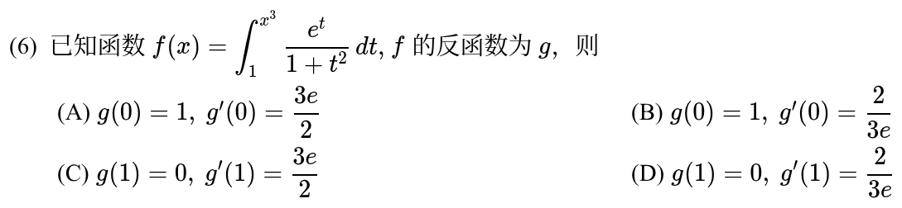
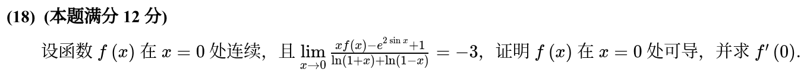
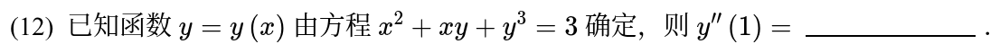
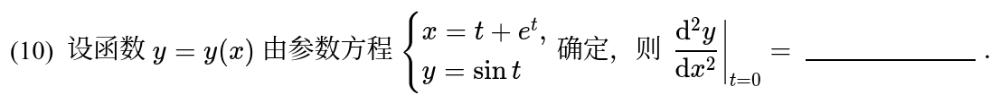
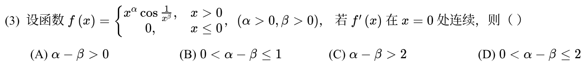
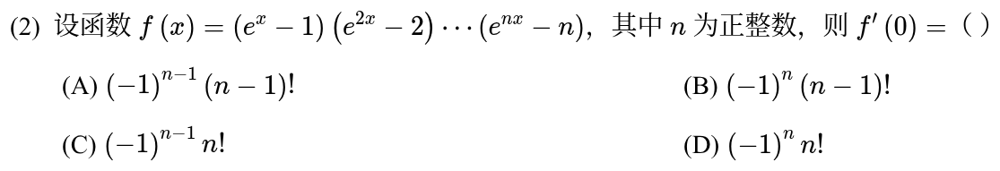
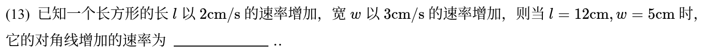

[« 连续与间断点](03-continuity.md)　　[中值定理、零点与不等式证明 »](05-mean-value-proofs.md)

# 高等数学 · 导数、微分与求导法则

> **本章共 23 题**
> 
> - **核心必做（建议按顺序攻克关键方法）**：  
>   [第 22 题](#q22)（导数定义认极限） → [第 09 题](#q09)（分段点从定义求导） → [第 14 题](#q14)（参数方程二阶导） → [第 07 题](#q07)（隐函数连求两次导） → [第 01 题](#q01)（变上限与反函数求导）
> 
> - **分流与刷题建议**：  
>   - **较难挑战**：[第 04 题](#q04)（由极限反推可导）、[第 10 题](#q10)（相关变化率列式）  
>   - **重在看思路**：[第 06 题](#q06)（含绝对值的参数曲线光滑性）  
>   - **首轮可跳过**：[第 16 题](#q16)（技巧较偏或综合度高，首轮不必死磕）  
> 
> - **过关目标**：分清对谁求导；二阶参数导数还要再除一次横坐标的导数。

---

### 01 · 2026年

答案与解析

**答案**：**（B）** $g(0)=1,\ g'(0)=\dfrac{2}{3e}$

- **切入点与推演**：先确定原函数与反函数的对应点。令积分上限等于下限 $x^3=1$，得 $x=1$，此时
  $$f(1) = \int_1^1 \frac{e^t}{1+t^2}\,\mathrm{d}t = 0.$$
  由反函数定义立刻得 $g(0)=1$。再对变上限积分 $f(x)$ 求导（注意链式法则乘以上限导数 $3x^2$）：
  $$f'(x) = \frac{e^{x^3}}{1+x^6}\cdot(x^3)' = \frac{3x^2 e^{x^3}}{1+x^6}.$$
  代入 $x=1$ 得 $f'(1) = \dfrac{3e}{2} \ne 0$，由反函数求导公式得
  $$g'(0) = \frac{1}{f'\bigl(g(0)\bigr)} = \frac{1}{f'(1)} = \frac{2}{3e}.$$
  故选 **（B）**。
- **干扰项 / 易错提示**：选项（A）忘记对 $f'(1)$ 取倒数；选项（C）（D）把 $f(1)=0$ 错写成 $g(1)=0$，颠倒了原函数与反函数的自变量与因变量。

---

### 02 · 2025年

答案与解析

**答案**：**（D）** $4$

- **切入点与推演**：条件中已给出 $f(x)$ **连续**，这是关键前提（保证当 $f(0)\ne 0$ 时 $f(x)$ 在 $x=0$ 某邻域内局部保号）。逐条检验：
  - **② 充分**：极限存在且分母趋于 $0$，由 $f$ 连续知分子趋于 $f(0)-|f(0)|=0$，即 $|f(0)|=f(0)$，故原式直接就是 $\lim\limits_{x\to 0}\dfrac{f(x)-f(0)}{x}$，从而 $f'(0)$ 存在。
  - **④ 充分**：设 $\lim\limits_{x\to 0}\dfrac{|f(x)|-|f(0)|}{x}=A$。
    - 若 $f(0)>0$，由连续性在 $0$ 的某邻域内 $f(x)>0$，$|f(x)|=f(x)$，得 $f'(0)=A$；
    - 若 $f(0)<0$，由连续性在 $0$ 的某邻域内 $f(x)<0$，$|f(x)|=-f(x)$，得 $f'(0)=-A$；
    - 若 $f(0)=0$，则 $\lim\limits_{x\to 0}\dfrac{|f(x)|}{x}=A$。因 $x>0$ 时比值非负（$A\ge 0$），$x<0$ 时比值非正（$A\le 0$），故必有 $A=0$。进而
      $$\left|\frac{f(x)-f(0)}{x}\right| = \left|\frac{|f(x)|}{x}\right| \to 0 \implies f'(0)=0.$$
  - **① 充分**：由分母趋于 $0$ 与连续性得 $|f(0)|-f(0)=0$，即 $f(0)=|f(0)|$，条件 ① 化为条件 ④，故 $f'(0)$ 存在。
  - **③ 充分**：由分母趋于 $0$ 与连续性得 $|f(0)|=0$，即 $f(0)=0$，条件 ③ 化为条件 ④ 中 $f(0)=0$ 的情形，故 $f'(0)=0$ 存在。

  综上，四个条件均能推出 $f(x)$ 在 $x=0$ 处可导，选 **（D）**。
- **干扰项 / 易错提示**：若没有“$f(x)$ 连续”这一前提，条件 ④ 不能推出可导（如狄利克雷型函数取 $\pm 1$）；正是连续性提供的局部保号性，使得 $f(0)\ne 0$ 时绝对值可直接脱去。

---

### 03 · 2025年

答案与解析

**答案**：$e$

- **切入点与推演**：先定出 $x=0$ 对应的参数 $t$ 与函数值 $y$。由 $x=\ln(1+2t)=0$ 得 $t=0$，代入第二个方程得
  $$\int_1^y e^{-u^2}\,\mathrm{d}u = 0.$$
  因为被积函数 $e^{-u^2}>0$ 恒正，故唯一解为 $y=1$。
  再分别对两式关于 $t$ 求导：
  $$\frac{\mathrm{d}x}{\mathrm{d}t} = \frac{2}{1+2t} \implies \left.\frac{\mathrm{d}x}{\mathrm{d}t}\right|_{t=0} = 2;$$
  $$2 - e^{-(y+t^2)^2}\left(\frac{\mathrm{d}y}{\mathrm{d}t} + 2t\right) = 0.$$
  将 $t=0,\ y=1$ 代入上式：
  $$2 - e^{-1}\left.\frac{\mathrm{d}y}{\mathrm{d}t}\right|_{t=0} = 0 \implies \left.\frac{\mathrm{d}y}{\mathrm{d}t}\right|_{t=0} = 2e.$$
  因此
  $$\left.\frac{\mathrm{d}y}{\mathrm{d}x}\right|_{x=0} = \frac{\left.\frac{\mathrm{d}y}{\mathrm{d}t}\right|_{t=0}}{\left.\frac{\mathrm{d}x}{\mathrm{d}t}\right|_{t=0}} = \frac{2e}{2} = e.$$
- **易错点**：变上限积分对 $t$ 求导时切忌漏乘上限 $y+t^2$ 对 $t$ 的导数 $\frac{\mathrm{d}y}{\mathrm{d}t}+2t$，且最后别忘除以 $\frac{\mathrm{d}x}{\mathrm{d}t}=2$。

---

### 04 · 2025年

> *导数定义综合大题。条件是极限，分母用泰勒展开化简为 $-x^2$。先由极限存在推分子为 0 得 $f(0)$，再凑导数定义极限式求 $f'(0)$。*

答案与解析

**结论速览**：$f(x)$ 在 $x=0$ 处可导，且 $f'(0)=5$

- **完整解答**：
  1. **化简分母并求 $f(0)$**：当 $x\to 0$ 时，分母
     $$\ln(1+x)+\ln(1-x) = \ln(1-x^2) \sim -x^2.$$
     由题设极限得
     $$\lim_{x\to 0}\frac{xf(x) - e^{2\sin x} + 1}{x^2} = (-3)\cdot(-1) = 3.$$
     两边同乘 $x$（$x\to 0$），得
     $$\lim_{x\to 0}\left(f(x) - \frac{e^{2\sin x}-1}{x}\right) = 0.$$
     因为 $\lim\limits_{x\to 0}\dfrac{e^{2\sin x}-1}{x} = \lim\limits_{x\to 0}\dfrac{2\sin x}{x} = 2$，且 $f(x)$ 在 $x=0$ 处连续，故
     $$f(0) = \lim_{x\to 0}f(x) = 2.$$
  2. **按导数定义证明可导并求 $f'(0)$**：将差商拆分为已知极限与初等极限之和：
     $$\frac{f(x)-f(0)}{x} = \frac{xf(x)-2x}{x^2} = \frac{xf(x)-e^{2\sin x}+1}{x^2} + \frac{e^{2\sin x}-1-2x}{x^2}.$$
     对第二项作二阶泰勒展开：由 $2\sin x = 2x + o(x^2)$ 得
     $$e^{2\sin x} - 1 - 2x = 2\sin x + \frac{1}{2}(2\sin x)^2 + o(x^2) - 2x = 2x^2 + o(x^2),$$
     故
     $$\lim_{x\to 0}\frac{e^{2\sin x}-1-2x}{x^2} = 2.$$
     于是差商极限存在：
     $$f'(0) = \lim_{x\to 0}\frac{f(x)-f(0)}{x} = 3 + 2 = 5.$$
     因此 $f(x)$ 在 $x=0$ 处可导，且 $f'(0)=5$。
- **核心思路与避坑**：本题必须先由连续性定出 $f(0)=2$，再通过凑项 $\frac{xf(x)-2x}{x^2}$ 直接验证导数定义，切忌未经证明就对分子中的 $f(x)$ 用洛必达法则。

---

### 05 · 2024年

答案与解析

**答案**：**（B）** $\dfrac{4}{3}e$

- **切入点与推演**：先将无穷远处的极限化为导数定义。令 $h=\dfrac{2}{x}$，则 $x\to+\infty$ 时 $h\to 0^+$，且 $x=\dfrac{2}{h}$，于是
  $$\lim_{x\to+\infty}x\left[f\!\left(2+\frac{2}{x}\right)-f(2)\right] = 2\lim_{h\to 0^+}\frac{f(2+h)-f(2)}{h} = 2f'(2).$$
  再由参数方程反解 $x=2$ 对应的参数 $t$：$1+t^3=2 \implies t=1$（唯一实根）。计算参数方程一阶导数：
  $$f'(x) = \frac{\mathrm{d}y/\mathrm{d}t}{\mathrm{d}x/\mathrm{d}t} = \frac{2t e^{t^2}}{3t^2} = \frac{2e^{t^2}}{3t}.$$
  代入 $t=1$ 得 $f'(2)=\dfrac{2}{3}e$，故所求极限为 $2f'(2)=\dfrac{4}{3}e$，选 **（B）**。
- **干扰项 / 易错提示**：选项（C）漏乘了换元出来的系数 $2$；选项（D）在对 $e^{t^2}$ 求导时漏乘了内层导数 $2t$ 的系数 $2$。

---

### 06 · 2023年

答案与解析

**答案**：**（C）** $f'(x)$ 连续，$f''(0)$ 不存在

- **切入点与推演**：按 $t\ge 0$ 与 $t<0$ 去绝对值并消去参数 $t$，写出 $f(x)$ 的分段显式表达：
  - 当 $t\ge 0$ 时，$x=3t\ge 0 \implies t=\dfrac{x}{3}$，故 $f(x)=\dfrac{x}{3}\sin\dfrac{x}{3}$；
  - 当 $t<0$ 时，$x=t<0$，故 $f(x)=-x\sin x$。

  逐阶检验 $x=0$ 处的可导性与连续性：
  1. **一阶导数与连续性**：$f(0)=0$，在 $x\ne 0$ 处分别求导得
     $$f'(x) = \begin{cases} \dfrac{1}{3}\sin\dfrac{x}{3}+\dfrac{x}{9}\cos\dfrac{x}{3}, & x>0, \\ -\sin x - x\cos x, & x<0. \end{cases}$$
     在 $x=0$ 处按定义算左右导数：
     $$f'_+(0)=\lim_{x\to 0^+}\frac{1}{3}\sin\frac{x}{3}=0, \qquad f'_-(0)=\lim_{x\to 0^-}(-\sin x)=0,$$
     故 $f'(0)=0$。又 $\lim\limits_{x\to 0^+}f'(x)=\lim\limits_{x\to 0^-}f'(x)=0=f'(0)$，所以 $f'(x)$ 在 $x=0$ 处**连续**。
  2. **二阶导数**：在 $x=0$ 处按定义算左右二阶导数：
     $$f''_+(0) = \lim_{x\to 0^+}\frac{\frac{1}{3}\sin\frac{x}{3}+\frac{x}{9}\cos\frac{x}{3}}{x} = \frac{1}{9}+\frac{1}{9}=\frac{2}{9},$$
     $$f''_-(0) = \lim_{x\to 0^-}\frac{-\sin x - x\cos x}{x} = -1 - 1 = -2.$$
     因为 $f''_+(0)\ne f''_-(0)$，故 $f''(0)$ 不存在。选 **（C）**。
- **干扰项 / 易错提示**：含绝对值的参数方程最稳妥的做法是分段消参化为显函数，切忌在 $t=0$ 处直接套用 $\frac{y'(t)}{x'(t)}$ 公式（该处 $x(t),y(t)$ 均不可导）。

---

### 07 · 2022年

答案与解析

**第一步与完整推演**

- **触发条件**：隐函数方程 $x^2 + xy + y^3 = 3$，只求 $x=1$ 处的二阶导数 $y''(1)$。
- **第一步落笔（定 $y(1)$）**：将 $x=1$ 代入原方程，得
  $$1 + y + y^3 = 3 \iff y^3 + y - 2 = 0 \iff (y-1)(y^2+y+2) = 0.$$
  因为 $y^2 + y + 2 = \left(y+\frac{1}{2}\right)^2 + \frac{7}{4} > 0$，故有唯一实根 $y(1) = 1$（且 $F_y(1,1) = 1 + 3\cdot 1^2 = 4 \neq 0$，局部光滑隐函数存在）。
- **第二步（两边对 $x$ 求导一次，立刻代点）**：
  $$2x + y + xy' + 3y^2 y' = 0.$$
  代入 $x=1,\ y=1$：
  $$2 + 1 + y'(1) + 3y'(1) = 0 \implies 4y'(1) = -3 \implies y'(1) = -\frac{3}{4}.$$
- **第三步（对一阶导方程再对 $x$ 求导，立刻代点）**：
  $$2 + y' + y' + xy'' + 6y(y')^2 + 3y^2 y'' = 0,$$
  即
  $$2 + 2y' + 6y(y')^2 + (x + 3y^2)y'' = 0.$$
  代入 $x=1,\ y=1,\ y'(1) = -\frac{3}{4}$：
  $$2 + 2\left(-\frac{3}{4}\right) + 6\cdot 1\cdot\left(-\frac{3}{4}\right)^2 + (1 + 3)y''(1) = 0.$$
  逐项通分计算：
  $$2 - \frac{3}{2} + \frac{27}{8} + 4y''(1) = 0 \implies \frac{4}{8} + \frac{27}{8} + 4y''(1) = 0 \implies \frac{31}{8} + 4y''(1) = 0,$$
  解得
  $$y''(1) = -\frac{31}{32}.$$

---

### 08 · 2022年

> *抽象可导函数极限反推导数。把要求的极限式凑成导数定义形式，配凑出 $\frac{f(1+x)-f(1)}{x}$ 与 $\frac{f(1-x)-f(1)}{-x}$ 的线性组合。*

答案与解析

**结论速览**：$f'(1)=-1$

- **完整解答**：
  1. **由极限存在确定 $f(1)=0$**：因为 $f(x)$ 在 $x=1$ 处可导，所以 $f(x)$ 在 $x=1$ 处连续。已知分母 $x^2\to 0$ 且原极限为有限数 $2$，故分子极限必为 $0$：
     $$\lim_{x\to 0}\bigl[f(e^{x^2}) - 3f(1+\sin^2 x)\bigr] = f(1) - 3f(1) = -2f(1) = 0 \implies f(1)=0.$$
  2. **配凑 $x=1$ 处的导数定义求 $f'(1)$**：利用 $f(1)=0$ 将分子拆项并配凑差商：
     $$\frac{f(e^{x^2}) - 3f(1+\sin^2 x)}{x^2} = \frac{f(e^{x^2}) - f(1)}{e^{x^2}-1}\cdot\frac{e^{x^2}-1}{x^2} - 3\cdot\frac{f(1+\sin^2 x) - f(1)}{\sin^2 x}\cdot\frac{\sin^2 x}{x^2}.$$
     当 $x\to 0$（$x\ne 0$）时，$e^{x^2}-1\to 0$（且非零），$\sin^2 x\to 0$（且在 $0$ 的去心邻域内非零），且 $\lim\limits_{x\to 0}\dfrac{e^{x^2}-1}{x^2}=1$，$\lim\limits_{x\to 0}\dfrac{\sin^2 x}{x^2}=1$。由 $f(x)$ 在 $x=1$ 处可导得
     $$\lim_{x\to 0}\frac{f(e^{x^2})-f(1)}{e^{x^2}-1} = f'(1), \qquad \lim_{x\to 0}\frac{f(1+\sin^2 x)-f(1)}{\sin^2 x} = f'(1).$$
     因此原极限等于 $f'(1) - 3f'(1) = -2f'(1) = 2$，解得 $f'(1)=-1$。
- **核心思路与避坑**：题设仅已知 $f(x)$ 在 $x=1$ **一点**可导，不能使用洛必达法则（无法保证邻域内可导及导函数连续），必须通过 $f(1)=0$ 严格配凑该点的导数定义。

---

### 09 · 2021年

答案与解析

**第一步与完整推演**

- **触发条件**：$x=0$ 为单独补定义的点，且选项同时区分“连续取极值”与“可导且导数是否为 $0$”，最直接的入口就是先验连续再算 $f'(0)$。
- **第一步落笔**：
  1. **核对连续性**：
     $$\lim_{x\to 0} f(x) = \lim_{x\to 0}\frac{e^x - 1}{x} = 1 = f(0),$$
     故 $f(x)$ 在 $x=0$ 处连续。
  2. **按导数定义算 $f'(0)$**：
     $$f'(0) = \lim_{x\to 0}\frac{f(x) - f(0)}{x - 0} = \lim_{x\to 0}\frac{\frac{e^x - 1}{x} - 1}{x} = \lim_{x\to 0}\frac{e^x - 1 - x}{x^2}.$$
     由泰勒展开 $e^x = 1 + x + \frac{1}{2}x^2 + o(x^2)$（或一次洛必达），得
     $$f'(0) = \lim_{x\to 0}\frac{\frac{1}{2}x^2 + o(x^2)}{x^2} = \frac{1}{2} \neq 0.$$
- **收尾结论**：$f(x)$ 在 $x=0$ 处可导，且 $f'(0) = \frac{1}{2} \neq 0$，选 **（D）**。

**选择题关键干扰项拆解**

- **（C）可导且导数为 $0$**：在差商 $\frac{\frac{e^x-1}{x}-1}{x}$ 中误把 $e^x-1$ 局部等价替换成 $x$，得出分子恒为 $0$，抹掉了关键的二阶项 $\frac{1}{2}x^2$。
- **（A）（B）连续且取极大/极小值**：既然 $f'(0) = \frac{1}{2} > 0$，由导数保号性知 $x=0$ 右侧 $f(x)>f(0)$、左侧 $f(x)<f(0)$，既非极大值也非极小值（也直接违背费马引理“可导极值点必有 $f'(0)=0$”）。

---

### 10 · 2021年

答案与解析

**答案**：**（C）** $-100\pi\ \text{cm}^3/\text{s}$，$40\pi\ \text{cm}^2/\text{s}$

- **切入点与推演**：设底面半径为 $r(t)$、高为 $h(t)$，已知 $r'=2,\ h'=-3$，且当前时刻 $r=10,\ h=5$。分别写出圆柱体体积 $V$ 与**总表面积** $S$（含上下两个底面）并对时间 $t$ 求导：
  1. **体积变化率**：$V = \pi r^2 h$，求导得
     $$V' = \pi(2rr'h + r^2 h') = \pi\bigl(2\cdot 10\cdot 2\cdot 5 + 10^2\cdot(-3)\bigr) = \pi(200 - 300) = -100\pi\ \text{cm}^3/\text{s}.$$
  2. **表面积变化率**：$S = 2\pi r^2 + 2\pi rh$，求导得
     $$S' = 2\pi(2rr' + r'h + rh') = 2\pi\bigl(2\cdot 10\cdot 2 + 2\cdot 5 + 10\cdot(-3)\bigr) = 2\pi(40 + 10 - 30) = 40\pi\ \text{cm}^2/\text{s}.$$
  故选 **（C）**。
- **干扰项 / 易错提示**：计算圆柱表面积时切忌漏掉上下两个底面 $2\pi r^2$（若只算侧面积会算出 $-40\pi$ 而误选 D）。

---

### 11 · 2021年

答案与解析

**答案**：$\dfrac{2}{3}$

- **切入点与推演**：对参数方程分别求 $x(t),y(t)$ 关于 $t$ 的一阶与二阶导数：
  $$x'(t) = 2e^t + 1, \qquad x''(t) = 2e^t;$$
  $$y'(t) = 4e^t + 4(t-1)e^t + 2t = 4te^t + 2t, \qquad y''(t) = 4e^t + 4te^t + 2.$$
  在 $t=0$ 处有 $x'(0)=3,\ x''(0)=2,\ y'(0)=0,\ y''(0)=6$。代入参数方程二阶导数公式
  $$\left.\frac{\mathrm{d}^2y}{\mathrm{d}x^2}\right|_{t=0} = \frac{y''(0)x'(0) - y'(0)x''(0)}{\bigl[x'(0)\bigr]^3} = \frac{6\cdot 3 - 0\cdot 2}{3^3} = \frac{18}{27} = \frac{2}{3}.$$
- **易错点**：计算 $y'(t)$ 时对 $4(t-1)e^t$ 用乘法法则化简为 $4te^t$ 可大幅减少后续计算量；套二阶导公式时分母是 $[x'(t)]^3$ 而非 $[x'(t)]^2$。

---

### 12 · 2020年

答案与解析

**答案**：$-\sqrt{2}$

- **切入点与推演**：先分别求 $x'(t)$ 与 $y'(t)$：
  $$x'(t) = \frac{t}{\sqrt{t^2+1}}, \qquad y'(t) = \frac{1 + \frac{t}{\sqrt{t^2+1}}}{t+\sqrt{t^2+1}} = \frac{1}{\sqrt{t^2+1}}.$$
  于是先化简一阶导数：
  $$\frac{\mathrm{d}y}{\mathrm{d}x} = \frac{y'(t)}{x'(t)} = \frac{1}{t}.$$
  再对 $x$ 求二阶导数（对 $t$ 求导后再除以 $x'(t)$）：
  $$\frac{\mathrm{d}^2y}{\mathrm{d}x^2} = \frac{\mathrm{d}}{\mathrm{d}t}\left(\frac{1}{t}\right)\cdot\frac{1}{x'(t)} = -\frac{1}{t^2}\cdot\frac{\sqrt{t^2+1}}{t} = -\frac{\sqrt{t^2+1}}{t^3}.$$
  代入 $t=1$ 得 $\left.\dfrac{\mathrm{d}^2y}{\mathrm{d}x^2}\right|_{t=1} = -\sqrt{2}$。
- **易错点**：牢记常用导数 $\bigl[\ln(t+\sqrt{t^2+1})\bigr]' = \frac{1}{\sqrt{t^2+1}}$，化简出 $\frac{\mathrm{d}y}{\mathrm{d}x}=\frac{1}{t}$ 后再求二阶导时切忌忘记除以 $x'(t)$。

---

### 13 · 2018年

答案与解析

**答案**：**（D）** $f(x)=\cos\sqrt{|x|}$

- **切入点与推演**：对各选项直接按导数定义计算 $x=0$ 处的差商极限 $\lim\limits_{x\to 0}\dfrac{f(x)-f(0)}{x}$：
  - **（A）**：$f(0)=0$，$\dfrac{|x|\sin|x|}{x} = \dfrac{x\sin x}{x} = \sin x \to 0$，可导（$f'(0)=0$）；
  - **（B）**：$f(0)=0$，$\left|\dfrac{|x|\sin\sqrt{|x|}}{x}\right| = \sin\sqrt{|x|} \to 0$，可导（$f'(0)=0$）；
  - **（C）**：因 $\cos$ 为偶函数，$\cos|x|=\cos x$，在 $x=0$ 处可导（$f'(0)=0$）；
  - **（D）**：$f(0)=1$，利用 $\cos u - 1 \sim -\dfrac{1}{2}u^2$，得
    $$\frac{\cos\sqrt{|x|}-1}{x} \sim \frac{-\frac{1}{2}|x|}{x} = \begin{cases} -\dfrac{1}{2}, & x>0, \\ \dfrac{1}{2}, & x<0. \end{cases}$$
    左右导数分别为 $f'_+(0)=-\dfrac{1}{2}$ 与 $f'_-(0)=\dfrac{1}{2}$，不相等，故不可导。选 **（D）**。
- **干扰项 / 易错提示**：判定含 $|x|$ 的函数在 $x=0$ 处是否可导，核心看去掉常数项后最低阶项是否为 $|x|$ 的一次幂——（D）中 $\cos\sqrt{|x|}-1$ 主项为 $-\frac{1}{2}|x|$，恰是一次绝对值，必不可导。

---

### 14 · 2017年

答案与解析

**第一步与完整推演**

- **触发条件**：给定参数方程 $x=t+e^t,\ y=\sin t$，求 $t=0$ 处的二阶导数。
- **第一步落笔**：先算一阶导数（$x'(t) = 1 + e^t > 0$ 处处非零）：
  $$\frac{dy}{dx} = \frac{y'(t)}{x'(t)} = \frac{\cos t}{1 + e^t}.$$
- **再对 $x$ 求导（务必再除以 $x'(t)$）**：
  $$\begin{aligned}
  \frac{d^2y}{dx^2} &= \frac{d}{dt}\!\left(\frac{\cos t}{1 + e^t}\right)\cdot\frac{1}{x'(t)} \\
  &= \frac{-\sin t(1 + e^t) - \cos t \cdot e^t}{(1 + e^t)^2} \cdot \frac{1}{1 + e^t} \\
  &= \frac{-\sin t(1 + e^t) - e^t\cos t}{(1 + e^t)^3}.
  \end{aligned}$$
- **代入 $t = 0$**：
  $$\left.\frac{d^2y}{dx^2}\right|_{t=0} = \frac{0 - 1 \cdot 1}{(1 + 1)^3} = -\frac{1}{8}.$$

> **常见失误提醒**：如果漏乘最后的 $\frac{1}{x'(t)}$，会算出 $-\frac{1}{4}$，恰好差一个因子 $x'(0)=2$。

---

### 15 · 2016年

答案与解析

**答案**：$2\sqrt{2}\,v_0$

- **切入点与推演**：动点 $P(x,y)$ 在 $y=x^3$ 上运动，原点到 $P$ 的距离 $l$ 满足
  $$l^2 = x^2 + y^2 = x^2 + x^6.$$
  两边对时间 $t$ 求导（已知 $\dfrac{\mathrm{d}x}{\mathrm{d}t}=v_0$）：
  $$2l\frac{\mathrm{d}l}{\mathrm{d}t} = (2x + 6x^5)\frac{\mathrm{d}x}{\mathrm{d}t} = (2x + 6x^5)v_0.$$
  当 $P$ 运动到 $(1,1)$ 时，$x=1,\ l=\sqrt{1^2+1^2}=\sqrt{2}$，代入得
  $$2\sqrt{2}\frac{\mathrm{d}l}{\mathrm{d}t} = (2+6)v_0 = 8v_0 \implies \frac{\mathrm{d}l}{\mathrm{d}t} = 2\sqrt{2}\,v_0.$$
- **易错点**：直接对 $l^2=x^2+x^6$ 隐式求导比先开根号再求导简洁得多，代入 $l=\sqrt{2}$ 后注意把 $\frac{4}{\sqrt{2}}$ 有理化为 $2\sqrt{2}$。

---

### 16 · 2015年

答案与解析

**答案**：**（A）** $\alpha-\beta>0$

- **切入点与推演**：求 $f'(x)$ 在 $x=0$ 处连续的充要条件。
  1. **$f'(0)$ 存在**：$f'_-(0)=0$，$f'_+(0)=\lim\limits_{x\to 0^+}x^{\alpha-1}\cos\dfrac{1}{x^\beta}=0 \iff \alpha > 1$（此时 $f'(0)=0$）。
  2. **$\lim\limits_{x\to 0^+}f'(x)=f'(0)=0$**：对 $x>0$ 求导得
     $$f'(x) = \alpha x^{\alpha-1}\cos\frac{1}{x^\beta} + \beta x^{\alpha-\beta-1}\sin\frac{1}{x^\beta}.$$
     因为 $\beta>0$，当 $\alpha-\beta-1 > 0$（即 $\alpha-\beta > 1$）时，必有 $\alpha-1 > \beta > 0$，两项均趋于 $0$，从而 $f'(x)$ 在 $x=0$ 处连续；反之，若 $\alpha-\beta \le 1$，取点列 $x_n=\left(2n\pi+\frac{\pi}{2}\right)^{-\frac{1}{\beta}}\to 0^+$，此时 $\cos\frac{1}{x_n^\beta}=0,\ \sin\frac{1}{x_n^\beta}=1$，则 $f'(x_n)=\beta x_n^{\alpha-\beta-1}\not\to 0$。

  因此 $f'(x)$ 在 $x=0$ 处连续的充要条件为 $\alpha-\beta > 1$。对照选项，只有 **（A）$\alpha-\beta > 0$** 是 $\alpha-\beta > 1$ 必然推出的结论（（B）与 $\alpha-\beta>1$ 互斥，（C）可取 $\alpha-\beta=1.5$ 反驳，（D）可取 $\alpha-\beta=3$ 反驳）。故选 **（A）**。
- **干扰项 / 易错提示**：本题是“由连续推必要条件”，注意 $\alpha-\beta > 1 \implies \alpha-\beta > 0$；不要因为充要条件是 $\alpha-\beta>1$ 而误选包含边界 $1$ 的（B）或过强的（C）。

---

### 17 · 2015年

答案与解析

**答案**：$40$

- **切入点与推演**：先求一阶导数并化简为多项式：
  $$x'(t) = \frac{1}{1+t^2}, \qquad y'(t) = 3t^2+1 \implies \frac{\mathrm{d}y}{\mathrm{d}x} = \frac{y'(t)}{x'(t)} = (3t^2+1)(1+t^2) = 3t^4 + 4t^2 + 1.$$
  再对 $x$ 求二阶导数（对 $t$ 求导后除以 $x'(t)$）：
  $$\frac{\mathrm{d}^2y}{\mathrm{d}x^2} = \frac{\mathrm{d}}{\mathrm{d}t}(3t^4+4t^2+1)\cdot\frac{1}{x'(t)} = (12t^3 + 8t)(1+t^2).$$
  代入 $t=1$ 得
  $$\left.\frac{\mathrm{d}^2y}{\mathrm{d}x^2}\right|_{t=1} = (12+8)\cdot(1+1) = 40.$$
- **易错点**：若忘记再除以 $x'(1)=\frac{1}{2}$，会少乘一个 $2$ 而错算为 $20$。

---

### 18 · 2013年

答案与解析

**答案**：**（A）** $2$

- **切入点与推演**：先确定 $f(0)$ 与 $f'(0)$。将 $x=0$ 代入隐函数方程 $\cos(xy)-\ln y+x=1$，得 $1-\ln y=1 \implies y=1$，即 $f(0)=1$。
  方程两边对 $x$ 求导：
  $$-\sin(xy)\cdot(y+xy') - \frac{y'}{y} + 1 = 0.$$
  代入 $x=0,\ y=1$ 得 $-y'(0)+1=0 \implies f'(0)=1$。
  再将所求极限改写为 $x=0$ 处的导数定义：
  $$\lim_{n\to\infty}n\left[f\!\left(\frac{2}{n}\right)-1\right] = 2\lim_{n\to\infty}\frac{f\!\left(\frac{2}{n}\right)-f(0)}{\frac{2}{n}} = 2f'(0) = 2.$$
  故选 **（A）**。
- **干扰项 / 易错提示**：配凑导数定义时分母是 $\frac{2}{n}$ 而非 $\frac{1}{n}$，别漏乘前面的系数 $2$（否则会错选 B）。

---

### 19 · 2013年

答案与解析

**答案**：$\sqrt{\dfrac{e}{e-1}}$（或写作 $\dfrac{1}{\sqrt{1-e^{-1}}}$）

- **切入点与推演**：在定义域 $(-\infty,0)$ 内，被积函数 $\sqrt{1-e^t}>0$ 恒正，故 $f(x)=\displaystyle\int_{-1}^{x}\sqrt{1-e^t}\,\mathrm{d}t$ 严格单调递增。令积分上下限相等得 $f(-1)=0$，因此 $y=0$ 唯一对应原像 $x=-1$。
  由变上限积分求导公式得
  $$f'(x) = \sqrt{1-e^x} \implies f'(-1) = \sqrt{1-e^{-1}} = \sqrt{\frac{e-1}{e}} \ne 0.$$
  由反函数求导法则得
  $$\left.\frac{\mathrm{d}x}{\mathrm{d}y}\right|_{y=0} = \frac{1}{f'(-1)} = \frac{1}{\sqrt{1-e^{-1}}} = \sqrt{\frac{e}{e-1}}.$$
- **易错点**：反函数在 $y=0$ 处的导数是原函数在对应点 $x=-1$（而非 $x=0$！）处导数的倒数。

---

### 20 · 2012年

答案与解析

**答案**：**（A）** $(-1)^{n-1}(n-1)!$

- **切入点与推演**：观察到第一个因子在 $x=0$ 处为 $0$，即 $f(0)=0$，直接按导数定义计算最为快捷：
  $$f'(0) = \lim_{x\to 0}\frac{f(x)-f(0)}{x} = \lim_{x\to 0}\frac{e^x-1}{x}\cdot(e^{2x}-2)(e^{3x}-3)\cdots(e^{nx}-n).$$
  因为 $\lim\limits_{x\to 0}\dfrac{e^x-1}{x}=1$，其余 $n-1$ 个因子连续且在 $x=0$ 处分别取值为 $1-2,\ 1-3,\ \cdots,\ 1-n$，故
  $$f'(0) = 1\cdot(-1)(-2)\cdots\bigl(-(n-1)\bigr) = (-1)^{n-1}(n-1)!.$$
  故选 **（A）**。
- **干扰项 / 易错提示**：共提取了 $n-1$ 个负号（从 $k=2$ 到 $k=n$），符号应为 $(-1)^{n-1}$ 且阶乘是 $(n-1)!$，不要误记成 $n$ 个因子而错选（B）（C）（D）。

---

### 21 · 2012年

答案与解析

**答案**：$1$

- **切入点与推演**：先定 $x=0$ 处的 $y(0)$：代入方程得 $e^y + y = 1$。因为 $g(y)=e^y+y$ 在 $\mathbb{R}$ 上严格递增，故有唯一解 $y(0)=0$。
  方程两边对 $x$ 求导一次：
  $$2x - y' = e^y y' \iff (1+e^y)y' = 2x.$$
  代入 $x=0,\ y=0$ 得 $2y'(0)=0 \implies y'(0)=0$。
  对 $(1+e^y)y' = 2x$ 两边再对 $x$ 求导一次：
  $$e^y(y')^2 + (1+e^y)y'' = 2.$$
  代入 $x=0,\ y=0,\ y'(0)=0$ 得
  $$0 + (1+1)y''(0) = 2 \implies y''(0) = 1.$$
- **易错点**：对 $(1+e^y)y'$ 再求导时不要漏掉 $e^y(y')^2$ 项（尽管本题因 $y'(0)=0$ 该项恰好归零，养成规范求导习惯可避免其他题丢分）。

---

### 22 · 2011年

答案与解析

**第一步与完整推演**

- **触发条件**：已知 $f(x)$ 仅在 $x=0$ 处可导且 $f(0)=0$，分子两项分别为 $x^2 f(x)$ 与 $-2f(x^3)$，除以分母 $x^3$ 后恰好各自配成一阶差商。
- **第一步落笔**：按分母 $x^3$ 拆分两项并补出 $f(0)=0$：
  $$\frac{x^2 f(x) - 2f(x^3)}{x^3} = \frac{f(x) - f(0)}{x - 0} - 2\cdot\frac{f(x^3) - f(0)}{x^3 - 0}.$$
- **取极限收尾**：当 $x\to 0$ 时，对第二项令 $h = x^3$，有 $h\to 0$ 且 $x\neq 0 \implies h\neq 0$，由导数定义得
  $$\lim_{x\to 0}\frac{f(x)-f(0)}{x} = f'(0), \qquad \lim_{x\to 0}\frac{f(x^3)-f(0)}{x^3} = \lim_{h\to 0}\frac{f(h)-f(0)}{h} = f'(0).$$
  两项极限均存在，故
  $$\lim_{x\to 0}\frac{x^2 f(x) - 2f(x^3)}{x^3} = f'(0) - 2f'(0) = -f'(0).$$
  选 **（B）**。

> **选择题交叉检验**：取特例 $f(x) = x$（满足在 $0$ 处可导、$f(0)=0$、$f'(0)=1$），原式 $= \frac{x^3 - 2x^3}{x^3} = -1 = -f'(0)$，可迅速交叉核对（但不能用特例替代上面的一般证明）。

**选择题关键干扰项拆解**

- **（A）$-2f'(0)$**：只算了第二项，把第一项 $\frac{x^2 f(x)}{x^3} = \frac{f(x)}{x}$ 漏算或错当成 $0$。
- **（C）$f'(0)$**：丢掉第二项前面的系数 $2$ 或正负号算反。
- **（D）$0$**：对 $f(x^3)$ 误用洛必达漏写链式因子 $3x^2$，或误把 $f(x^3)$ 当成 $x^3$ 的高阶无穷小。

---

### 23 · 2010年

答案与解析

**答案**：$3\ \mathrm{cm/s}$

- **切入点与推演**：设长方形对角线长为 $d$，由勾股定理有 $d^2 = l^2 + w^2$。两边对时间 $t$ 求导得
  $$2d\frac{\mathrm{d}d}{\mathrm{d}t} = 2l\frac{\mathrm{d}l}{\mathrm{d}t} + 2w\frac{\mathrm{d}w}{\mathrm{d}t} \implies \frac{\mathrm{d}d}{\mathrm{d}t} = \frac{l\frac{\mathrm{d}l}{\mathrm{d}t} + w\frac{\mathrm{d}w}{\mathrm{d}t}}{d}.$$
  当 $l=12\ \mathrm{cm},\ w=5\ \mathrm{cm}$ 时，$d=\sqrt{12^2+5^2}=13\ \mathrm{cm}$，代入 $\dfrac{\mathrm{d}l}{\mathrm{d}t}=2,\ \dfrac{\mathrm{d}w}{\mathrm{d}t}=3$ 得
  $$\frac{\mathrm{d}d}{\mathrm{d}t} = \frac{12\times 2 + 5\times 3}{13} = \frac{39}{13} = 3\ \mathrm{cm/s}.$$
- **易错点**：相关变化率问题应先对关系式 $d^2=l^2+w^2$ 求导，最后再代入瞬时数值 $l=12,w=5$，切勿先代数值再求导。

---

[« 连续与间断点](03-continuity.md)　　[中值定理、零点与不等式证明 »](05-mean-value-proofs.md)
