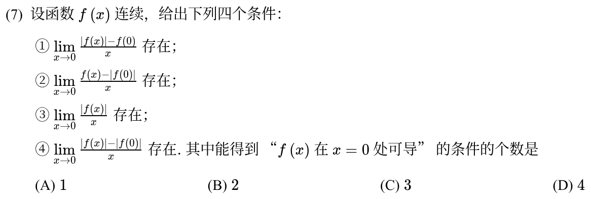
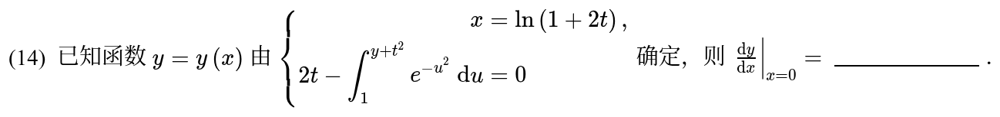
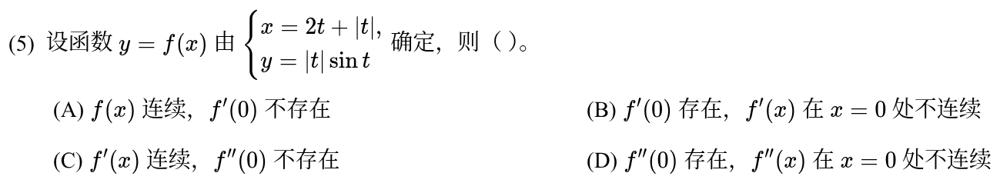
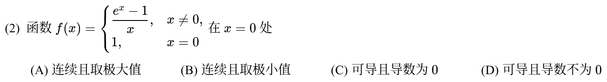
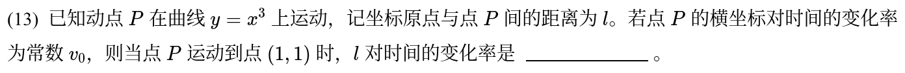
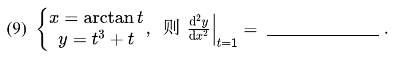
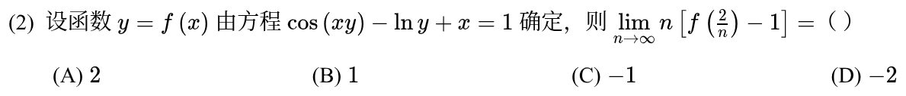
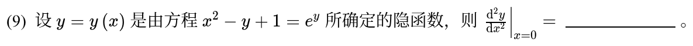

[« 连续与间断点](03-continuity.md)　　[中值定理、零点与不等式证明 »](05-mean-value-proofs.md)

# 高等数学 · 导数、微分与求导法则

> **本章共 23 题**
> 
> - **核心必做（建议按顺序攻克关键方法）**：  
>   [第 22 题](#q22)（导数定义认极限） → [第 09 题](#q09)（分段点从定义求导） → [第 14 题](#q14)（参数方程二阶导） → [第 07 题](#q07)（隐函数连求两次导） → [第 01 题](#q01)（变上限与反函数求导）
> 
> - **分流与刷题建议**：  
>   - **较难挑战**：[第 04 题](#q04)（由极限反推可导）、[第 10 题](#q10)（相关变化率列式）  
>   - **重在看思路**：[第 06 题](#q06)（含绝对值的参数曲线光滑性）  
>   - **首轮可跳过**：[第 16 题](#q16)（技巧较偏或综合度高，首轮不必死磕）  
> 
> - **过关目标**：分清对谁求导；二阶参数导数还要再除一次横坐标的导数。

---

### 01 · 2026年

---

### 02 · 2025年

---

### 03 · 2025年

---

### 04 · 2025年

> *导数定义综合大题。条件是极限，分母用泰勒展开化简为 $-x^2$。先由极限存在推分子为 0 得 $f(0)$，再凑导数定义极限式求 $f'(0)$。*

---

### 05 · 2024年

---

### 06 · 2023年

---

### 07 · 2022年

---

### 08 · 2022年

> *抽象可导函数极限反推导数。把要求的极限式凑成导数定义形式，配凑出 $\frac{f(1+x)-f(1)}{x}$ 与 $\frac{f(1-x)-f(1)}{-x}$ 的线性组合。*

---

### 09 · 2021年

---

### 10 · 2021年

---

### 11 · 2021年

---

### 12 · 2020年

---

### 13 · 2018年

---

### 14 · 2017年

---

### 15 · 2016年

---

### 16 · 2015年

---

### 17 · 2015年

---

### 18 · 2013年

---

### 19 · 2013年

---

### 20 · 2012年

---

### 21 · 2012年

---

### 22 · 2011年

---

### 23 · 2010年

---

[« 连续与间断点](03-continuity.md)　　[中值定理、零点与不等式证明 »](05-mean-value-proofs.md)
