# 高等数学 · 导数、微分与求导法则

> 2010—2026年 · 23 道完整真题 · 年份从新到旧（2026→2010）  
> 题型分布：选择题 11 题 · 填空题 10 题 · 解答题 2 题  
> 考查范围：导数定义、可导条件、参数方程、反函数与一元隐函数求导、变化率

[查看对应网页版](04-derivatives.html) · [返回章节总目录](../README.md)

---

## 2026年

### 01 · 2026-06 · 选择题

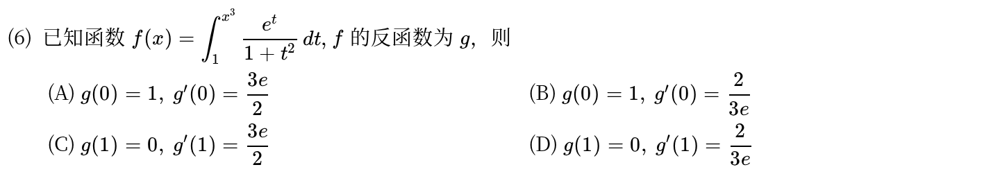

*关联章节：[定积分、变上限积分与积分性质](11-definite-integrals.md)*

---

## 2025年

### 02 · 2025-07 · 选择题

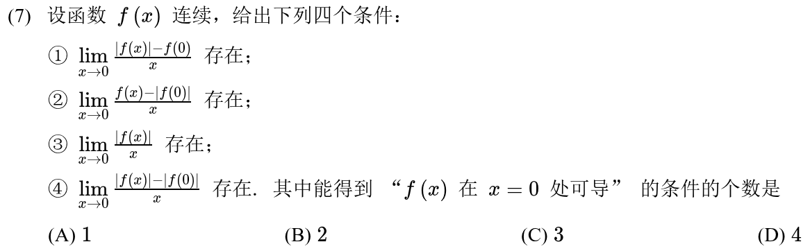

---

### 03 · 2025-14 · 填空题

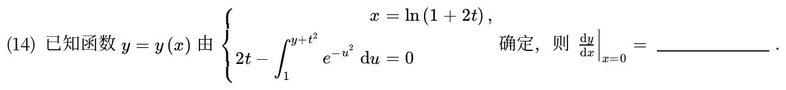

*关联章节：[定积分、变上限积分与积分性质](11-definite-integrals.md)*

---

### 04 · 2025-18 · 解答题

> *导数定义综合大题。条件是极限，分母用泰勒展开化简为 $-x^2$。先由极限存在推分子为 0 得 $f(0)$，再凑导数定义极限式求 $f'(0)$。*

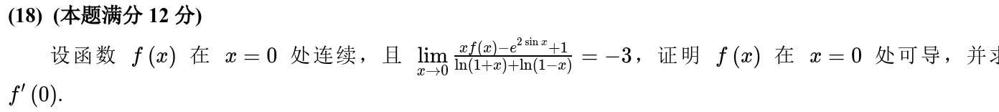

*关联章节：[函数极限与无穷小](01-limits.md) · [泰勒公式与高阶导数](08-taylor.md)*

---

## 2024年

### 05 · 2024-02 · 选择题

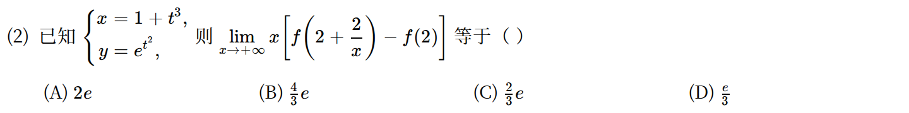

*关联章节：[函数极限与无穷小](01-limits.md)*

---

## 2023年

### 06 · 2023-05 · 选择题

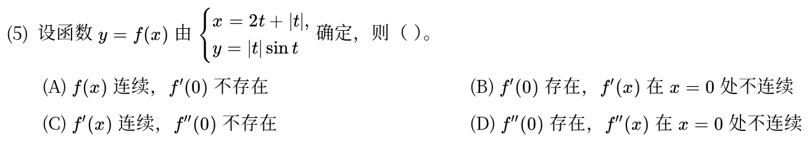

---

## 2022年

### 07 · 2022-12 · 填空题

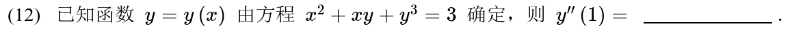

---

### 08 · 2022-17 · 解答题

> *抽象可导函数极限反推导数。把要求的极限式凑成导数定义形式，配凑出 $\frac{f(1+x)-f(1)}{x}$ 与 $\frac{f(1-x)-f(1)}{-x}$ 的线性组合。*

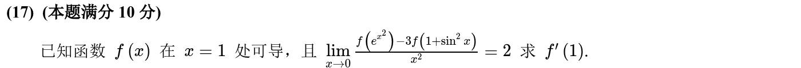

*关联章节：[函数极限与无穷小](01-limits.md)*

---

## 2021年

### 09 · 2021-02 · 选择题

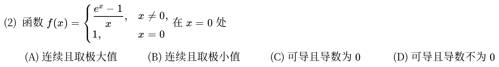

*关联章节：[连续与间断点](03-continuity.md) · [单调性、极值与零点个数](06-monotonicity-extrema.md)*

---

### 10 · 2021-03 · 选择题

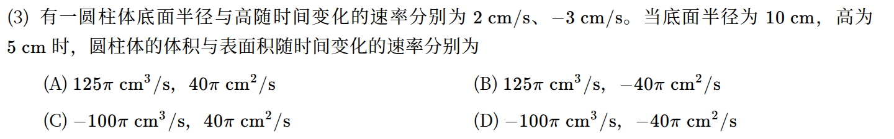

---

### 11 · 2021-12 · 填空题

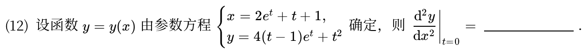

---

## 2020年

### 12 · 2020-09 · 填空题

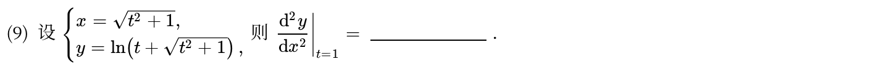

---

## 2018年

### 13 · 2018-02 · 选择题

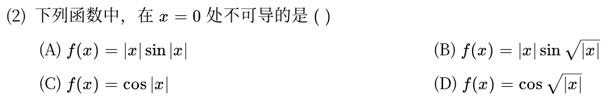

---

## 2017年

### 14 · 2017-10 · 填空题

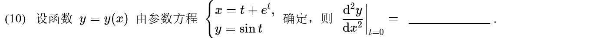

---

## 2016年

### 15 · 2016-13 · 填空题

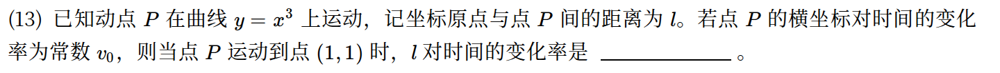

---

## 2015年

### 16 · 2015-03 · 选择题

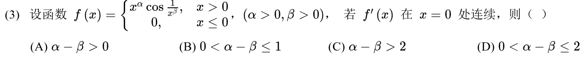

*关联章节：[连续与间断点](03-continuity.md)*

---

### 17 · 2015-09 · 填空题

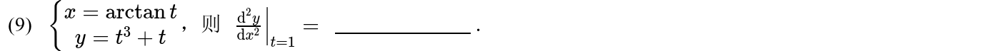

---

## 2013年

### 18 · 2013-02 · 选择题

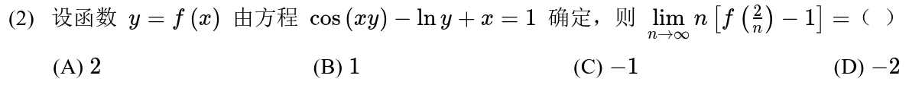

*关联章节：[函数极限与无穷小](01-limits.md)*

---

### 19 · 2013-10 · 填空题

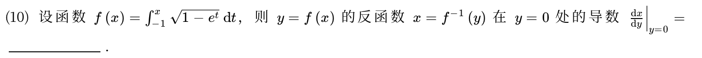

*关联章节：[定积分、变上限积分与积分性质](11-definite-integrals.md)*

---

## 2012年

### 20 · 2012-02 · 选择题

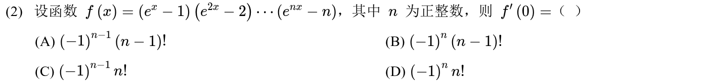

---

### 21 · 2012-09 · 填空题

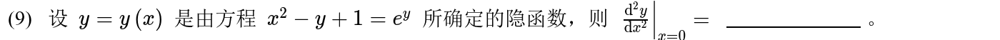

*关联章节：[多元复合函数与隐函数求导](17-chain-implicit.md)*

---

## 2011年

### 22 · 2011-02 · 选择题

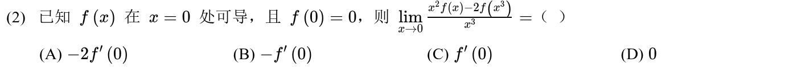

*关联章节：[函数极限与无穷小](01-limits.md)*

---

## 2010年

### 23 · 2010-13 · 填空题

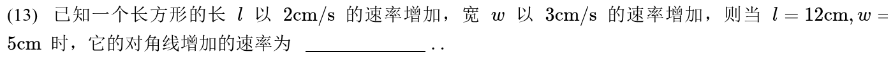

---

## 交叉考点索引

以下题目主归其他章节，点击跳转到对应章节题目；不计入本章主收录题数：

- [2026年 · 第18题](11-definite-integrals.md)（主章节：定积分、变上限积分与积分性质）
- [2023年 · 第14题](09-curve-geometry.md)（主章节：切线、法线、渐近线与曲率）
- [2022年 · 第3题](06-monotonicity-extrema.md)（主章节：单调性、极值与零点个数）
- [2020年 · 第16题](11-definite-integrals.md)（主章节：定积分、变上限积分与积分性质）
- [2018年 · 第20题](13-integral-applications.md)（主章节：定积分应用）
- [2017年 · 第18题](06-monotonicity-extrema.md)（主章节：单调性、极值与零点个数）
- [2015年 · 第2题](03-continuity.md)（主章节：连续与间断点）
- [2015年 · 第10题](08-taylor.md)（主章节：泰勒公式与高阶导数）
- [2015年 · 第11题](11-definite-integrals.md)（主章节：定积分、变上限积分与积分性质）
- [2013年 · 第3题](11-definite-integrals.md)（主章节：定积分、变上限积分与积分性质）
- [2011年 · 第16题](06-monotonicity-extrema.md)（主章节：单调性、极值与零点个数）
- [2010年 · 第17题](15-higher-order-ode.md)（主章节：高阶微分方程）
