# 高等数学 · 中值定理、零点与不等式证明

> 2010—2026年 · 11 道完整真题 · 年份从新到旧（2026→2010）  
> 题型分布：选择题 1 题 · 填空题 0 题 · 解答题 10 题  
> 考查范围：罗尔与拉格朗日等中值定理、构造辅助函数、存在性与不等式证明

[查看对应网页版](05-mean-value-proofs.html) · [返回章节总目录](../README.md)

---

## 2024年

### 01 · 2024-21 · 解答题

> *开篇硬骨头！当年压轴难题，别慌。第一问分别在 0 和 1 处写带拉格朗日余项的泰勒展开，按权重消掉一阶导；第二问对第一问两边直接取定积分，计算量其实不大。*

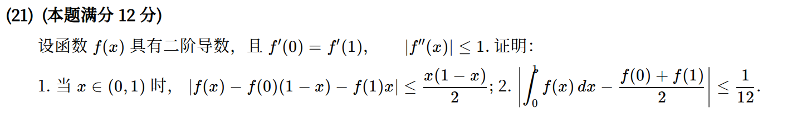

*关联章节：[定积分、变上限积分与积分性质](11-definite-integrals.md) · [泰勒公式与高阶导数](08-taylor.md)*

---

## 2023年

### 02 · 2023-21 · 解答题

> *又是一道压轴大题。第一问在 0 点左右展开泰勒相加直接出；第二问设极值点为 $x_0$，利用 $f'(x_0)=0$ 分别在 $x_0$ 展开到 $a$ 和 $-a$，做差放缩即可。*

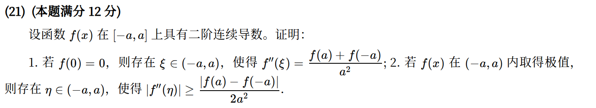

*关联章节：[泰勒公式与高阶导数](08-taylor.md)*

---

## 2020年

### 03 · 2020-06 · 选择题

> *导数不等式选择题。看到 $f'(x) > f(x) > 0$，立马联想构造辅助函数 $g(x) = e^{-x}f(x)$，求导发现 $g'(x) > 0$ 单调递增，比大小直接秒。*

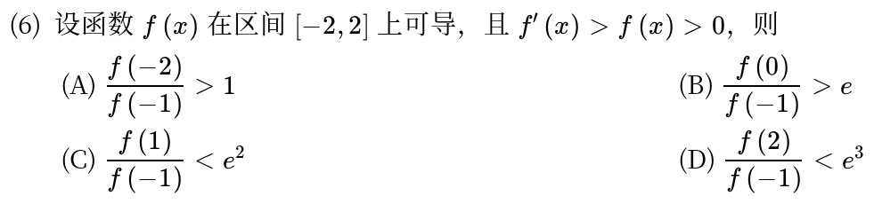

---

### 04 · 2020-20 · 解答题

> *两问都是经典中值设问。第一问移项构造辅助函数 $g(x)=(x-2)f(x)$ 用罗尔定理；第二问变限积分除以 $\ln 2$ 用柯西中值定理，比硬算轻松得多。*

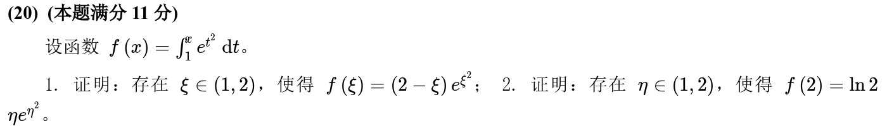

*关联章节：[定积分、变上限积分与积分性质](11-definite-integrals.md)*

---

## 2019年

### 05 · 2019-21 · 解答题

> *典型积分中值证明。第一问由积分值与端点值用连续函数介值或积分中值定理找零点；第二问用二阶泰勒展开，代入积分条件反推矛盾法或拉格朗日。*

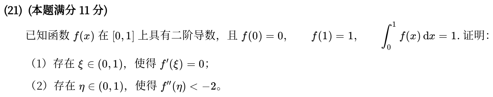

*关联章节：[定积分、变上限积分与积分性质](11-definite-integrals.md)*

---

## 2018年

### 06 · 2018-18 · 解答题

> *高难度不等式证明。令 $f(x)=x-\ln^2 x+2k\ln x-1$，求导发现导函数还能再求一次导。用二阶导的零点卡出一阶导单调性，分段讨论即可。*

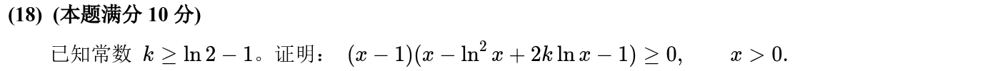

---

## 2017年

### 07 · 2017-19 · 解答题

> *方程根的存在性大题。第一问用极限保号性判断 0 附近符号，与 $f(1)>0$ 夹出介值定理零点；第二问识别出左边是 $(f(x)f'(x))'$，罗尔定理层层下递。*

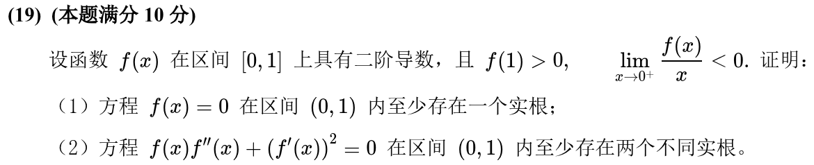

---

## 2015年

### 08 · 2015-21 · 解答题

> *几何切线不等式证明。由二阶导大于 0 可知曲线是凹的（割线在上方，切线在下方）。写出切线方程求截距 $x_0$，用拉格朗日直接证 $a < x_0 < b$。*

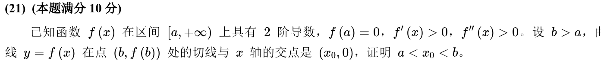

*关联章节：[凹凸性与拐点](07-convexity.md) · [切线、法线、渐近线与曲率](09-curve-geometry.md)*

---

## 2013年

### 09 · 2013-18 · 解答题

> *奇函数导数证明。奇函数二阶导依然有对称性，先由奇函数 $f(0)=0$ 结合 $f(1)=1$ 用罗尔得第一问；第二问构造辅助函数 $e^x(f'(x)-1)$ 再次罗尔。*

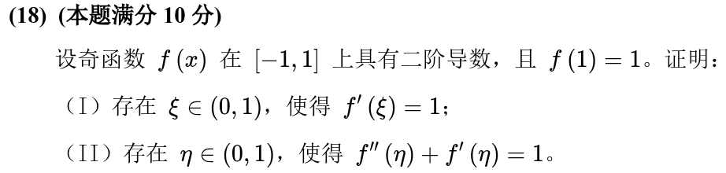

---

## 2012年

### 10 · 2012-20 · 解答题

> *对数不等式证明。看到对称区间 $(-1,1)$，先移项构辅助函数并求导，导数若还看不出正负就求二阶导，二阶导通分后分子因式分解立现正负。*

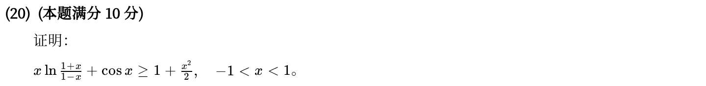

---

## 2010年

### 11 · 2010-21 · 解答题

> *双中值证明经典。区间 $[0,1]$ 被 $1/2$ 劈成两半，在 $[0, 1/2]$ 和 $[1/2, 1]$ 上分别应用拉格朗日中值定理，再相加凑出平方和。*

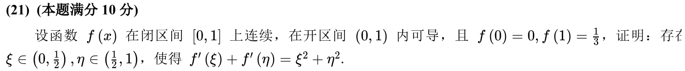

---

## 交叉考点索引

以下题目主归其他章节，点击跳转到对应章节题目；不计入本章主收录题数：

- [2025年 · 第21题](07-convexity.md)（主章节：凹凸性与拐点）
- [2022年 · 第21题](07-convexity.md)（主章节：凹凸性与拐点）
- [2018年 · 第4题](07-convexity.md)（主章节：凹凸性与拐点）
- [2018年 · 第21题](02-sequences.md)（主章节：数列极限与求和极限）
- [2016年 · 第21题](11-definite-integrals.md)（主章节：定积分、变上限积分与积分性质）
- [2015年 · 第19题](06-monotonicity-extrema.md)（主章节：单调性、极值与零点个数）
- [2014年 · 第3题](07-convexity.md)（主章节：凹凸性与拐点）
- [2014年 · 第5题](01-limits.md)（主章节：函数极限与无穷小）
- [2014年 · 第19题](11-definite-integrals.md)（主章节：定积分、变上限积分与积分性质）
- [2012年 · 第21题](02-sequences.md)（主章节：数列极限与求和极限）
- [2011年 · 第19题](02-sequences.md)（主章节：数列极限与求和极限）
- [2010年 · 第16题](11-definite-integrals.md)（主章节：定积分、变上限积分与积分性质）
