[« 导数、微分与求导法则](04-derivatives.md)　　[单调性、极值与零点个数 »](06-monotonicity-extrema.md)

# 高等数学 · 中值定理、零点与不等式证明

> **本章共 11 题**
> 
> - **核心必做（建议按顺序攻克关键方法）**：  
>   [第 03 题](#q03)（构造函数比较大小） → [第 08 题](#q08)（切线问题接中值定理） → [第 04 题](#q04)（罗尔与柯西的标准入口） → [第 07 题](#q07)（零点接连续两次罗尔）
> 
> - **分流与刷题建议**：  
>   - **较难挑战**：[第 02 题](#q02)（选展开点构造二阶导数）  
>   - **重在看思路**：[第 01 题](#q01)（插值误差与积分误差估计）  
>   - **首轮可跳过**：[第 06 题](#q06)、[第 10 题](#q10)、[第 11 题](#q11)（技巧较偏或综合度高，首轮不必死磕）  
> 
> - **过关目标**：能写出辅助函数、端点条件和使用定理的区间，而非只写定理名字。

---

### 01 · 2024年

> *开篇硬骨头！当年压轴难题，别慌。第一问分别在 0 和 1 处写带拉格朗日余项的泰勒展开，按权重消掉一阶导；第二问对第一问两边直接取定积分，计算量其实不大。*

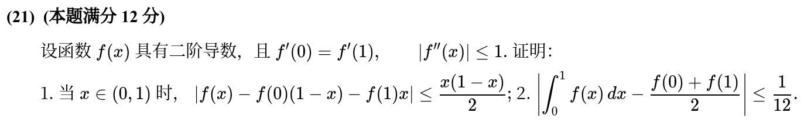

答案与解析

**结论速览**：（1）用线性插值余项与三次零点辅助函数两次罗尔定理得 $|h(x)|\le\frac{x(1-x)}{2}$；（2）将（1）在 $[0,1]$ 上积分即得梯形求积误差上界 $\frac{1}{12}$。

- **（1）证明线性插值误差不等式**：
  记线性插值误差函数为
  $$
  h(t) = f(t) - f(0)(1-t) - f(1)t,\qquad t\in[0,1],
  $$
  则 $h(0) = h(1) = 0$，且 $h''(t) = f''(t)$。对任意固定的 $x \in (0,1)$，构造辅助函数
  $$
  H(t) = h(t) - \frac{h(x)}{x(1-x)}\,t(1-t),\qquad t\in[0,1].
  $$
  易见 $H(t)$ 在 $[0,1]$ 上二阶可导，且 $H(0) = H(x) = H(1) = 0$。在 $[0,x]$ 与 $[x,1]$ 上分别对 $H(t)$ 用罗尔定理，存在 $c_1 \in (0,x)$ 与 $c_2 \in (x,1)$ 使 $H'(c_1) = H'(c_2) = 0$；再在 $[c_1,c_2]$ 上对 $H'(t)$ 用罗尔定理，存在 $\xi \in (c_1,c_2) \subset (0,1)$ 使 $H''(\xi) = 0$。由于
  $$
  H''(t) = f''(t) + \frac{2h(x)}{x(1-x)},
  $$
  代入 $t=\xi$ 得
  $$
  h(x) = -\frac{1}{2}f''(\xi)\,x(1-x).
  $$
  结合 $|f''(\xi)| \le 1$，立刻得到
  $$
  \left|f(x) - f(0)(1-x) - f(1)x\right| = |h(x)| \le \frac{x(1-x)}{2}.
  $$
- **（2）证明梯形求积误差不等式**：
  由 $h(x)$ 的定义，直接计算
  $$
  \int_0^1 \bigl[f(0)(1-x) + f(1)x\bigr]\,\mathrm{d}x = \frac{f(0)+f(1)}{2},
  $$
  故
  $$
  \left|\int_0^1 f(x)\,\mathrm{d}x - \frac{f(0)+f(1)}{2}\right| = \left|\int_0^1 h(x)\,\mathrm{d}x\right| \le \int_0^1 |h(x)|\,\mathrm{d}x.
  $$
  将第（1）问的不等式在 $[0,1]$ 上积分（端点 $0,1$ 处亦成立），得
  $$
  \int_0^1 |h(x)|\,\mathrm{d}x \le \frac{1}{2}\int_0^1 x(1-x)\,\mathrm{d}x = \frac{1}{2}\left[\frac{x^2}{2}-\frac{x^3}{3}\right]_0^1 = \frac{1}{12}.
  $$
- **核心思路与避坑**：本题本质是线性插值余项公式与梯形公式误差估计；构造含 $t(1-t)$ 的三零点辅助函数后两次用罗尔定理是标准动作。注意题给 $f'(0)=f'(1)$ 在该证法中并未用到，属冗余条件，不必强行凑入。

---

### 02 · 2023年

> *又是一道压轴大题。第一问在 0 点左右展开泰勒相加直接出；第二问设极值点为 $x_0$，利用 $f'(x_0)=0$ 分别在 $x_0$ 展开到 $a$ 和 $-a$，做差放缩即可。*

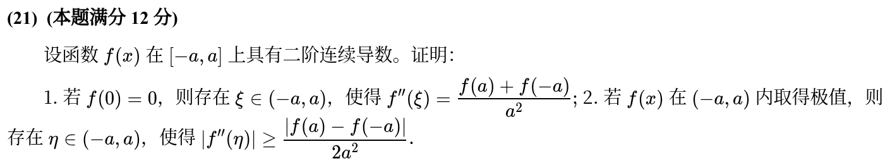

答案与解析

**结论速览**：（1）构造二次插值多项式两次用罗尔定理得 $f''(\xi)=\frac{f(a)+f(-a)}{a^2}$；（2）以极值点 $x_0$ 为中心对 $f(a)$ 与 $f(-a)$ 分别作带拉格朗日余项的一阶泰勒展开（利用 $f'(x_0)=0$），两式相减即得下界 $\frac{|f(a)-f(-a)|}{2a^2}$。

- **（1）证明存在 $\xi\in(-a,a)$ 使 $f''(\xi)=\dfrac{f(a)+f(-a)}{a^2}$**：
  构造过 $(-a,f(-a)),(0,0),(a,f(a))$ 的二次多项式
  $$
  P(x) = \frac{f(a)-f(-a)}{2a}\,x + \frac{f(a)+f(-a)}{2a^2}\,x^2,
  $$
  令 $g(x) = f(x) - P(x)$。由 $f(0)=0$ 知 $g(-a) = g(0) = g(a) = 0$。在 $[-a,0]$ 和 $[0,a]$ 上分别对 $g$ 用罗尔定理，存在 $c_1\in(-a,0)$ 和 $c_2\in(0,a)$ 使 $g'(c_1)=g'(c_2)=0$；再在 $[c_1,c_2]$ 上对 $g'$ 用罗尔定理，存在 $\xi\in(c_1,c_2)\subset(-a,a)$ 使 $g''(\xi)=0$，即
  $$
  f''(\xi) = P''(\xi) = \frac{f(a)+f(-a)}{a^2}.
  $$
- **（2）证明存在 $\eta\in(-a,a)$ 使 $|f''(\eta)|\ge\dfrac{|f(a)-f(-a)|}{2a^2}$**：
  因 $f(x)$ 在 $(-a,a)$ 内可导且在某内点 $x_0\in(-a,a)$ 取得极值，由费马引理知 $f'(x_0) = 0$。
  以 $x_0$ 为展开点，对 $f(a)$ 与 $f(-a)$ 分别作带拉格朗日余项的一阶泰勒展开：
  $$
  f(a) = f(x_0) + \frac{1}{2}f''(\xi_1)(a-x_0)^2,\qquad f(-a) = f(x_0) + \frac{1}{2}f''(\xi_2)(-a-x_0)^2,
  $$
  其中 $\xi_1 \in (x_0,a)$，$\xi_2 \in (-a,x_0)$。两式相减并取绝对值：
  $$
  |f(a)-f(-a)| = \frac{1}{2}\left|f''(\xi_1)(a-x_0)^2 - f''(\xi_2)(a+x_0)^2\right|.
  $$
  取 $\eta\in\{\xi_1,\xi_2\}\subset(-a,a)$ 使得 $|f''(\eta)| = \max\bigl\{|f''(\xi_1)|,|f''(\xi_2)|\bigr\}$，则由三角不等式得
  $$
  |f(a)-f(-a)| \le \frac{|f''(\eta)|}{2}\bigl[(a-x_0)^2 + (a+x_0)^2\bigr] = |f''(\eta)|(a^2+x_0^2) \le 2a^2|f''(\eta)|,
  $$
  其中最后一步用了 $x_0\in(-a,a)\implies x_0^2 < a^2$。两边同除以 $2a^2$，即得
  $$
  |f''(\eta)| \ge \frac{|f(a)-f(-a)|}{2a^2}.
  $$
- **核心思路与避坑**：第（2）问极易踩坑——若先在 $[-a,a]$ 上用拉格朗日中值定理得 $f'(c)=\frac{f(a)-f(-a)}{2a}$，再在 $c,x_0$ 间用中值定理并估计 $|c-x_0|<2a$，分母会落到 $4a^2$ 而差一个因子 $2$；必须以极值点 $x_0$ 为中心向两端作一阶泰勒展开，借助 $f'(x_0)=0$ 消去一次项，再由 $(a-x_0)^2+(a+x_0)^2 = 2(a^2+x_0^2) < 4a^2$ 精确拿到系数 $\frac{1}{2a^2}$。

---

### 03 · 2020年

> *导数不等式选择题。看到 $f'(x) > f(x) > 0$，立马联想构造辅助函数 $g(x) = e^{-x}f(x)$，求导发现 $g'(x) > 0$ 单调递增，比大小直接秒。*

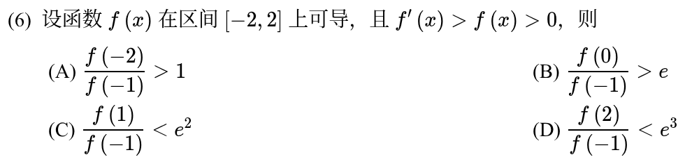

答案与解析

**第一步落笔与完整推导**

1. **识别结构，构造辅助函数**：由 $f'(x) > f(x)$ 得 $f'(x) - f(x) > 0$。构造
   $$g(x) = e^{-x}f(x), \qquad x \in [-2, 2].$$
   因为 $f(x)$ 在 $[-2, 2]$ 上可导，所以 $g(x)$ 在 $[-2, 2]$ 上可导，且
   $$g'(x) = e^{-x}\big(f'(x) - f(x)\big) > 0.$$
   因此 $g(x)$ 在 $[-2, 2]$ 上**严格单调递增**。
   > **等价写法**：因为题干额外给了 $f(x) > 0$，也可以直接写成 $\frac{f'(x)}{f(x)} > 1$，即 $\big(\ln f(x) - x\big)' > 0$，同样推出 $\ln f(x) - x$ 严格递增。
2. **导出统一比较不等式**：对任意 $-2 \le x_1 < x_2 \le 2$，有 $g(x_2) > g(x_1)$，即
   $$e^{-x_2}f(x_2) > e^{-x_1}f(x_1).$$
   利用 $f(x_1) > 0$ 与 $e^{x_2} > 0$ 两边同除不变号，得
   $$\frac{f(x_2)}{f(x_1)} > e^{x_2 - x_1}.$$
3. **代入选项端点比对**：四个选项分母都是 $f(-1)$，取 $x_1 = -1$：
   - 当 $x_2 = 0 > -1$ 时：$\frac{f(0)}{f(-1)} > e^{0 - (-1)} = e$，与 **（B）** 完全一致。

**选择题干扰项拆解**

- **（A）$\frac{f(-2)}{f(-1)} > 1$**：方向完全反了。由 $f'(x) > f(x) > 0$ 知 $f(x)$ 本身严格递增，且 $-2 < -1$，故 $f(-2) < f(-1)$，实际上 $\frac{f(-2)}{f(-1)} < e^{-1} < 1$。
- **（C）$\frac{f(1)}{f(-1)} < e^2$** 与 **（D）$\frac{f(2)}{f(-1)} < e^3$**：指数幂次 $1-(-1)=2$、$2-(-1)=3$ 都故意设成正确的临界值，专门抓“不等号方向写反”的失误；由统一不等式实际应有 $\frac{f(1)}{f(-1)} > e^2$、$\frac{f(2)}{f(-1)} > e^3$。
- **考场特例速验**：取满足条件的简单函数 $f(x) = e^{2x}$（$f'(x) = 2e^{2x} > e^{2x} > 0$），立刻算得 $\frac{f(-2)}{f(-1)} = e^{-2}$、$\frac{f(0)}{f(-1)} = e^2 > e$、$\frac{f(1)}{f(-1)} = e^4 > e^2$、$\frac{f(2)}{f(-1)} = e^6 > e^3$，一秒锁定 **（B）**。

---

### 04 · 2020年

> *两问都是经典中值设问。第一问移项构造辅助函数 $g(x)=(x-2)f(x)$ 用罗尔定理；第二问变限积分除以 $\ln 2$ 用柯西中值定理，比硬算轻松得多。*

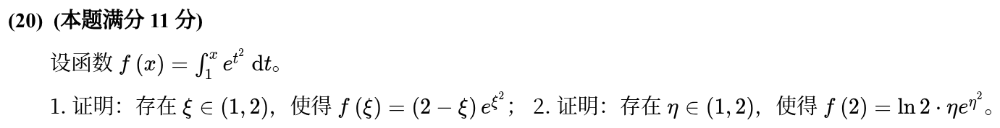

答案与解析

**先做公共预处理**

由变上限积分求导公式，被积函数 $e^{t^2}$ 在 $\mathbb{R}$ 上连续，因此 $f(x) = \int_1^x e^{t^2}\,dt$ 在 $[1, 2]$ 上连续、可导，且
$$f(1) = 0, \qquad f'(x) = e^{x^2}.$$

**第（1）问：从目标反推乘积辅助函数（罗尔定理）**

- **看外形定入口**：把 $e^{\xi^2}$ 识别为 $f'(\xi)$，目标等式即为
  $$f(\xi) - (2 - \xi)f'(\xi) = 0 \iff (2 - \xi)f'(\xi) - f(\xi) = 0.$$
  注意到 $(2 - x)' = -1$，左边正好是乘积 $(2 - x)f(x)$ 的导数！
- **第一步落笔**：构造辅助函数
  $$F(x) = (2 - x)f(x), \qquad x \in [1, 2].$$
- **完整证明**：
  $F(x)$ 在 $[1, 2]$ 上连续，在 $(1, 2)$ 内可导，且
  $$F(1) = (2 - 1)f(1) = 0, \qquad F(2) = (2 - 2)f(2) = 0.$$
  由罗尔定理，存在 $\xi \in (1, 2)$，使得 $F'(\xi) = 0$。因为
  $$F'(x) = -f(x) + (2 - x)f'(x) = (2 - x)e^{x^2} - f(x),$$
  代入 $x = \xi$ 即得 $(2 - \xi)e^{\xi^2} - f(\xi) = 0$，即 $f(\xi) = (2 - \xi)e^{\xi^2}$。

> **备选路线对比**：本题第（1）问也可以直接令 $G(x) = f(x) - (2 - x)e^{x^2}$，由 $G(1) = -e < 0$、$G(2) = \int_1^2 e^{t^2}\,dt > 0$ 用零点定理直接秒杀。但乘积构造法在抽象函数（未给出 $e^{t^2}$ 符号）时仍适用，两种视角都应掌握。

**第（2）问：把 $\ln 2$ 还原成 $\ln 2 - \ln 1$（柯西中值定理）**

- **看外形定入口**：目标 $f(2) = \ln 2 \cdot \eta e^{\eta^2}$ 可改写为
  $$\frac{f(2) - f(1)}{\ln 2 - \ln 1} = \eta e^{\eta^2} = \frac{e^{\eta^2}}{1/\eta} = \frac{f'(\eta)}{(\ln x)'\big|_{x=\eta}}.$$
  分子分母完美对齐 $f(x)$ 与 $g(x) = \ln x$ 在 $[1, 2]$ 上的增量比，立刻触发**柯西中值定理**。
- **完整证明**：
  令 $g(x) = \ln x$。函数 $f(x)$ 与 $g(x)$ 在 $[1, 2]$ 上均连续，在 $(1, 2)$ 内均可导，且对任意 $x \in (1, 2)$ 有 $g'(x) = \frac{1}{x} \neq 0$。
  由柯西中值定理，存在 $\eta \in (1, 2)$，使得
  $$\frac{f(2) - f(1)}{g(2) - g(1)} = \frac{f'(\eta)}{g'(\eta)}.$$
  代入 $f(1) = 0$、$g(1) = \ln 1 = 0$、$g(2) = \ln 2$、$f'(\eta) = e^{\eta^2}$ 与 $g'(\eta) = \frac{1}{\eta}$，得
  $$\frac{f(2)}{\ln 2} = \frac{e^{\eta^2}}{1/\eta} = \eta e^{\eta^2},$$
  即 $f(2) = \ln 2 \cdot \eta e^{\eta^2}$。

> **避坑提醒**：有同学会把 $f(2)$ 写成 $\int_1^2 (te^{t^2}) \cdot \frac{1}{t}\,dt$ 再用推广的积分中值定理，但这只能先得到 $\eta \in [1, 2]$（闭区间），要进一步说明 $\eta$ 不取端点 $1, 2$ 还需要额外论证 $te^{t^2}$ 严格递增；而柯西中值定理一步就能严格落入开区间 $(1, 2)$。

---

### 05 · 2019年

> *典型积分中值证明。第一问由积分值与端点值用连续函数介值或积分中值定理找零点；第二问用二阶泰勒展开，代入积分条件反推矛盾法或拉格朗日。*

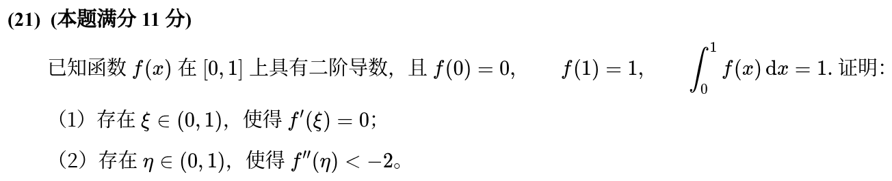

答案与解析

- **第（1）问（两种干净入口）**：
  - **入口 A（最值点法，直接为第 2 问铺路）**：设 $f(x)$ 在闭区间 $[0, 1]$ 上的最大值为 $M = f(\xi)$。若 $M \le 1$，则对一切 $x \in [0, 1]$ 有 $f(x) \le 1$，又 $f(0) = 0 < 1$ 且 $f$ 连续，故 $\int_0^1 f(x)\,dx < \int_0^1 1\,dx = 1$，与已知矛盾！因此必有 $M > 1$。因为 $f(0) = 0 < M$ 且 $f(1) = 1 < M$，最大值点 $\xi$ 必落在开区间 $(0, 1)$ 内，由费马定理得 $f'(\xi) = 0$。
  - **入口 B（变上限函数罗尔法）**：令 $F(x) = \int_0^x f(t)\,dt - x$，则 $F(0) = F(1) = 0$，由罗尔定理存在 $c \in (0, 1)$ 使 $F'(c) = f(c) - 1 = 0$，即 $f(c) = 1 = f(1)$；再在 $[c, 1]$ 上对 $f$ 用罗尔定理，得 $\xi \in (c, 1) \subset (0, 1)$ 使 $f'(\xi) = 0$。
- **第（2）问（在最大值点 $\xi$ 处展开 $f(0)$）**：
  由入口 A 已有 $\xi \in (0, 1)$ 满足 $f(\xi) > 1$ 且 $f'(\xi) = 0$。将 $f(0)$ 在 $x = \xi$ 处作带拉格朗日余项的二阶泰勒展开：存在 $\eta \in (0, \xi) \subset (0, 1)$，使得
  $$0 = f(0) = f(\xi) + f'(\xi)(0 - \xi) + \frac{1}{2}f''(\eta)(0 - \xi)^2 = f(\xi) + \frac{1}{2}f''(\eta)\xi^2.$$
  解得
  $$f''(\eta) = -\frac{2f(\xi)}{\xi^2}.$$
  因为 $f(\xi) > 1$ 且 $0 < \xi < 1 \implies 0 < \xi^2 < 1$，故 $f''(\eta) < -\frac{2 \cdot 1}{1} = -2$。
  > **避坑点**：如果只用入口 B 得到 $f(c)=1$ 和 $f'(\xi)=0$，在 $[\xi_1, \xi]$ 上二次套拉格朗日只能得到 $f''(\eta) = -\frac{1}{c(\xi - \xi_1)}$，无法保证分母 $< \frac{1}{2}$；**必须用到 $f(\xi) > 1$ 这个比 $1$ 严格大的最大值点信息**。

---

### 06 · 2018年

> *高难度不等式证明。令 $f(x)=x-\ln^2 x+2k\ln x-1$，求导发现导函数还能再求一次导。用二阶导的零点卡出一阶导单调性，分段讨论即可。*

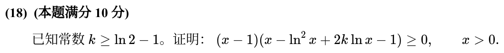

答案与解析

**结论速览**：令 $t=\ln x$ 将不等式化为 $(e^t-1)H(t)\ge 0$，求导证明 $H'(t)\ge 0$ 且 $H(0)=0$，故两因子恒同号（或同为零）。

- **完整解答**：
  因为 $x>0$，作换元 $t = \ln x \in (-\infty,+\infty)$，则 $x = e^t$，原不等式等价于
  $$
  (e^t - 1)\bigl(e^t - 1 - t^2 + 2kt\bigr) \ge 0,\qquad t\in\mathbb{R}.
  $$
  记 $H(t) = e^t - 1 - t^2 + 2kt$，显然 $H(0) = 0$。对其求导得
  $$
  H'(t) = e^t - 2t + 2k,\qquad H''(t) = e^t - 2.
  $$
  令 $H''(t) = 0$ 得唯一驻点 $t = \ln 2$：
  - 当 $t < \ln 2$ 时，$H''(t) < 0$，$H'(t)$ 单调递减；
  - 当 $t > \ln 2$ 时，$H''(t) > 0$，$H'(t)$ 单调递增。
  因此 $H'(t)$ 在 $t = \ln 2$ 处取得最小值：
  $$
  H'(t) \ge H'(\ln 2) = 2 - 2\ln 2 + 2k = 2\bigl(k - (\ln 2 - 1)\bigr) \ge 0 \qquad (\text{由 } k \ge \ln 2 - 1).
  $$
  于是 $H(t)$ 在 $(-\infty,+\infty)$ 上单调递增。结合 $H(0) = 0$：
  - 当 $t > 0$（即 $x > 1$）时，$e^t - 1 > 0$ 且 $H(t) \ge H(0) = 0$，乘积 $\ge 0$；
  - 当 $t = 0$（即 $x = 1$）时，乘积 $= 0$；
  - 当 $t < 0$（即 $0 < x < 1$）时，$e^t - 1 < 0$ 且 $H(t) \le H(0) = 0$，乘积 $\ge 0$。
  综上，对一切 $x > 0$ 原不等式恒成立。
- **核心思路与避坑**：看到含 $\ln x$ 与 $x$ 混搭的乘积不等式，优先用 $t=\ln x$ 把对数多项式变成指数加多项式，求导结构立即干净；切忌把两个括号硬乘开再求导。

---

### 07 · 2017年

> *方程根的存在性大题。第一问用极限保号性判断 0 附近符号，与 $f(1)>0$ 夹出介值定理零点；第二问识别出左边是 $(f(x)f'(x))'$，罗尔定理层层下递。*

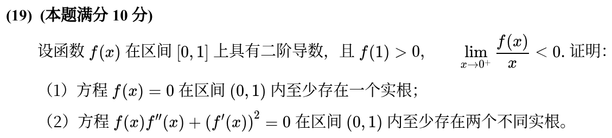

答案与解析

**第（1）问：为什么不能直接在 $[0,1]$ 上套零点定理？**

- **先看条件给的正则性**：$f(x)$ 在 $[0,1]$ 上具有二阶导数 $\implies f(x)$ 与 $f'(x)$ 在 $[0,1]$ 上均连续、可导。
- **检查左端点 $x=0$**：已知 $\lim_{x\to 0^+} \frac{f(x)}{x} = A < 0$（极限存在且有限），又 $f(x)$ 在 $0$ 处右连续，所以
  $$f(0) = \lim_{x\to 0^+} f(x) = \lim_{x\to 0^+} \left(\frac{f(x)}{x} \cdot x\right) = A \cdot 0 = 0.$$
  既然 $f(0)=0$，就不满足 $f(0)f(1) < 0$，不能直接对 $[0,1]$ 宣称“端点异号”。
- **第一步怎么落笔**：利用极限的**局部保号性**。因为 $\lim_{x\to 0^+} \frac{f(x)}{x} < 0$，存在 $\delta \in (0,1)$，使得对一切 $x \in (0,\delta)$ 都有 $\frac{f(x)}{x} < 0$。取内部点 $x_0 = \frac{\delta}{2} \in (0,1)$，由 $x_0 > 0$ 得
  $$f(x_0) < 0.$$
- **收尾**：在闭区间 $[x_0, 1] \subset [0,1]$ 上，$f(x)$ 连续，且 $f(x_0) < 0 < f(1)$。由零点定理，存在 $c \in (x_0, 1) \subset (0,1)$，使得
  $$f(c) = 0.$$

> **注意**：这一问里顺手推出来的 $f(0)=0$ 并不是废话，它是第（2）问凑齐三个零点的关键起点。

**第（2）问：辅助函数从哪一项来？罗尔定理用在哪些区间？**

- **从目标反推辅助函数**：目标方程是 $f(x)f''(x) + (f'(x))^2 = 0$。两项合在一起正好是乘积的导数结构：
  $$\big(f(x)f'(x)\big)' = f'(x)f'(x) + f(x)f''(x) = f(x)f''(x) + (f'(x))^2.$$
  因此构造辅助函数
  $$H(x) = f(x)f'(x), \qquad x \in [0,1].$$
  因为 $f(x)$ 在 $[0,1]$ 上有二阶导数，所以 $f(x)$ 与 $f'(x)$ 都在 $[0,1]$ 上连续且可导，从而 $H(x)$ 在 $[0,1]$ 上连续、在 $(0,1)$ 内可导，且 $H'(x) = f(x)f''(x) + (f'(x))^2$。
- **盘点零点缺口**：要证 $H'(x)=0$ 在 $(0,1)$ 内至少有 **2 个不同实根**，需要为 $H(x)$ 准备 **3 个严格有序的零点**，把区间切出 2 个互不相交的子区间。
  目前已知 $f(0)=0$ 与 $f(c)=0$（$0 < c < 1$），只能得到
  $$H(0) = f(0)f'(0) = 0, \qquad H(c) = f(c)f'(c) = 0,$$
  还差 **1 个** $H(x)$ 的零点。
- **补齐第三个零点**：$H(x) = f(x)f'(x)$ 为零有两条路——要么 $f(x)=0$，要么 $f'(x)=0$。在 $[0, c]$ 上对 $f(x)$ 用一次罗尔定理（$f$ 在 $[0,c]$ 连续、在 $(0,c)$ 可导，且 $f(0)=f(c)=0$），必存在 $\xi \in (0, c)$，使得 $f'(\xi) = 0$，从而
  $$H(\xi) = f(\xi)f'(\xi) = 0.$$
- **分段使用罗尔定理**：现在已有三个次序明确的零点 $0 < \xi < c < 1$，满足 $H(0) = H(\xi) = H(c) = 0$：
  1. 在 $[0, \xi]$ 上对 $H(x)$ 用罗尔定理：存在 $\eta_1 \in (0, \xi)$，使 $H'(\eta_1) = 0$；
  2. 在 $[\xi, c]$ 上对 $H(x)$ 用罗尔定理：存在 $\eta_2 \in (\xi, c)$，使 $H'(\eta_2) = 0$。
  因为 $0 < \eta_1 < \xi < \eta_2 < c < 1$，所以 $\eta_1 \neq \eta_2$，且均落在 $(0,1)$ 内，即原方程在 $(0,1)$ 内至少存在两个不同实根。

---

### 08 · 2015年

> *几何切线不等式证明。由二阶导大于 0 可知曲线是凹的（割线在上方，切线在下方）。写出切线方程求截距 $x_0$，用拉格朗日直接证 $a < x_0 < b$。*

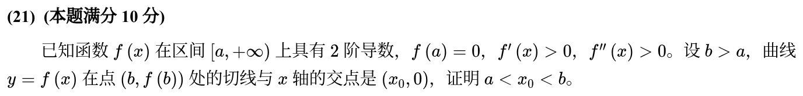

答案与解析

**第一步落笔：显式解出切线横截距 $x_0$**

曲线 $y = f(x)$ 在点 $(b, f(b))$ 处的切线方程为
$$y - f(b) = f'(b)(x - b).$$
令 $y = 0$，因为 $f'(b) > 0$（分母非零，合法相除），解得交点横坐标
$$x_0 = b - \frac{f(b)}{f'(b)}.$$

**证明右半边：$x_0 < b$（只用到 $f'(x) > 0$）**

因为在 $[a, +\infty)$ 上 $f'(x) > 0$，所以 $f(x)$ 在 $[a, b]$ 上严格单调递增。由 $b > a$ 及 $f(a) = 0$，得
$$f(b) > f(a) = 0.$$
又 $f'(b) > 0$，故 $\frac{f(b)}{f'(b)} > 0$，从而
$$x_0 = b - \frac{f(b)}{f'(b)} < b.$$

**证明左半边：$x_0 > a$（两种等价入口）**

把目标 $b - \frac{f(b)}{f'(b)} > a$ 等价变形（利用 $f'(b) > 0$ 与 $b - a > 0$）：
$$x_0 > a \iff \frac{f(b) - f(a)}{b - a} < f'(b).$$

- **解法一（拉格朗日中值定理——比割线与切线斜率）**：
  $f(x)$ 在 $[a, b]$ 上连续、在 $(a, b)$ 内可导，由拉格朗日中值定理，存在 $\xi \in (a, b)$，使得
  $$\frac{f(b) - f(a)}{b - a} = f'(\xi).$$
  因为 $f''(x) > 0$ 在 $[a, +\infty)$ 上恒成立，所以 $f'(x)$ 在 $[a, b]$ 上严格单调递增。由 $\xi < b$ 得 $f'(\xi) < f'(b)$，即
  $$\frac{f(b)}{b - a} < f'(b) \implies \frac{f(b)}{f'(b)} < b - a \implies x_0 = b - \frac{f(b)}{f'(b)} > a.$$
- **解法二（二阶泰勒展开——把“曲线在切线上方”代数化）**：
  以切点 $x = b$ 为展开点，将 $f(a)$ 展开到带拉格朗日余项的二阶泰勒公式：存在 $\xi \in (a, b)$，使得
  $$0 = f(a) = f(b) + f'(b)(a - b) + \frac{1}{2}f''(\xi)(a - b)^2.$$
  因为 $f''(\xi) > 0$ 且 $(a - b)^2 > 0$，所以余项严格为正，从而
  $$f(b) + f'(b)(a - b) < 0 \implies f(b) < f'(b)(b - a) \implies b - \frac{f(b)}{f'(b)} > a.$$

综合两半，证得 $a < x_0 < b$。

---

### 09 · 2013年

> *奇函数导数证明。奇函数二阶导依然有对称性，先由奇函数 $f(0)=0$ 结合 $f(1)=1$ 用罗尔得第一问；第二问构造辅助函数 $e^x(f'(x)-1)$ 再次罗尔。*

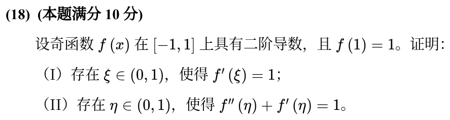

答案与解析

- **先挖掘“奇函数 + 二阶可导”的两个隐藏零值**：
  因为 $f(x)$ 是 $[-1, 1]$ 上的奇函数，所以 $f(0) = 0$；对 $f(-x) = -f(x)$ 连续求两次导得 $f'(-x) = f'(x)$（偶函数）、$f''(-x) = -f''(x)$（奇函数），从而 $f''(0) = 0$。
- **第（I）问**：在 $[0, 1]$ 上对 $f(x)$ 用拉格朗日中值定理，存在 $\xi \in (0, 1)$，使得
  $$f'(\xi) = \frac{f(1) - f(0)}{1 - 0} = 1.$$
- **第（II）问（注意区间是开区间 $(0, 1)$，不能只用 $[-\xi, \xi]$）**：
  目标 $f''(\eta) + f'(\eta) - 1 = 0$ 提示构造积分因子辅助函数
  $$H(x) = e^x\big(f'(x) - 1\big), \qquad x \in [0, \xi],$$
  则 $H'(x) = e^x\big(f''(x) + f'(x) - 1\big)$。已知 $H(\xi) = 0$，且在左端点 $x = 0$ 处利用 $f''(0) = 0$ 有
  $$H'(0) = f''(0) + f'(0) - 1 = f'(0) - 1 = H(0).$$
  按 $H(0)$ 的符号分三种情况，均能把 $\eta$ 严格锁在 $(0, \xi) \subset (0, 1)$ 内：
  1. 若 $H(0) = 0$：则 $H(0) = H(\xi) = 0$，在 $[0, \xi]$ 上用罗尔定理得 $\eta \in (0, \xi)$ 使 $H'(\eta) = 0$；
  2. 若 $H(0) > 0$：则 $H'(0) = H(0) > 0$，由导数定义知在 $0$ 的右侧附近存在点使 $H(x) > H(0) > 0 = H(\xi)$，故 $H(x)$ 在 $[0, \xi]$ 上的最大值必在内部某点 $\eta \in (0, \xi)$ 取得，由费马定理得 $H'(\eta) = 0$；
  3. 若 $H(0) < 0$：则 $H'(0) = H(0) < 0$，同理 $H(x)$ 在 $[0, \xi]$ 上的最小值必在内部某点 $\eta \in (0, \xi)$ 取得，由费马定理得 $H'(\eta) = 0$。
  综上，必存在 $\eta \in (0, 1)$ 使 $f''(\eta) + f'(\eta) = 1$。

---

### 10 · 2012年

> *对数不等式证明。看到对称区间 $(-1,1)$，先移项构辅助函数并求导，导数若还看不出正负就求二阶导，二阶导通分后分子因式分解立现正负。*

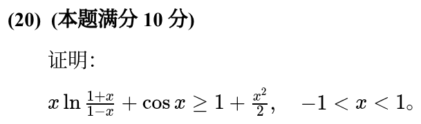

答案与解析

**结论速览**：利用偶函数对称性归约到 $x\in[0,1)$，再结合 $\ln\frac{1+x}{1-x}\ge 2x$ 与 $\cos x\ge 1-\frac{x^2}{2}$（或直接两次求导）即证。

- **完整解答**：
  令
  $$
  f(x) = x\ln\frac{1+x}{1-x} + \cos x - 1 - \frac{x^2}{2},\qquad x\in(-1,1).
  $$
  先验奇偶性：$f(-x) = (-x)\ln\frac{1-x}{1+x} + \cos(-x) - 1 - \frac{x^2}{2} = f(x)$，故 $f(x)$ 为偶函数，只需证明当 $x\in[0,1)$ 时 $f(x)\ge 0$。
  - **估计对数项**：对 $x\in[0,1)$，由积分表示知
    $$
    \ln\frac{1+x}{1-x} = \int_0^x \frac{2}{1-t^2}\,\mathrm{d}t \ge \int_0^x 2\,\mathrm{d}t = 2x \qquad (\text{因 } 0\le t<1 \text{ 时 } \frac{1}{1-t^2}\ge 1),
    $$
    两边同乘 $x\ge 0$ 得 $x\ln\frac{1+x}{1-x} \ge 2x^2$。
  - **估计余弦项**：对任意 $x\in\mathbb{R}$，有
    $$
    1 - \cos x = 2\sin^2\frac{x}{2} \le 2\left(\frac{x}{2}\right)^2 = \frac{x^2}{2} \implies \cos x \ge 1 - \frac{x^2}{2}.
    $$
  将两式相加，得对一切 $x\in[0,1)$：
  $$
  x\ln\frac{1+x}{1-x} + \cos x \ge 2x^2 + 1 - \frac{x^2}{2} = 1 + \frac{3}{2}x^2 \ge 1 + \frac{x^2}{2},
  $$
  由偶性即知对一切 $x\in(-1,1)$ 均成立。
- **核心思路与避坑**：本题用直接放缩比硬求导快得多（且留有 $x^2$ 的裕量）；若用求导法，务必先声明偶函数将范围缩到 $[0,1)$，避免在 $(-1,0)$ 上讨论符号反复。

---

### 11 · 2010年

> *双中值证明经典。区间 $[0,1]$ 被 $1/2$ 劈成两半，在 $[0, 1/2]$ 和 $[1/2, 1]$ 上分别应用拉格朗日中值定理，再相加凑出平方和。*

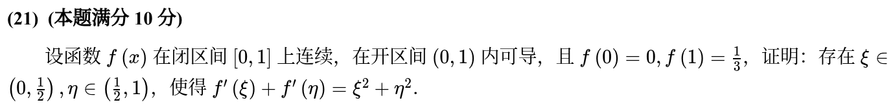

答案与解析

**结论速览**：构造辅助函数 $F(x)=f(x)-\frac{1}{3}x^3$，在 $[0,\frac{1}{2}]$ 与 $[\frac{1}{2},1]$ 上分别用拉格朗日中值定理后相加消去 $F(\frac{1}{2})$。

- **完整解答**：
  观察结论 $\bigl[f'(\xi)-\xi^2\bigr] + \bigl[f'(\eta)-\eta^2\bigr] = 0$，移项后两侧结构完全一致，自然构造原函数形式的辅助函数：
  $$
  F(x) = f(x) - \frac{1}{3}x^3,\qquad x\in[0,1].
  $$
  由题设知 $F(x)$ 在 $[0,1]$ 上连续、在 $(0,1)$ 内可导，且
  $$
  F(0) = f(0) - 0 = 0,\qquad F(1) = f(1) - \frac{1}{3} = 0.
  $$
  在子区间 $\left[0,\frac{1}{2}\right]$ 和 $\left[\frac{1}{2},1\right]$ 上分别对 $F(x)$ 应用拉格朗日中值定理，存在 $\xi\in\left(0,\frac{1}{2}\right)$ 和 $\eta\in\left(\frac{1}{2},1\right)$，使得
  $$
  F'(\xi) = \frac{F\!\left(\frac{1}{2}\right) - F(0)}{\frac{1}{2} - 0} = 2F\!\left(\frac{1}{2}\right),\qquad F'(\eta) = \frac{F(1) - F\!\left(\frac{1}{2}\right)}{1 - \frac{1}{2}} = -2F\!\left(\frac{1}{2}\right).
  $$
  两式相加得
  $$
  F'(\xi) + F'(\eta) = 0.
  $$
  代回 $F'(x) = f'(x) - x^2$，即得
  $$
  f'(\xi) + f'(\eta) = \xi^2 + \eta^2.
  $$
- **核心思路与避坑**：双中值问题且两区间长度相等（均为 $\frac{1}{2}$）时，把 $\xi$ 与 $\eta$ 分别归位成 $F'(\xi)+F'(\eta)=0$，就能让分点处的 $F(\frac{1}{2})$ 恰好一正一负抵消。注意切勿误用罗尔定理直接套在 $[0,1]$ 上（那样只能拿到单中值）。

---

[« 导数、微分与求导法则](04-derivatives.md)　　[单调性、极值与零点个数 »](06-monotonicity-extrema.md)
