[« 中值定理、零点与不等式证明](05-mean-value-proofs.md)　　[凹凸性与拐点 »](07-convexity.md)

# 高等数学 · 单调性、极值与零点个数

> **必会·按此顺序**：[2016-04](#q2016-4)（读导函数图像） → [2019-15](#q2019-15)（分段点与极值） → [2021-04](#q2021-4)（最小值控制零点个数） → [2017-18](#q2017-18)（隐函数极值）  
> **冲一冲**：[2016-16](#q2016-16)（绝对值积分分区求最值）  
> **见识·先会开题**：[2015-19](#q2015-19)（变限积分函数的零点个数）  
> **首轮过关**：极值看变号，零点先分单调段，分界点单独检查。

---

## 2026年

### 01 · 2026-05 · 选择题

> 导数与极值概念辨析。注意：单调递减加递增确实能推极小值；但反过来极值点两侧导数不一定单调（可能有无穷次振荡）。代入经典振荡函数排除假命题。

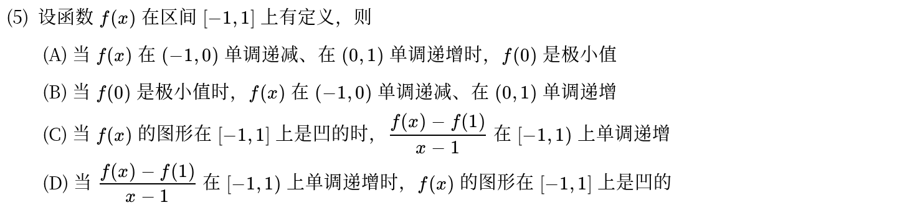

*关联章节：[凹凸性与拐点](07-convexity.md)*

---

## 2025年

### 02 · 2025-02 · 选择题

> 变上限积分极值与拐点。对  和  求导，看到因式里有  和 ，通过导数变号判断极值点，二阶导变号判断拐点。

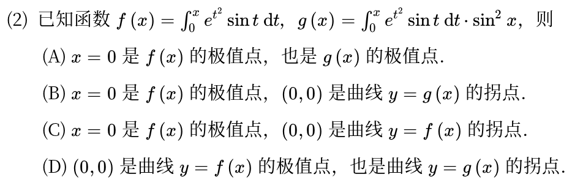

*关联章节：[凹凸性与拐点](07-convexity.md) · [定积分、变上限积分与积分性质](11-definite-integrals.md)*

---

## 2023年

### 03 · 2023-07 · 选择题

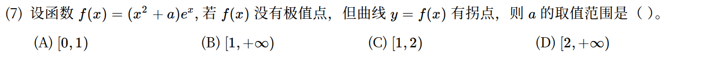

*关联章节：[凹凸性与拐点](07-convexity.md)*

---

## 2022年

### 04 · 2022-03 · 选择题

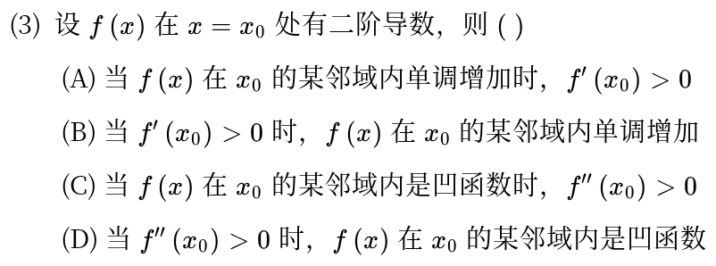

*关联章节：[导数、微分与求导法则](04-derivatives.md) · [凹凸性与拐点](07-convexity.md)*

---

## 2021年

### 05 · 2021-04 · 选择题

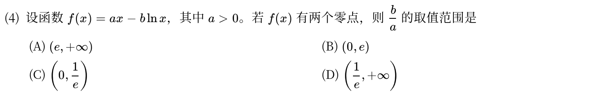

---

## 2019年

### 06 · 2019-15 · 解答题

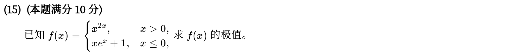

---

## 2017年

### 07 · 2017-18 · 解答题

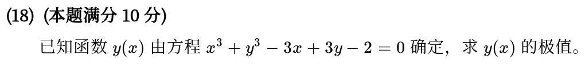

*关联章节：[导数、微分与求导法则](04-derivatives.md)*

---

## 2016年

### 08 · 2016-04 · 选择题

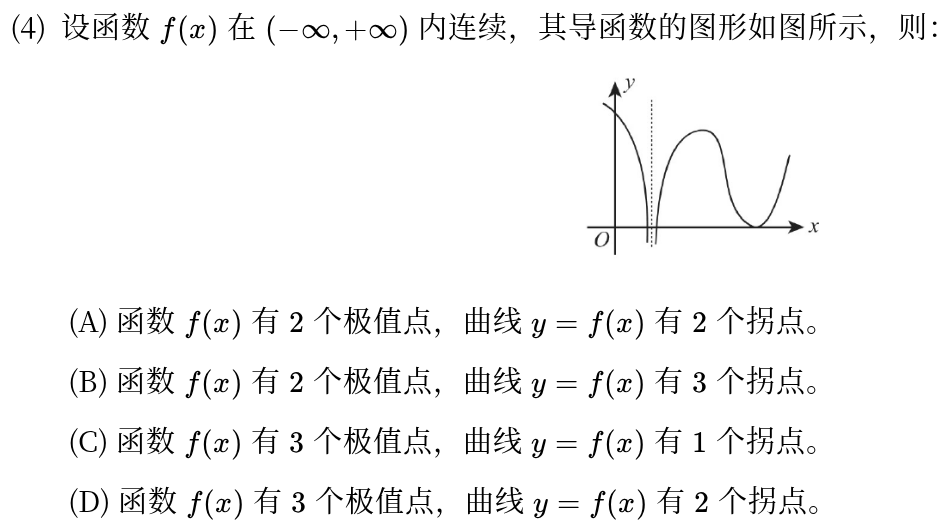

*关联章节：[凹凸性与拐点](07-convexity.md)*

---

### 09 · 2016-16 · 解答题

> 含绝对值的变限积分大题。被积函数含 ，在积分区间  内以  为分界点拆成两段去掉绝对值，求导解驻点求最小值。

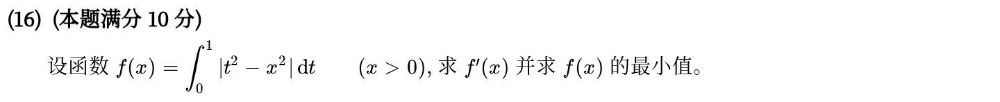

*关联章节：[定积分、变上限积分与积分性质](11-definite-integrals.md)*

---

## 2015年

### 10 · 2015-19 · 解答题

> 变限积分零点个数大题。两边求导得到 ，解出导数驻点并判断单调区间；结合端点极限  和  的函数值正负卡出零点个数。

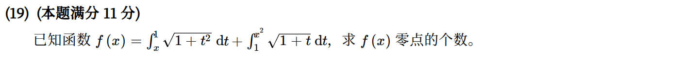

*关联章节：[定积分、变上限积分与积分性质](11-definite-integrals.md) · [中值定理、零点与不等式证明](05-mean-value-proofs.md)*

---

## 2011年

### 11 · 2011-03 · 选择题

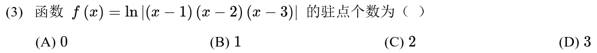

---

### 12 · 2011-16 · 解答题

> 参数方程极值与拐点大题。先算一阶导  求驻点定极值；再用参数方程二阶导公式求出 ，令二阶导为 0 找出拐点坐标。

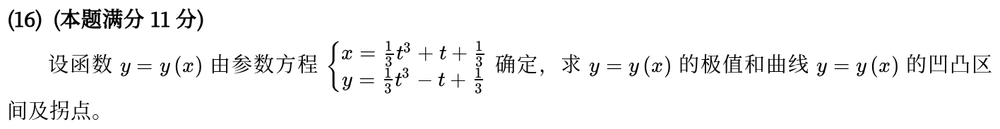

*关联章节：[凹凸性与拐点](07-convexity.md) · [导数、微分与求导法则](04-derivatives.md)*

---

## 2010年

### 13 · 2010-15 · 解答题

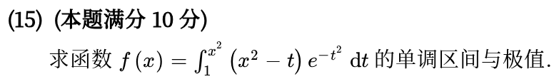

*关联章节：[定积分、变上限积分与积分性质](11-definite-integrals.md)*

---

## 交叉考点索引

以下题目主归其他章节，点击跳转到对应章节题目；不计入本章主收录题数：

- [2024年 · 第19题](13-integral-applications.md)（主章节：定积分应用）
- [2023年 · 第6题](12-improper-integrals.md)（主章节：反常积分）
- [2023年 · 第17题](14-first-order-ode.md)（主章节：一阶微分方程）
- [2021年 · 第2题](04-derivatives.md)（主章节：导数、微分与求导法则）
- [2021年 · 第20题](14-first-order-ode.md)（主章节：一阶微分方程）
- [2016年 · 第21题](11-definite-integrals.md)（主章节：定积分、变上限积分与积分性质）
- [2014年 · 第16题](14-first-order-ode.md)（主章节：一阶微分方程）
- [2013年 · 第20题](02-sequences.md)（主章节：数列极限与求和极限）
- [2012年 · 第5题](16-multivariable-basics.md)（主章节：多元函数极限、偏导与全微分）

[« 中值定理、零点与不等式证明](05-mean-value-proofs.md)　　[凹凸性与拐点 »](07-convexity.md)
