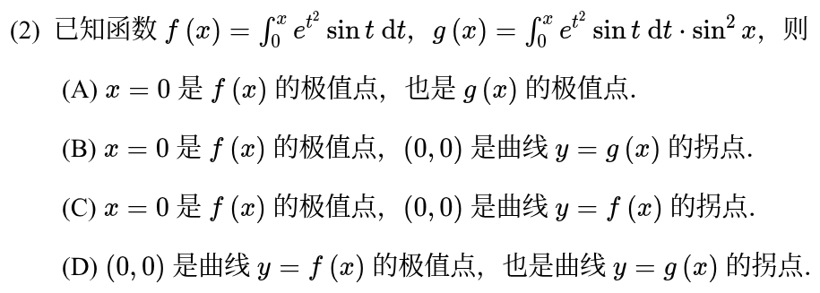
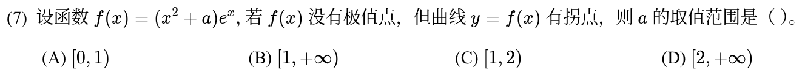
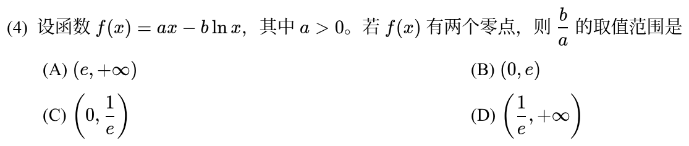
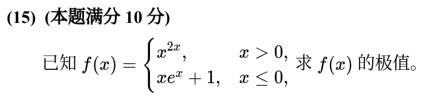
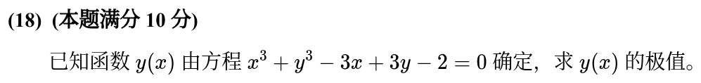
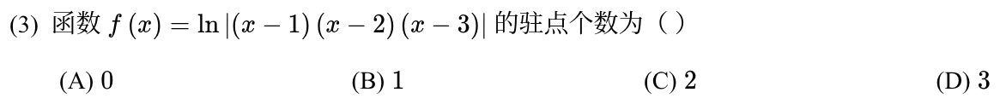
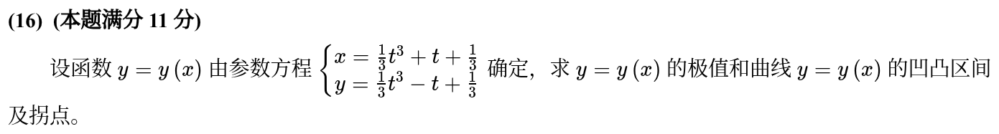
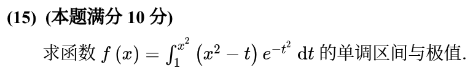

[« 中值定理、零点与不等式证明](05-mean-value-proofs.md)　　[凹凸性与拐点 »](07-convexity.md)

# 高等数学 · 单调性、极值与零点个数

> **本章共 13 题**
> 
> - **核心必做（建议按顺序攻克关键方法）**：  
>   [第 08 题](#q08)（读导函数图像） → [第 06 题](#q06)（分段点与极值） → [第 05 题](#q05)（最小值控制零点个数） → [第 07 题](#q07)（隐函数极值）
> 
> - **分流与刷题建议**：  
>   - **较难挑战**：[第 09 题](#q09)（绝对值积分分区求最值）  
>   - **重在看思路**：[第 10 题](#q10)（变限积分函数的零点个数）  
> 
> - **过关目标**：极值看变号，零点先分单调段，分界点单独检查。

---

### 01 · 2026年

> *导数与极值概念辨析。注意：单调递减加递增确实能推极小值；但反过来极值点两侧导数不一定单调（可能有无穷次振荡）。代入经典振荡函数排除假命题。*

答案与解析

**答案**：**（C）** 当 $f(x)$ 的图形在 $[-1,1]$ 上是凹的时，$\dfrac{f(x)-f(1)}{x-1}$ 在 $[-1,1)$ 上单调递增

- **切入点与推演**：按考研数学教材惯例，“图形是凹的”指曲线下凸（弦在曲线上方）。任取 $-1\le u < v < 1$，将 $v$ 写成 $u$ 与 $1$ 的凸组合：
  $$
  v = \frac{1-v}{1-u}\,u + \frac{v-u}{1-u}\cdot 1.
  $$
  由凹函数定义有
  $$
  f(v) \le \frac{1-v}{1-u}\,f(u) + \frac{v-u}{1-u}\,f(1).
  $$
  移项整理得 $(1-u)\bigl(f(v)-f(1)\bigr) \le (1-v)\bigl(f(u)-f(1)\bigr)$，两侧同除以正数 $(1-u)(1-v)$ 并改变分子分母符号：
  $$
  \frac{f(u)-f(1)}{u-1} \le \frac{f(v)-f(1)}{v-1},
  $$
  故 $\dfrac{f(x)-f(1)}{x-1}$ 在 $[-1,1)$ 上单调递增，（C）正确。
- **干扰项 / 易错提示**：
  - （A）未要求 $f(x)$ 在 $x=0$ 处连续，反例：$f(x)=|x|$（$x\ne 0$），$f(0)=1$，则 $f(0)$ 是极大值而非极小值；
  - （B）极小值点两侧不必单调，反例：$f(x)=x^2\bigl(2+\sin\frac{1}{x}\bigr)$（$x\ne 0$），$f(0)=0$；
  - （D）仅固定右端点 $x=1$ 的割线斜率单调递增不能保证全区间凹，反例：$f(x)=(x-1)(x+1)^2$，割线斜率为 $(x+1)^2$ 在 $[-1,1)$ 递增，但 $f''(x)=6x+2$ 在 $(-1,-\frac{1}{3})$ 上为负。

---

### 02 · 2025年

> *变上限积分极值与拐点。对 $f(x)$ 和 $g(x)$ 求导，看到因式里有 $\sin t$ 和 $\sin^2 x$，通过导数变号判断极值点，二阶导变号判断拐点。*

答案与解析

**答案**：**（A）** $x=0$ 是 $f(x)$ 的极值点，也是 $g(x)$ 的极值点

- **切入点与推演**：在 $x=0$ 处直接用泰勒主部（等价无穷小）或保号性判断极值与拐点最快：
  - 当 $t\to 0$ 时，$e^{t^2}\sin t = t + O(t^3)$，积分得
    $$
    f(x) = \int_0^x e^{t^2}\sin t\,\mathrm{d}t = \frac{1}{2}x^2 + O(x^4),
    $$
    故在 $x=0$ 的去心邻域内恒有 $f(x) > 0 = f(0)$，$x=0$ 是 $f(x)$ 的极小值点；且 $f''(0)=1>0$，故 $(0,0)$ 不是拐点。
  - 再看 $g(x) = f(x)\sin^2 x$：
    $$
    g(x) = \left(\frac{1}{2}x^2 + O(x^4)\right)\left(x^2 + O(x^4)\right) = \frac{1}{2}x^4 + O(x^6),
    $$
    故在 $x=0$ 的去心邻域内恒有 $g(x) > 0 = g(0)$，$x=0$ 也是 $g(x)$ 的极小值点；且 $g''(x) = 6x^2 + O(x^4)$ 在 $x=0$ 两侧均为正、不变号，故 $(0,0)$ 不是 $g(x)$ 的拐点。
- **干扰项 / 易错提示**：不要看见 $g''(0)=0$ 就误判 $(0,0)$ 是拐点；高阶偶次主部 $c x^{2k}$ 给出极值点而非拐点，只有奇次主部（阶数 $\ge 3$）才对应拐点。另外注意（D）中把极值点写成坐标 $(0,0)$ 本身也不规范。

---

### 03 · 2023年

答案与解析

**答案**：**（C）** $[1,2)$

- **切入点与推演**：分别计算一阶导数与二阶导数，利用 $e^x > 0$ 将变号问题转化为二次多项式的判别式问题：
  $$
  f'(x) = (x^2 + 2x + a)e^x = \bigl[(x+1)^2 + a - 1\bigr]e^x,
  $$
  $$
  f''(x) = (x^2 + 4x + a + 2)e^x = \bigl[(x+2)^2 + a - 2\bigr]e^x.
  $$
  - **无极值点**：要求 $f'(x)$ 在 $\mathbb{R}$ 上不变号，即二次式 $(x+1)^2 + a - 1 \ge 0$ 恒成立，故 $a - 1 \ge 0 \implies a \ge 1$（重根 $a=1$ 时 $f'(x)=(x+1)^2 e^x \ge 0$，仍不变号，无极值点）。
  - **有拐点**：要求 $f''(x)$ 至少变号一次，即二次式 $(x+2)^2 + a - 2$ 有两个相异实根，故 $a - 2 < 0 \implies a < 2$（若 $a=2$，重根处 $f''(x)=(x+2)^2 e^x \ge 0$ 不变号，无拐点）。
  联立得 $a \in [1,2)$，选（C）。
- **干扰项 / 易错提示**：端点处最容易漏判重根——二次函数有重根时导数“触零不变号”，因此“无极值”包含 $a=1$（闭端点），而“有拐点”必须排除 $a=2$（开端点）。

---

### 04 · 2022年

答案与解析

**答案**：**（B）** 当 $f'(x_0)>0$ 时，$f(x)$ 在 $x_0$ 的某邻域内单调增加

- **切入点与推演**：题干条件“$f(x)$ 在 $x=x_0$ 处有二阶导数”隐含两层强信息：① $f'(x)$ 在 $x_0$ 的某邻域内存在；② $f'(x)$ 在 $x=x_0$ 处可导，从而**在 $x=x_0$ 处连续**。
  因此，当 $f'(x_0) > 0$ 时，由函数连续性的局部保号性，存在 $\delta > 0$，使得对一切 $x\in(x_0-\delta, x_0+\delta)$ 均有 $f'(x) > 0$，故 $f(x)$ 在 $(x_0-\delta, x_0+\delta)$ 内严格单调增加，（B）正确。
- **干扰项 / 易错提示**：
  - （A）（C）错在把“$\ge 0$”写成了严格“$> 0$”，反例分别为 $f(x)=x^3$ 与 $f(x)=x^4$（在 $x_0=0$ 处）；
  - （D）错在仅知道单点 $f''(x_0)>0$，不能保证 $f''(x)$ 在邻域内存在或保号（题设并未说二阶导连续），反例：$f(x)=x^2+x^5\sin\frac{1}{x^2}$（$x\ne 0$），$f(0)=0$，虽有 $f''(0)=2>0$，但 $x\to 0$ 时 $f''(x)$ 含无界振荡项 $-\frac{4}{x}\sin\frac{1}{x^2}$，在原点任意邻域内均非凹函数。

---

### 05 · 2021年

答案与解析

**解法一：直接求导，用单调区间、最小值与分界点锁定根数**

1. **定义域**：由 $\ln x$ 知 $x \in (0, +\infty)$。
2. **求导并先查参数分界 $b = 0$**：
   $$f'(x) = a - \frac{b}{x} = \frac{ax - b}{x}, \qquad x > 0.$$
   因为 $a > 0$、$x > 0$，分母恒正，导数符号只看 $ax - b$：
   - **当 $b \le 0$ 时**：$ax - b > 0$ 对一切 $x > 0$ 恒成立，故 $f(x)$ 在 $(0, +\infty)$ 上**严格单调递增**，**至多有 1 个零点**（具体地，$b=0$ 时 $f(x)=ax>0$ 无零点；$b<0$ 时两端极限为 $-\infty$ 到 $+\infty$，恰有 1 个零点）。不可能有两个零点，直接排除 $b \le 0$。
   - **因此必有 $b > 0$**，此时驻点 $x_0 = \frac{b}{a} \in (0, +\infty)$ 确实落在定义域内。
3. **切分单调区间并核对端点极限**：
   - 在 $\left(0, \frac{b}{a}\right)$ 上：$f'(x) < 0$，$f(x)$ 严格单调递减 $\implies$ **至多 1 根**；
   - 在 $\left(\frac{b}{a}, +\infty\right)$ 上：$f'(x) > 0$，$f(x)$ 严格单调递增 $\implies$ **至多 1 根**；
   - 算两端极限（注意 $a > 0, b > 0$）：
     $$\lim_{x\to 0^+} (ax - b\ln x) = +\infty, \qquad \lim_{x\to +\infty} (ax - b\ln x) = \lim_{x\to +\infty} x\left(a - b\frac{\ln x}{x}\right) = +\infty.$$
4. **单独检查驻点（单调分界点）处的最小值**：
   $$f\left(\frac{b}{a}\right) = a\cdot \frac{b}{a} - b\ln\frac{b}{a} = b\left(1 - \ln\frac{b}{a}\right).$$
   因为 $b > 0$，最小值的符号只取决于 $1 - \ln\frac{b}{a}$，临界分界值是 $\frac{b}{a} = e$：
   - 若 $0 < \frac{b}{a} < e$：最小值 $f\left(\frac{b}{a}\right) > 0$，全区间 $f(x) > 0$ $\implies$ **0 个零点**；
   - 若 $\frac{b}{a} = e$：最小值 $f(e) = 0$，曲线仅在分界点 $x = e$ 处与 $x$ 轴相切 $\implies$ **1 个零点**（不能漏查等号！）；
   - 若 $\frac{b}{a} > e$：最小值 $f\left(\frac{b}{a}\right) < 0$，且分界点本身不是零点。此时：
     - 在 $\left(0, \frac{b}{a}\right)$ 上严格递减且由 $+\infty$ 降到负值 $\implies$ **恰有 1 根**；
     - 在 $\left(\frac{b}{a}, +\infty\right)$ 上严格递增且由负值升到 $+\infty$ $\implies$ **恰有 1 根**；
     - 合计 **恰有 2 个零点**。

   故 $\frac{b}{a} \in (e, +\infty)$，选 **（A）**。

**解法二：分离参数（同法迁移自专题 9 第 13 页）**

既然已经排除 $b \le 0$，在 $x > 0$、$a > 0$、$b > 0$ 下，方程 $ax - b\ln x = 0$ 等价于
$$\frac{\ln x}{x} = \frac{a}{b}.$$
令固定函数 $g(x) = \frac{\ln x}{x}$（$x > 0$），则 $g'(x) = \frac{1 - \ln x}{x^2}$：
- $g(x)$ 在 $(0, e)$ 上严格递增、在 $(e, +\infty)$ 上严格递减，最大值 $g(e) = \frac{1}{e}$；
- $\lim_{x\to 0^+} g(x) = -\infty$，$\lim_{x\to +\infty} g(x) = 0^+$（从正侧趋于 $0$，不与 $x$ 轴在右端相交）。

因此水平线 $y = \frac{a}{b}$ 与 $y = g(x)$ 有两个交点，当且仅当
$$0 < \frac{a}{b} < \frac{1}{e} \iff \frac{b}{a} > e,$$
同样得 **（A）**。

**选择题关键干扰项拆解**

- **（C）$\left(0, \frac{1}{e}\right)$（最容易踩的坑）**：这正是解法二中 **$\frac{a}{b}$** 的范围，而不是题目问的 **$\frac{b}{a}$**。分离参数后务必回头看一眼题干求的是比值还是倒数。
- **（B）$(0, e)$**：把最小值小于 $0$ 的不等式 $1 - \ln\frac{b}{a} < 0$ 写反了，对应的是 $0$ 个零点。
- **（D）$\left(\frac{1}{e}, +\infty\right)$**：把临界值 $e$ 与 $\frac{1}{e}$ 混用。

---

### 06 · 2019年

答案与解析

**第一步落笔与完整推导**

1. **先检查分段点 $x = 0$ 的连续性**：
   $$f(0) = 0 \cdot e^0 + 1 = 1, \qquad \lim_{x\to 0^+} x^{2x} = \lim_{x\to 0^+} e^{2x\ln x} = e^0 = 1 = f(0).$$
   故 $f(x)$ 在 $(-\infty, +\infty)$ 上处处连续。
2. **分段求导，找全部驻点**：
   - 当 $x < 0$ 时：$f'(x) = (x + 1)e^x$。令 $f'(x) = 0$ 得驻点 $x = -1$；
     - 在 $(-\infty, -1)$ 上 $f'(x) < 0$；在 $(-1, 0)$ 上 $f'(x) > 0$。
   - 当 $x > 0$ 时：改写 $f(x) = e^{2x\ln x}$，求导得
     $$f'(x) = e^{2x\ln x}\cdot 2(\ln x + 1) = 2x^{2x}(\ln x + 1).$$
     令 $f'(x) = 0$ 得驻点 $x = \frac{1}{e}$；
     - 在 $\left(0, \frac{1}{e}\right)$ 上 $f'(x) < 0$；在 $\left(\frac{1}{e}, +\infty\right)$ 上 $f'(x) > 0$。
3. **汇总全部可疑点（两个驻点 + 分段点 $x = 0$）画单调符号表**：

| 区间 / 点 | $(-\infty, -1)$ | $-1$ | $(-1, 0)$ | $0$ | $\left(0, \frac{1}{e}\right)$ | $\frac{1}{e}$ | $\left(\frac{1}{e}, +\infty\right)$ |
| :---: | :---: | :---: | :---: | :---: | :---: | :---: | :---: |
| $f'(x)$ | $-$ | $0$ | $+$ | 不存在（右导 $-\infty$） | $-$ | $0$ | $+$ |
| $f(x)$ | $\searrow$ | **极小值** | $\nearrow$ | **极大值** | $\searrow$ | **极小值** | $\nearrow$ |

4. **写出全部极值**（注意题目问“极值”，必须算函数值）：
   - 极小值：$f(-1) = 1 - \frac{1}{e}$，以及 $f\left(\frac{1}{e}\right) = \left(\frac{1}{e}\right)^{2/e} = e^{-\frac{2}{e}}$；
   - 极大值：$f(0) = 1$。

---

### 07 · 2017年

答案与解析

1. **一阶隐函数求导**：方程两边对 $x$ 求导得 $3x^2 + 3y^2 y' - 3 + 3y' = 0$，即
   $$y' = \frac{1 - x^2}{y^2 + 1}.$$
   分母 $y^2 + 1 \ge 1 > 0$ 恒不为 $0$，因此 $y(x)$ 处处可导，无不可导点。
2. **求驻点并代回原方程解 $y$**：令 $y' = 0$ 得 $x = 1$ 或 $x = -1$。
   注意到辅助函数 $g(y) = y^3 + 3y$ 满足 $g'(y) = 3y^2 + 3 > 0$ 严格递增，故每个 $x$ 对应的实数 $y$ **唯一**：
   - $x = 1$ 时：$y^3 + 3y - 4 = 0 \implies (y - 1)(y^2 + y + 4) = 0 \implies y = 1$；
   - $x = -1$ 时：$y^3 + 3y = 0 \implies y(y^2 + 3) = 0 \implies y = 0$。
3. **二阶隐函数求导判别**（直接在 $x^2 + y^2 y' - 1 + y' = 0$ 两边求导，并在 $y' = 0$ 处简化，免去商的求导）：
   $$2x + 2y(y')^2 + (y^2 + 1)y'' = 0 \xrightarrow{y' = 0} y'' = -\frac{2x}{y^2 + 1}.$$
   - 在 $(1, 1)$ 处：$y''(1) = -1 < 0 \implies$ 极大值 $y(1) = 1$；
   - 在 $(-1, 0)$ 处：$y''(-1) = 2 > 0 \implies$ 极小值 $y(-1) = 0$。

---

### 08 · 2016年

答案与解析

**逐点扫描与完整推导**

题干已知 $f(x)$ 在 $(-\infty, +\infty)$ 内**连续**，图中给出的是导函数 $y = f'(x)$ 的图像。从左到右标出 5 个关键横坐标 $0 < x_1 < x_0 < x_2 < x_3 < x_4$：

1. **$x_1$（$x$ 轴第一个穿过的零点）**：$f'(x)$ 从正变为负 $\implies$ **$f(x)$ 的极大值点**；两侧 $f'(x)$ 均单调递减（$f'' < 0$）$\implies$ 不是拐点。
2. **$x_0$（虚线铅直渐近线处）**：
   - 左右两侧 $f'(x)$ 均小于 $0$（同趋于 $-\infty$），$f'(x)$ **不变号** $\implies$ **不是极值点**；
   - 左侧 $f'(x)$ 严格递减（$f''(x) < 0$），右侧 $f'(x)$ 严格递增（$f''(x) > 0$），且题干保证 $f(x)$ 在 $x_0$ 处**连续** $\implies$ **$(x_0, f(x_0))$ 是拐点**！（本题最核心的隐藏点）
3. **$x_2$（$x$ 轴第二个穿过的零点）**：$f'(x)$ 从负变为正 $\implies$ **$f(x)$ 的极小值点**；两侧 $f'(x)$ 均单调递增（$f'' > 0$）$\implies$ 不是拐点。
4. **$x_3$（$f'(x)$ 的波峰 / 极大值点）**：$f'(x)$ 恒正不变号 $\implies$ 不是极值点；$f'(x)$ 由增变减（$f''$ 由正变负）$\implies$ **$(x_3, f(x_3))$ 是拐点**。
5. **$x_4$（$f'(x)$ 与 $x$ 轴相切的波谷 / 极小值点）**：
   - 左右两侧 $f'(x) \ge 0$ 不变号 $\implies$ **不是极值点**；
   - $f'(x)$ 由减变增（$f''$ 由负变正）$\implies$ **$(x_4, f(x_4))$ 是拐点**。

汇总：**极值点 2 个**（$x_1, x_2$），**拐点 3 个**（$x_0, x_3, x_4$），选 **（B）**。

**选择题干扰项拆解**

- **（A）2 个极值点，2 个拐点（最常见错误）**：正确排除了相切点 $x_4$ 作为极值点，却把铅直渐近线 $x_0$ 处当成“导数不存在就没有拐点”漏掉了。
- **（D）3 个极值点，2 个拐点**：既把相切点 $x_4$ 误当成极值点（只看 $f'=0$ 不看变号），又漏掉了 $x_0$ 处的拐点。
- **（C）3 个极值点，1 个拐点**：同时漏掉了 $x_0$ 与 $x_4$ 两个拐点。

---

### 09 · 2016年

> *含绝对值的变限积分大题。被积函数含 $|t^2-x^2|$，在积分区间 $[0,1]$ 内以 $t=x$ 为分界点拆成两段去掉绝对值，求导解驻点求最小值。*

答案与解析

**结论速览**：$f'(x)=\begin{cases}4x^2-2x,&0<x<1,\\2x,&x\ge 1,\end{cases}$ 最小值为 $f\!\left(\dfrac{1}{2}\right)=\dfrac{1}{4}$。

- **完整解答**：
  1. **按 $x$ 与 $1$ 的大小拆绝对值求 $f(x)$**：
     因 $x>0$ 且积分变量 $t\in[0,1]$，需以 $t=x$ 为分界点讨论：
     - 当 $0 < x < 1$ 时：
       $$
       \begin{aligned}
       f(x) &= \int_0^x (x^2-t^2)\,\mathrm{d}t + \int_x^1 (t^2-x^2)\,\mathrm{d}t \\
       &= \left[x^2 t - \frac{t^3}{3}\right]_0^x + \left[\frac{t^3}{3} - x^2 t\right]_x^1 = \frac{4}{3}x^3 - x^2 + \frac{1}{3}.
       \end{aligned}
       $$
     - 当 $x \ge 1$ 时，对一切 $t\in[0,1]$ 均有 $x^2 \ge t^2$：
       $$
       f(x) = \int_0^1 (x^2-t^2)\,\mathrm{d}t = x^2 - \frac{1}{3}.
       $$
  2. **求导并核验分段点 $x=1$ 处的可导性**：
     当 $0<x<1$ 时 $f'(x) = 4x^2 - 2x$；当 $x>1$ 时 $f'(x) = 2x$。
     在 $x=1$ 处，$f(1^-) = \frac{2}{3} = f(1^+)$（连续），且左右导数分别为
     $$
     f'_-(1) = \lim_{x\to 1^-} (4x^2-2x) = 2,\qquad f'_+(1) = \lim_{x\to 1^+} 2x = 2,
     $$
     故 $f'(1)=2$，从而
     $$
     f'(x) = \begin{cases} 4x^2 - 2x, & 0 < x < 1, \\ 2x, & x \ge 1. \end{cases}
     $$
  3. **求最小值**：
     令 $f'(x)=0$，在 $(0,+\infty)$ 上得唯一驻点 $x=\frac{1}{2}$。
     - 当 $0 < x < \frac{1}{2}$ 时，$f'(x) < 0$，$f(x)$ 单调递减；
     - 当 $x > \frac{1}{2}$ 时，$f'(x) > 0$，$f(x)$ 单调递增。
     因此 $f(x)$ 在 $x=\frac{1}{2}$ 处取得唯一极小值，也是 $(0,+\infty)$ 上的最小值：
     $$
     f\!\left(\frac{1}{2}\right) = \frac{4}{3}\cdot\frac{1}{8} - \frac{1}{4} + \frac{1}{3} = \frac{1}{4}.
     $$
- **核心思路与避坑**：含参数绝对值定积分必须先按参数落在积分区间内/外分段，再单独验证分段点 $x=1$ 处的连续性与左右导数是否相等，漏核分段点是常见扣分点。

---

### 10 · 2015年

> *变限积分零点个数大题。两边求导得到 $f'(x)$，解出导数驻点并判断单调区间；结合端点极限 $x\to 0^+$ 和 $x\to +\infty$ 的函数值正负卡出零点个数。*

答案与解析

**独立练习提示（先遮住，做完再核对要点）**：
- **先核定义域**：对一切 $x \in \mathbb{R}$，$x^2 \ge 0 > -1$，所以定义域是**全体实数 $(-\infty, +\infty)$**（不要误写成 $x > 0$）。
- **求导切分单调段**：$f'(x) = (2x-1)\sqrt{1+x^2}$，唯一驻点 $x = \frac{1}{2}$。
- **不硬算积分判断最小值符号**：直接观察特殊点 $f(1) = 0$，利用 $f$ 在 $\left(\frac{1}{2}, +\infty\right)$ 上严格递增，立刻得 $f\left(\frac{1}{2}\right) < f(1) = 0$；再看 $x \to -\infty$ 时 $f(x) \to +\infty$，即可闭合得出总根数为 **2 个**。

---

### 11 · 2011年

答案与解析

**答案**：**（C）** $2$

- **切入点与推演**：先确定定义域：$x \ne 1,2,3$。记 $P(x) = (x-1)(x-2)(x-3)$，令 $u = x-2$，则 $P(x) = u(u^2-1) = u^3 - u$。
  在定义域上，$f(x) = \ln|P(x)|$ 可导，且
  $$
  f'(x) = \frac{P'(x)}{P(x)} = \frac{3u^2 - 1}{u^3 - u}.
  $$
  令 $f'(x) = 0$，得 $3u^2 - 1 = 0 \implies u = \pm\frac{1}{\sqrt{3}}$，即 $x = 2 \pm \frac{\sqrt{3}}{3}$。
  易知这两个点均满足 $x \ne 1,2,3$（即 $P(x)\ne 0$），落在定义域内，故驻点恰有 $2$ 个，选（C）。
- **干扰项 / 易错提示**：驻点要求 $f'(x)=0$，而 $x=1,2,3$ 是 $f(x)$ 的无定义点（铅直渐近线位置），既非驻点也非极值点；另外用罗尔定理亦可一眼看出 $P(x)$ 在 $(1,2)$ 和 $(2,3)$ 内各有一个 $P'(x)=0$ 的根。

---

### 12 · 2011年

> *参数方程极值与拐点大题。先算一阶导 $\frac{dy}{dx}$ 求驻点定极值；再用参数方程二阶导公式求出 $\frac{d^2y}{dx^2}$，令二阶导为 0 找出拐点坐标。*

答案与解析

**结论速览**：极大值为 $y(-1)=1$，极小值为 $y\!\left(\frac{5}{3}\right)=-\frac{1}{3}$；凸区间为 $\left(-\infty,\frac{1}{3}\right]$，凹区间为 $\left[\frac{1}{3},+\infty\right)$，拐点为 $\left(\frac{1}{3},\frac{1}{3}\right)$。

- **完整解答**：
  1. **确定 $x(t)$ 的单调性与一阶导数**：
     $$
     \frac{\mathrm{d}x}{\mathrm{d}t} = t^2 + 1 > 0,\qquad \frac{\mathrm{d}y}{\mathrm{d}t} = t^2 - 1.
     $$
     因 $\frac{\mathrm{d}x}{\mathrm{d}t} > 0$ 且 $t\to\pm\infty$ 时 $x\to\pm\infty$，$x$ 是 $t$ 的严格单调递增函数，区间方向与 $t$ 一致。一阶导数为
     $$
     \frac{\mathrm{d}y}{\mathrm{d}x} = \frac{t^2-1}{t^2+1}.
     $$
     令 $\frac{\mathrm{d}y}{\mathrm{d}x} = 0$ 得驻点 $t = -1$（对应 $x = -1$）和 $t = 1$（对应 $x = \frac{5}{3}$）：
     - $t < -1$（$x < -1$）时，$\frac{\mathrm{d}y}{\mathrm{d}x} > 0$；
     - $-1 < t < 1$（$-1 < x < \frac{5}{3}$）时，$\frac{\mathrm{d}y}{\mathrm{d}x} < 0$；
     - $t > 1$（$x > \frac{5}{3}$）时，$\frac{\mathrm{d}y}{\mathrm{d}x} > 0$。
     故当 $x = -1$（$t=-1$）时取**极大值** $y = -\frac{1}{3}+1+\frac{1}{3} = 1$；当 $x = \frac{5}{3}$（$t=1$）时取**极小值** $y = \frac{1}{3}-1+\frac{1}{3} = -\frac{1}{3}$。
  2. **求二阶导数、凹凸区间与拐点**：
     $$
     \frac{\mathrm{d}^2y}{\mathrm{d}x^2} = \frac{\mathrm{d}}{\mathrm{d}t}\!\left(\frac{t^2-1}{t^2+1}\right)\cdot\frac{1}{\mathrm{d}x/\mathrm{d}t} = \frac{4t}{(t^2+1)^2}\cdot\frac{1}{t^2+1} = \frac{4t}{(t^2+1)^3}.
     $$
     令 $\frac{\mathrm{d}^2y}{\mathrm{d}x^2}=0$ 得 $t=0$，对应点 $(x,y) = \left(\frac{1}{3},\frac{1}{3}\right)$：
     - 当 $t < 0$（即 $x < \frac{1}{3}$）时，$\frac{\mathrm{d}^2y}{\mathrm{d}x^2} < 0$，曲线在 $\left(-\infty,\frac{1}{3}\right]$ 上是**凸**的；
     - 当 $t > 0$（即 $x > \frac{1}{3}$）时，$\frac{\mathrm{d}^2y}{\mathrm{d}x^2} > 0$，曲线在 $\left[\frac{1}{3},+\infty\right)$ 上是**凹**的。
     因此拐点为 $\left(\frac{1}{3},\frac{1}{3}\right)$。
- **核心思路与避坑**：参数方程求二阶导切勿漏乘 $\dfrac{1}{\mathrm{d}x/\mathrm{d}t}$；另外凹凸区间必须换算回自变量 $x$ 的区间（而非停留在参数 $t$ 的区间），极值也要给出 $y$ 值。

---

### 13 · 2010年

答案与解析

**结论速览**：单调递减区间为 $(-\infty,-1]$ 和 $[0,1]$，单调递增区间为 $[-1,0]$ 和 $[1,+\infty)$；极小值为 $f(\pm 1)=0$，极大值为 $f(0)=\dfrac{1-e^{-1}}{2}$。

- **完整解答**：
  1. **分离含 $x$ 因子后求导**：
     将 $f(x)$ 拆成两项变上限积分：
     $$
     f(x) = x^2\int_1^{x^2} e^{-t^2}\,\mathrm{d}t - \int_1^{x^2} t e^{-t^2}\,\mathrm{d}t.
     $$
     两边对 $x$ 求导（两项的上限求导项恰好抵消）：
     $$
     f'(x) = 2x\int_1^{x^2} e^{-t^2}\,\mathrm{d}t + x^2 e^{-x^4}\cdot 2x - x^2 e^{-x^4}\cdot 2x = 2x\int_1^{x^2} e^{-t^2}\,\mathrm{d}t.
     $$
  2. **按 $x$ 与 $x^2-1$ 的符号划分单调区间**：
     因为 $e^{-t^2} > 0$，所以 $\int_1^{x^2} e^{-t^2}\,\mathrm{d}t$ 与 $x^2-1$ 同号。令 $f'(x)=0$ 得驻点 $x=-1,0,1$：
     - $x \in (-\infty,-1)$：$2x < 0$ 且 $x^2 > 1 \implies f'(x) < 0$，单调递减；
     - $x \in (-1,0)$：$2x < 0$ 且 $x^2 < 1 \implies f'(x) > 0$，单调递增；
     - $x \in (0,1)$：$2x > 0$ 且 $x^2 < 1 \implies f'(x) < 0$，单调递减；
     - $x \in (1,+\infty)$：$2x > 0$ 且 $x^2 > 1 \implies f'(x) > 0$，单调递增。
     故单调递减区间为 $(-\infty,-1]$ 和 $[0,1]$，单调递增区间为 $[-1,0]$ 和 $[1,+\infty)$。
  3. **计算极值**：
     - 在 $x = -1$ 与 $x = 1$ 处，$f'(x)$ 由负变正，均取得**极小值** $f(\pm 1) = 0$；
     - 在 $x = 0$ 处，$f'(x)$ 由正变负，取得**极大值**：
       $$
       f(0) = \int_1^0 (-t)e^{-t^2}\,\mathrm{d}t = \int_0^1 t e^{-t^2}\,\mathrm{d}t = \left[-\frac{1}{2}e^{-t^2}\right]_0^1 = \frac{1-e^{-1}}{2}.
       $$
- **核心思路与避坑**：被积函数含外变量 $x$ 时，必须先把它提到积分号外再求导；另外算 $f(0)$ 时注意原积分限是 $\int_1^0$，调换上下限要变号，与被积函数的负号抵消后得正值。

---

[« 中值定理、零点与不等式证明](05-mean-value-proofs.md)　　[凹凸性与拐点 »](07-convexity.md)
