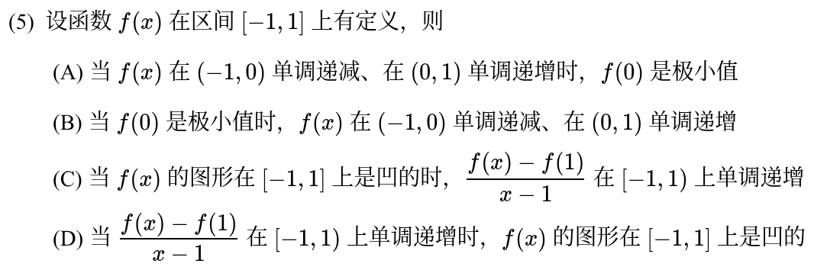
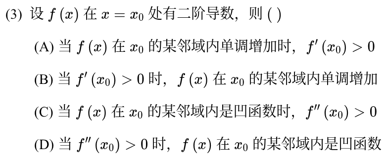
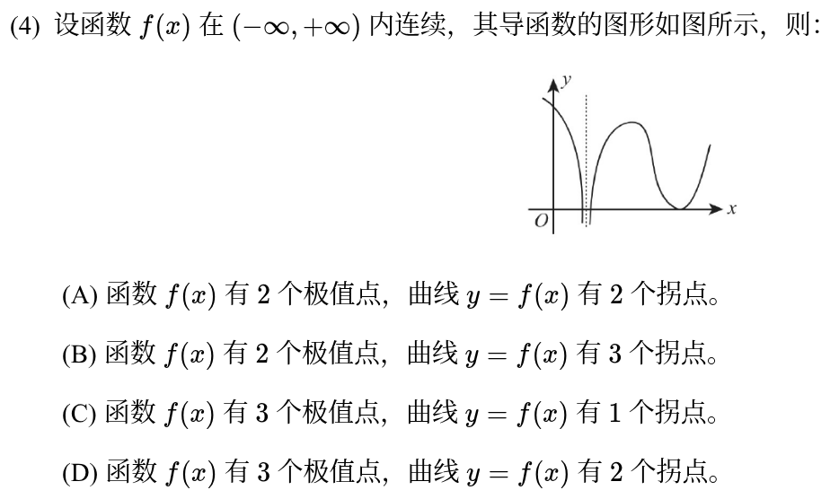
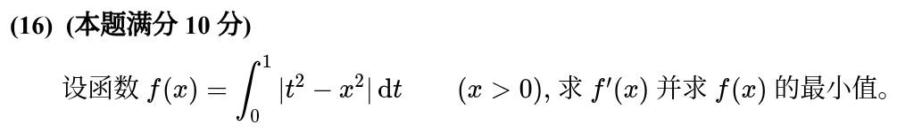
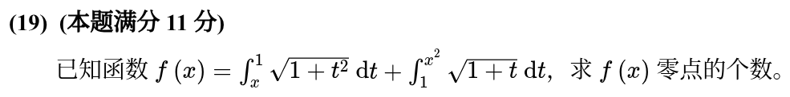

[« 中值定理、零点与不等式证明](05-mean-value-proofs.md)　　[凹凸性与拐点 »](07-convexity.md)

# 高等数学 · 单调性、极值与零点个数

> **本章共 13 题**
> 
> - **核心必做（建议按顺序攻克关键方法）**：  
>   [第 08 题](#q08)（读导函数图像） → [第 06 题](#q06)（分段点与极值） → [第 05 题](#q05)（最小值控制零点个数） → [第 07 题](#q07)（隐函数极值）
> 
> - **分流与刷题建议**：  
>   - **较难挑战**：[第 09 题](#q09)（绝对值积分分区求最值）  
>   - **重在看思路**：[第 10 题](#q10)（变限积分函数的零点个数）  
> 
> - **过关目标**：极值看变号，零点先分单调段，分界点单独检查。

---

### 01 · 2026年

> *导数与极值概念辨析。注意：单调递减加递增确实能推极小值；但反过来极值点两侧导数不一定单调（可能有无穷次振荡）。代入经典振荡函数排除假命题。*

答案与解析

**答案 C。** 按题中“凹”的用法，弦在图像上方。对 $u<v<1$，将 $v$ 写成 $u,1$ 的凸组合，弦不等式给出 $\frac{f(u)-f(1)}{u-1}\le\frac{f(v)-f(1)}{v-1}$。A 漏了在 $0$ 处的连续性，B 把局部极小误当成两边单调。D 只控制固定右端点的弦，不能控制任意两点的弦。例如 $f(x)=(x-1)(x+1)^2$ 的该弦斜率为  $(x+1)^2$，在所给区间递增，但 $f''(x)=6x+2$ 在左端附近为负。

---

### 02 · 2025年

> *变上限积分极值与拐点。对 $f(x)$ 和 $g(x)$ 求导，看到因式里有 $\sin t$ 和 $\sin^2 x$，通过导数变号判断极值点，二阶导变号判断拐点。*

答案与解析

**答案 A。** 在原点附近，$e^{t^2}\sin t$ 与 $t$ 同号，故对两侧的非零 $x$ 都有 $f(x)>0=f(0)$。又 $\sin^2 x>0$，得 $g(x)>0=g(0)$。所以两者都在 0 取严格局部极小值。$f''(0)=1$，而 $g''(x)=6x^2+O(x^4)$ 在原点两侧同号，两处均非拐点。

---

### 03 · 2023年

答案与解析

**答案 C，$1\le a<2$。** $f'=e^x[(x+1)^2+a-1]$，无极值要求该二次式不发生变号，故 $a\ge1$。$f''=e^x[(x+2)^2+a-2]$，有拐点要求二阶导变号，故 $a<2$。$a=2$ 的重根不引起变号。

---

### 04 · 2022年

答案与解析

**答案 B。** $f''(x_0)$ 存在保证 $f'$ 在 $x_0$ 连续，故 $f'(x_0)>0$ 时邻域内 $f'>0$。A、C 可分别用 $x^3,x^4$ 在 0 反驳。D 要保证整个邻域的凹性。例 $f(x)=x^2+x^5\sin(1/x^2)$、$f(0)=0$，有 $f''(0)=2$，但邻域内 $f''$ 含无界振荡项 $-4\sin(1/x^2)/x$，不能保持非负。

---

### 05 · 2021年

答案与解析

**解法一：直接求导，用单调区间、最小值与分界点锁定根数**

1. **定义域**：由 $\ln x$ 知 $x \in (0, +\infty)$。
2. **求导并先查参数分界 $b = 0$**：
   $$f'(x) = a - \frac{b}{x} = \frac{ax - b}{x}, \qquad x > 0.$$
   因为 $a > 0$、$x > 0$，分母恒正，导数符号只看 $ax - b$：
   - **当 $b \le 0$ 时**：$ax - b > 0$ 对一切 $x > 0$ 恒成立，故 $f(x)$ 在 $(0, +\infty)$ 上**严格单调递增**，**至多有 1 个零点**（具体地，$b=0$ 时 $f(x)=ax>0$ 无零点；$b<0$ 时两端极限为 $-\infty$ 到 $+\infty$，恰有 1 个零点）。不可能有两个零点，直接排除 $b \le 0$。
   - **因此必有 $b > 0$**，此时驻点 $x_0 = \frac{b}{a} \in (0, +\infty)$ 确实落在定义域内。
3. **切分单调区间并核对端点极限**：
   - 在 $\left(0, \frac{b}{a}\right)$ 上：$f'(x) < 0$，$f(x)$ 严格单调递减 $\implies$ **至多 1 根**；
   - 在 $\left(\frac{b}{a}, +\infty\right)$ 上：$f'(x) > 0$，$f(x)$ 严格单调递增 $\implies$ **至多 1 根**；
   - 算两端极限（注意 $a > 0, b > 0$）：
     $$\lim_{x\to 0^+} (ax - b\ln x) = +\infty, \qquad \lim_{x\to +\infty} (ax - b\ln x) = \lim_{x\to +\infty} x\left(a - b\frac{\ln x}{x}\right) = +\infty.$$
4. **单独检查驻点（单调分界点）处的最小值**：
   $$f\left(\frac{b}{a}\right) = a\cdot \frac{b}{a} - b\ln\frac{b}{a} = b\left(1 - \ln\frac{b}{a}\right).$$
   因为 $b > 0$，最小值的符号只取决于 $1 - \ln\frac{b}{a}$，临界分界值是 $\frac{b}{a} = e$：
   - 若 $0 < \frac{b}{a} < e$：最小值 $f\left(\frac{b}{a}\right) > 0$，全区间 $f(x) > 0$ $\implies$ **0 个零点**；
   - 若 $\frac{b}{a} = e$：最小值 $f(e) = 0$，曲线仅在分界点 $x = e$ 处与 $x$ 轴相切 $\implies$ **1 个零点**（不能漏查等号！）；
   - 若 $\frac{b}{a} > e$：最小值 $f\left(\frac{b}{a}\right) < 0$，且分界点本身不是零点。此时：
     - 在 $\left(0, \frac{b}{a}\right)$ 上严格递减且由 $+\infty$ 降到负值 $\implies$ **恰有 1 根**；
     - 在 $\left(\frac{b}{a}, +\infty\right)$ 上严格递增且由负值升到 $+\infty$ $\implies$ **恰有 1 根**；
     - 合计 **恰有 2 个零点**。

   故 $\frac{b}{a} \in (e, +\infty)$，选 **（A）**。

**解法二：分离参数（同法迁移自专题 9 第 13 页）**

既然已经排除 $b \le 0$，在 $x > 0$、$a > 0$、$b > 0$ 下，方程 $ax - b\ln x = 0$ 等价于
$$\frac{\ln x}{x} = \frac{a}{b}.$$
令固定函数 $g(x) = \frac{\ln x}{x}$（$x > 0$），则 $g'(x) = \frac{1 - \ln x}{x^2}$：
- $g(x)$ 在 $(0, e)$ 上严格递增、在 $(e, +\infty)$ 上严格递减，最大值 $g(e) = \frac{1}{e}$；
- $\lim_{x\to 0^+} g(x) = -\infty$，$\lim_{x\to +\infty} g(x) = 0^+$（从正侧趋于 $0$，不与 $x$ 轴在右端相交）。

因此水平线 $y = \frac{a}{b}$ 与 $y = g(x)$ 有两个交点，当且仅当
$$0 < \frac{a}{b} < \frac{1}{e} \iff \frac{b}{a} > e,$$
同样得 **（A）**。

**选择题关键干扰项拆解**

- **（C）$\left(0, \frac{1}{e}\right)$（最容易踩的坑）**：这正是解法二中 **$\frac{a}{b}$** 的范围，而不是题目问的 **$\frac{b}{a}$**。分离参数后务必回头看一眼题干求的是比值还是倒数。
- **（B）$(0, e)$**：把最小值小于 $0$ 的不等式 $1 - \ln\frac{b}{a} < 0$ 写反了，对应的是 $0$ 个零点。
- **（D）$\left(\frac{1}{e}, +\infty\right)$**：把临界值 $e$ 与 $\frac{1}{e}$ 混用。

---

### 06 · 2019年

答案与解析

**第一步落笔与完整推导**

1. **先检查分段点 $x = 0$ 的连续性**：
   $$f(0) = 0 \cdot e^0 + 1 = 1, \qquad \lim_{x\to 0^+} x^{2x} = \lim_{x\to 0^+} e^{2x\ln x} = e^0 = 1 = f(0).$$
   故 $f(x)$ 在 $(-\infty, +\infty)$ 上处处连续。
2. **分段求导，找全部驻点**：
   - 当 $x < 0$ 时：$f'(x) = (x + 1)e^x$。令 $f'(x) = 0$ 得驻点 $x = -1$；
     - 在 $(-\infty, -1)$ 上 $f'(x) < 0$；在 $(-1, 0)$ 上 $f'(x) > 0$。
   - 当 $x > 0$ 时：改写 $f(x) = e^{2x\ln x}$，求导得
     $$f'(x) = e^{2x\ln x}\cdot 2(\ln x + 1) = 2x^{2x}(\ln x + 1).$$
     令 $f'(x) = 0$ 得驻点 $x = \frac{1}{e}$；
     - 在 $\left(0, \frac{1}{e}\right)$ 上 $f'(x) < 0$；在 $\left(\frac{1}{e}, +\infty\right)$ 上 $f'(x) > 0$。
3. **汇总全部可疑点（两个驻点 + 分段点 $x = 0$）画单调符号表**：

| 区间 / 点 | $(-\infty, -1)$ | $-1$ | $(-1, 0)$ | $0$ | $\left(0, \frac{1}{e}\right)$ | $\frac{1}{e}$ | $\left(\frac{1}{e}, +\infty\right)$ |
| :---: | :---: | :---: | :---: | :---: | :---: | :---: | :---: |
| $f'(x)$ | $-$ | $0$ | $+$ | 不存在（右导 $-\infty$） | $-$ | $0$ | $+$ |
| $f(x)$ | $\searrow$ | **极小值** | $\nearrow$ | **极大值** | $\searrow$ | **极小值** | $\nearrow$ |

4. **写出全部极值**（注意题目问“极值”，必须算函数值）：
   - 极小值：$f(-1) = 1 - \frac{1}{e}$，以及 $f\left(\frac{1}{e}\right) = \left(\frac{1}{e}\right)^{2/e} = e^{-\frac{2}{e}}$；
   - 极大值：$f(0) = 1$。

---

### 07 · 2017年

答案与解析

1. **一阶隐函数求导**：方程两边对 $x$ 求导得 $3x^2 + 3y^2 y' - 3 + 3y' = 0$，即
   $$y' = \frac{1 - x^2}{y^2 + 1}.$$
   分母 $y^2 + 1 \ge 1 > 0$ 恒不为 $0$，因此 $y(x)$ 处处可导，无不可导点。
2. **求驻点并代回原方程解 $y$**：令 $y' = 0$ 得 $x = 1$ 或 $x = -1$。
   注意到辅助函数 $g(y) = y^3 + 3y$ 满足 $g'(y) = 3y^2 + 3 > 0$ 严格递增，故每个 $x$ 对应的实数 $y$ **唯一**：
   - $x = 1$ 时：$y^3 + 3y - 4 = 0 \implies (y - 1)(y^2 + y + 4) = 0 \implies y = 1$；
   - $x = -1$ 时：$y^3 + 3y = 0 \implies y(y^2 + 3) = 0 \implies y = 0$。
3. **二阶隐函数求导判别**（直接在 $x^2 + y^2 y' - 1 + y' = 0$ 两边求导，并在 $y' = 0$ 处简化，免去商的求导）：
   $$2x + 2y(y')^2 + (y^2 + 1)y'' = 0 \xrightarrow{y' = 0} y'' = -\frac{2x}{y^2 + 1}.$$
   - 在 $(1, 1)$ 处：$y''(1) = -1 < 0 \implies$ 极大值 $y(1) = 1$；
   - 在 $(-1, 0)$ 处：$y''(-1) = 2 > 0 \implies$ 极小值 $y(-1) = 0$。

---

### 08 · 2016年

答案与解析

**逐点扫描与完整推导**

题干已知 $f(x)$ 在 $(-\infty, +\infty)$ 内**连续**，图中给出的是导函数 $y = f'(x)$ 的图像。从左到右标出 5 个关键横坐标 $0 < x_1 < x_0 < x_2 < x_3 < x_4$：

1. **$x_1$（$x$ 轴第一个穿过的零点）**：$f'(x)$ 从正变为负 $\implies$ **$f(x)$ 的极大值点**；两侧 $f'(x)$ 均单调递减（$f'' < 0$）$\implies$ 不是拐点。
2. **$x_0$（虚线铅直渐近线处）**：
   - 左右两侧 $f'(x)$ 均小于 $0$（同趋于 $-\infty$），$f'(x)$ **不变号** $\implies$ **不是极值点**；
   - 左侧 $f'(x)$ 严格递减（$f''(x) < 0$），右侧 $f'(x)$ 严格递增（$f''(x) > 0$），且题干保证 $f(x)$ 在 $x_0$ 处**连续** $\implies$ **$(x_0, f(x_0))$ 是拐点**！（本题最核心的隐藏点）
3. **$x_2$（$x$ 轴第二个穿过的零点）**：$f'(x)$ 从负变为正 $\implies$ **$f(x)$ 的极小值点**；两侧 $f'(x)$ 均单调递增（$f'' > 0$）$\implies$ 不是拐点。
4. **$x_3$（$f'(x)$ 的波峰 / 极大值点）**：$f'(x)$ 恒正不变号 $\implies$ 不是极值点；$f'(x)$ 由增变减（$f''$ 由正变负）$\implies$ **$(x_3, f(x_3))$ 是拐点**。
5. **$x_4$（$f'(x)$ 与 $x$ 轴相切的波谷 / 极小值点）**：
   - 左右两侧 $f'(x) \ge 0$ 不变号 $\implies$ **不是极值点**；
   - $f'(x)$ 由减变增（$f''$ 由负变正）$\implies$ **$(x_4, f(x_4))$ 是拐点**。

汇总：**极值点 2 个**（$x_1, x_2$），**拐点 3 个**（$x_0, x_3, x_4$），选 **（B）**。

**选择题干扰项拆解**

- **（A）2 个极值点，2 个拐点（最常见错误）**：正确排除了相切点 $x_4$ 作为极值点，却把铅直渐近线 $x_0$ 处当成“导数不存在就没有拐点”漏掉了。
- **（D）3 个极值点，2 个拐点**：既把相切点 $x_4$ 误当成极值点（只看 $f'=0$ 不看变号），又漏掉了 $x_0$ 处的拐点。
- **（C）3 个极值点，1 个拐点**：同时漏掉了 $x_0$ 与 $x_4$ 两个拐点。

---

### 09 · 2016年

> *含绝对值的变限积分大题。被积函数含 $|t^2-x^2|$，在积分区间 $[0,1]$ 内以 $t=x$ 为分界点拆成两段去掉绝对值，求导解驻点求最小值。*

答案与解析

**解。** $0<x<1$ 时在 $t=x$ 拆绝对值，得 $f=1/3-x^2+4x^3/3$；$x\ge1$ 时 $f=x^2-1/3$。两侧导数在 $x=1$ 同为 2，因此
$$
f'(x)=\begin{cases}4x^2-2x,&0<x<1,\\2x,&x\ge1.\end{cases}
$$
在 $x=1/2$ 由负变正，故最小值是 $f(1/2)=1/4$。

---

### 10 · 2015年

> *变限积分零点个数大题。两边求导得到 $f'(x)$，解出导数驻点并判断单调区间；结合端点极限 $x\to 0^+$ 和 $x\to +\infty$ 的函数值正负卡出零点个数。*

答案与解析

**独立练习提示（先遮住，做完再核对要点）**：
- **先核定义域**：对一切 $x \in \mathbb{R}$，$x^2 \ge 0 > -1$，所以定义域是**全体实数 $(-\infty, +\infty)$**（不要误写成 $x > 0$）。
- **求导切分单调段**：$f'(x) = (2x-1)\sqrt{1+x^2}$，唯一驻点 $x = \frac{1}{2}$。
- **不硬算积分判断最小值符号**：直接观察特殊点 $f(1) = 0$，利用 $f$ 在 $\left(\frac{1}{2}, +\infty\right)$ 上严格递增，立刻得 $f\left(\frac{1}{2}\right) < f(1) = 0$；再看 $x \to -\infty$ 时 $f(x) \to +\infty$，即可闭合得出总根数为 **2 个**。

---

### 11 · 2011年

答案与解析

**答案 C，2 个。** 置 $u=x-2$，对数中的乘积为 $P=u^3-u$。在定义域上 $f'=P'/P$，驻点由 $3u^2-1=0$ 给出，这两个根处 $P$ 都非零。$x=1,2,3$ 不属于定义域。

---

### 12 · 2011年

> *参数方程极值与拐点大题。先算一阶导 $\frac{dy}{dx}$ 求驻点定极值；再用参数方程二阶导公式求出 $\frac{d^2y}{dx^2}$，令二阶导为 0 找出拐点坐标。*

答案与解析

**解。** $dx/dt=t^2+1>0$，故可直接沿参数排序。$y'=(t^2-1)/(t^2+1)$，符号依次为正、负、正，所以在 $t=-1$（$x=-1$）取极大值 $1$，在 $t=1$（$x=5/3$）取极小值 $-1/3$。

再除以 $dx/dt$ 求得 $y''=4t/(t^2+1)^3$。因此 $x<1/3$ 时二阶导为负，$x>1/3$ 时为正，拐点为 $(1/3,1/3)$。

---

### 13 · 2010年

答案与解析

**解。** 对积分求导，变上限的端点项因 $x^2-t=0$ 消失，得 $f'(x)=2x\int_1^{x^2}e^{-t^2}dt$。依次在 $(-\infty,-1),(-1,0),(0,1),(1,\infty)$ 上符号为负、正、负、正。

故 $x=\pm1$ 取极小值 0，也是全局最小值。$x=0$ 取局部极大值 $f(0)=\int_0^1t e^{-t^2}dt=(1-e^{-1})/2$。

---

[« 中值定理、零点与不等式证明](05-mean-value-proofs.md)　　[凹凸性与拐点 »](07-convexity.md)
