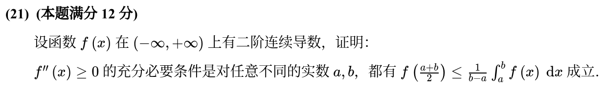
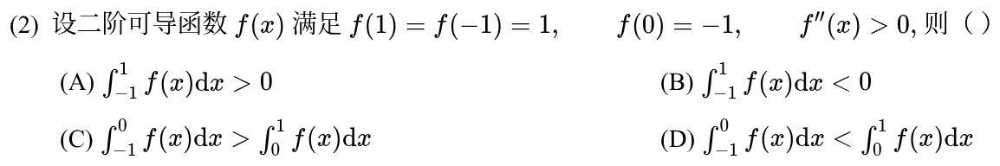
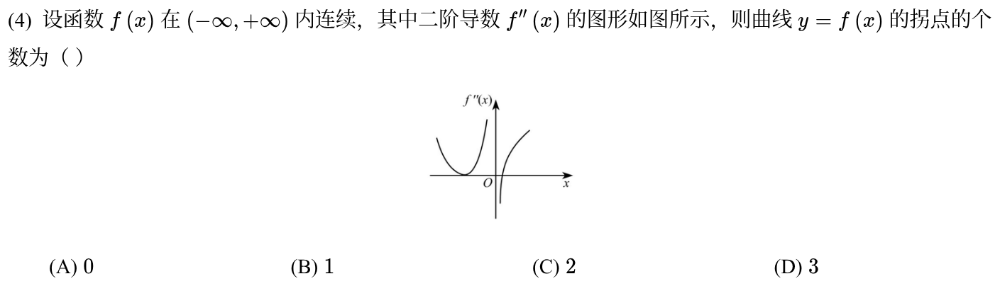

[« 单调性、极值与零点个数](06-monotonicity-extrema.md)　　[泰勒公式与高阶导数 »](08-taylor.md)

# 高等数学 · 凹凸性与拐点

> **本章共 8 题**
> 
> - **核心必做（建议按顺序攻克关键方法）**：  
>   [第 07 题](#q07)（读二阶导图像） → [第 04 题](#q04)（算拐点并查变号） → [第 08 题](#q08)（曲线与弦的位置） → [第 03 题](#q03)（含绝对值的完整计算）
> 
> - **分流与刷题建议**：  
>   - **较难挑战**：[第 01 题](#q01)（割线斜率条件的充要性）  
>   - **重在看思路**：[第 02 题](#q02)（先理解中点值与积分均值的比较）  
> 
> - **过关目标**：二阶导为零只是候选；能用图像与导数符号相互核对。

---

### 01 · 2025年

> *当年压轴证明题。充分性直接利用拉格朗日中值定理把割线斜率换成导数，递增性立显；必要性取极限让点逼近，用导数定义把不等式还原回导函数递增。*

答案与解析

**结论速览**：必要性用两段拉格朗日中值定理直接导出；充分性对任意 $u<v$ 取中间点 $w\in(u,v)$，利用三点割线斜率单调性对内点取极限得到 $f'(u)\le\frac{f(w)-f(u)}{w-u}<\frac{f(v)-f(w)}{v-w}\le f'(v)$。

- **完整解答**：
  - **必要性（$f'$ 严格递增 $\implies$ 割线斜率严格递增）**：
    任取 $x_1,x_2,x_3\in(a,b)$ 满足 $x_1 < x_2 < x_3$。由于 $f(x)$ 在 $(a,b)$ 内可导，分别在 $[x_1,x_2]$ 和 $[x_2,x_3]$ 上应用拉格朗日中值定理，存在 $\xi_1\in(x_1,x_2)$ 和 $\xi_2\in(x_2,x_3)$，使得
    $$
    \frac{f(x_2)-f(x_1)}{x_2-x_1} = f'(\xi_1),\qquad \frac{f(x_3)-f(x_2)}{x_3-x_2} = f'(\xi_2).
    $$
    因 $\xi_1 < x_2 < \xi_2$ 且 $f'$ 在 $(a,b)$ 内严格单调递增，故 $f'(\xi_1) < f'(\xi_2)$，即
    $$
    \frac{f(x_2)-f(x_1)}{x_2-x_1} < \frac{f(x_3)-f(x_2)}{x_3-x_2}.
    $$
  - **充分性（割线斜率严格递增 $\implies f'$ 严格递增）**：
    任取 $u,v\in(a,b)$ 且 $u < v$，在 $(u,v)$ 内任取一点 $w$（如 $w=\frac{u+v}{2}$）。
    1. 任取 $t\in(u,w)$，由 $u < t < w$ 及题设条件得
       $$
       \frac{f(t)-f(u)}{t-u} < \frac{f(w)-f(t)}{w-t}.
       $$
       令 $t\to u^+$，利用 $f$ 在 $u$ 处可导（从而连续），由极限保号性得
       $$
       f'(u) \le \frac{f(w)-f(u)}{w-u}.
       $$
    2. 同理，任取 $s\in(w,v)$，由 $w < s < v$ 得 $\frac{f(s)-f(w)}{s-w} < \frac{f(v)-f(s)}{v-s}$，令 $s\to v^-$ 得
       $$
       \frac{f(v)-f(w)}{v-w} \le f'(v).
       $$
    3. 再对 $u < w < v$ 直接应用题设严格不等式，得
       $$
       f'(u) \le \frac{f(w)-f(u)}{w-u} < \frac{f(v)-f(w)}{v-w} \le f'(v),
       $$
       从而 $f'(u) < f'(v)$，即 $f'(x)$ 在 $(a,b)$ 内严格单调递增。
- **核心思路与避坑**：充分性中直接让 $x_2\to x_1^+$ 取极限会把严格不等号变成“$\le$”，必须引入中间过渡点 $w\in(u,v)$，用中间一步的严格不等号把两端的弱不等号严格拉开。

---

### 02 · 2022年

> *当年大题难点。必要性直接在中点做一阶泰勒展开后两边积分（切线放缩）；充分性抓住极值点附近的局部凸性，用反证法排除反例。*

答案与解析

**结论速览**：必要性在中点 $m=\frac{a+b}{2}$ 处作带拉格朗日余项的一阶泰勒展开并积分（奇次项抵消）；充分性取对称区间 $[m-h,m+h]$ 作二阶皮亚诺泰勒展开后令 $h\to 0^+$。

- **完整解答**：
  不妨设 $a < b$（当 $a > b$ 时，$\frac{1}{b-a}\int_a^b f(x)\,\mathrm{d}x = \frac{1}{a-b}\int_b^a f(x)\,\mathrm{d}x$，表达式关于 $a,b$ 对称），记中点 $m = \frac{a+b}{2}$，半宽 $h = \frac{b-a}{2} > 0$。
  - **必要性（$f''(x)\ge 0 \implies$ 积分不等式）**：
    对任意 $x\in[a,b]$，在 $m$ 处作带拉格朗日余项的一阶泰勒展开：
    $$
    f(x) = f(m) + f'(m)(x-m) + \frac{1}{2}f''(\xi_x)(x-m)^2 \ge f(m) + f'(m)(x-m) \qquad (\text{因 } f''\ge 0).
    $$
    两边在 $[a,b]$ 上积分，利用 $\int_a^b (x-m)\,\mathrm{d}x = 0$，得
    $$
    \int_a^b f(x)\,\mathrm{d}x \ge f(m)(b-a) \implies f\!\left(\frac{a+b}{2}\right) \le \frac{1}{b-a}\int_a^b f(x)\,\mathrm{d}x.
    $$
  - **充分性（积分不等式 $\implies f''(x)\ge 0$）**：
    任取 $m\in\mathbb{R}$，对任意 $h>0$，取 $a=m-h, b=m+h$，则题设不等式化为
    $$
    \frac{1}{2h}\int_{m-h}^{m+h} \bigl[f(x) - f(m)\bigr]\,\mathrm{d}x \ge 0.
    $$
    因 $f$ 具有二阶连续导数，在 $x=m$ 处作带皮亚诺余项的二阶泰勒展开（或直接用洛必达法则两次）：
    $$
    f(x) - f(m) = f'(m)(x-m) + \frac{1}{2}f''(m)(x-m)^2 + o\bigl((x-m)^2\bigr).
    $$
    在 $[m-h,m+h]$ 上积分，一次项积分为 $0$，得
    $$
    \frac{1}{2h}\int_{m-h}^{m+h} \bigl[f(x) - f(m)\bigr]\,\mathrm{d}x = \frac{1}{6}f''(m)h^2 + o(h^2) \ge 0.
    $$
    两边同除以 $h^2 > 0$ 后令 $h\to 0^+$，由保号性得 $\frac{1}{6}f''(m) \ge 0$，即 $f''(m)\ge 0$。由 $m$ 的任意性即证。
- **核心思路与避坑**：这是经典的 Hermite-Hadamard 下界充要刻画；充分性也可用洛必达法则计算 $\lim_{h\to 0^+}\frac{\int_{m-h}^{m+h} f(x)\,\mathrm{d}x - 2hf(m)}{h^3} = \frac{1}{3}f''(m)\ge 0$，但用对称区间泰勒展开一步到位且更不易算错系数。

---

### 03 · 2021年

> *绝对值分段讨论。去绝对值后分 $x>0$ 和 $x<0$ 分别求一阶、二阶导数定凹凸区间；渐近线别漏掉斜渐近线在正负无穷可能重合。*

答案与解析

**结论速览**：凹区间为 $(-\infty,-1)$ 和 $[0,+\infty)$，凸区间为 $(-1,0]$，拐点为 $(0,0)$；渐近线有 $3$ 条：$x=-1$，$y=x-1$（$x\to+\infty$），$y=-x+1$（$x\to-\infty$）。

- **完整解答**：
  1. **确定定义域与分段化简**：
     定义域为 $(-\infty,-1)\cup(-1,+\infty)$。按 $x$ 的正负去绝对值并分离多项式部分：
     $$
     f(x) = \begin{cases}
     \dfrac{x^2}{1+x} = x - 1 + \dfrac{1}{1+x}, & x \ge 0, \\[6pt]
     -\dfrac{x^2}{1+x} = -x + 1 - \dfrac{1}{1+x}, & x < 0\text{ 且 }x \ne -1.
     \end{cases}
     $$
  2. **求凹凸区间与拐点**：
     当 $x \ne 0,-1$ 时逐段求二阶导数：
     $$
     f''(x) = \begin{cases}
     \dfrac{2}{(1+x)^3}, & x > 0, \\[6pt]
     -\dfrac{2}{(1+x)^3}, & x < 0\text{ 且 }x \ne -1.
     \end{cases}
     $$
     - 当 $x \in (-\infty,-1)$ 时，$1+x < 0 \implies f''(x) > 0$，曲线为**凹**的；
     - 当 $x \in (-1,0)$ 时，$1+x > 0 \implies f''(x) < 0$，曲线为**凸**的；
     - 当 $x \in (0,+\infty)$ 时，$1+x > 0 \implies f''(x) > 0$，曲线为**凹**的。
     在 $x=0$ 处 $f(x)$ 连续（$f(0)=0$）且两侧凹凸性改变，故 $(0,0)$ 是**拐点**；$x=-1$ 不在定义域内，不是拐点。
  3. **求全部渐近线**：
     - **铅直渐近线**：$\lim_{x\to -1} f(x) = \infty$，故 $x = -1$ 为铅直渐近线。
     - **斜渐近线**：由上面的多项式分解直接读取余项 $\pm\frac{1}{1+x}\to 0$：
       - 当 $x\to+\infty$ 时，$f(x) - (x-1) = \frac{1}{1+x}\to 0$，得斜渐近线 $y = x - 1$；
       - 当 $x\to-\infty$ 时，$f(x) - (-x+1) = -\frac{1}{1+x}\to 0$，得斜渐近线 $y = -x + 1$。
       （两端斜率均非零，故无水平渐近线。）
- **核心思路与避坑**：含 $|x|$ 的函数在 $x\to+\infty$ 与 $x\to-\infty$ 时分属不同解析式，必须分别求斜渐近线，最容易漏掉 $x\to-\infty$ 这一支；另外 $x=0$ 处虽不可二阶导，但连续且凹凸变号，仍是拐点。

---

### 04 · 2019年

答案与解析

**第一步落笔与完整推导**

1. **逐阶求导**（化简后再求二阶，减少项数）：
   $$y' = \sin x + x\cos x - 2\sin x = x\cos x - \sin x,$$
   $$y'' = \cos x - x\sin x - \cos x = -x\sin x.$$
2. **在开区间 $(0, 2\pi)$ 内解 $y'' = 0$ 并检验变号**：
   因为 $x \in (0, 2\pi)$ 时 $x > 0$，所以 $y'' = -x\sin x = 0 \iff \sin x = 0 \iff x = \pi$。
   - 当 $x \in (0, \pi)$ 时，$\sin x > 0 \implies y'' < 0$；
   - 当 $x \in (\pi, 2\pi)$ 时，$\sin x < 0 \implies y'' > 0$。
   二阶导数在 $x = \pi$ 两侧变号，故 $x = \pi$ 对应唯一拐点。
3. **代回原函数算纵坐标**：
   $$y(\pi) = \pi\sin\pi + 2\cos\pi = -2.$$
   故拐点为 $(\pi, -2)$，选 **（C）**。

**选择题干扰项拆解**

- **（B）$(0, 2)$**：最阴险的区间陷阱——虽然在 $x = 0$ 处 $y''(0) = 0$，但一来 $0 \notin (0, 2\pi)$ 不在题干给定区间内；二来 $y'' = -x\sin x$ 在 $x=0$ 左右两边**同为负号**（偶函数性质），即使把定义域扩到 $\mathbb{R}$，$(0, 2)$ 也不是拐点！
- **（A）$\left(\frac{\pi}{2}, \frac{\pi}{2}\right)$** 与 **（D）$\left(\frac{3\pi}{2}, -\frac{3\pi}{2}\right)$**：把 $y''$ 错算成含 $\cos x$ 的表达式后解出的 $\cos x = 0$ 的根。

---

### 05 · 2018年

答案与解析

**答案**：**（D）** 当 $f''(x)>0$ 时，$f\!\left(\dfrac{1}{2}\right)<0$

- **切入点与推演**：在区间中点 $x_0=\frac{1}{2}$ 处作带拉格朗日余项的一阶泰勒展开：
  $$
  f(x) = f\!\left(\frac{1}{2}\right) + f'\!\left(\frac{1}{2}\right)\left(x-\frac{1}{2}\right) + \frac{1}{2}f''(\xi_x)\left(x-\frac{1}{2}\right)^2.
  $$
  当 $f''(x) > 0$ 时，对任意 $x\ne\frac{1}{2}$ 均有严格不等式 $f(x) > f\!\left(\frac{1}{2}\right) + f'\!\left(\frac{1}{2}\right)\left(x-\frac{1}{2}\right)$。两边在 $[0,1]$ 上积分，利用 $\int_0^1 \left(x-\frac{1}{2}\right)\mathrm{d}x = 0$ 及题设 $\int_0^1 f(x)\,\mathrm{d}x = 0$，得
  $$
  0 = \int_0^1 f(x)\,\mathrm{d}x > f\!\left(\frac{1}{2}\right) \implies f\!\left(\frac{1}{2}\right) < 0,
  $$
  故（D）正确。
- **干扰项 / 易错提示**：（B）与（D）符号相反（$f''<0$ 推出 $f(\frac{1}{2})>0$）；（A）（C）只知一阶导符号，取线性函数 $f(x)=\pm\left(x-\frac{1}{2}\right)$ 满足积分 $=0$ 但 $f(\frac{1}{2})=0$，立即可排除。

---

### 06 · 2017年

答案与解析

**答案**：**（B）** $\displaystyle\int_{-1}^{1} f(x)\,\mathrm{d}x < 0$

- **切入点与推演**：由 $f''(x)>0$ 知曲线 $y=f(x)$ 严格下凸（图形位于任意两点的连线弦下方）。分别在 $[-1,0]$ 和 $[0,1]$ 上写出端点连线弦：
  - 在 $[-1,0]$ 上，过 $(-1,1)$ 与 $(0,-1)$ 的弦为 $y = -2x - 1$，故对 $x\in(-1,0)$ 有 $f(x) < -2x-1$；
  - 在 $[0,1]$ 上，过 $(0,-1)$ 与 $(1,1)$ 的弦为 $y = 2x - 1$，故对 $x\in(0,1)$ 有 $f(x) < 2x-1$。
  分段积分并相加：
  $$
  \int_{-1}^{1} f(x)\,\mathrm{d}x < \int_{-1}^{0}(-2x-1)\,\mathrm{d}x + \int_{0}^{1}(2x-1)\,\mathrm{d}x = 0 + 0 = 0,
  $$
  故（B）正确。
- **干扰项 / 易错提示**：三个给定点关于 $y$ 轴对称并不意味着 $f(x)$ 是偶函数（例如 $f(x)=2x^2-1+\varepsilon x(x^2-1)$ 在 $|\varepsilon|$ 足够小时仍满足 $f''>0$），因此无法比较左右两半积分的大小，排除（C）（D）。

---

### 07 · 2015年

答案与解析

**逐点扫描与完整推导**

题干已知 $f(x)$ 在 $(-\infty, +\infty)$ 内**连续**，从左到右检查图中 $f''(x)$ 的三个关键位置：

1. **负半轴切点 $x_1 < 0$**：$f''(x)$ 在 $x_1$ 处与 $x$ 轴相切，左右两侧均有 $f''(x) > 0$（不变号）$\implies$ **不是拐点**。
2. **原点 $x = 0$**：虽然 $f''(0)$ 不存在，但当 $x \to 0^-$ 时 $f''(x) > 0$，当 $x \to 0^+$ 时 $f''(x) < 0$，二阶导数左右变号，且 $f(x)$ 在 $x = 0$ 处**连续** $\implies$ **$(0, f(0))$ 是拐点**。
3. **正半轴交点 $x_2 > 0$**：$f''(x)$ 穿过 $x$ 轴，由负变正 $\implies$ **$(x_2, f(x_2))$ 是拐点**。

综上，曲线 $y = f(x)$ 共有 **2 个拐点**，选 **（C）**。

**选择题干扰项拆解**

- **（B）1**：漏掉了 $f''(x)$ 无定义的原点 $x = 0$（误以为拐点必须满足 $f''(x) = 0$）。
- **（D）3**：把负半轴与 $x$ 轴相切的点 $x_1$ 误算成了拐点（只看 $f''(x_1)=0$ 忘了检查左右变号）。

---

### 08 · 2014年

答案与解析

**答案**：**（D）** 当 $f''(x)\ge 0$ 时，$f(x)\le g(x)$

- **切入点与推演**：$g(x) = f(0)(1-x) + f(1)x$ 正是连接端点 $(0,f(0))$ 与 $(1,f(1))$ 的直线（割线弦），满足 $g(0)=f(0)$，$g(1)=f(1)$，$g''(x)=0$。
  令 $h(x) = f(x) - g(x)$，则 $h(0)=h(1)=0$，且当 $f''(x)\ge 0$ 时 $h''(x) = f''(x) \ge 0$。
  若存在 $x_0\in(0,1)$ 使 $h(x_0) > 0$，则 $h(x)$ 在 $[0,1]$ 上的最大值必在某内点 $c\in(0,1)$ 处取到，但由 $h''(x)\ge 0$ 知 $h'$ 单调递增，与 $h$ 在 $c$ 处取正最大值矛盾（也可直接由凹函数定义：图形位于弦的下方）。故 $h(x)\le 0$，即 $f(x)\le g(x)$，选（D）。
- **干扰项 / 易错提示**：单调性（$f'\ge 0$）不能决定曲线在弦的上方还是下方，例如 $f_1(x)=x^2$ 与 $f_2(x)=2x-x^2$ 在 $[0,1]$ 上均单调递增且端点弦同为 $y=x$，却分别位于弦的下方与上方，从而排除（A）（B）。

---

[« 单调性、极值与零点个数](06-monotonicity-extrema.md)　　[泰勒公式与高阶导数 »](08-taylor.md)
