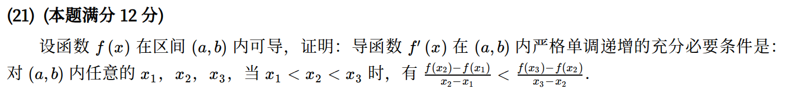
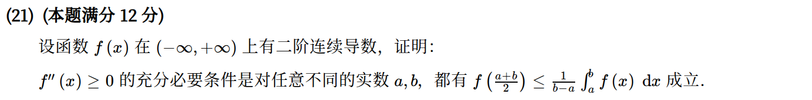
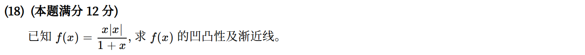
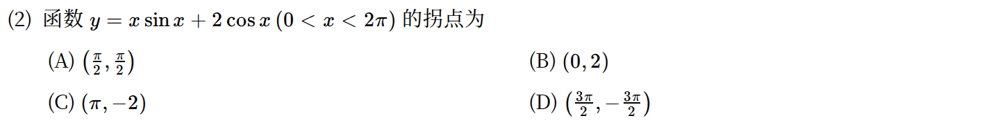
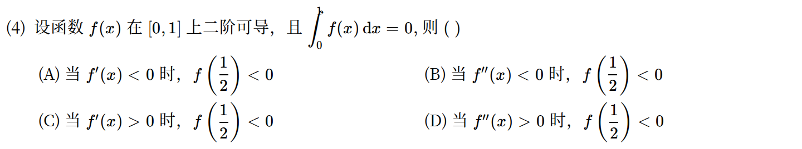
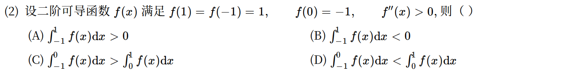
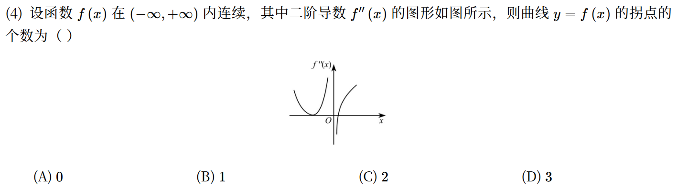
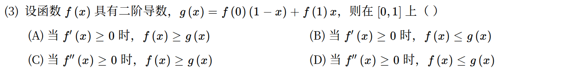

# 高等数学 · 凹凸性与拐点

> 2010—2026年 · 8 道完整真题 · 年份从新到旧（2026→2010）  
> 题型分布：选择题 5 题 · 填空题 0 题 · 解答题 3 题  
> 考查范围：凹凸判定、拐点、弦切线关系及凸性等价条件

[查看对应网页版](07-convexity.html) · [返回章节总目录](../README.md)

---

## 2025年

### 01 · 2025-21 · 解答题

> *当年压轴证明题。充分性直接利用拉格朗日中值定理把割线斜率换成导数，递增性立显；必要性取极限让点逼近，用导数定义把不等式还原回导函数递增。*

*关联章节：[中值定理、零点与不等式证明](05-mean-value-proofs.md)*

---

## 2022年

### 02 · 2022-21 · 解答题

> *当年大题难点。必要性直接在中点做一阶泰勒展开后两边积分（切线放缩）；充分性抓住极值点附近的局部凸性，用反证法排除反例。*

*关联章节：[中值定理、零点与不等式证明](05-mean-value-proofs.md) · [定积分、变上限积分与积分性质](11-definite-integrals.md)*

---

## 2021年

### 03 · 2021-18 · 解答题

> *绝对值分段讨论。去绝对值后分 $x>0$ 和 $x<0$ 分别求一阶、二阶导数定凹凸区间；渐近线别漏掉斜渐近线在正负无穷可能重合。*

*关联章节：[切线、法线、渐近线与曲率](09-curve-geometry.md)*

---

## 2019年

### 04 · 2019-02 · 选择题

---

## 2018年

### 05 · 2018-04 · 选择题

*关联章节：[定积分、变上限积分与积分性质](11-definite-integrals.md) · [中值定理、零点与不等式证明](05-mean-value-proofs.md)*

---

## 2017年

### 06 · 2017-02 · 选择题

*关联章节：[定积分、变上限积分与积分性质](11-definite-integrals.md)*

---

## 2015年

### 07 · 2015-04 · 选择题

---

## 2014年

### 08 · 2014-03 · 选择题

*关联章节：[中值定理、零点与不等式证明](05-mean-value-proofs.md)*

---

## 交叉考点索引

以下题目主归其他章节，点击跳转到对应章节题目；不计入本章主收录题数：

- [2026年 · 第5题](06-monotonicity-extrema.md)（主章节：单调性、极值与零点个数）
- [2026年 · 第20题](13-integral-applications.md)（主章节：定积分应用）
- [2025年 · 第2题](06-monotonicity-extrema.md)（主章节：单调性、极值与零点个数）
- [2023年 · 第7题](06-monotonicity-extrema.md)（主章节：单调性、极值与零点个数）
- [2022年 · 第3题](06-monotonicity-extrema.md)（主章节：单调性、极值与零点个数）
- [2018年 · 第10题](09-curve-geometry.md)（主章节：切线、法线、渐近线与曲率）
- [2016年 · 第4题](06-monotonicity-extrema.md)（主章节：单调性、极值与零点个数）
- [2016年 · 第5题](09-curve-geometry.md)（主章节：切线、法线、渐近线与曲率）
- [2015年 · 第21题](05-mean-value-proofs.md)（主章节：中值定理、零点与不等式证明）
- [2012年 · 第19题](15-higher-order-ode.md)（主章节：高阶微分方程）
- [2011年 · 第16题](06-monotonicity-extrema.md)（主章节：单调性、极值与零点个数）
