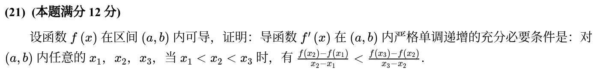
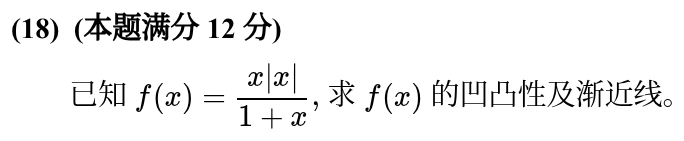
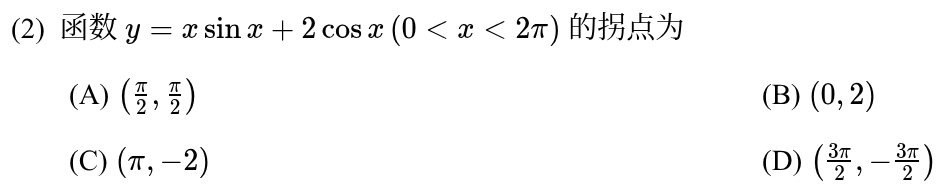
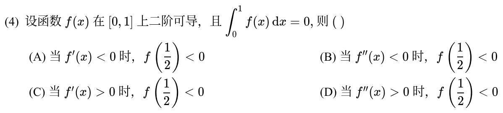
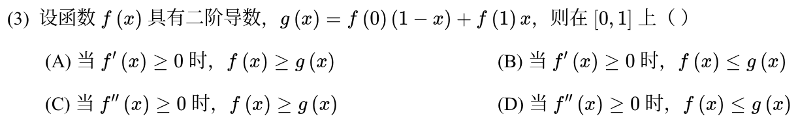

[« 单调性、极值与零点个数](06-monotonicity-extrema.md)　　[泰勒公式与高阶导数 »](08-taylor.md)

# 高等数学 · 凹凸性与拐点

> **本章共 8 题**
> 
> - **核心必做（建议按顺序攻克关键方法）**：  
>   [第 07 题](#q07)（读二阶导图像） → [第 04 题](#q04)（算拐点并查变号） → [第 08 题](#q08)（曲线与弦的位置） → [第 03 题](#q03)（含绝对值的完整计算）
> 
> - **分流与刷题建议**：  
>   - **较难挑战**：[第 01 题](#q01)（割线斜率条件的充要性）  
>   - **重在看思路**：[第 02 题](#q02)（先理解中点值与积分均值的比较）  
> 
> - **过关目标**：二阶导为零只是候选；能用图像与导数符号相互核对。

---

### 01 · 2025年

> *当年压轴证明题。充分性直接利用拉格朗日中值定理把割线斜率换成导数，递增性立显；必要性取极限让点逼近，用导数定义把不等式还原回导函数递增。*

答案与解析

**证明。** 若 $f'$ 严格递增，在相邻区间分别用拉格朗日中值定理，两个弦斜率等于 $f'(\xi_1),f'(\xi_2)$，且 $\xi_1<\xi_2$，由此得严格不等式。

反向取任意 $u<v$，在中间取一点 $w$。由三点斜率条件令靠近 $u$、$v$ 的内点分别趋于端点，得
$$
f'(u)\le\frac{f(w)-f(u)}{w-u}<\frac{f(v)-f(w)}{v-w}\le f'(v).
$$
两个端点取极限时只保留弱不等号，中间严格不等号确保 $f'(u)<f'(v)$。

---

### 02 · 2022年

> *当年大题难点。必要性直接在中点做一阶泰勒展开后两边积分（切线放缩）；充分性抓住极值点附近的局部凸性，用反证法排除反例。*

答案与解析

**证明。** 若 $f''\ge0$，以 $m=(a+b)/2$ 为中点，凸性给 $f(m-t)+f(m+t)\ge2f(m)$，对 $0\le t\le |b-a|/2$ 积分得到原式。

反向固定任意 $m$，设端点为 $m\pm h$。二阶泰勒展开后，区间平均值为 $f(m)+f''(m)h^2/6+o(h^2)$。奇次项在对称区间抵消。由平均值不小于 $f(m)$，令 $h\to0^+$ 得 $f''(m)\ge0$。

---

### 03 · 2021年

> *绝对值分段讨论。去绝对值后分 $x>0$ 和 $x<0$ 分别求一阶、二阶导数定凹凸区间；渐近线别漏掉斜渐近线在正负无穷可能重合。*

答案与解析

**解。** 写成 $f(x)=\operatorname{sgn}(x)[x-1+1/(x+1)]$。当 $x\ne0,-1$，$f''=2\operatorname{sgn}(x)/(x+1)^3$，故 $( -\infty,-1)$ 与 $(0,\infty)$ 上 $f''>0$，$(-1,0)$ 上 $f''<0$。原点处连续且凹凸变号，是拐点；$-1$ 不在定义域。

渐近线为 $x=-1$，以及 $x\to+\infty$ 的 $y=x-1$、$x\to-\infty$ 的 $y=-x+1$。

---

### 04 · 2019年

答案与解析

**第一步落笔与完整推导**

1. **逐阶求导**（化简后再求二阶，减少项数）：
   $$y' = \sin x + x\cos x - 2\sin x = x\cos x - \sin x,$$
   $$y'' = \cos x - x\sin x - \cos x = -x\sin x.$$
2. **在开区间 $(0, 2\pi)$ 内解 $y'' = 0$ 并检验变号**：
   因为 $x \in (0, 2\pi)$ 时 $x > 0$，所以 $y'' = -x\sin x = 0 \iff \sin x = 0 \iff x = \pi$。
   - 当 $x \in (0, \pi)$ 时，$\sin x > 0 \implies y'' < 0$；
   - 当 $x \in (\pi, 2\pi)$ 时，$\sin x < 0 \implies y'' > 0$。
   二阶导数在 $x = \pi$ 两侧变号，故 $x = \pi$ 对应唯一拐点。
3. **代回原函数算纵坐标**：
   $$y(\pi) = \pi\sin\pi + 2\cos\pi = -2.$$
   故拐点为 $(\pi, -2)$，选 **（C）**。

**选择题干扰项拆解**

- **（B）$(0, 2)$**：最阴险的区间陷阱——虽然在 $x = 0$ 处 $y''(0) = 0$，但一来 $0 \notin (0, 2\pi)$ 不在题干给定区间内；二来 $y'' = -x\sin x$ 在 $x=0$ 左右两边**同为负号**（偶函数性质），即使把定义域扩到 $\mathbb{R}$，$(0, 2)$ 也不是拐点！
- **（A）$\left(\frac{\pi}{2}, \frac{\pi}{2}\right)$** 与 **（D）$\left(\frac{3\pi}{2}, -\frac{3\pi}{2}\right)$**：把 $y''$ 错算成含 $\cos x$ 的表达式后解出的 $\cos x = 0$ 的根。

---

### 05 · 2018年

答案与解析

**答案 D。** $f''>0$ 时图像严格位于任一点切线之上（切点除外）。在中点写 $f(x)>f(1/2)+f'(1/2)(x-1/2)$ 并积分，一次项抵消，所以 $0>f(1/2)$。只知单调性不能得到严格结论，如 $x-1/2$ 及其相反数。

---

### 06 · 2017年

答案与解析

**答案 B。** $f''>0$，在 $[-1,0]$ 和 $[0,1]$ 上，图像严格在各自端点弦的下方。两条弦的积分均为 0（两端高度为 $1,-1$ 或反过来），所以原积分严格小于 0。两半的积分大小不能仅由三个函数值推出。

---

### 07 · 2015年

答案与解析

**逐点扫描与完整推导**

题干已知 $f(x)$ 在 $(-\infty, +\infty)$ 内**连续**，从左到右检查图中 $f''(x)$ 的三个关键位置：

1. **负半轴切点 $x_1 < 0$**：$f''(x)$ 在 $x_1$ 处与 $x$ 轴相切，左右两侧均有 $f''(x) > 0$（不变号）$\implies$ **不是拐点**。
2. **原点 $x = 0$**：虽然 $f''(0)$ 不存在，但当 $x \to 0^-$ 时 $f''(x) > 0$，当 $x \to 0^+$ 时 $f''(x) < 0$，二阶导数左右变号，且 $f(x)$ 在 $x = 0$ 处**连续** $\implies$ **$(0, f(0))$ 是拐点**。
3. **正半轴交点 $x_2 > 0$**：$f''(x)$ 穿过 $x$ 轴，由负变正 $\implies$ **$(x_2, f(x_2))$ 是拐点**。

综上，曲线 $y = f(x)$ 共有 **2 个拐点**，选 **（C）**。

**选择题干扰项拆解**

- **（B）1**：漏掉了 $f''(x)$ 无定义的原点 $x = 0$（误以为拐点必须满足 $f''(x) = 0$）。
- **（D）3**：把负半轴与 $x$ 轴相切的点 $x_1$ 误算成了拐点（只看 $f''(x_1)=0$ 忘了检查左右变号）。

---

### 08 · 2014年

答案与解析

**答案 D。** $g$ 是图像两端点连成的弦，$f''\ge0$ 时图像位于弦下，故 $f\le g$。单调增加不决定与弦的位置，例如 $x^2$ 与 $2x-x^2$ 都递增，却分别位于 $y=x$ 的两侧。

---

[« 单调性、极值与零点个数](06-monotonicity-extrema.md)　　[泰勒公式与高阶导数 »](08-taylor.md)
