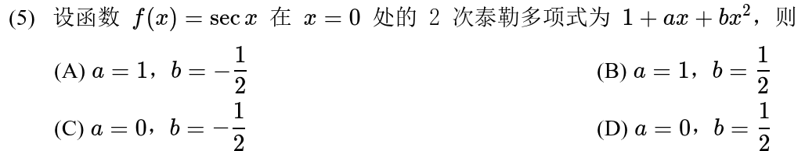
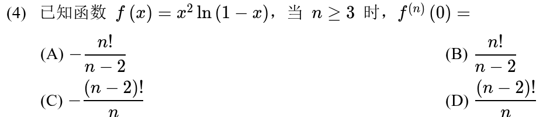
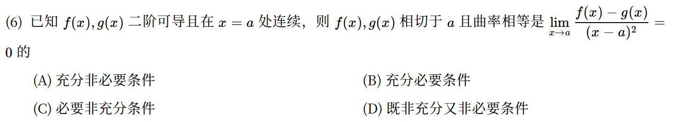
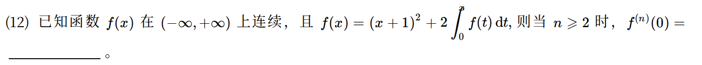
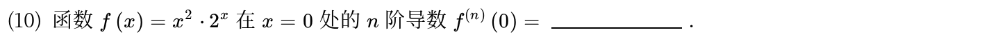
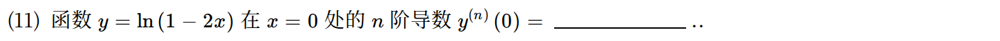

[« 凹凸性与拐点](07-convexity.md)　　[切线、法线、渐近线与曲率 »](09-curve-geometry.md)

# 高等数学 · 泰勒公式与高阶导数

> 2010—2026年 · 7 道完整真题 · 年份从新到旧（2026→2010）  
> 题型分布：选择题 3 题 · 填空题 4 题 · 解答题 0 题  
> 考查范围：泰勒展开、多项式系数、高阶导数与佩亚诺余项

---

## 2024年

### 01 · 2024-14 · 填空题

> 高阶导数计算。求  的 5 阶导，直接上莱布尼茨公式，因为  求导三次就变 0，实际只需算前三项，千万别硬求五次。

---

## 2021年

### 02 · 2021-05 · 选择题

---

## 2020年

### 03 · 2020-04 · 选择题

> 高阶导数系数题。把  展开成麦克劳林级数，再乘前面的 ，对比  项系数和高阶导公式 ，秒出答案。

---

## 2019年

### 04 · 2019-06 · 选择题

*关联章节：[切线、法线、渐近线与曲率](09-curve-geometry.md) · [函数极限与无穷小](01-limits.md)*

---

## 2016年

### 05 · 2016-12 · 填空题

> 两边求一次导直接变成一阶微分方程，解出  之后看指数通项，别傻傻逐次求导找规律。

*关联章节：[定积分、变上限积分与积分性质](11-definite-integrals.md) · [一阶微分方程](14-first-order-ode.md)*

---

## 2015年

### 06 · 2015-10 · 填空题

*关联章节：[导数、微分与求导法则](04-derivatives.md)*

---

## 2010年

### 07 · 2010-11 · 填空题

---

## 交叉考点索引

以下题目主归其他章节，点击跳转到对应章节题目；不计入本章主收录题数：

- [2025年 · 第18题](04-derivatives.md)（主章节：导数、微分与求导法则）
- [2024年 · 第21题](05-mean-value-proofs.md)（主章节：中值定理、零点与不等式证明）
- [2023年 · 第11题](01-limits.md)（主章节：函数极限与无穷小）
- [2023年 · 第21题](05-mean-value-proofs.md)（主章节：中值定理、零点与不等式证明）
- [2021年 · 第1题](01-limits.md)（主章节：函数极限与无穷小）
- [2021年 · 第17题](01-limits.md)（主章节：函数极限与无穷小）
- [2019年 · 第1题](01-limits.md)（主章节：函数极限与无穷小）
- [2018年 · 第1题](01-limits.md)（主章节：函数极限与无穷小）
- [2016年 · 第5题](09-curve-geometry.md)（主章节：切线、法线、渐近线与曲率）
- [2016年 · 第15题](01-limits.md)（主章节：函数极限与无穷小）
- [2015年 · 第15题](01-limits.md)（主章节：函数极限与无穷小）
- [2014年 · 第5题](01-limits.md)（主章节：函数极限与无穷小）
- [2014年 · 第15题](01-limits.md)（主章节：函数极限与无穷小）
- [2013年 · 第15题](01-limits.md)（主章节：函数极限与无穷小）
- [2012年 · 第15题](01-limits.md)（主章节：函数极限与无穷小）
- [2011年 · 第1题](01-limits.md)（主章节：函数极限与无穷小）

[« 凹凸性与拐点](07-convexity.md)　　[切线、法线、渐近线与曲率 »](09-curve-geometry.md)
