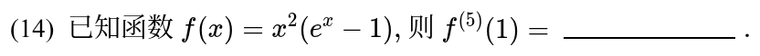
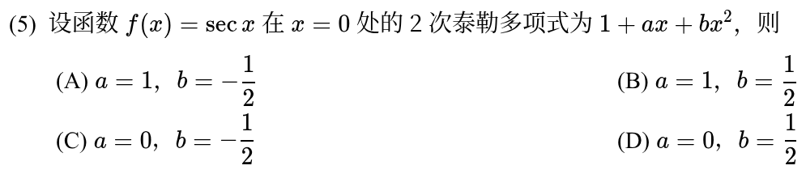
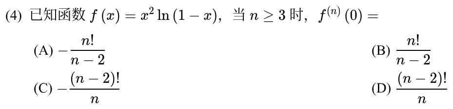
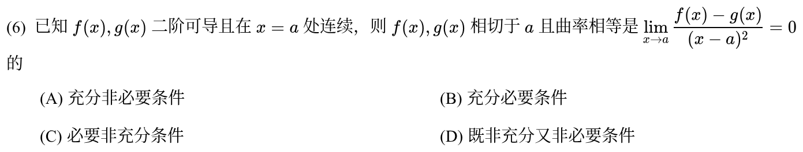
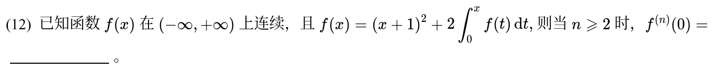
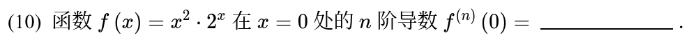
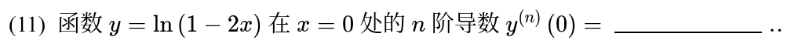

[« 凹凸性与拐点](07-convexity.md)　　[切线、法线、渐近线与曲率 »](09-curve-geometry.md)

# 高等数学 · 泰勒公式与高阶导数

> **本章共 7 题**
> 
> - **核心必做（建议按顺序攻克关键方法）**：  
>   [第 02 题](#q02)（二阶泰勒多项式） → [第 07 题](#q07)（对数函数高阶导数） → [第 03 题](#q03)（展开系数对应高阶导数） → [第 01 题](#q01)（莱布尼茨公式少求导）
> 
> - **分流与刷题建议**：  
>   - **较难挑战**：[第 05 题](#q05)（积分方程求导后找递推）  
>   - **重在看思路**：[第 04 题](#q04)（二阶接触与曲率相等的区别）  
> 
> - **过关目标**：能说明展开的阶数、余项和系数与阶乘的对应。

---

### 01 · 2024年

> *高阶导数计算。求 $x^2(e^x-1)$ 的 5 阶导，直接上莱布尼茨公式，因为 $x^2$ 求导三次就变 0，实际只需算前三项，千万别硬求五次。*

答案与解析

**第一步落笔与完整推导**

1. **先拆项消掉低次多项式**：
   $$f(x) = x^2 e^x - x^2.$$
   因为 $-x^2$ 是 $2$ 次多项式，求 $5$ 阶导数时直接为 $0$，即 $(-x^2)^{(5)} = 0$。故只需计算 $(x^2 e^x)^{(5)}$。
2. **用莱布尼茨公式（取 $u = x^2$，$v = e^x$）**：
   $u' = 2x$，$u'' = 2$，$u^{(k)} = 0$（$k \ge 3$），而 $(e^x)^{(m)} = e^x$，因此只剩前 3 项：
   $$f^{(5)}(x) = C_5^0 x^2 e^x + C_5^1 (2x) e^x + C_5^2 (2) e^x = \big(x^2 + 10x + 20\big)e^x.$$
3. **代入 $x = 1$**：
   $$f^{(5)}(1) = (1 + 10 + 20)e = 31e.$$

---

### 02 · 2021年

答案与解析

**解法一：奇偶性 + 已知展开直接截断（最快入口）**

1. **偶函数秒杀一次项**：$f(x) = \sec x = \frac{1}{\cos x}$ 是偶函数，其在 $x = 0$ 处的泰勒多项式不含奇次项，立刻得 $a = 0$（直接排除 A、B）。
2. **用 $\cos x$ 展开与等比级数截断**：
   $$\sec x = \frac{1}{\cos x} = \frac{1}{1 - \frac{x^2}{2} + o(x^2)} = 1 + \frac{1}{2}x^2 + o(x^2).$$
   对照 $1 + ax + bx^2$，得 $a = 0$，$b = \frac{1}{2}$，选 **（D）**。

**解法二：直接求导代入公式（核对用）**

- $f(0) = \sec 0 = 1$；
- $f'(x) = \sec x \tan x \implies f'(0) = 0 \implies a = f'(0) = 0$；
- $f''(x) = \sec x \tan^2 x + \sec^3 x \implies f''(0) = 1 \implies b = \frac{f''(0)}{2!} = \frac{1}{2}$。

**选择题干扰项拆解**

- **（C）$a = 0, b = -\frac{1}{2}$**：把 $\sec x = \frac{1}{\cos x}$ 和 $\cos x = 1 - \frac{1}{2}x^2 + o(x^2)$ 的二次项符号混为一谈，忘了取倒数后 $\frac{1}{1-u} = 1 + u + \cdots$ 负负得正。
- **（A）与（B）**：没有利用偶函数性质，误以为 $a = 1$。

---

### 03 · 2020年

> *高阶导数系数题。把 $\ln(1-x)$ 展开成麦克劳林级数，再乘前面的 $x^2$，对比 $x^n$ 项系数和高阶导公式 $f^{(n)}(0)/n!$，秒出答案。*

答案与解析

**解法一：幂级数展开 + 指标平移（最快）**

由 $\ln(1 - x) = -\sum_{k=1}^{\infty} \frac{x^k}{k}$（$|x| < 1$），两边同乘 $x^2$：
$$f(x) = x^2\ln(1 - x) = -\sum_{k=1}^{\infty} \frac{x^{k+2}}{k}.$$
令 $n = k + 2$（则 $k = n - 2$，且当 $k \ge 1$ 时正好对应题干条件 $n \ge 3$）：
$$f(x) = -\sum_{n=3}^{\infty} \frac{x^n}{n - 2}.$$
比较 $x^n$ 项系数 $\frac{f^{(n)}(0)}{n!} = -\frac{1}{n - 2}$，得
$$f^{(n)}(0) = -\frac{n!}{n - 2},$$
选 **（A）**。

**解法二：莱布尼茨公式（交叉检验）**

令 $u = x^2$、$v = \ln(1 - x)$，在 $x = 0$ 处只有 $u''(0) = 2$ 非零（$u(0) = u'(0) = 0$，且 $k \ge 3$ 时 $u^{(k)} \equiv 0$），因此莱布尼茨公式在 $x = 0$ 处**只剩 $k = 2$ 这一项**：
$$f^{(n)}(0) = C_n^2 \cdot u''(0) \cdot v^{(n-2)}(0) = \frac{n(n-1)}{2} \cdot 2 \cdot \big(-(n - 3)!\big) = -n(n - 1)(n - 3)! = -\frac{n!}{n - 2}.$$

**选择题干扰项拆解**

- **（B）$\frac{n!}{n - 2}$**：符号错把 $\ln(1-x)$ 当成正项展开；只需代 $n = 3$ 速验：$f(x) = x^2(-x - \cdots) = -x^3 + o(x^3) \implies f'''(0) = -6 < 0$，立刻排除（B）（D）。
- **（C）$-\frac{(n - 2)!}{n}$**：套用 $n!$ 还原系数时把分子分母的阶乘与次数写反了；代 $n = 3$ 得 $-\frac{1}{3} \neq -6$，立刻排除。

---

### 04 · 2019年

答案与解析

- **先翻译后件（极限条件）**：令 $h(x) = f(x) - g(x)$，在 $x = a$ 处作带佩亚诺余项的二阶泰勒展开：
  $$h(x) = h(a) + h'(a)(x - a) + \frac{h''(a)}{2}(x - a)^2 + o\big((x - a)^2\big).$$
  因此
  $$\lim_{x\to a}\frac{f(x) - g(x)}{(x - a)^2} = 0 \iff h(a) = 0,\; h'(a) = 0,\; h''(a) = 0 \iff f(a) = g(a),\; f'(a) = g'(a),\; f''(a) = g''(a).$$
- **再翻译前件（相切且曲率相等）**：
  - 相切于 $a$ $\iff f(a) = g(a)$ 且 $f'(a) = g'(a)$；
  - 曲率相等 $\iff \frac{|f''(a)|}{\big(1 + (f'(a))^2\big)^{3/2}} = \frac{|g''(a)|}{\big(1 + (g'(a))^2\big)^{3/2}} \iff |f''(a)| = |g''(a)|$（注意**绝对值**！）。
- **比对逻辑方向**：
  - 后件 $\implies$ 前件（$f''(a) = g''(a) \implies |f''(a)| = |g''(a)|$），故前件是**必要条件**；
  - 前件 $\not\implies$ 后件（反例：$a = 0$，$f(x) = x^2$，$g(x) = -x^2$，在 $0$ 处相切且曲率均为 $2$，但 $\lim_{x\to 0}\frac{x^2 - (-x^2)}{x^2} = 2 \neq 0$），故**不充分**。
- **答案**：**（C）必要非充分条件**。

---

### 05 · 2016年

> *两边求一次导直接变成一阶微分方程，解出 $f(x)$ 之后看指数通项，别傻傻逐次求导找规律。*

答案与解析

1. **逐阶求导并同步算 $x = 0$ 处的初值**：
   - 代 $x = 0$：$f(0) = 1^2 + 0 = 1$；
   - 求一阶导：$f'(x) = 2(x + 1) + 2f(x) \implies f'(0) = 2 + 2(1) = 4$；
   - 求二阶导：$f''(x) = 2 + 2f'(x) \implies f''(0) = 2 + 2(4) = 10$；
   - 求三阶及以上导数（$n \ge 3$）：常数 $2$ 求导归零，得纯递推关系
     $$f^{(n)}(x) = 2f^{(n-1)}(x) \implies f^{(n)}(0) = 2f^{(n-1)}(0).$$
2. **解递推并核对起点 $n = 2$**：
   对 $n \ge 3$，$f^{(n)}(0) = 2^{n-2} f''(0) = 10 \cdot 2^{n-2} = 5 \cdot 2^{n-1}$。
   回代 $n = 2$ 检验：$5 \cdot 2^{2-1} = 10 = f''(0)$，公式对一切 $n \ge 2$ 统一成立。
3. **答案**：$5 \cdot 2^{n-1}$。

---

### 06 · 2015年

答案与解析

**答案**：$n(n-1)(\ln 2)^{n-2}$（$n\ge 2$；当 $n=1$ 时为 $0$）

- **切入点与推演**：求多项式乘以指数函数在 $x=0$ 处的高阶导数，直接用麦克劳林展开比系数（或莱布尼茨公式）最快：
  - **方法一（麦克劳林展开比系数）**：将 $2^x$ 写为 $e^{x\ln 2}$ 并展开：
    $$
    f(x) = x^2 e^{x\ln 2} = x^2 \sum_{k=0}^{\infty} \frac{(\ln 2)^k}{k!}\,x^k = \sum_{k=0}^{\infty} \frac{(\ln 2)^k}{k!}\,x^{k+2}.
    $$
    当 $n\ge 2$ 时，令 $k+2 = n$（即 $k=n-2$），比对 $x^n$ 项系数 $\dfrac{f^{(n)}(0)}{n!} = \dfrac{(\ln 2)^{n-2}}{(n-2)!}$，立即得
    $$
    f^{(n)}(0) = \frac{n!}{(n-2)!}(\ln 2)^{n-2} = n(n-1)(\ln 2)^{n-2}.
    $$
    （当 $n=1$ 时，$x$ 项系数为 $0$，故 $f'(0)=0$。）
  - **方法二（莱布尼茨公式）**：$(x^2)^{(k)}$ 仅在 $k=0,1,2$ 时非零，在 $x=0$ 处仅剩 $k=2$ 一项：
    $$
    f^{(n)}(0) = \binom{n}{2}\left.(x^2)''\right|_{x=0}\left.(2^x)^{(n-2)}\right|_{x=0} = \frac{n(n-1)}{2}\cdot 2 \cdot (\ln 2)^{n-2} = n(n-1)(\ln 2)^{n-2}.
    $$
- **易错点**：切勿漏写 $(2^x)'=2^x\ln 2$ 带来的因子 $(\ln 2)^{n-2}$，也不要把比系数时的 $n!$ 与 $(n-2)!$ 约分错成 $n(n-1)/2$。

---

### 07 · 2010年

答案与解析

**解法一：麦克劳林展开比系数（推荐）**

由基本展开 $\ln(1 - u) = -\sum_{n=1}^{\infty} \frac{u^n}{n}$（$|u| < 1$），令 $u = 2x$，得
$$y = \ln(1 - 2x) = -\sum_{n=1}^{\infty} \frac{(2x)^n}{n} = -\sum_{n=1}^{\infty} \frac{2^n}{n} x^n.$$
比较 $x^n$ 项系数 $\frac{y^{(n)}(0)}{n!} = -\frac{2^n}{n}$，两边同乘 $n!$ 即得
$$y^{(n)}(0) = -\frac{2^n}{n} \cdot n! = -2^n(n - 1)!.$$

**解法二：直接求导归纳（验证 $n=1,2,3$）**

- $y' = -\frac{2}{1 - 2x} \implies y'(0) = -2 = -2^1 \cdot 0!$；
- $y'' = -\frac{2^2 \cdot 1}{(1 - 2x)^2} \implies y''(0) = -4 = -2^2 \cdot 1!$；
- $y''' = -\frac{2^3 \cdot 2!}{(1 - 2x)^3} \implies y'''(0) = -16 = -2^3 \cdot 2!$；
归纳得 $y^{(n)}(x) = -\frac{2^n(n-1)!}{(1-2x)^n}$，代入 $x = 0$ 得 $-2^n(n-1)!$。

---

[« 凹凸性与拐点](07-convexity.md)　　[切线、法线、渐近线与曲率 »](09-curve-geometry.md)
