[« 泰勒公式与高阶导数](08-taylor.md)　　[不定积分与原函数 »](10-antiderivatives.md)

# 高等数学 · 切线、法线、渐近线与曲率

> 2010—2026年 · 20 道完整真题 · 年份从新到旧（2026→2010）  
> 题型分布：选择题 6 题 · 填空题 13 题 · 解答题 1 题  
> 考查范围：曲线局部几何、切法线、各类渐近线、曲率与曲率圆

---

## 2026年

### 01 · 2026-13 · 填空题

> 隐函数曲率半径填空。在点  处对隐方程求一阶导得 ，再求二阶导得 ，直接代入曲率半径公式 ，别算错代数式。

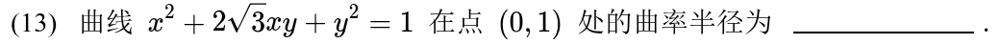

---

## 2025年

### 02 · 2025-12 · 填空题

> 三次根式斜渐近线。求斜渐近线别死算两步极限，提公因子  出来利用泰勒展开 ，直接展开得到 。

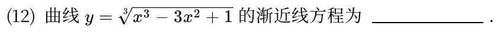

---

## 2024年

### 03 · 2024-11 · 填空题

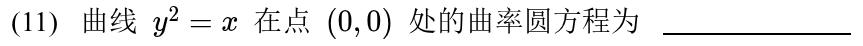

---

## 2023年

### 04 · 2023-01 · 选择题

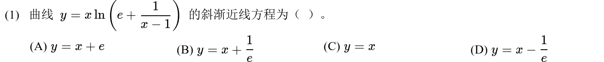

---

### 05 · 2023-14 · 填空题

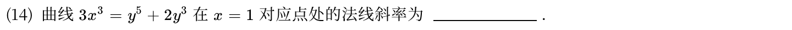

*关联章节：[导数、微分与求导法则](04-derivatives.md)*

---

## 2020年

### 06 · 2020-15 · 解答题

> 幂指函数斜渐近线大题。先算斜率 ；算截距  时化为 ，利用对数展开式或等价无穷小求极限。

*关联章节：[函数极限与无穷小](01-limits.md)*

---

## 2019年

### 07 · 2019-10 · 填空题

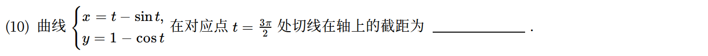

---

## 2018年

### 08 · 2018-10 · 填空题

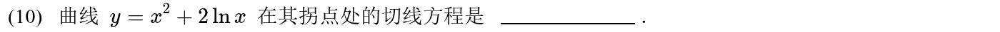

*关联章节：[凹凸性与拐点](07-convexity.md)*

---

### 09 · 2018-12 · 填空题

---

## 2017年

### 10 · 2017-09 · 填空题

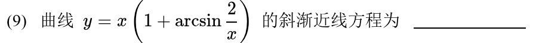

*关联章节：[函数极限与无穷小](01-limits.md)*

---

## 2016年

### 11 · 2016-05 · 选择题

> 切线与曲率比较。两曲线相切说明一阶导相等；曲率大说明二阶导绝对值大。结合  判定局部凸性与相对位置，画草图一目了然。

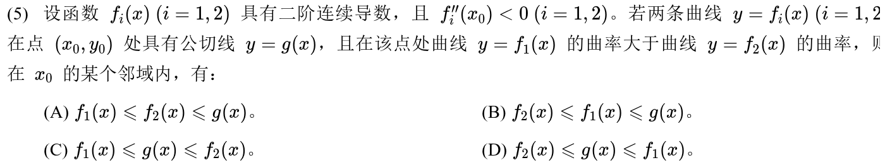

*关联章节：[凹凸性与拐点](07-convexity.md) · [泰勒公式与高阶导数](08-taylor.md)*

---

### 12 · 2016-09 · 填空题

---

## 2014年

### 13 · 2014-02 · 选择题

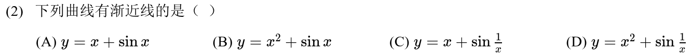

---

### 14 · 2014-04 · 选择题

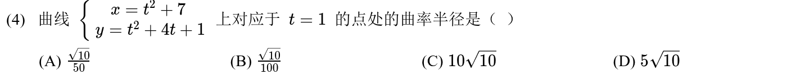

---

### 15 · 2014-12 · 填空题

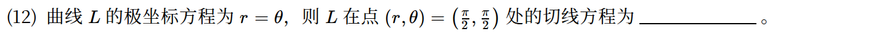

---

## 2013年

### 16 · 2013-12 · 填空题

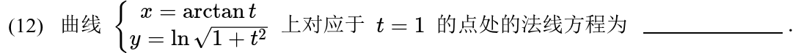

---

## 2012年

### 17 · 2012-01 · 选择题

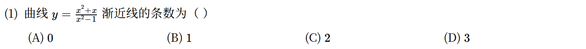

---

### 18 · 2012-13 · 填空题

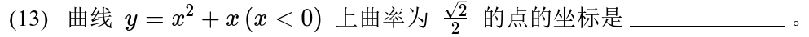

---

## 2010年

### 19 · 2010-03 · 选择题

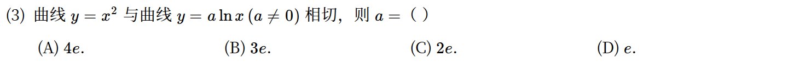

---

### 20 · 2010-10 · 填空题

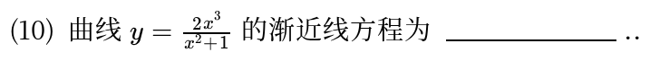

---

## 交叉考点索引

以下题目主归其他章节，点击跳转到对应章节题目；不计入本章主收录题数：

- [2023年 · 第17题](14-first-order-ode.md)（主章节：一阶微分方程）
- [2021年 · 第18题](07-convexity.md)（主章节：凹凸性与拐点）
- [2021年 · 第20题](14-first-order-ode.md)（主章节：一阶微分方程）
- [2020年 · 第21题](14-first-order-ode.md)（主章节：一阶微分方程）
- [2019年 · 第6题](08-taylor.md)（主章节：泰勒公式与高阶导数）
- [2017年 · 第21题](14-first-order-ode.md)（主章节：一阶微分方程）
- [2015年 · 第21题](05-mean-value-proofs.md)（主章节：中值定理、零点与不等式证明）
- [2012年 · 第17题](13-integral-applications.md)（主章节：定积分应用）
- [2011年 · 第18题](14-first-order-ode.md)（主章节：一阶微分方程）

[« 泰勒公式与高阶导数](08-taylor.md)　　[不定积分与原函数 »](10-antiderivatives.md)
