[« 泰勒公式与高阶导数](08-taylor.md)　　[不定积分与原函数 »](10-antiderivatives.md)

# 高等数学 · 切线、法线、渐近线与曲率

> **本章共 20 题**
> 
> - **核心必做（建议按顺序攻克关键方法）**：  
>   [第 19 题](#q19)（相切的两个条件） → [第 17 题](#q17)（渐近线与可去点区别） → [第 02 题](#q02)（斜渐近线截距） → [第 14 题](#q14)（参数曲线曲率半径） → [第 01 题](#q01)（隐曲线曲率半径）
> 
> - **分流与刷题建议**：  
>   - **较难挑战**：[第 06 题](#q06)（幂指函数的斜渐近线）  
>   - **重在看思路**：[第 03 题](#q03)（竖直切线处换自变量求曲率圆）  
>   - **首轮可跳过**：[第 15 题](#q15)（技巧较偏或综合度高，首轮不必死磕）  
>   - **题面存疑暂缓**：[第 07 题](#q07)（题干未明确截距对应哪个坐标轴，待核）（原卷转写存疑，首轮暂不安排）  
> 
> - **过关目标**：切线要有点和斜率；渐近线查差值，曲率注意绝对值与倒数。

---

### 01 · 2026年

> *隐函数曲率半径填空。在点 $(0,1)$ 处对隐方程求一阶导得 $y'$，再求二阶导得 $y''$，直接代入曲率半径公式 $R = (1+y'^2)^{3/2}/|y''|$，别算错代数式。*

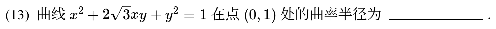

答案与解析

**答案 $4$。** 隐式求导，在 $(0,1)$ 代入 $2x+2\sqrt3(y+xy')+2yy'=0$ 得 $y'=-\sqrt3$。再求一次导，代点得 $2+4\sqrt3y'+2(y')^2+2y''=0$，即 $y''=2$。曲率半径 $\rho=(1+(y')^2)^{3/2}/|y''|=4$。

---

### 02 · 2025年

> *三次根式斜渐近线。求斜渐近线别死算两步极限，提公因子 $x$ 出来利用泰勒展开 $(1+u)^{1/3} = 1 + u/3 - u^2/9$，直接展开得到 $y = x - 1$。*

答案与解析

1. **无铅直与水平渐近线**：奇次根式在 $\mathbb{R}$ 上处处连续，无铅直渐近线；当 $x \to \pm\infty$ 时 $y \to \pm\infty$，无水平渐近线。
2. **提主项配合泰勒展开一步求斜渐近线**（比直接套 $k, b$ 硬有理化更快）：当 $x \to \pm\infty$ 时，
   $$y = x\left(1 - \frac{3}{x} + \frac{1}{x^3}\right)^{\frac{1}{3}} = x\left[1 + \frac{1}{3}\left(-\frac{3}{x} + \frac{1}{x^3}\right) + o\left(\frac{1}{x}\right)\right] = x - 1 + o(1).$$
   因此无论是 $x \to +\infty$ 还是 $x \to -\infty$，均有 $k = \lim_{x\to \pm\infty}\frac{y}{x} = 1$、$b = \lim_{x\to \pm\infty}(y - x) = -1$。
3. **答案**：$y = x - 1$。

---

### 03 · 2024年

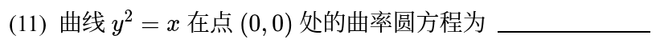

答案与解析

**答案 $(x-\tfrac12)^2+y^2=\tfrac14$。** 以 $y=t$ 为参数，曲线为 $(t^2,t)$。原点切线竖直、曲线向右弯，曲率 $|x'y''-y'x''|/(x'^2+y'^2)^{3/2}=2$，故圆心在右侧法线上、距原点 $1/2$。

---

### 04 · 2023年

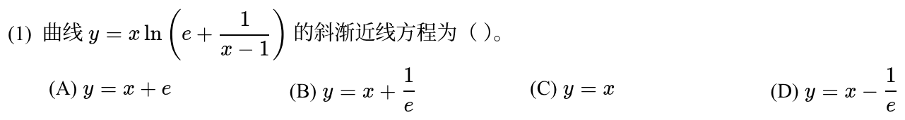

答案与解析

**答案 B。** 写成 $y=x+x\ln(1+1/[e(x-1)])$。在正、负无穷远，第二项都趋于 $1/e$，所以斜渐近线为 $y=x+1/e$。先拆出线性项，再对余项取极限。

---

### 05 · 2023年

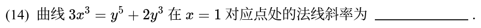

答案与解析

**答案 $-11/9$。** 当 $x=1$ 时，$y^5+2y^3=3$ 唯一实根为 $1$（左边严格递增）。隐式求导得 $9x^2=(5y^4+6y^2)y'$，所以该点切线斜率 $9/11$，法线斜率为负倒数。

---

### 06 · 2020年

> *幂指函数斜渐近线大题。先算斜率 $a = \lim y/x$；算截距 $b = \lim (y-ax)$ 时化为 $x[(1+1/x)^{-x}-1]$，利用对数展开式或等价无穷小求极限。*

答案与解析

**答案 $y=x/e+1/(2e)$。** 写成 $y=x\exp[-x\ln(1+1/x)]$，在无穷远展开指数为 $-1+1/(2x)+O(x^{-2})$。于是 $y=x/e+1/(2e)+O(x^{-1})$，余项趋零。

---

### 07 · 2019年

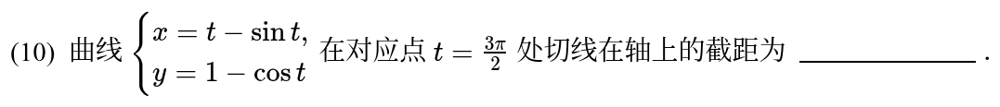

答案与解析

**题面待核。** 题图若只说“在轴上的截距”，需确认是哪条轴。参数点为 $(3\pi/2+1,1)$，由 $(dy/dt)/(dx/dt)=-1$，切线为 $y=-x+3\pi/2+2$。若问横截距或纵截距的数值，本题两者恰都等于 $3\pi/2+2$；对应截点分别在两条轴上。

---

### 08 · 2018年

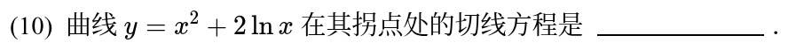

答案与解析

**答案 $y=4x-3$。** 在 $x>0$，$y''=2-2/x^2$ 在 $x=1$ 变号，拐点 $(1,1)$。由 $y'=2x+2/x$ 得切线斜率 4。

---

### 09 · 2018年

答案与解析

**答案 $2/3$。** 在第一象限参数范围，$x'=-3\cos^2t\sin t,\ y'=3\sin^2t\cos t$，速率为 $3\sin t\cos t$。切线斜率 $-\tan t$ 的切线方向角对 $t$ 的变化率绝对值为 1，故曲率为 $1/(3\sin t\cos t)$，代 $t=\pi/4$。

---

### 10 · 2017年

答案与解析

**答案 $y=x+2$。** $y-x=x\arcsin(2/x)\to2$，正、负无穷远均成立。看到 $x$ 已显式分出，直接取剩余项的极限。

---

### 11 · 2016年

> *切线与曲率比较。两曲线相切说明一阶导相等；曲率大说明二阶导绝对值大。结合 $f''_i(x_0)<0$ 判定局部凸性与相对位置，画草图一目了然。*

答案与解析

**答案 A。** 公切线给两函数相同的函数值和一阶导数，故曲率公式的分母相同。两二阶导为负，曲率较大意味着 $f_1''(x_0)<f_2''(x_0)<0$。分别比较 $f_1-f_2,f_2-g$ 的二阶泰勒首项，得切点附近 $f_1\le f_2\le g$。

---

### 12 · 2016年

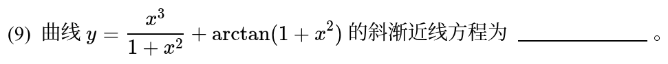

答案与解析

**答案 $y=x+\pi/2$。** 用 $x^3/(1+x^2)=x-x/(1+x^2)$，并注意 $\arctan(1+x^2)\to\pi/2$ 在两端均成立。

---

### 13 · 2014年

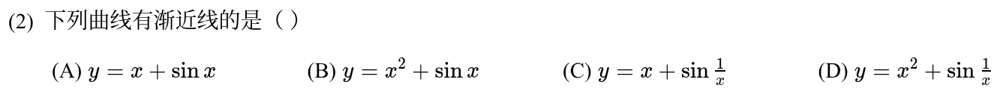

答案与解析

**答案 C。** C 在两端有 $\sin(1/x)\to0$，所以 $y=x$ 为斜渐近线。A 的差项持续振荡，B、D 在无穷远增长为二次量。各式的有限点附近也没有无穷大，其中 $\sin(1/x)$ 在原点虽无极限却有界。

---

### 14 · 2014年

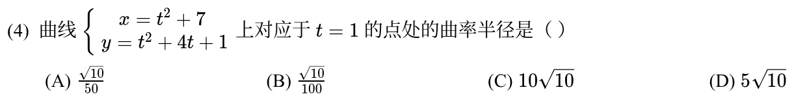

答案与解析

**答案 C，$10\sqrt{10}$。** 参数曲线的曲率半径为 $(x'^2+y'^2)^{3/2}/|x'y''-y'x''|$。在 $t=1$，有 $x'=2,y'=6,x''=y''=2$，代入得 $40^{3/2}/8$。

---

### 15 · 2014年

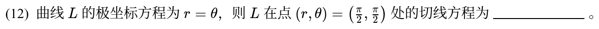

答案与解析

**答案 $y-\frac\pi2=-\frac2\pi x$。** 参数化 $x=\theta\cos\theta,y=\theta\sin\theta$。在 $\theta=\pi/2$ 时点为 $(0,\pi/2)$，导数向量为 $(-\pi/2,1)$，斜率为 $-2/\pi$。

---

### 16 · 2013年

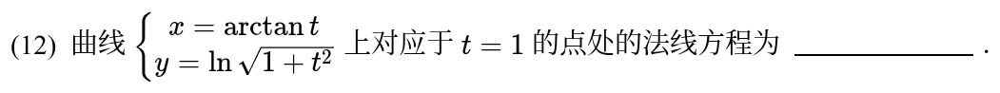

答案与解析

**答案 $x+y=\pi/4+\frac12\ln2$。** 由 $dy/dx=t$，在 $t=1$ 时法线斜率 $-1$。参数点为 $(\pi/4,\frac12\ln2)$。

---

### 17 · 2012年

答案与解析

**第一步落笔与完整推导**

先对分子分母因式分解：
$$y = \frac{x(x + 1)}{(x - 1)(x + 1)}, \qquad x \neq \pm 1.$$

1. **查铅直渐近线（逐个核对无定义点 $x = -1$ 与 $x = 1$）**：
   - 在 $x = -1$ 处：
     $$\lim_{x\to -1} \frac{x^2 + x}{x^2 - 1} = \lim_{x\to -1} \frac{x}{x - 1} = \frac{-1}{-2} = \frac{1}{2} \neq \infty,$$
     因此 $x = -1$ 是**可去间断点**，**不是**铅直渐近线！
   - 在 $x = 1$ 处：
     $$\lim_{x\to 1} \frac{x^2 + x}{x^2 - 1} = \lim_{x\to 1} \frac{x}{x - 1} = \infty,$$
     故 $x = 1$ 是唯一一条铅直渐近线。
2. **查水平渐近线（$x \to \pm\infty$）**：
   $$\lim_{x\to \infty} \frac{x^2 + x}{x^2 - 1} = 1,$$
   左右无穷极限相同，得水平渐近线 $y = 1$（共 1 条）。
3. **查斜渐近线**：因为 $+\infty$ 与 $-\infty$ 两侧均已有水平渐近线，故无斜渐近线。

综上，共有 **2 条**渐近线（$x = 1$ 与 $y = 1$），选 **（C）**。

**选择题干扰项拆解**

- **（D）3（头号陷阱）**：直接令分母 $x^2 - 1 = 0$ 得到 $x = 1$ 和 $x = -1$ 两条铅直渐近线，加上 $y = 1$ 误选 3。
- **（B）1**：漏查水平渐近线或只算了铅直渐近线。

---

### 18 · 2012年

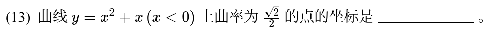

答案与解析

**答案 $(-1,0)$。** 曲率 $\kappa=2/[1+(2x+1)^2]^{3/2}$，令其等于 $\sqrt2/2$ 得 $(2x+1)^2=1$。候选 $x=0,-1$ 中只保留题设 $x<0$ 的值。

---

### 19 · 2010年

答案与解析

**答案 C，$2e$。** 设切点横坐标 $x_0>0$。函数值与导数同时相同，得 $x_0^2=a\ln x_0$、$2x_0=a/x_0$。消元得 $\ln x_0=1/2$，再代回 $a=2x_0^2=2e$。

---

### 20 · 2010年

答案与解析

**答案 $y=2x$。** $2x^3/(x^2+1)=2x-2x/(x^2+1)$，余项在两端均趋 0。分母无实零点，故没有垂直渐近线。

---

[« 泰勒公式与高阶导数](08-taylor.md)　　[不定积分与原函数 »](10-antiderivatives.md)
