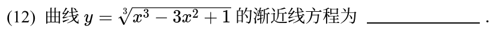
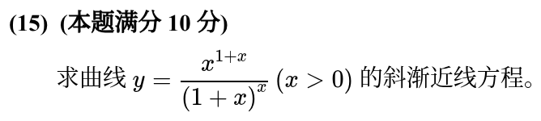
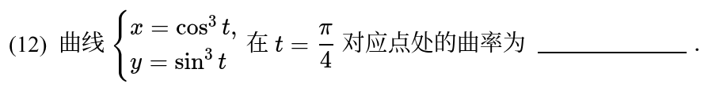
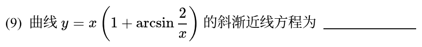
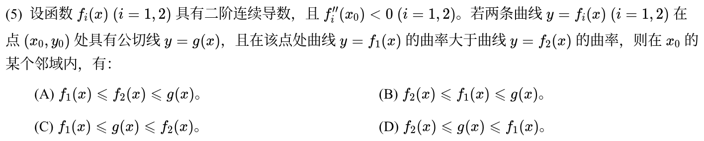
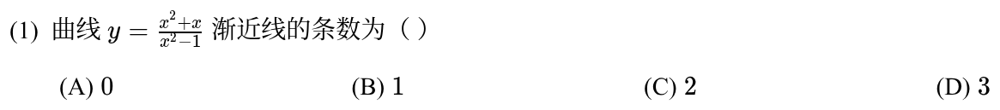
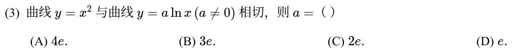
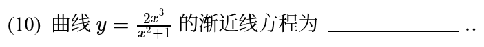

[« 泰勒公式与高阶导数](08-taylor.md)　　[不定积分与原函数 »](10-antiderivatives.md)

# 高等数学 · 切线、法线、渐近线与曲率

> **本章共 20 题**
> 
> - **核心必做（建议按顺序攻克关键方法）**：  
>   [第 19 题](#q19)（相切的两个条件） → [第 17 题](#q17)（渐近线与可去点区别） → [第 02 题](#q02)（斜渐近线截距） → [第 14 题](#q14)（参数曲线曲率半径） → [第 01 题](#q01)（隐曲线曲率半径）
> 
> - **分流与刷题建议**：  
>   - **较难挑战**：[第 06 题](#q06)（幂指函数的斜渐近线）  
>   - **重在看思路**：[第 03 题](#q03)（竖直切线处换自变量求曲率圆）  
>   - **首轮可跳过**：[第 15 题](#q15)（技巧较偏或综合度高，首轮不必死磕）  
>   - **题面存疑暂缓**：[第 07 题](#q07)（题干未明确截距对应哪个坐标轴，待核）（原卷转写存疑，首轮暂不安排）  
> 
> - **过关目标**：切线要有点和斜率；渐近线查差值，曲率注意绝对值与倒数。

---

### 01 · 2026年

> *隐函数曲率半径填空。在点 $(0,1)$ 处对隐方程求一阶导得 $y'$，再求二阶导得 $y''$，直接代入曲率半径公式 $R = (1+y'^2)^{3/2}/|y''|$，别算错代数式。*

答案与解析

**答案**：$4$

- **切入点与推演**：对隐函数方程 $x^2 + 2\sqrt{3}xy + y^2 = 1$ 两边对 $x$ 连续求导两次，再代入点 $(0,1)$ 求 $y'$ 与 $y''$：
  1. 一阶求导并除以 $2$：
     $$
     x + \sqrt{3}(y + xy') + yy' = 0.
     $$
     代入 $(0,1)$ 得 $\sqrt{3} + y' = 0 \implies y' = -\sqrt{3}$。
  2. 对上式再求一次导：
     $$
     1 + \sqrt{3}(2y' + xy'') + (y')^2 + yy'' = 0.
     $$
     代入 $(0,1)$ 及 $y' = -\sqrt{3}$ 得
     $$
     1 + 2\sqrt{3}(-\sqrt{3}) + (-\sqrt{3})^2 + y'' = 0 \implies 1 - 6 + 3 + y'' = 0 \implies y'' = 2.
     $$
  3. 代入曲率半径公式：
     $$
     \rho = \frac{\bigl(1+(y')^2\bigr)^{\frac{3}{2}}}{|y''|} = \frac{(1+3)^{\frac{3}{2}}}{2} = \frac{8}{2} = 4.
     $$
- **易错点**：二阶隐函数求导时别漏掉乘积项 $(xy')' = y' + xy''$ 和 $(yy')' = (y')^2 + yy''$，且注意题目问的是**曲率半径** $\rho = \frac{1}{\kappa}$ 而非曲率 $\kappa$。

---

### 02 · 2025年

> *三次根式斜渐近线。求斜渐近线别死算两步极限，提公因子 $x$ 出来利用泰勒展开 $(1+u)^{1/3} = 1 + u/3 - u^2/9$，直接展开得到 $y = x - 1$。*

答案与解析

1. **无铅直与水平渐近线**：奇次根式在 $\mathbb{R}$ 上处处连续，无铅直渐近线；当 $x \to \pm\infty$ 时 $y \to \pm\infty$，无水平渐近线。
2. **提主项配合泰勒展开一步求斜渐近线**（比直接套 $k, b$ 硬有理化更快）：当 $x \to \pm\infty$ 时，
   $$y = x\left(1 - \frac{3}{x} + \frac{1}{x^3}\right)^{\frac{1}{3}} = x\left[1 + \frac{1}{3}\left(-\frac{3}{x} + \frac{1}{x^3}\right) + o\left(\frac{1}{x}\right)\right] = x - 1 + o(1).$$
   因此无论是 $x \to +\infty$ 还是 $x \to -\infty$，均有 $k = \lim_{x\to \pm\infty}\frac{y}{x} = 1$、$b = \lim_{x\to \pm\infty}(y - x) = -1$。
3. **答案**：$y = x - 1$。

---

### 03 · 2024年

答案与解析

**答案**：$\left(x-\dfrac{1}{2}\right)^2 + y^2 = \dfrac{1}{4}$

- **切入点与推演**：曲线 $x = y^2$ 在原点处切线为铅直线 $x=0$，直接把 $y$ 看作自变量（即 $x(y) = y^2$）可避开 $y'(0)=\infty$：
  1. 在 $y=0$ 处，$x'(0) = 0$，$x''(0) = 2$，故曲率与曲率半径分别为
     $$
     \kappa = \frac{|x''(0)|}{\bigl(1+[x'(0)]^2\bigr)^{\frac{3}{2}}} = 2,\qquad R = \frac{1}{\kappa} = \frac{1}{2}.
     $$
  2. 确定曲率圆圆心：原点处切线为 $y$ 轴（$x=0$），法线为 $x$ 轴（$y=0$）；又曲线 $x=y^2\ge 0$ 向 $x$ 轴正方向弯曲（凹向右侧），故圆心位于法线正半轴距原点 $R=\frac{1}{2}$ 处，即 $\left(\frac{1}{2},0\right)$。
  3. 写出曲率圆方程：
     $$
     \left(x-\frac{1}{2}\right)^2 + y^2 = \frac{1}{4}.
     $$
- **易错点**：曲率圆圆心一定偏向曲线的凹侧（本题为 $x>0$ 一侧），不要把圆心误写成 $\left(-\frac{1}{2},0\right)$ 或把右边 $R^2$ 错写成 $R=\frac{1}{2}$。

---

### 04 · 2023年

答案与解析

**答案**：**（B）** $y = x + \dfrac{1}{e}$

- **切入点与推演**：把对数内的常数因子 $e$ 提出，直接拆分出线性主部 $x$：
  $$
  y = x\ln\!\left(e + \frac{1}{x-1}\right) = x\left[1 + \ln\!\left(1 + \frac{1}{e(x-1)}\right)\right] = x + x\ln\!\left(1 + \frac{1}{e(x-1)}\right).
  $$
  当 $x \to \pm\infty$ 时，$\dfrac{1}{e(x-1)} \to 0$，由等价无穷小 $\ln(1+u)\sim u$ 得
  $$
  \lim_{x\to\pm\infty} (y - x) = \lim_{x\to\pm\infty} x\ln\!\left(1 + \frac{1}{e(x-1)}\right) = \lim_{x\to\pm\infty} \frac{x}{e(x-1)} = \frac{1}{e}.
  $$
  故斜渐近线方程为 $y = x + \dfrac{1}{e}$，选（B）。
- **干扰项 / 易错提示**：求截距 $b=\lim(y-kx)$ 时务必注意 $\ln(e+u) = 1 + \ln(1+u/e)$，不要忘了除以 $e$ 而误选（A）。

---

### 05 · 2023年

答案与解析

**答案**：$-\dfrac{11}{9}$

- **切入点与推演**：
  1. **确定对应点纵坐标**：将 $x=1$ 代入方程得 $y^5 + 2y^3 = 3$。因 $g(y)=y^5+2y^3$ 的导数 $g'(y)=5y^4+6y^2 \ge 0$ 且仅在 $y=0$ 处为零，$g(y)$ 在 $\mathbb{R}$ 上严格单调递增，故 $y=1$ 是唯一实根，对应点为 $(1,1)$。
  2. **隐函数求导得切线斜率**：方程两边对 $x$ 求导：
     $$
     9x^2 = (5y^4 + 6y^2)y'.
     $$
     代入 $(1,1)$ 得切线斜率 $y'\big|_{(1,1)} = \dfrac{9}{5+6} = \dfrac{9}{11}$。
  3. **取负倒数得法线斜率**：
     $$
     k_{\text{法}} = -\frac{1}{y'\big|_{(1,1)}} = -\frac{11}{9}.
     $$
- **易错点**：看清题目求的是**法线斜率**而非切线斜率，且取负倒数时别丢负号。

---

### 06 · 2020年

> *幂指函数斜渐近线大题。先算斜率 $a = \lim y/x$；算截距 $b = \lim (y-ax)$ 时化为 $x[(1+1/x)^{-x}-1]$，利用对数展开式或等价无穷小求极限。*

答案与解析

**结论速览**：斜渐近线方程为 $y = \dfrac{1}{e}x + \dfrac{1}{2e}$。

- **完整解答**：
  因定义域为 $x > 0$，只需考察 $x \to +\infty$ 方向的斜渐近线 $y = kx + b$。
  1. **求斜率 $k$**：
     $$
     k = \lim_{x\to+\infty}\frac{y}{x} = \lim_{x\to+\infty}\frac{x^x}{(1+x)^x} = \lim_{x\to+\infty}\left(1+\frac{1}{x}\right)^{-x} = \frac{1}{e}.
     $$
  2. **求截距 $b$**：
     将 $\dfrac{y}{x} = \left(1+\dfrac{1}{x}\right)^{-x}$ 改写为指数形式并利用 $\ln(1+u) = u - \frac{1}{2}u^2 + o(u^2)$（$u\to 0$）：
     $$
     \begin{aligned}
     b &= \lim_{x\to+\infty}\left(y - \frac{1}{e}x\right)
        = \lim_{x\to+\infty} x\left[e^{-x\ln\left(1+\frac{1}{x}\right)} - e^{-1}\right] \\
       &= \frac{1}{e}\lim_{x\to+\infty} x\left[e^{1 - x\ln\left(1+\frac{1}{x}\right)} - 1\right].
     \end{aligned}
     $$
     当 $x\to+\infty$ 时，
     $$
     1 - x\ln\!\left(1+\frac{1}{x}\right) = 1 - x\left(\frac{1}{x} - \frac{1}{2x^2} + o\!\left(\frac{1}{x^2}\right)\right) = \frac{1}{2x} + o\!\left(\frac{1}{x}\right) \to 0.
     $$
     由 $e^u - 1 \sim u$（$u\to 0$），得
     $$
     b = \frac{1}{e}\lim_{x\to+\infty} x\left[\frac{1}{2x} + o\!\left(\frac{1}{x}\right)\right] = \frac{1}{2e}.
     $$
  综上，曲线的斜渐近线方程为 $y = \dfrac{1}{e}x + \dfrac{1}{2e}$。
- **核心思路与避坑**：本题本质是 $\infty\cdot 0$ 型幂指函数极限求二阶展开项；提出公因子 $e^{-1}$ 后把指数差用泰勒展开到 $x^{-1}$ 阶即可，切勿在指数内部提前用 $\ln(1+\frac{1}{x})\sim\frac{1}{x}$ 替换（会导致 $1-1=0$ 丢失主部）。

---

### 07 · 2019年

答案与解析

**题面待核**（当前转录题干为“在轴上的截距”，缺少坐标轴字母 $x$ 或 $y$；按原卷常见问法，无论问在 $x$ 轴还是 $y$ 轴上的截距，本题数值恰好均为 $\dfrac{3\pi}{2}+2$）

- **切入点与推演**：
  1. **求切点坐标**：将 $t = \dfrac{3\pi}{2}$ 代入参数方程：
     $$
     x = \frac{3\pi}{2} - \sin\frac{3\pi}{2} = \frac{3\pi}{2} + 1,\qquad y = 1 - \cos\frac{3\pi}{2} = 1,
     $$
     切点为 $\left(\dfrac{3\pi}{2}+1,\;1\right)$。
  2. **求切线斜率与切线方程**：
     $$
     \left.\frac{\mathrm{d}y}{\mathrm{d}x}\right|_{t=\frac{3\pi}{2}} = \left.\frac{\sin t}{1-\cos t}\right|_{t=\frac{3\pi}{2}} = \frac{-1}{1-0} = -1.
     $$
     故切线方程为
     $$
     y - 1 = -\left(x - \frac{3\pi}{2} - 1\right) \iff x + y = \frac{3\pi}{2} + 2.
     $$
  3. **求截距**：令 $y=0$ 得在 $x$ 轴上的截距为 $\dfrac{3\pi}{2}+2$；令 $x=0$ 得在 $y$ 轴上的截距亦为 $\dfrac{3\pi}{2}+2$。
- **易错点**：计算 $\sin\frac{3\pi}{2}=-1$ 时注意负号，切点横坐标是 $\frac{3\pi}{2}+1$ 而非 $\frac{3\pi}{2}-1$；原卷问的是在 $y$ 轴（或 $x$ 轴）上的截距，因切线斜率为 $-1$，两轴截距恰好相等。

---

### 08 · 2018年

答案与解析

**答案**：$y = 4x - 3$

- **切入点与推演**：定义域为 $x > 0$。依次求一阶导数与二阶导数：
  $$
  y' = 2x + \frac{2}{x},\qquad y'' = 2 - \frac{2}{x^2}.
  $$
  令 $y'' = 0$，在 $x > 0$ 内得唯一解 $x = 1$：当 $0 < x < 1$ 时 $y'' < 0$，当 $x > 1$ 时 $y'' > 0$，二阶导在 $x=1$ 两侧变号，故拐点为 $(1, 1)$。
  该点处切线斜率为 $y'(1) = 2 + 2 = 4$，于是切线方程为
  $$
  y - 1 = 4(x - 1) \iff y = 4x - 3.
  $$
- **易错点**：求导时注意 $x>0$ 的定义域限制（无需考虑 $x=-1$），且解出拐点横坐标后别忘了验证二阶导确实变号。

---

### 09 · 2018年

答案与解析

**答案**：$\dfrac{2}{3}$

- **切入点与推演**：对参数方程 $x=\cos^3 t,\; y=\sin^3 t$ 分别求一阶、二阶导数并代入 $t=\dfrac{\pi}{4}$：
  $$
  x'(t) = -3\cos^2 t\sin t,\qquad y'(t) = 3\sin^2 t\cos t,
  $$
  $$
  x''(t) = 3\cos t(2\sin^2 t - \cos^2 t),\qquad y''(t) = 3\sin t(2\cos^2 t - \sin^2 t).
  $$
  代入 $t = \dfrac{\pi}{4}$（$\sin t = \cos t = \dfrac{\sqrt{2}}{2}$）：
  $$
  x' = -\frac{3\sqrt{2}}{4},\qquad y' = \frac{3\sqrt{2}}{4},\qquad x'' = \frac{3\sqrt{2}}{4},\qquad y'' = \frac{3\sqrt{2}}{4}.
  $$
  代入参数方程曲率公式：
  $$
  \kappa = \frac{|x'y'' - y'x''|}{\bigl[(x')^2 + (y')^2\bigr]^{\frac{3}{2}}}
  = \frac{\left|-\frac{9}{8} - \frac{9}{8}\right|}{\left(\frac{9}{8}+\frac{9}{8}\right)^{\frac{3}{2}}}
  = \frac{\frac{9}{4}}{\left(\frac{9}{4}\right)^{\frac{3}{2}}}
  = \frac{1}{\sqrt{9/4}} = \frac{2}{3}.
  $$
- **易错点**：本题也可由 $\frac{\mathrm{d}y}{\mathrm{d}x} = -\tan t$ 直接求 $\frac{\mathrm{d}^2 y}{\mathrm{d}x^2} = \frac{-\sec^2 t}{-3\cos^2 t\sin t} = \frac{1}{3\cos^4 t\sin t}$ 后套显函数曲率公式；两种方法都需注意分子绝对值与分母 $\frac{3}{2}$ 次幂的化简。

---

### 10 · 2017年

答案与解析

**答案**：$y = x + 2$

- **切入点与推演**：将函数展开为 $y = x + x\arcsin\dfrac{2}{x}$。当 $x \to \pm\infty$ 时，$\dfrac{2}{x} \to 0$，由等价无穷小 $\arcsin u \sim u$ 得
  $$
  \lim_{x\to\pm\infty} (y - x) = \lim_{x\to\pm\infty} x\arcsin\frac{2}{x} = \lim_{x\to\pm\infty} x\cdot\frac{2}{x} = 2.
  $$
  因此当 $x\to+\infty$ 与 $x\to-\infty$ 时曲线有同一条斜渐近线 $y = x + 2$。
- **易错点**：等价无穷小 $\arcsin\frac{2}{x}\sim\frac{2}{x}$ 在 $x\to+\infty$ 和 $x\to-\infty$ 双向均成立且符号一致，不会出现两条不同斜渐近线。

---

### 11 · 2016年

> *切线与曲率比较。两曲线相切说明一阶导相等；曲率大说明二阶导绝对值大。结合 $f''_i(x_0)<0$ 判定局部凸性与相对位置，画草图一目了然。*

答案与解析

**答案**：**（A）** $f_1(x) \leqslant f_2(x) \leqslant g(x)$

- **切入点与推演**：
  1. **翻译公切线条件**：两曲线在 $(x_0,y_0)$ 处具有公切线 $y = g(x)$（一次函数，故 $g''(x)\equiv 0$），意味着
     $$
     f_1(x_0) = f_2(x_0) = g(x_0) = y_0,\qquad f_1'(x_0) = f_2'(x_0) = g'(x_0).
     $$
  2. **翻译曲率大小条件**：因两曲线在 $x_0$ 处一阶导数相同，曲率公式 $\kappa_i = \dfrac{|f_i''(x_0)|}{\bigl(1+[f_i'(x_0)]^2\bigr)^{3/2}}$ 的分母相同，故 $\kappa_1 > \kappa_2 \iff |f_1''(x_0)| > |f_2''(x_0)|$。结合题设 $f_1''(x_0) < 0$ 且 $f_2''(x_0) < 0$，得
     $$
     f_1''(x_0) < f_2''(x_0) < 0 = g''(x_0).
     $$
  3. **二阶泰勒展开比大小**：在 $x_0$ 处展开，差函数的常数项与一次项均为零：
     $$
     f_1(x) - f_2(x) = \frac{1}{2}\bigl(f_1''(x_0) - f_2''(x_0)\bigr)(x-x_0)^2 + o\bigl((x-x_0)^2\bigr),
     $$
     $$
     f_2(x) - g(x) = \frac{1}{2}f_2''(x_0)(x-x_0)^2 + o\bigl((x-x_0)^2\bigr).
     $$
     因两式首项系数均严格小于 $0$，在 $x_0$ 的某邻域内恒有 $f_1(x) \le f_2(x) \le g(x)$，选（A）。
- **干扰项 / 易错提示**：当 $f''(x_0) < 0$ 时曲线向上凸（在切线下方），曲率越大说明向下弯曲越剧烈、图像越靠下，切勿忽略负号而把 $|f_1''|>|f_2''|$ 误写成 $f_1''>f_2''$（从而误选（B））。

---

### 12 · 2016年

答案与解析

**答案**：$y = x + \dfrac{\pi}{2}$

- **切入点与推演**：对有理分式先作多项式除法拆出一次项 $x$：
  $$
  y = \frac{x^3}{1+x^2} + \arctan(1+x^2) = x - \frac{x}{1+x^2} + \arctan(1+x^2).
  $$
  当 $x \to \pm\infty$ 时，均有 $\dfrac{x}{1+x^2} \to 0$ 且 $1+x^2 \to +\infty$，从而 $\arctan(1+x^2) \to \dfrac{\pi}{2}$。于是
  $$
  \lim_{x\to\pm\infty} (y - x) = \frac{\pi}{2},
  $$
  故斜渐近线方程为 $y = x + \dfrac{\pi}{2}$。
- **易错点**：注意自变量是 $1+x^2$ 而非 $x$，无论 $x\to+\infty$ 还是 $x\to-\infty$ 都有 $1+x^2\to+\infty$，不要误以为 $x\to-\infty$ 时 $\arctan(1+x^2)\to -\frac{\pi}{2}$。

---

### 13 · 2014年

答案与解析

**答案**：**（C）** $y = x + \sin\dfrac{1}{x}$

- **切入点与推演**：逐项检查水平、铅直与斜渐近线：
  - 对（C）$y = x + \sin\dfrac{1}{x}$：当 $x \to \pm\infty$ 时，$\sin\dfrac{1}{x} \to 0$，即 $\lim_{x\to\pm\infty}(y-x) = 0$，故 $y=x$ 是其斜渐近线，（C）正确。
- **干扰项 / 易错提示**：
  - （A）$y=x+\sin x$：虽有 $\lim_{x\to\infty}\frac{y}{x}=1$，但 $y-x=\sin x$ 在 $x\to\infty$ 时振荡无极限，无斜渐近线；
  - （B）（D）：主部为 $x^2$，在无穷远呈二次增长（$\lim\frac{y}{x}=\infty$），无水平或斜渐近线；且（D）在 $x\to 0$ 时 $\sin\frac{1}{x}$ 有界振荡而非趋于无穷，无铅直渐近线。

---

### 14 · 2014年

答案与解析

**答案**：**（C）** $10\sqrt{10}$

- **切入点与推演**：对参数方程 $x=t^2+7,\; y=t^2+4t+1$ 求导并代入 $t=1$：
  $$
  x'(t) = 2t,\qquad y'(t) = 2t + 4,\qquad x''(t) = 2,\qquad y''(t) = 2.
  $$
  在 $t=1$ 处，有 $x'=2,\; y'=6,\; x''=2,\; y''=2$。代入参数曲线曲率半径公式：
  $$
  \rho = \frac{\bigl[(x')^2 + (y')^2\bigr]^{\frac{3}{2}}}{|x'y'' - y'x''|}
  = \frac{(2^2 + 6^2)^{\frac{3}{2}}}{|2\cdot 2 - 6\cdot 2|}
  = \frac{40^{\frac{3}{2}}}{8}
  = \frac{40\cdot 2\sqrt{10}}{8} = 10\sqrt{10},
  $$
  故选（C）。
- **干扰项 / 易错提示**：不要把曲率 $\kappa = \frac{1}{10\sqrt{10}} = \frac{\sqrt{10}}{100}$ 与曲率半径 $\rho = 10\sqrt{10}$ 搞反（（B）正是曲率值的干扰项）。

---

### 15 · 2014年

答案与解析

**答案**：$y = -\dfrac{2}{\pi}x + \dfrac{\pi}{2}$（或 $2x + \pi y = \dfrac{\pi^2}{2}$）

- **切入点与推演**：将极坐标方程 $r = \theta$ 化为以 $\theta$ 为参数的直角坐标方程：
  $$
  \begin{cases}
  x = r\cos\theta = \theta\cos\theta, \\
  y = r\sin\theta = \theta\sin\theta.
  \end{cases}
  $$
  1. **求切点直角坐标**：当 $\theta = \dfrac{\pi}{2}$ 时，$x = 0$，$y = \dfrac{\pi}{2}$，切点为 $\left(0,\dfrac{\pi}{2}\right)$。
  2. **求切线斜率**：
     $$
     \frac{\mathrm{d}x}{\mathrm{d}\theta} = \cos\theta - \theta\sin\theta,\qquad \frac{\mathrm{d}y}{\mathrm{d}\theta} = \sin\theta + \theta\cos\theta.
     $$
     代入 $\theta = \dfrac{\pi}{2}$ 得 $x' = -\dfrac{\pi}{2}$， $y' = 1$，故切线斜率为
     $$
     k = \left.\frac{\mathrm{d}y}{\mathrm{d}x}\right|_{\theta=\frac{\pi}{2}} = \frac{1}{-\pi/2} = -\frac{2}{\pi}.
     $$
  3. **写出切线方程**：$y - \dfrac{\pi}{2} = -\dfrac{2}{\pi}(x - 0)$，即 $y = -\dfrac{2}{\pi}x + \dfrac{\pi}{2}$。
- **易错点**：切线方程最终必须用直角坐标 $(x,y)$ 写出，切勿把极坐标点 $\left(\frac{\pi}{2},\frac{\pi}{2}\right)$ 直接当成直角坐标代入点斜式。

---

### 16 · 2013年

答案与解析

**答案**：$x + y = \dfrac{\pi}{4} + \dfrac{1}{2}\ln 2$

- **切入点与推演**：
  1. **求对应点坐标**：将 $t=1$ 代入参数方程：
     $$
     x(1) = \arctan 1 = \frac{\pi}{4},\qquad y(1) = \ln\sqrt{2} = \frac{1}{2}\ln 2.
     $$
  2. **求切线与法线斜率**：
     $$
     \frac{\mathrm{d}x}{\mathrm{d}t} = \frac{1}{1+t^2},\qquad \frac{\mathrm{d}y}{\mathrm{d}t} = \frac{t}{1+t^2} \implies \frac{\mathrm{d}y}{\mathrm{d}x} = t.
     $$
     在 $t=1$ 处切线斜率为 $1$，故法线斜率为 $-1$。
  3. **写出法线方程**：
     $$
     y - \frac{1}{2}\ln 2 = -\left(x - \frac{\pi}{4}\right) \iff x + y = \frac{\pi}{4} + \frac{1}{2}\ln 2.
     $$
- **易错点**：看清题目要求的是**法线方程**而非切线方程，斜率应取 $-1$ 而非 $1$。

---

### 17 · 2012年

答案与解析

**第一步落笔与完整推导**

先对分子分母因式分解：
$$y = \frac{x(x + 1)}{(x - 1)(x + 1)}, \qquad x \neq \pm 1.$$

1. **查铅直渐近线（逐个核对无定义点 $x = -1$ 与 $x = 1$）**：
   - 在 $x = -1$ 处：
     $$\lim_{x\to -1} \frac{x^2 + x}{x^2 - 1} = \lim_{x\to -1} \frac{x}{x - 1} = \frac{-1}{-2} = \frac{1}{2} \neq \infty,$$
     因此 $x = -1$ 是**可去间断点**，**不是**铅直渐近线！
   - 在 $x = 1$ 处：
     $$\lim_{x\to 1} \frac{x^2 + x}{x^2 - 1} = \lim_{x\to 1} \frac{x}{x - 1} = \infty,$$
     故 $x = 1$ 是唯一一条铅直渐近线。
2. **查水平渐近线（$x \to \pm\infty$）**：
   $$\lim_{x\to \infty} \frac{x^2 + x}{x^2 - 1} = 1,$$
   左右无穷极限相同，得水平渐近线 $y = 1$（共 1 条）。
3. **查斜渐近线**：因为 $+\infty$ 与 $-\infty$ 两侧均已有水平渐近线，故无斜渐近线。

综上，共有 **2 条**渐近线（$x = 1$ 与 $y = 1$），选 **（C）**。

**选择题干扰项拆解**

- **（D）3（头号陷阱）**：直接令分母 $x^2 - 1 = 0$ 得到 $x = 1$ 和 $x = -1$ 两条铅直渐近线，加上 $y = 1$ 误选 3。
- **（B）1**：漏查水平渐近线或只算了铅直渐近线。

---

### 18 · 2012年

答案与解析

**答案**：$(-1, 0)$

- **切入点与推演**：由 $y = x^2 + x$ 得 $y' = 2x + 1$，$y'' = 2$。代入显函数曲率公式并令其等于 $\dfrac{\sqrt{2}}{2}$：
  $$
  \kappa = \frac{|y''|}{\bigl(1+(y')^2\bigr)^{\frac{3}{2}}} = \frac{2}{\bigl[1+(2x+1)^2\bigr]^{\frac{3}{2}}} = \frac{\sqrt{2}}{2} = \frac{2}{2^{\frac{3}{2}}}.
  $$
  比较分母得
  $$
  1 + (2x+1)^2 = 2 \implies (2x+1)^2 = 1 \implies 2x+1 = \pm 1 \implies x = 0 \text{ 或 } x = -1.
  $$
  结合题设条件 $x < 0$，舍去 $x=0$，取 $x=-1$，对应 $y = (-1)^2 + (-1) = 0$，故所求点坐标为 $(-1,0)$。
- **易错点**：务必留意题干中的范围限制 $x < 0$，否则容易把 $(0,0)$ 也一并写入答案。

---

### 19 · 2010年

答案与解析

**答案**：**（C）** $2e$

- **切入点与推演**：设两曲线的切点横坐标为 $x_0 > 0$。两曲线在 $x_0$ 处相切等价于函数值相等且一阶导数相等：
  $$
  \begin{cases}
  x_0^2 = a\ln x_0, \\
  2x_0 = \dfrac{a}{x_0}.
  \end{cases}
  $$
  由第二式得 $a = 2x_0^2$，代入第一式并约去 $x_0^2 > 0$：
  $$
  1 = 2\ln x_0 \implies \ln x_0 = \frac{1}{2} \implies x_0 = e^{\frac{1}{2}}.
  $$
  代回得 $a = 2x_0^2 = 2e$，选（C）。
- **干扰项 / 易错提示**：相切必须同时联立“函数值相等”与“导数值相等”两个方程，切忌漏掉函数值相等或解出 $\ln x_0=\frac{1}{2}$ 后误算 $x_0^2 = e^2$。

---

### 20 · 2010年

答案与解析

**答案**：$y = 2x$

- **切入点与推演**：
  1. **铅直渐近线**：分母 $x^2 + 1 \ge 1 > 0$ 恒无实零点，函数在 $\mathbb{R}$ 上处处连续，故无铅直渐近线。
  2. **斜渐近线**：作多项式除法分离一次项：
     $$
     y = \frac{2x^3}{x^2+1} = 2x - \frac{2x}{x^2+1}.
     $$
     当 $x \to \pm\infty$ 时，$\dfrac{2x}{x^2+1} \to 0$，即 $\lim_{x\to\pm\infty}(y - 2x) = 0$，故曲线仅有唯一渐近线 $y = 2x$。
- **易错点**：题目问的是“渐近线方程”（未限定斜渐近线），规范解答需顺带确认分母无零点、不存在铅直渐近线。

---

[« 泰勒公式与高阶导数](08-taylor.md)　　[不定积分与原函数 »](10-antiderivatives.md)
