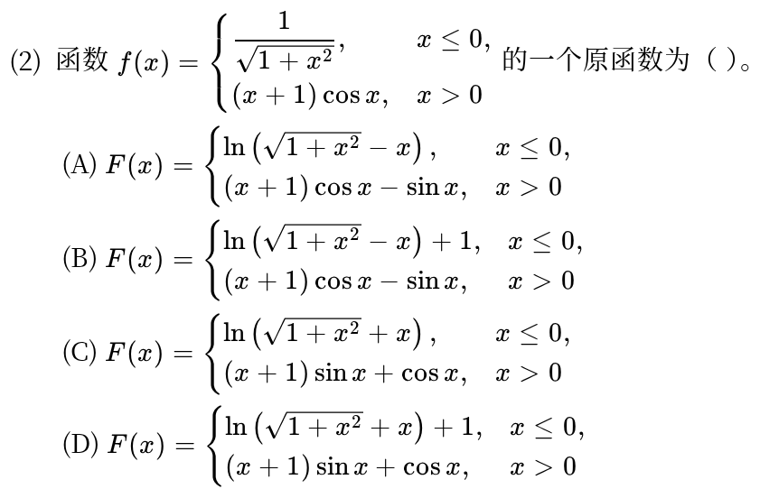
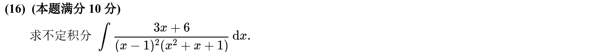
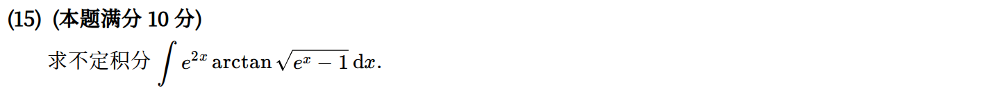
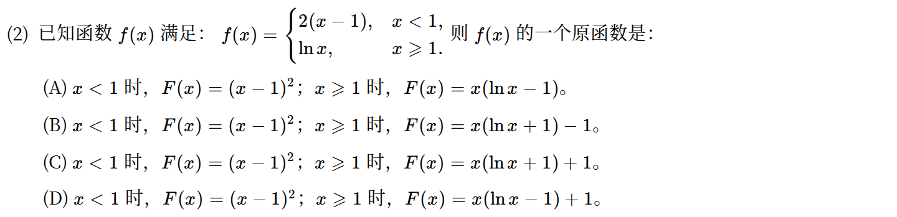

# 高等数学 · 不定积分与原函数

> 2010—2026年 · 4 道完整真题 · 年份从新到旧（2026→2010）  
> 题型分布：选择题 2 题 · 填空题 0 题 · 解答题 2 题  
> 考查范围：原函数判定、不定积分计算、分部与换元积分

[查看对应网页版](10-antiderivatives.html) · [返回章节总目录](../README.md)

---

## 2023年

### 01 · 2023-02 · 选择题

> *分段函数原函数选择题。分段求出各段的不定积分，最关键的一步是：原函数在分界点 $x=0$ 处必须连续，据此定出两段积分常数 $C_1, C_2$ 的差值。*

---

## 2019年

### 02 · 2019-16 · 解答题

> *复杂有理函数不定积分大题。分母含有 $(x-1)^2(x^2+x+1)$，标准待定系数裂项为 $\frac{A}{x-1}+\frac{B}{(x-1)^2}+\frac{Cx+D}{x^2+x+1}$，通分仔细算分子系数。*

---

## 2018年

### 03 · 2018-15 · 解答题

> *根式与反三角不定积分大题。含有 $\sqrt{e^x-1}$，果断做换元 $t = \sqrt{e^x-1}$，转化成有理多项式乘 $\arctan t$，再上分部积分法化简。*

---

## 2016年

### 04 · 2016-02 · 选择题

*关联章节：[连续与间断点](03-continuity.md)*

---

## 交叉考点索引

以下题目主归其他章节，点击跳转到对应章节题目；不计入本章主收录题数：

- [2021年 · 第19题](13-integral-applications.md)（主章节：定积分应用）
