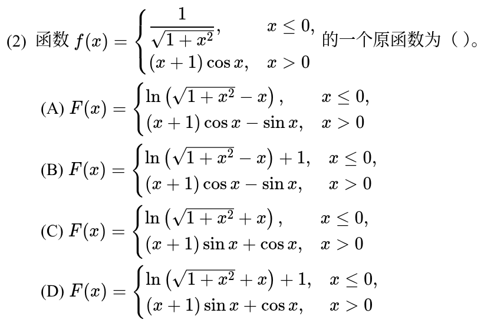
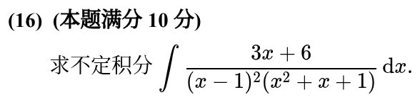
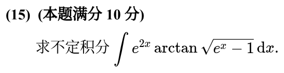
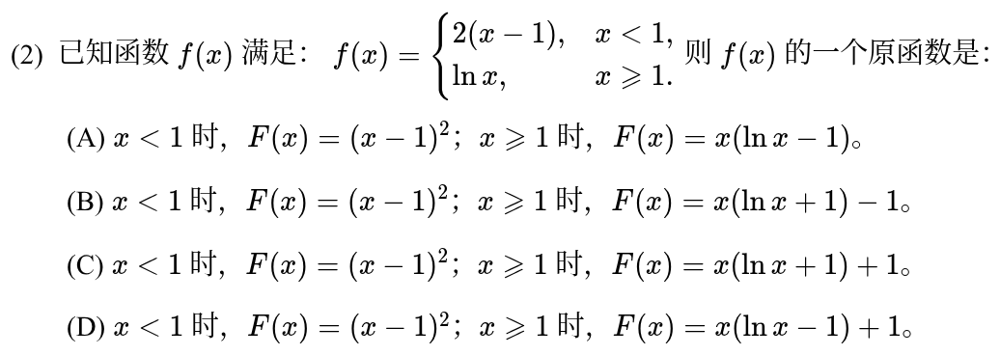

[« 切线、法线、渐近线与曲率](09-curve-geometry.md)　　[定积分、变上限积分与积分性质 »](11-definite-integrals.md)

# 高等数学 · 不定积分与原函数

> **本章共 4 题**
> 
> - **核心必做（建议按顺序攻克关键方法）**：  
>   [第 04 题](#q04)（分段原函数接常数） → [第 01 题](#q01)（先求导核对选项） → [第 02 题](#q02)（有理函数拆分）
> 
> - **分流与刷题建议**：  
>   - **较难挑战**：[第 03 题](#q03)（根式换元再分部积分）  
> 
> - **过关目标**：用求导验算；分段原函数的积分常数必须接好。

---

### 01 · 2023年

> *分段函数原函数选择题。分段求出各段的不定积分，最关键的一步是：原函数在分界点 $x=0$ 处必须连续，据此定出两段积分常数 $C_1, C_2$ 的差值。*

答案与解析

1. 先核分段点 $x=0$：$f(0^-)=1=f(0^+)$，连续，故原函数必在 $x=0$ 处连续。
2. 左段 $x \le 0$：$\int \frac{\mathrm{d}x}{\sqrt{1+x^2}} = \ln\left(\sqrt{1+x^2}+x\right) + C_1$（注意 $\ln(\sqrt{1+x^2}-x)$ 求导会多一个负号，直接排除（A）（B））。
3. 右段 $x > 0$：分部积分得 $\int (x+1)\cos x\,\mathrm{d}x = (x+1)\sin x + \cos x + C_2$。
4. 选项（C）（D）右段均取 $C_2 = 0$，于是 $F(0^+) = 0 + \cos 0 = 1$；由 $F(0^-) = \ln 1 + C_1 = C_1 = 1$ 得 $C_1 = 1$。
5. 答案：**（D）**。

---

### 02 · 2019年

> *复杂有理函数不定积分大题。分母含有 $(x-1)^2(x^2+x+1)$，标准待定系数裂项为 $\frac{A}{x-1}+\frac{B}{(x-1)^2}+\frac{Cx+D}{x^2+x+1}$，通分仔细算分子系数。*

答案与解析

**结论速览**：$\ln(x^2+x+1) - 2\ln|x-1| - \dfrac{3}{x-1} + C$。

- **完整解答**：
  1. **有理函数部分分式分解**：
     分母 $(x-1)^2(x^2+x+1)$ 含二重实根 $x=1$ 和不可约二次因子 $x^2+x+1$，设
     $$
     \frac{3x+6}{(x-1)^2(x^2+x+1)} = \frac{A}{x-1} + \frac{B}{(x-1)^2} + \frac{Cx+D}{x^2+x+1}.
     $$
     两边同乘 $(x-1)^2(x^2+x+1)$：
     $$
     3x+6 = A(x-1)(x^2+x+1) + B(x^2+x+1) + (Cx+D)(x-1)^2.
     $$
     - 令 $x=1$ 得 $9 = 3B \implies B = 3$；
     - 移项消去 $B$ 项：
       $$
       (3x+6) - 3(x^2+x+1) = -3x^2 + 3 = -3(x-1)(x+1).
       $$
       两边约去 $(x-1)$ 得
       $$
       -3(x+1) = A(x^2+x+1) + (Cx+D)(x-1).
       $$
     - 再令 $x=1$ 得 $-6 = 3A \implies A = -2$；
     - 代回得 $(Cx+D)(x-1) = -3x-3 + 2(x^2+x+1) = 2x^2 - x - 1 = (2x+1)(x-1)$，故 $C=2, D=1$。
     由此得到分解式：
     $$
     \frac{3x+6}{(x-1)^2(x^2+x+1)} = -\frac{2}{x-1} + \frac{3}{(x-1)^2} + \frac{2x+1}{x^2+x+1}.
     $$
  2. **逐项积分**：
     注意 $(x^2+x+1)' = 2x+1$ 且 $x^2+x+1 > 0$ 恒成立，直接凑微分即可：
     $$
     \begin{aligned}
     \int\frac{3x+6}{(x-1)^2(x^2+x+1)}\,\mathrm{d}x
     &= -2\int\frac{\mathrm{d}x}{x-1} + 3\int\frac{\mathrm{d}x}{(x-1)^2} + \int\frac{\mathrm{d}(x^2+x+1)}{x^2+x+1} \\
     &= -2\ln|x-1| - \frac{3}{x-1} + \ln(x^2+x+1) + C.
     \end{aligned}
     $$
- **核心思路与避坑**：先代 $x=1$ 求出 $B$ 后立即移项约去 $(x-1)$，能避免解四元线性方程组，大幅降低算错概率；另外 $\int\frac{\mathrm{d}x}{x-1} = \ln|x-1|$ 的绝对值符号不要漏写。

---

### 03 · 2018年

> *根式与反三角不定积分大题。含有 $\sqrt{e^x-1}$，果断做换元 $t = \sqrt{e^x-1}$，转化成有理多项式乘 $\arctan t$，再上分部积分法化简。*

答案与解析

**结论速览**：$\dfrac{1}{2}e^{2x}\arctan\sqrt{e^x-1} - \dfrac{1}{2}\sqrt{e^x-1} - \dfrac{1}{6}(e^x-1)^{\frac{3}{2}} + C$。

- **完整解答**：
  1. **分部积分去掉反三角函数**：
     被积函数是指数函数与反三角函数的乘积，取 $u = \arctan\sqrt{e^x-1}$，$\mathrm{d}v = e^{2x}\,\mathrm{d}x = \mathrm{d}\!\left(\frac{1}{2}e^{2x}\right)$。
     先算 $\mathrm{d}u$（注意 $1 + (\sqrt{e^x-1})^2 = e^x$ 恰好与分子的 $e^x$ 约掉）：
     $$
     \mathrm{d}u = \frac{1}{1+(e^x-1)}\cdot\frac{e^x}{2\sqrt{e^x-1}}\,\mathrm{d}x = \frac{1}{2\sqrt{e^x-1}}\,\mathrm{d}x.
     $$
     代入分部积分公式：
     $$
     \int e^{2x}\arctan\sqrt{e^x-1}\,\mathrm{d}x
     = \frac{1}{2}e^{2x}\arctan\sqrt{e^x-1} - \frac{1}{4}\int\frac{e^{2x}}{\sqrt{e^x-1}}\,\mathrm{d}x.
     $$
  2. **根式换元计算剩余积分**：
     令 $t = \sqrt{e^x-1}$（$t>0$），则 $e^x = t^2 + 1$，两边微分得 $e^x\,\mathrm{d}x = 2t\,\mathrm{d}t$，于是
     $$
     \begin{aligned}
     \frac{1}{4}\int\frac{e^{2x}}{\sqrt{e^x-1}}\,\mathrm{d}x
     &= \frac{1}{4}\int\frac{e^x \cdot e^x\,\mathrm{d}x}{\sqrt{e^x-1}}
     = \frac{1}{4}\int\frac{(t^2+1)\cdot 2t\,\mathrm{d}t}{t} \\
     &= \frac{1}{2}\int(t^2+1)\,\mathrm{d}t
     = \frac{1}{6}t^3 + \frac{1}{2}t + C_1.
     \end{aligned}
     $$
  3. **回代 $t = \sqrt{e^x-1}$**：
     $$
     \int e^{2x}\arctan\sqrt{e^x-1}\,\mathrm{d}x
     = \frac{1}{2}e^{2x}\arctan\sqrt{e^x-1} - \frac{1}{2}\sqrt{e^x-1} - \frac{1}{6}(e^x-1)^{\frac{3}{2}} + C.
     $$
- **核心思路与避坑**：本题分部积分后 $\frac{1}{1+(e^x-1)}$ 与链式求导出来的 $e^x$ 精确约消，是命题人设计的“减负开关”；换元时把 $e^{2x}\,\mathrm{d}x$ 拆成 $e^x\cdot(e^x\,\mathrm{d}x) = (t^2+1)\cdot 2t\,\mathrm{d}t$，不要把 $\mathrm{d}x$ 硬写成 $\frac{2t\,\mathrm{d}t}{t^2+1}$ 再绕一圈。

---

### 04 · 2016年

答案与解析

**触发条件与第一步落笔**

- **触发条件**：题干给分段函数 $f(x)$（分段点 $x=1$），求原函数 $F(x)$。先核对分段点连续性：$\lim_{x\to 1^-} 2(x-1) = 0 = \ln 1 = f(1)$，故 $f(x)$ 在 $\mathbb{R}$ 上连续，原函数存在且在 $x=1$ 处必连续。
- **第一步怎么落笔**：在 $x<1$ 与 $x\ge 1$ 上分别求不定积分，**明确写出两个独立常数 $C_1, C_2$**：
  - 当 $x < 1$ 时：
    $$\int 2(x-1)\,\mathrm{d}x = (x-1)^2 + C_1.$$
  - 当 $x \ge 1$ 时（分部积分）：
    $$\int \ln x\,\mathrm{d}x = x\ln x - \int x\cdot\frac{1}{x}\,\mathrm{d}x = x\ln x - x + C_2 = x(\ln x - 1) + C_2.$$

**完整推演与常数拼接**

四个选项在 $x < 1$ 时都取 $F(x) = (x-1)^2$，即已固定 $C_1 = 0$。由此算左极限：
$$\lim_{x\to 1^-} F(x) = \lim_{x\to 1^-} (x-1)^2 = 0.$$
因为原函数 $F(x)$ 在 $x=1$ 处可导，必有 $F(x)$ 在 $x=1$ 处连续，所以
$$F(1) = \lim_{x\to 1^+} F(x) = 1\cdot(\ln 1 - 1) + C_2 = -1 + C_2 = 0 \implies C_2 = 1.$$
因此 $x \ge 1$ 时 $F(x) = x(\ln x - 1) + 1$。再复核 $x=1$ 处的导数：由导数极限定理，$F'_-(1) = 0 = F'_+(1) = f(1)$，确实成立。故选择 **（D）**。

**选择题干扰项拆解**

- **（A）$x(\ln x - 1)$**：右段导数正确，但忘了拼连续性，$F(1^+) = -1 \neq 0 = F(1^-)$，在 $x=1$ 处不可导，不是原函数。
- **（B）$x(\ln x + 1) - 1$**：最隐蔽的干扰项——它在 $x=1$ 处恰好连续（$F(1^+)=0$），但把 $\int \ln x\,\mathrm{d}x$ 的负号记反了，求导得 $\ln x + 2 \neq \ln x$。
- **（C）$x(\ln x + 1) + 1$**：求导符号错且在 $x=1$ 处不连续（$F(1^+)=2$）。

---

[« 切线、法线、渐近线与曲率](09-curve-geometry.md)　　[定积分、变上限积分与积分性质 »](11-definite-integrals.md)
