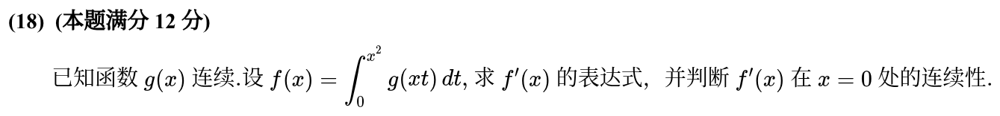
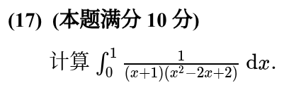
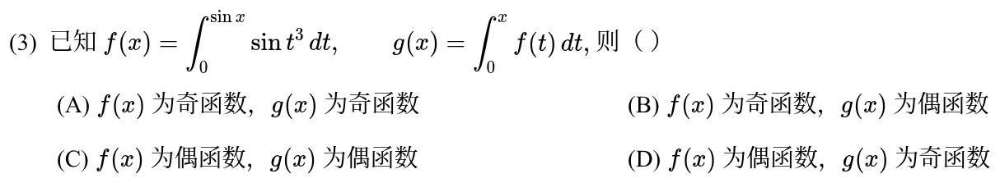
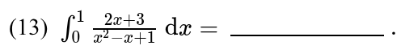
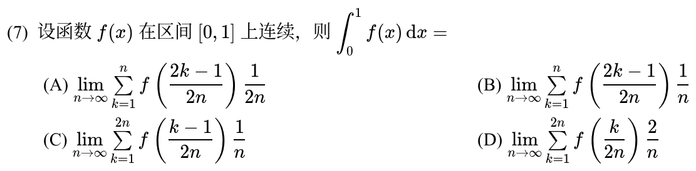
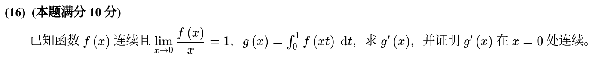
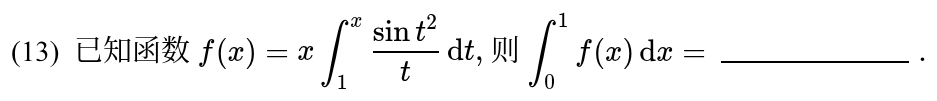
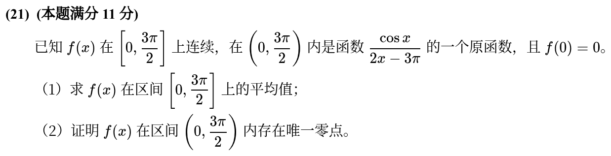
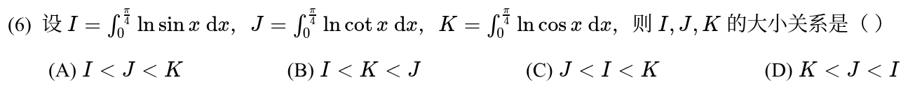
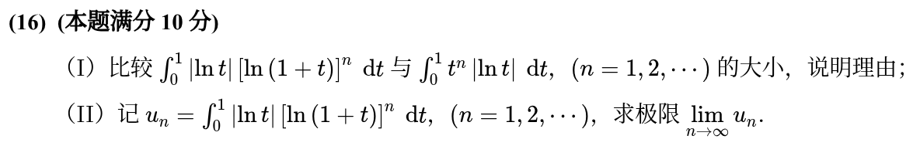

[« 不定积分与原函数](10-antiderivatives.md)　　[反常积分 »](12-improper-integrals.md)

# 高等数学 · 定积分、变上限积分与积分性质

> **本章共 21 题**
> 
> - **核心必做（建议按顺序攻克关键方法）**：  
>   [第 15 题](#q15)（变上限求导） → [第 04 题](#q04)（变限积分的奇偶性） → [第 08 题](#q08)（定义中的步长与取点） → [第 01 题](#q01)（积分平均值） → [第 03 题](#q03)（完整写出定积分计算）
> 
> - **分流与刷题建议**：  
>   - **较难挑战**：[第 02 题](#q02)（先换元再求导并查零点连续性）  
>   - **重在看思路**：[第 17 题](#q17)（单调函数与带权积分不等式）  
>   - **首轮可跳过**：[第 09 题](#q09)、[第 14 题](#q14)（技巧较偏或综合度高，首轮不必死磕）  
> 
> - **过关目标**：积分求值能验算；变量上限要乘内导，不能把连续当作可导。

---

### 01 · 2026年

答案与解析

**答案**：$3\ln 2 - 1$

- **切入点与推演**：由函数在闭区间 $[a,b]$ 上的平均值公式 $\bar{f}=\dfrac{1}{b-a}\int_a^b f(x)\,\mathrm{d}x$，直接代入 $a=0, b=2$ 并令 $u = 2+x$ 换元：
  $$\bar{f} = \frac{1}{2-0}\int_0^2 \ln(2+x)\,\mathrm{d}x = \frac{1}{2}\int_2^4 \ln u\,\mathrm{d}u.$$
  利用分部积分公式 $\int \ln u\,\mathrm{d}u = u\ln u - u + C$，代入上下限：
  $$\bar{f} = \frac{1}{2}\Big[u\ln u - u\Big]_2^4 = \frac{1}{2}\bigl[(4\ln 4 - 4) - (2\ln 2 - 2)\bigr] = \frac{1}{2}(6\ln 2 - 2) = 3\ln 2 - 1.$$
- **易错点**：计算平均值时容易漏乘区间长度的倒数 $\dfrac{1}{2}$，或把 $4\ln 4$ 误化简为 $4\ln 2$（应为 $8\ln 2$）。

---

### 02 · 2026年

> *开篇变限积分大题。被积函数含复合项 $xt$，先换元 $u=xt$ 把变量 $x$ 提出来剥离干净再求导；第二问连续性注意在 $x=0$ 处必须用极限定义验证。*

答案与解析

**结论速览**：$f'(x) = \begin{cases}3x g(x^3) - \dfrac{1}{x^2}\displaystyle\int_0^{x^3} g(u)\,\mathrm{d}u, & x\ne 0,\\ 0, & x=0,\end{cases}$ 且 $f'(x)$ 在 $x=0$ 处连续。

- **（1）求 $f'(x)$ 的表达式**：
  - **当 $x \ne 0$ 时**：因为 $g$ 仅已知连续、未知可导，不能直接对积分号内求导，先令 $u = xt$（$\mathrm{d}t = \dfrac{\mathrm{d}u}{x}$；当 $t=0$ 时 $u=0$，当 $t=x^2$ 时 $u=x^3$）将 $x$ 移出被积函数：
    $$f(x) = \frac{1}{x}\int_0^{x^3} g(u)\,\mathrm{d}u.$$
    由商（或乘积）的求导法则与变上限积分求导公式得：
    $$f'(x) = -\frac{1}{x^2}\int_0^{x^3} g(u)\,\mathrm{d}u + \frac{1}{x}\cdot g(x^3)\cdot 3x^2 = 3x g(x^3) - \frac{1}{x^2}\int_0^{x^3} g(u)\,\mathrm{d}u.$$
  - **当 $x = 0$ 时**：显然 $f(0) = \int_0^0 g(0)\,\mathrm{d}t = 0$。由积分中值定理，存在 $\xi$ 介于 $0$ 与 $x^2$ 之间，使 $f(x) = x^2 g(x\xi)$。按导数定义：
    $$f'(0) = \lim_{x\to 0}\frac{f(x) - f(0)}{x} = \lim_{x\to 0} x g(x\xi) = 0\cdot g(0) = 0.$$
  综上，
  $$f'(x) = \begin{cases} 3x g(x^3) - \dfrac{1}{x^2}\displaystyle\int_0^{x^3} g(u)\,\mathrm{d}u, & x\ne 0, \\[8pt] 0, & x=0. \end{cases}$$
- **（2）判断 $f'(x)$ 在 $x=0$ 处的连续性**：
  求 $x\to 0$ 时 $f'(x)$ 的极限。对第二项应用洛必达法则（分子分母均趋于 $0$，且 $g$ 连续）：
  $$\lim_{x\to 0}\frac{\int_0^{x^3} g(u)\,\mathrm{d}u}{x^2} = \lim_{x\to 0}\frac{3x^2 g(x^3)}{2x} = \lim_{x\to 0}\frac{3}{2}x g(x^3) = 0.$$
  又 $\lim_{x\to 0} 3x g(x^3) = 0$，故
  $$\lim_{x\to 0} f'(x) = 0 - 0 = 0 = f'(0).$$
  因此 $f'(x)$ 在 $x=0$ 处连续。
- **核心思路与避坑**：被积函数含参变量 $x$ 且仅知连续时，第一步必做换元 $u=xt$ 将 $x$ 移到积分限；求 $f'(0)$ 必须用导数定义（不可直接代入 $x\ne 0$ 的导数式），再通过 $\lim_{x\to 0}f'(x) = f'(0)$ 判定连续性。

---

### 03 · 2025年

答案与解析

**结论速览**：$\dfrac{3}{10}\ln 2 + \dfrac{\pi}{10}$

- **完整解答**：
  1. **有理函数部分分式拆分**：因为 $x^2 - 2x + 2 = (x-1)^2 + 1 > 0$ 在实数域上不可约，设
     $$\frac{1}{(x+1)(x^2-2x+2)} = \frac{A}{x+1} + \frac{Bx+C}{x^2-2x+2}.$$
     去分母得 $1 = A(x^2-2x+2) + (Bx+C)(x+1)$。令 $x = -1$ 得 $5A = 1 \implies A = \dfrac{1}{5}$；比较 $x^2$ 项系数得 $A + B = 0 \implies B = -\dfrac{1}{5}$；令 $x = 0$ 得 $2A + C = 1 \implies C = \dfrac{3}{5}$。于是
     $$\frac{1}{(x+1)(x^2-2x+2)} = \frac{1}{5}\cdot\frac{1}{x+1} + \frac{1}{5}\cdot\frac{-x+3}{x^2-2x+2}.$$
  2. **凑分母导数并配方**：对二次分母求导得 $(x^2-2x+2)' = 2x - 2$，将分子 $-x+3$ 拆分为导数项与常数项：
     $$-x + 3 = -\frac{1}{2}(2x-2) + 2, \qquad x^2 - 2x + 2 = (x-1)^2 + 1.$$
  3. **逐项定积分**：
     $$\begin{aligned}
     \int_0^1 \frac{\mathrm{d}x}{(x+1)(x^2-2x+2)}
     &= \frac{1}{5}\int_0^1 \frac{\mathrm{d}x}{x+1} - \frac{1}{10}\int_0^1 \frac{2x-2}{x^2-2x+2}\,\mathrm{d}x + \frac{2}{5}\int_0^1 \frac{\mathrm{d}x}{(x-1)^2+1} \\
     &= \frac{1}{5}\Big[\ln(x+1)\Big]_0^1 - \frac{1}{10}\Big[\ln(x^2-2x+2)\Big]_0^1 + \frac{2}{5}\Big[\arctan(x-1)\Big]_0^1 \\
     &= \frac{1}{5}\ln 2 - \frac{1}{10}(\ln 1 - \ln 2) + \frac{2}{5}\left(0 - \left(-\frac{\pi}{4}\right)\right) \\
     &= \frac{3}{10}\ln 2 + \frac{\pi}{10}.
     \end{aligned}$$
- **核心思路与避坑**：有理函数积分遇到不可约二次因式时，先“凑分母导数”出 $\ln$ 项，再“配方”出 $\arctan$ 项；代入下限 $x=0$ 时注意 $\ln(x^2-2x+2)\big|_{x=0}=\ln 2 \ne 0$ 且 $\arctan(-1)=-\dfrac{\pi}{4}$，两处负负得正极易算错符号。

---

### 04 · 2024年

答案与解析

**触发条件与第一步落笔**

- **触发条件**：两层变限积分，内层上限为 $\sin x$，外层上限为 $x$，下限均为 $0$，只问奇偶性而不求具体值。
- **第一步怎么落笔**：直接按定义计算 $f(-x)$，通过换元 $t = -s$ 把积分上限里的负号消掉。

**完整推演**

1. **判断 $f(x)$ 的奇偶性**：
   被积函数 $h(t) = \sin(t^3)$ 满足 $h(-t) = \sin((-t)^3) = -\sin(t^3) = -h(t)$，为奇函数。
   直接代 $-x$：
   $$f(-x) = \int_0^{\sin(-x)} \sin t^3\,\mathrm{d}t = \int_0^{-\sin x} \sin t^3\,\mathrm{d}t.$$
   令 $t = -s$（$\mathrm{d}t = -\mathrm{d}s$，当 $t = -\sin x$ 时 $s = \sin x$）：
   $$f(-x) = \int_0^{\sin x} \sin(-s^3)\cdot(-\mathrm{d}s) = \int_0^{\sin x} \sin s^3\,\mathrm{d}s = f(x).$$
   因此 **$f(x)$ 为偶函数**。
   （求导复核：$f'(x) = \sin(\sin^3 x)\cdot\cos x$，满足 $f'(-x) = \sin(-\sin^3 x)\cos(-x) = -f'(x)$ 为奇函数，故 $f(x)$ 必为偶函数。）

2. **判断 $g(x)$ 的奇偶性**：
   因为 $f(t)$ 为偶函数，且 $g(x) = \int_0^x f(t)\,\mathrm{d}t$ 下限为 $0$，令 $t = -s$：
   $$g(-x) = \int_0^{-x} f(t)\,\mathrm{d}t = \int_0^x f(-s)(-\mathrm{d}s) = -\int_0^x f(s)\,\mathrm{d}s = -g(x).$$
   因此 **$g(x)$ 为奇函数**。

故选择 **（D）**。

**选择题干扰项拆解**

- **（A）（B）**：误把 $f(x)$ 当成奇函数——常见错因是看到“$\sin x$ 是奇函数、$\sin t^3$ 也是奇函数”，凭直觉以为“奇复合奇还是奇”，忽略了**积分本身会把奇函数变成偶函数**（$H(u) = \int_0^u \sin t^3\,\mathrm{d}t$ 是偶函数，偶函数复合奇函数 $H(\sin x)$ 仍是偶函数）。
- **（C）**：算对了 $f(x)$ 是偶函数，却把“偶函数的变限积分（下限为 $0$）”错记成偶函数。

---

### 05 · 2023年

答案与解析

**答案**：$\dfrac{1}{2}$

- **切入点与推演**：已知区间长度为 $2$ 的积分 $\int_0^2 f(x)\,\mathrm{d}x = 0$ 与步长为 $2$ 的差分关系 $f(x+2)-f(x)=x$，目标是将 $\int_1^3 f(x)\,\mathrm{d}x$ 拆出 $[0,2]$ 与平移差。利用积分区间可加性：
  $$\int_1^3 f(x)\,\mathrm{d}x = \int_1^2 f(x)\,\mathrm{d}x + \int_2^3 f(x)\,\mathrm{d}x = \left(\int_0^2 f(x)\,\mathrm{d}x - \int_0^1 f(x)\,\mathrm{d}x\right) + \int_2^3 f(x)\,\mathrm{d}x.$$
  对 $\int_2^3 f(x)\,\mathrm{d}x$ 作平移换元 $x = t + 2$（当 $x\in[2,3]$ 时 $t\in[0,1]$），并代入 $\int_0^2 f(x)\,\mathrm{d}x = 0$：
  $$\int_1^3 f(x)\,\mathrm{d}x = 0 + \int_0^1 \bigl[f(t+2) - f(t)\bigr]\,\mathrm{d}t = \int_0^1 t\,\mathrm{d}t = \frac{1}{2}.$$
- **易错点**：平移换元后需同步改写上下限，并确认相减的是 $f(t+2)-f(t)$ 而非相反顺序，避免符号颠倒得 $-\dfrac{1}{2}$。

---

### 06 · 2022年

答案与解析

**答案**：**（A）** $I_1 < I_2 < I_3$

- **切入点与推演**：三个积分区间均为 $[0,1]$，直接比较被积函数在 $(0,1)$ 上的大小，并利用简单函数 $x$ 作为“桥梁”。
  1. **比较 $I_1$ 与 $I_2$**：二者分母同为 $1+\cos x > 0$，只需比较分子 $\dfrac{x}{2}$ 与 $\ln(1+x)$。对 $x\in(0,1)$，有
     $$\ln(1+x) = \int_0^x \frac{\mathrm{d}t}{1+t} > \int_0^x \frac{\mathrm{d}t}{2} = \frac{x}{2},$$
     故 $\dfrac{\ln(1+x)}{1+\cos x} > \dfrac{x}{2(1+\cos x)}$，从而 $I_1 < I_2$。
  2. **比较 $I_2$ 与 $I_3$**：对 $x\in(0,1)$，一方面 $\ln(1+x) < x$ 且 $1+\cos x > 1$，故
     $$\frac{\ln(1+x)}{1+\cos x} < \frac{x}{1} = x;$$
     另一方面 $0 < \sin x < 1 \implies 1+\sin x < 2$，故
     $$\frac{2x}{1+\sin x} > \frac{2x}{2} = x.$$
     于是 $\dfrac{\ln(1+x)}{1+\cos x} < x < \dfrac{2x}{1+\sin x}$，积分得 $I_2 < \int_0^1 x\,\mathrm{d}x < I_3$。
  综合得 $I_1 < I_2 < I_3$，选 **（A）**。
- **干扰项 / 易错提示**：不要盲目把 $I_1, I_2, I_3$ 的原函数算出来（均非初等函数），也不要在 $[0,1]$ 上误用 $\ln(1+x) > x - \dfrac{x^2}{2}$ 后放缩过松；用中转函数 $x$ 一次就能隔开 $I_2$ 与 $I_3$。

---

### 07 · 2022年

答案与解析

**答案**：$\dfrac{8\pi}{3\sqrt{3}}$（等价写作 $\dfrac{8\sqrt{3}\pi}{9}$）

- **切入点与推演**：分母 $x^2 - x + 1 = \left(x-\dfrac{1}{2}\right)^2 + \dfrac{3}{4} > 0$ 为不可约二次式，将分子 $2x+3$ 拆成“分母导数 $2x-1$ + 常数 $4$”：
  $$\int_0^1 \frac{2x+3}{x^2-x+1}\,\mathrm{d}x = \int_0^1 \frac{2x-1}{x^2-x+1}\,\mathrm{d}x + 4\int_0^1 \frac{\mathrm{d}x}{\left(x-\frac{1}{2}\right)^2 + \left(\frac{\sqrt{3}}{2}\right)^2}.$$
  第一项直接凑微分，因 $x^2-x+1$ 在 $x=0$ 与 $x=1$ 处均等于 $1$，积分为 $0$：
  $$\int_0^1 \frac{2x-1}{x^2-x+1}\,\mathrm{d}x = \Big[\ln(x^2-x+1)\Big]_0^1 = \ln 1 - \ln 1 = 0.$$
  第二项套用 $\int \dfrac{\mathrm{d}u}{u^2+a^2} = \dfrac{1}{a}\arctan\dfrac{u}{a} + C$（这里 $a = \dfrac{\sqrt{3}}{2}$）：
  $$4\cdot\frac{2}{\sqrt{3}}\left[\arctan\frac{2x-1}{\sqrt{3}}\right]_0^1 = \frac{8}{\sqrt{3}}\left[\arctan\frac{1}{\sqrt{3}} - \arctan\left(-\frac{1}{\sqrt{3}}\right)\right] = \frac{8}{\sqrt{3}}\cdot\left(\frac{\pi}{6} + \frac{\pi}{6}\right) = \frac{8\pi}{3\sqrt{3}}.$$
- **易错点**：配方后常数 $a = \dfrac{\sqrt{3}}{2}$ 而非 $\dfrac{3}{4}$，套公式时 $\dfrac{1}{a} = \dfrac{2}{\sqrt{3}}$ 容易漏掉因子 $2$，且下限处的 $-\arctan\left(-\dfrac{1}{\sqrt{3}}\right) = +\dfrac{\pi}{6}$ 注意双负号变正。

---

### 08 · 2021年

答案与解析

**触发条件与第一步落笔**

- **触发条件**：已知 $f(x)$ 在 $[0,1]$ 上连续（保证黎曼可积，任意取点与分法极限均相等），要求从四个黎曼和中选出等于 $\int_0^1 f(x)\,\mathrm{d}x$ 的一项。
- **第一步怎么落笔**：逐项核对“项数 $N$”与“步长 $\Delta x = \frac{1}{N}$”，并检查 $\xi_k$ 是否落在第 $k$ 个子区间内。

**完整推演**

对区间 $[0,1]$ 作 $n$ 等分，第 $k$ 个子区间为 $\left[\frac{k-1}{n}, \frac{k}{n}\right]$（$k=1,2,\dots,n$），每个子区间长度为
$$\Delta x_k = \frac{1}{n}.$$
取每个子区间的中点作为样点：
$$\xi_k = \frac{1}{2}\left(\frac{k-1}{n} + \frac{k}{n}\right) = \frac{2k-1}{2n} \in \left[\frac{k-1}{n}, \frac{k}{n}\right].$$
因为 $f(x)$ 在 $[0,1]$ 上连续，由定积分定义：
$$\int_0^1 f(x)\,\mathrm{d}x = \lim_{n\to\infty} \sum_{k=1}^{n} f\left(\frac{2k-1}{2n}\right)\frac{1}{n}.$$
故选择 **（B）**。

**选择题干扰项拆解（含 $f(x)\equiv 1$ 速验）**

- **（A）$\lim_{n\to\infty}\sum_{k=1}^{n} f\left(\frac{2k-1}{2n}\right)\frac{1}{2n}$**：看到 $\frac{2k-1}{2n}$ 分母有 $2n$，误把步长当成 $\frac{1}{2n}$。实际上相邻两点间距是 $\frac{2(k+1)-1}{2n} - \frac{2k-1}{2n} = \frac{1}{n}$，故（A）$= \frac{1}{2}\int_0^1 f(x)\,\mathrm{d}x$（取 $f\equiv 1$ 得 $n\cdot\frac{1}{2n}=\frac{1}{2}$）。
- **（C）$\lim_{n\to\infty}\sum_{k=1}^{2n} f\left(\frac{k-1}{2n}\right)\frac{1}{n}$**：把 $[0,1]$ 分成了 $2n$ 等份，正确步长应是 $\frac{1}{2n}$，而题中乘的是 $\frac{1}{n} = 2\cdot\frac{1}{2n}$，故（C）$= 2\int_0^1 f(x)\,\mathrm{d}x$（取 $f\equiv 1$ 得 $2n\cdot\frac{1}{n}=2$）。
- **（D）$\lim_{n\to\infty}\sum_{k=1}^{2n} f\left(\frac{k}{2n}\right)\frac{2}{n}$**：同样是 $2n$ 等份，乘的是 $\frac{2}{n} = 4\cdot\frac{1}{2n}$，故（D）$= 4\int_0^1 f(x)\,\mathrm{d}x$（取 $f\equiv 1$ 得 $2n\cdot\frac{2}{n}=4$）。

---

### 09 · 2021年

答案与解析

**题面待核**：按当前转录题面 $f(t)=\int_1^t \mathrm{d}x \int_{\sqrt{x}}^1 \sin\frac{x}{y}\,\mathrm{d}y$，求导结果包含非初等函数定积分，这与考研填空题常规要求初等闭式结果不符，原题面（如被积函数或积分限）可能存在录入偏差。

- **按当前题面的严格推演**：将内层积分记为 $G(x) = \int_{\sqrt{x}}^1 \sin\dfrac{x}{y}\,\mathrm{d}y$。在 $x > 0$ 时，$G(x)$ 连续，由变上限积分求导公式直接对外层积分关于 $t$ 求导：
  $$f'(t) = G(t) = \int_{\sqrt{t}}^1 \sin\frac{t}{y}\,\mathrm{d}y.$$
  代入 $t = \dfrac{\pi}{2}$，并作换元 $u = \dfrac{\pi}{2y}$（则 $y = \dfrac{\pi}{2u}$，$\mathrm{d}y = -\dfrac{\pi}{2u^2}\,\mathrm{d}u$；当 $y = \sqrt{\dfrac{\pi}{2}}$ 时 $u = \sqrt{\dfrac{\pi}{2}}$，当 $y = 1$ 时 $u = \dfrac{\pi}{2}$）：
  $$f'\!\left(\frac{\pi}{2}\right) = \int_{\sqrt{\pi/2}}^1 \sin\frac{\pi}{2y}\,\mathrm{d}y = -\frac{\pi}{2}\int_{\sqrt{\pi/2}}^{\pi/2}\frac{\sin u}{u^2}\,\mathrm{d}u.$$
- **易错点**：外层积分变量为 $x$、内层积分变量为 $y$，故对 $t$ 求导时直接把 $x$ 换为 $t$ 即可，不要把内层上下限再额外求导；同时注意 $\sqrt{\dfrac{\pi}{2}} > 1$，原积分下限大于上限，数值为负。

---

### 10 · 2020年

答案与解析

**答案**：**（A）** $\dfrac{\pi^2}{4}$

- **切入点与推演**：被积函数同时出现 $\sqrt{x}$ 与 $\sqrt{1-x}$，且分母在 $x=0,1$ 处无界（为瑕积分），最自然的触发是三角代换 $x = \sin^2 t$，$t\in\left(0,\dfrac{\pi}{2}\right)$。此时：
  $$\sqrt{x} = \sin t, \quad \sqrt{1-x} = \cos t, \quad \mathrm{d}x = 2\sin t\cos t\,\mathrm{d}t, \quad \arcsin\sqrt{x} = t.$$
  代入积分（严格而言先在 $[\varepsilon, 1-\delta]$ 上换元再令 $\varepsilon,\delta\to 0^+$）：
  $$\int_0^1 \frac{\arcsin\sqrt{x}}{\sqrt{x(1-x)}}\,\mathrm{d}x = \int_0^{\frac{\pi}{2}} \frac{t}{\sin t\cos t}\cdot 2\sin t\cos t\,\mathrm{d}t = 2\int_0^{\frac{\pi}{2}} t\,\mathrm{d}t = \Big[t^2\Big]_0^{\frac{\pi}{2}} = \frac{\pi^2}{4}.$$
  等价做法：直接凑微分 $\mathrm{d}(\arcsin\sqrt{x}) = \dfrac{\mathrm{d}x}{2\sqrt{x(1-x)}}$，得 $2\int_0^1 \arcsin\sqrt{x}\,\mathrm{d}(\arcsin\sqrt{x}) = \Big[(\arcsin\sqrt{x})^2\Big]_0^1 = \dfrac{\pi^2}{4}$。故选择 **（A）**。
- **干扰项 / 易错提示**：凑微分或换元时漏掉系数 $2$ 会误选 **（B）** $\dfrac{\pi^2}{8}$；误把 $\int_0^{\pi/2} t\,\mathrm{d}t$ 算成一次幂会误选 **（C）（D）**。

---

### 11 · 2020年

> *抽象连续函数极值大题。利用极限条件把 $f(x)$ 在 0 点的局部性质看作 $f(x) \sim x$，变上限积分求导找驻点，利用二阶导正负判断极值。*

答案与解析

**结论速览**：$g'(x) = \begin{cases}\dfrac{f(x)}{x} - \dfrac{1}{x^2}\displaystyle\int_0^x f(u)\,\mathrm{d}u, & x\ne 0,\\ \dfrac{1}{2}, & x=0,\end{cases}$ 且 $g'(x)$ 在 $x=0$ 处连续。

- **（1）求 $g'(x)$**：
  先由 $\lim_{x\to 0}\dfrac{f(x)}{x} = 1$ 及 $f(x)$ 连续，得 $f(0) = \lim_{x\to 0} f(x) = 0$，从而 $g(0) = \int_0^1 f(0)\,\mathrm{d}t = 0$。
  - **当 $x \ne 0$ 时**：令 $u = xt$（$\mathrm{d}t = \dfrac{\mathrm{d}u}{x}$），将积分号内的 $x$ 移出：
    $$g(x) = \frac{1}{x}\int_0^x f(u)\,\mathrm{d}u.$$
    因为 $f$ 连续，由变上限积分求导公式及商的求导法则得
    $$g'(x) = \frac{x f(x) - \int_0^x f(u)\,\mathrm{d}u}{x^2} = \frac{f(x)}{x} - \frac{1}{x^2}\int_0^x f(u)\,\mathrm{d}u.$$
  - **当 $x = 0$ 时**：按导数定义，并应用洛必达法则（分子分母均趋于 $0$，且 $\left(\int_0^x f(u)\,\mathrm{d}u\right)' = f(x)$）：
    $$g'(0) = \lim_{x\to 0}\frac{g(x)-g(0)}{x} = \lim_{x\to 0}\frac{\int_0^x f(u)\,\mathrm{d}u}{x^2} = \lim_{x\to 0}\frac{f(x)}{2x} = \frac{1}{2}.$$
  综上，
  $$g'(x) = \begin{cases} \dfrac{f(x)}{x} - \dfrac{1}{x^2}\displaystyle\int_0^x f(u)\,\mathrm{d}u, & x\ne 0, \\[8pt] \dfrac{1}{2}, & x=0. \end{cases}$$
- **（2）证明 $g'(x)$ 在 $x=0$ 处连续**：
  求 $x\to 0$ 时 $g'(x)$ 的极限，利用已知条件 $\lim_{x\to 0}\dfrac{f(x)}{x}=1$ 及上述洛必达结果 $\lim_{x\to 0}\dfrac{\int_0^x f(u)\,\mathrm{d}u}{x^2}=\dfrac{1}{2}$：
  $$\lim_{x\to 0} g'(x) = \lim_{x\to 0}\frac{f(x)}{x} - \lim_{x\to 0}\frac{\int_0^x f(u)\,\mathrm{d}u}{x^2} = 1 - \frac{1}{2} = \frac{1}{2} = g'(0).$$
  故 $g'(x)$ 在 $x=0$ 处连续。
- **核心思路与避坑**：题目只给 $f$ 连续而未给 $f$ 可导，绝对不能直接对积分号内求导写 $g'(x)=\int_0^1 t f'(xt)\,\mathrm{d}t$！必须先令 $u=xt$ 消去被积函数中的 $x$；同时 $x=0$ 处的导数必须用定义单独求，分段表达式不能漏写 $x=0$ 一支。

---

### 12 · 2019年

答案与解析

**答案**：$\dfrac{\cos 1 - 1}{4}$

- **切入点与推演**：将 $f(x)$ 代入目标积分得到累次积分，内层 $\int_1^x \dfrac{\sin t^2}{t}\,\mathrm{d}t$ 无法直接求原函数，触发**交换积分次序**（或分部积分）。
  注意 $\lim_{t\to 0}\dfrac{\sin t^2}{t} = 0$，被积函数在 $t=0$ 处可连续延拓。将内层写为 $-\int_x^1 \dfrac{\sin t^2}{t}\,\mathrm{d}t$，积分区域为 $0 \le x \le t \le 1$，交换次序得：
  $$\begin{aligned}
  \int_0^1 f(x)\,\mathrm{d}x
  &= -\int_0^1 x\,\mathrm{d}x \int_x^1 \frac{\sin t^2}{t}\,\mathrm{d}t
   = -\int_0^1 \frac{\sin t^2}{t}\,\mathrm{d}t \int_0^t x\,\mathrm{d}x \\
  &= -\int_0^1 \frac{\sin t^2}{t}\cdot\frac{t^2}{2}\,\mathrm{d}t
   = -\frac{1}{2}\int_0^1 t\sin t^2\,\mathrm{d}t.
  \end{aligned}$$
  令 $u = t^2$（$\mathrm{d}u = 2t\,\mathrm{d}t$）：
  $$\int_0^1 f(x)\,\mathrm{d}x = -\frac{1}{4}\int_0^1 \sin u\,\mathrm{d}u = -\frac{1}{4}\Big[-\cos u\Big]_0^1 = \frac{\cos 1 - 1}{4}.$$
  （也可用分部积分：$\int_0^1 f(x)\,\mathrm{d}x = \left[\frac{x^2}{2}\int_1^x\frac{\sin t^2}{t}\,\mathrm{d}t\right]_0^1 - \frac{1}{2}\int_0^1 x\sin x^2\,\mathrm{d}x = \dfrac{\cos 1 - 1}{4}$。）
- **易错点**：内层积分是 $\int_1^x$ 而非 $\int_0^x$，交换次序时漏掉前面的负号会得到相反数 $\dfrac{1-\cos 1}{4}$。

---

### 13 · 2018年

答案与解析

**答案**：**（C）** $K > M > N$

- **切入点与推演**：三个积分的区间均为对称区间 $\left[-\dfrac{\pi}{2}, \dfrac{\pi}{2}\right]$，先用奇偶对称性化简并计算出确切基准值 $M$：
  1. **求 $M$**：展开分子并利用奇函数在对称区间积分为 $0$：
     $$M = \int_{-\frac{\pi}{2}}^{\frac{\pi}{2}}\left(1 + \frac{2x}{1+x^2}\right)\mathrm{d}x = \int_{-\frac{\pi}{2}}^{\frac{\pi}{2}} 1\,\mathrm{d}x + 0 = \pi.$$
  2. **比较 $K$ 与 $M$**：在 $\left(-\dfrac{\pi}{2}, \dfrac{\pi}{2}\right)$ 上 $\cos x > 0 \implies \sqrt{\cos x} > 0$，故
     $$K = \int_{-\frac{\pi}{2}}^{\frac{\pi}{2}}\left(1 + \sqrt{\cos x}\right)\mathrm{d}x = \pi + \int_{-\frac{\pi}{2}}^{\frac{\pi}{2}}\sqrt{\cos x}\,\mathrm{d}x > \pi = M.$$
  3. **比较 $N$ 与 $M$**：将 $N$ 按对称区间配对化到 $\left[0, \dfrac{\pi}{2}\right]$：
     $$N = \int_0^{\frac{\pi}{2}} \Bigl[(1+x)e^{-x} + (1-x)e^x\Bigr]\,\mathrm{d}x.$$
     记 $h(x) = (1+x)e^{-x} + (1-x)e^x$，则 $h(0) = 2$，且对 $x > 0$ 有
     $$h'(x) = -x e^{-x} - x e^x = -x(e^x + e^{-x}) < 0.$$
     因此对 $x\in\left(0, \dfrac{\pi}{2}\right]$ 恒有 $h(x) < h(0) = 2$，积分得
     $$N = \int_0^{\frac{\pi}{2}} h(x)\,\mathrm{d}x < \int_0^{\frac{\pi}{2}} 2\,\mathrm{d}x = \pi = M.$$
  综上 $K > M > N$，选择 **（C）**。
- **干扰项 / 易错提示**：若不先配对直接对 $N$ 逐点放缩，因 $(1+x)e^{-x}$ 在 $x<0$ 时大于 $1$、在 $x>0$ 时小于 $1$，容易误判 $N$ 与 $\pi$ 的大小；对称配对后求导一步即可严格比较。

---

### 14 · 2016年

> *定积分不等式与中值大题。利用积分均值定理与导数单调性，构造辅助函数将定积分与端点值联系起来，两小问层层递进。*

答案与解析

**结论速览**：（1）平均值为 $\dfrac{1}{3\pi}$；（2）先由 $f'$ 符号定单调区间，再结合平均值为正与介值定理证唯一零点。

- **（1）求 $f(x)$ 在 $\left[0, \dfrac{3\pi}{2}\right]$ 上的平均值**：
  记 $b = \dfrac{3\pi}{2}$。在 $(0, b)$ 上 $f'(x) = \dfrac{\cos x}{2x - 3\pi}$，且注意到 $\lim_{x\to b^-}\dfrac{\cos x}{2x - 3\pi} = \lim_{x\to b^-}\dfrac{-\sin x}{2} = \dfrac{1}{2}$，$f'(x)$ 在 $b$ 处有有限左极限。
  为消去 $f'(x)$ 的分母 $2x - 3\pi$，凑微分 $\mathrm{d}x = \mathrm{d}(x - b)$ 并分部积分（利用 $f(0) = 0$ 及 $f$ 在 $[0,b]$ 上连续）：
  $$\begin{aligned}
  \int_0^b f(x)\,\mathrm{d}x
  &= \Big[(x - b)f(x)\Big]_0^b - \int_0^b (x - b)f'(x)\,\mathrm{d}x \\
  &= \bigl[0 - (-b)f(0)\bigr] - \int_0^{\frac{3\pi}{2}} \left(x - \frac{3\pi}{2}\right)\frac{\cos x}{2x - 3\pi}\,\mathrm{d}x \\
  &= -\frac{1}{2}\int_0^{\frac{3\pi}{2}} \cos x\,\mathrm{d}x = -\frac{1}{2}\Big[\sin x\Big]_0^{\frac{3\pi}{2}} = -\frac{1}{2}(-1 - 0) = \frac{1}{2}.
  \end{aligned}$$
  因此 $f(x)$ 在 $\left[0, \dfrac{3\pi}{2}\right]$ 上的平均值为
  $$\bar{f} = \frac{1}{\frac{3\pi}{2} - 0}\int_0^{\frac{3\pi}{2}} f(x)\,\mathrm{d}x = \frac{2}{3\pi}\cdot\frac{1}{2} = \frac{1}{3\pi}.$$
- **（2）证明 $f(x)$ 在 $\left(0, \dfrac{3\pi}{2}\right)$ 内存在唯一零点**：
  在 $\left(0, \dfrac{3\pi}{2}\right)$ 内恒有 $2x - 3\pi < 0$，故 $f'(x) = \dfrac{\cos x}{2x - 3\pi}$ 与 $-\cos x$ 同号：
  1. 当 $x\in\left(0, \dfrac{\pi}{2}\right)$ 时，$\cos x > 0 \implies f'(x) < 0$，故 $f(x)$ 在 $\left[0, \dfrac{\pi}{2}\right]$ 上严格单调递减。由 $f(0) = 0$ 知，对一切 $x\in\left(0, \dfrac{\pi}{2}\right]$ 均有 $f(x) < 0$，从而 $f(x)$ 在 $\left(0, \dfrac{\pi}{2}\right]$ 上**无零点**，且 $f\!\left(\dfrac{\pi}{2}\right) < 0$。
  2. 当 $x\in\left(\dfrac{\pi}{2}, \dfrac{3\pi}{2}\right)$ 时，$\cos x < 0 \implies f'(x) > 0$，故 $f(x)$ 在 $\left[\dfrac{\pi}{2}, \dfrac{3\pi}{2}\right]$ 上严格单调递增。
  3. 由（1）知 $\int_0^{\frac{3\pi}{2}} f(x)\,\mathrm{d}x = \dfrac{1}{2} > 0$。若 $f\!\left(\dfrac{3\pi}{2}\right) \le 0$，则由上述单调性必有 $f(x) \le 0$ 在 $\left[0, \dfrac{3\pi}{2}\right]$ 上恒成立，导致 $\int_0^{\frac{3\pi}{2}} f(x)\,\mathrm{d}x \le 0$，矛盾！故必有 $f\!\left(\dfrac{3\pi}{2}\right) > 0$。
  4. 因为 $f(x)$ 在 $\left[\dfrac{\pi}{2}, \dfrac{3\pi}{2}\right]$ 上连续、严格单调递增且 $f\!\left(\dfrac{\pi}{2}\right) < 0 < f\!\left(\dfrac{3\pi}{2}\right)$，由零点存在定理及单调性，$f(x)$ 在 $\left(\dfrac{\pi}{2}, \dfrac{3\pi}{2}\right)$ 内存在唯一零点，从而在 $\left(0, \dfrac{3\pi}{2}\right)$ 内存在唯一零点。
- **核心思路与避坑**：第（1）问分部积分时把原函数选为 $x - \frac{3\pi}{2}$ 而非 $x$，才能精准消去 $f'(x)$ 的分母 $2x - 3\pi$ 并让 $x=\frac{3\pi}{2}$ 处的边界项为 $0$；第（2）问要借用第（1）问“积分 $> 0$”反证 $f\!\left(\frac{3\pi}{2}\right) > 0$。

---

### 15 · 2015年

答案与解析

**答案**：$2$

- **切入点与推演**：$\varphi(x)$ 是乘积与变上限积分的复合函数，按乘积求导法则和变上限积分求导公式求 $\varphi'(x)$：
  $$\varphi'(x) = 1\cdot\int_0^{x^2} f(t)\,\mathrm{d}t + x\cdot f(x^2)\cdot 2x = \int_0^{x^2} f(t)\,\mathrm{d}t + 2x^2 f(x^2).$$
  代入 $x = 1$，由已知 $\varphi(1) = 1\cdot\int_0^1 f(t)\,\mathrm{d}t = 1$ 及 $\varphi'(1) = 5$ 得：
  $$5 = \int_0^1 f(t)\,\mathrm{d}t + 2f(1) = 1 + 2f(1) \implies f(1) = 2.$$
- **易错点**：对 $\int_0^{x^2} f(t)\,\mathrm{d}t$ 求导时容易漏乘上限导数 $(x^2)' = 2x$，导致误算成 $f(1) = 4$。

---

### 16 · 2014年

答案与解析

**答案**：$1$

- **切入点与推演**：先用周期性与奇偶性把 $f(7)$ 归约到已知导数表达式的区间 $[0,2]$ 上：
  - 因为 $f(x)$ 以 $4$ 为周期，所以 $f(7) = f(7 - 8) = f(-1)$；
  - 因为 $f(x)$ 为可导奇函数，所以 $f(-1) = -f(1)$，且 $f(0) = 0$。
  在 $[0,1]\subset[0,2]$ 上由牛顿–莱布尼茨公式：
  $$f(1) = f(0) + \int_0^1 f'(x)\,\mathrm{d}x = 0 + \int_0^1 2(x-1)\,\mathrm{d}x = \Big[x^2 - 2x\Big]_0^1 = -1.$$
  因此 $f(7) = -f(1) = 1$。
- **易错点**：归约时容易忽略奇函数隐含条件 $f(0)=0$，或把 $f(7)$ 化为 $f(3)$ 后误将 $[0,2]$ 上的导数公式直接套用到 $x\in[2,3]$。

---

### 17 · 2014年

答案与解析

**结论速览**：（1）由积分保号性直接积分即得；（2）令 $c = a + \int_a^b g(t)\,\mathrm{d}t \in [a,b]$，拆分区间作差并利用 $f(x)$ 单调性放缩。

- **（1）证明 $0 \le \displaystyle\int_a^x g(t)\,\mathrm{d}t \le x - a$（$x\in[a,b]$）**：
  已知 $g(t)$ 在 $[a,b]$ 上连续且 $0 \le g(t) \le 1$。对任意 $x\in[a,b]$，在区间 $[a,x]$ 上对不等式 $0 \le g(t) \le 1$ 逐点积分，由定积分的保号性得：
  $$\int_a^x 0\,\mathrm{d}t \le \int_a^x g(t)\,\mathrm{d}t \le \int_a^x 1\,\mathrm{d}t \implies 0 \le \int_a^x g(t)\,\mathrm{d}t \le x - a.$$
- **（2）证明 $\displaystyle\int_a^{a+\int_a^b g(t)\,\mathrm{d}t} f(x)\,\mathrm{d}x \le \int_a^b f(x)g(x)\,\mathrm{d}x$**：
  记 $c = a + \displaystyle\int_a^b g(t)\,\mathrm{d}t$。在（1）中令 $x = b$ 得 $0 \le \int_a^b g(t)\,\mathrm{d}t \le b - a$，故 $a \le c \le b$。
  计算右端减左端，并将 $[a,b]$ 在 $c$ 处拆分：
  $$\begin{aligned}
  \int_a^b f(x)g(x)\,\mathrm{d}x - \int_a^c f(x)\,\mathrm{d}x
  &= \left(\int_a^c f(x)g(x)\,\mathrm{d}x + \int_c^b f(x)g(x)\,\mathrm{d}x\right) - \int_a^c f(x)\,\mathrm{d}x \\
  &= \int_c^b f(x)g(x)\,\mathrm{d}x - \int_a^c f(x)\bigl[1 - g(x)\bigr]\,\mathrm{d}x.
  \end{aligned}$$
  因为 $f(x)$ 在 $[a,b]$ 上单调增加，且 $g(x) \ge 0,\ 1 - g(x) \ge 0$：
  - 当 $x\in[c,b]$ 时，$f(x) \ge f(c)$，故 $\displaystyle\int_c^b f(x)g(x)\,\mathrm{d}x \ge f(c)\int_c^b g(x)\,\mathrm{d}x$；
  - 当 $x\in[a,c]$ 时，$f(x) \le f(c)$，故 $\displaystyle\int_a^c f(x)\bigl[1-g(x)\bigr]\,\mathrm{d}x \le f(c)\int_a^c \bigl[1-g(x)\bigr]\,\mathrm{d}x$。
  将两式相减，并利用 $c - a = \int_a^b g(x)\,\mathrm{d}x$：
  $$\begin{aligned}
  \int_a^b f(x)g(x)\,\mathrm{d}x - \int_a^c f(x)\,\mathrm{d}x
  &\ge f(c)\left[\int_c^b g(x)\,\mathrm{d}x - \int_a^c \bigl(1 - g(x)\bigr)\,\mathrm{d}x\right] \\
  &= f(c)\left[\int_a^b g(x)\,\mathrm{d}x - (c - a)\right] = f(c)\cdot 0 = 0.
  \end{aligned}$$
  从而 $\displaystyle\int_a^{a+\int_a^b g(t)\,\mathrm{d}t} f(x)\,\mathrm{d}x \le \int_a^b f(x)g(x)\,\mathrm{d}x$。
- **核心思路与避坑**：本题（史蒂芬森不等式）的标准考场写法就是“引入分点 $c$ 拆区间 + 用 $f(c)$ 作为中转界”；另一种思路是构造变上限函数 $F(x) = \int_a^x f(t)g(t)\,\mathrm{d}t - \int_a^{a+\int_a^x g(t)\,\mathrm{d}t} f(t)\,\mathrm{d}t$ 求导证 $F'(x) \ge 0$，同样需要用第（1）问保证 $a + \int_a^x g(t)\,\mathrm{d}t \le x$。

---

### 18 · 2013年

答案与解析

**答案**：**（C）** $F(x)$ 在 $x=\pi$ 处连续但不可导

- **切入点与推演**：考查变上限积分的光滑性与被积函数间断点之间的关系。
  1. **连续性**：$f(x)$ 在 $[0,2\pi]$ 上有界且仅有有限个间断点，故可积，其变上限积分 $F(x) = \int_0^x f(t)\,\mathrm{d}t$ 在 $[0,2\pi]$ 上必然连续（排除了 A、B）。
  2. **可导性**：分别计算 $F(x)$ 在 $x=\pi$ 处的左、右导数。
     - 当 $x\in[0,\pi)$ 时，$F(x) = \int_0^x \sin t\,\mathrm{d}t = 1 - \cos x$，且由连续性 $F(\pi) = 2$，故
       $$F'_-(\pi) = \lim_{x\to\pi^-}\frac{F(x)-F(\pi)}{x-\pi} = \lim_{x\to\pi^-}\frac{(1-\cos x) - 2}{x-\pi} = \lim_{x\to\pi^-}\sin x = 0.$$
     - 当 $x\in[\pi,2\pi]$ 时，$F(x) = F(\pi) + \int_\pi^x 2\,\mathrm{d}t = 2 + 2(x-\pi)$，故
       $$F'_+(\pi) = \lim_{x\to\pi^+}\frac{2(x-\pi)}{x-\pi} = 2.$$
     由于 $F'_-(\pi) = 0 \ne 2 = F'_+(\pi)$，$F(x)$ 在 $x=\pi$ 处不可导。故选择 **（C）**。
- **干扰项 / 易错提示**：熟记核心结论——若 $x_0$ 是 $f(x)$ 的**跳跃间断点**，则变上限积分 $F(x)$ 在 $x_0$ 处**连续但不可导**（左右导数分别等于 $f(x_0^-)$ 与 $f(x_0^+)$）；若为可去间断点，则 $F(x)$ 在 $x_0$ 处可导。

---

### 19 · 2012年

答案与解析

**答案**：**（D）** $I_2 < I_1 < I_3$

- **切入点与推演**：被积函数 $e^{x^2}\sin x$ 中 $\sin x$ 每隔长度 $\pi$ 变号一次，将 $I_k$ 拆为逐段正积分的交替和。记第 $j$ 段 $[ (j-1)\pi, j\pi ]$ 上的绝对面积为
  $$a_j = \int_{(j-1)\pi}^{j\pi} e^{x^2}|\sin x|\,\mathrm{d}x = \int_0^\pi e^{(t+(j-1)\pi)^2}\sin t\,\mathrm{d}t \quad (j=1,2,3).$$
  由于在 $(0,\pi)$ 上 $\sin t > 0$ 且指数 $(t+(j-1)\pi)^2$ 随 $j$ 严格递增，故有
  $$0 < a_1 < a_2 < a_3.$$
  按 $\sin x$ 的正负号写出三个积分：
  $$I_1 = a_1 > 0, \qquad I_2 = a_1 - a_2 < 0, \qquad I_3 = a_1 - a_2 + a_3 = I_1 + (a_3 - a_2) > I_1.$$
  因此 $I_2 < I_1 < I_3$，选择 **（D）**。
- **干扰项 / 易错提示**：因为权函数 $e^{x^2}$ 递增而非递减，相邻两段抵消时后一段幅度更大，所以 $I_2 < 0 < I_1 < I_3$；切勿与递减交错级数的部分和大小关系 $S_2 < S_3 < S_1$（干扰项 C）混淆。

---

### 20 · 2011年

答案与解析

**答案**：**（B）** $I < K < J$

- **切入点与推演**：三个积分均在 $\left(0, \dfrac{\pi}{4}\right)$ 上（$I, J$ 在 $x=0^+$ 处为反常积分，因 $\ln\sin x \sim \ln x$ 在 $0^+$ 处可积，三个积分均收敛），只需逐点比较被积函数的大小。
  当 $x \in \left(0, \dfrac{\pi}{4}\right)$ 时，有
  $$0 < \sin x < \frac{\sqrt{2}}{2} < \cos x < 1 < \frac{\cos x}{\sin x} = \cot x.$$
  因为 $\ln u$ 在 $(0, +\infty)$ 上严格单调递增，两边取自然对数得
  $$\ln\sin x < \ln\cos x < 0 < \ln\cot x.$$
  在 $\left(0, \dfrac{\pi}{4}\right)$ 上同时积分，由积分保号性得 $I < K < 0 < J$，即 $I < K < J$，选择 **（B）**。
- **干扰项 / 易错提示**：在 $\left(0, \dfrac{\pi}{4}\right)$ 上 $\sin x$ 与 $\cos x$ 均小于 $1$，取对数后均为负值，而 $\cot x > 1$ 取对数后为正值；若混淆 $\tan x$ 与 $\cot x$ 的范围，极易误选 **（A）**。

---

### 21 · 2010年

> *对数幂次积分比较与极限。第一问比较大小直接在被积区间 $[0,1]$ 上比被积函数大小；第二问通过分部积分找到递推关系式，用夹逼定理求极限。*

答案与解析

**结论速览**：（I）$\displaystyle\int_0^1 |\ln t|\,[\ln(1+t)]^n\,\mathrm{d}t < \int_0^1 t^n |\ln t|\,\mathrm{d}t$；（II）$\lim\limits_{n\to\infty} u_n = 0$

- **（I）比较两个反常积分的大小**：
  1. **收敛性说明**：在 $(0,1]$ 上，$|\ln t| = -\ln t \ge 0$，且当 $t\to 0^+$ 时 $t^n|\ln t| \to 0$、$|\ln t|\,[\ln(1+t)]^n \sim t^n|\ln t| \to 0$，故两个被积函数在 $t=0$ 处均可连续延拓（广义积分收敛）。
  2. **逐点比较**：令 $\varphi(t) = t - \ln(1+t)$（$t\in[0,1]$），则 $\varphi(0) = 0$ 且对 $t\in(0,1)$ 有
     $$\varphi'(t) = 1 - \frac{1}{1+t} = \frac{t}{1+t} > 0,$$
     故在 $(0,1)$ 上恒有 $0 < \ln(1+t) < t$。
     两边同时取 $n$ 次幂（$n=1,2,\dots$）并乘以正函数 $|\ln t| > 0$，得
     $$0 < |\ln t|\,[\ln(1+t)]^n < t^n|\ln t| \qquad (0 < t < 1).$$
     在 $[0,1]$ 上积分，由定积分的严格保号性得
     $$\int_0^1 |\ln t|\,[\ln(1+t)]^n\,\mathrm{d}t < \int_0^1 t^n |\ln t|\,\mathrm{d}t.$$
- **（II）求极限 $\lim\limits_{n\to\infty} u_n$**：
  计算（I）中的上界积分（在 $[0,1]$ 上 $|\ln t| = -\ln t$），用分部积分：
  $$\begin{aligned}
  \int_0^1 t^n|\ln t|\,\mathrm{d}t
  &= -\int_0^1 \ln t\,\mathrm{d}\!\left(\frac{t^{n+1}}{n+1}\right)
   = \lim_{\varepsilon\to 0^+}\left[-\frac{t^{n+1}}{n+1}\ln t\right]_\varepsilon^1 + \frac{1}{n+1}\int_0^1 t^n\,\mathrm{d}t \\
  &= 0 + \frac{1}{(n+1)^2} = \frac{1}{(n+1)^2},
  \end{aligned}$$
  其中用到了 $\lim_{\varepsilon\to 0^+} \varepsilon^{n+1}\ln\varepsilon = 0$。
  由（I）知对一切正整数 $n$ 有
  $$0 < u_n < \frac{1}{(n+1)^2}.$$
  因为 $\lim_{n\to\infty}\dfrac{1}{(n+1)^2} = 0$，由夹逼准则得 $\lim\limits_{n\to\infty} u_n = 0$。
- **核心思路与避坑**：第（I）问为第（II）问搭好夹逼上界，切勿在（II）中试图直接计算 $u_n$；计算 $\int_0^1 t^n|\ln t|\,\mathrm{d}t$ 时注意 $|\ln t| = -\ln t$ 的负号，以及 $t=0^+$ 端点需取极限说明 $t^{n+1}\ln t \to 0$。

---

[« 不定积分与原函数](10-antiderivatives.md)　　[反常积分 »](12-improper-integrals.md)
