[« 不定积分与原函数](10-antiderivatives.md)　　[反常积分 »](12-improper-integrals.md)

# 高等数学 · 定积分、变上限积分与积分性质

> **本章共 21 题**
> 
> - **核心必做（建议按顺序攻克关键方法）**：  
>   [第 15 题](#q15)（变上限求导） → [第 04 题](#q04)（变限积分的奇偶性） → [第 08 题](#q08)（定义中的步长与取点） → [第 01 题](#q01)（积分平均值） → [第 03 题](#q03)（完整写出定积分计算）
> 
> - **分流与刷题建议**：  
>   - **较难挑战**：[第 02 题](#q02)（先换元再求导并查零点连续性）  
>   - **重在看思路**：[第 17 题](#q17)（单调函数与带权积分不等式）  
>   - **首轮可跳过**：[第 09 题](#q09)、[第 14 题](#q14)（技巧较偏或综合度高，首轮不必死磕）  
> 
> - **过关目标**：积分求值能验算；变量上限要乘内导，不能把连续当作可导。

---

### 01 · 2026年

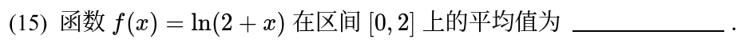

答案与解析

**答案 $3\ln2-1$。** 平均值为 $\frac12\int_0^2\ln(2+x)\,dx$。令 $u=2+x$ 得 $\frac12[u\ln u-u]_2^4=3\ln2-1$。

---

### 02 · 2026年

> *开篇变限积分大题。被积函数含复合项 $xt$，先换元 $u=xt$ 把变量 $x$ 提出来剥离干净再求导；第二问连续性注意在 $x=0$ 处必须用极限定义验证。*

答案与解析

**解。** 当 $x\ne0$ 时换元 $u=xt$，写成 $f(x)=x^{-1}\int_0^{x^3}g(u)\,du$，$x<0$ 时也成立。于是
$$
f'(x)=3xg(x^3)-\frac{1}{x^2}\int_0^{x^3}g(u)\,du\qquad(x\ne0).
$$

在原点，$f(0)=0$，且 $g$ 在原点附近有界，所以 $|f(x)|\le Mx^2$，得 $f'(0)=0$。同样 $|\int_0^{x^3}g(u)\,du|\le M|x|^3$，故上式两项都趋于 0，$f'$ 在原点连续。先换元可避开对只知连续的 $g$ 求导。

---

### 03 · 2025年

答案与解析

1. **有理函数部分分式拆分**：
   $$\frac{1}{(x+1)(x^2-2x+2)} = \frac{A}{x+1} + \frac{Bx+C}{x^2-2x+2}.$$
   令 $x=-1$ 得 $A = \frac{1}{1+2+2} = \frac{1}{5}$；通分对比系数得 $B = -\frac{1}{5}$，$C = \frac{3}{5}$。
2. **对不可约二次分母配方并拆出导数项**：
   $$x^2 - 2x + 2 = (x-1)^2 + 1, \qquad -x + 3 = -\frac{1}{2}(2x-2) + 2.$$
3. **逐项定积分**：
   $$\int_0^1 \frac{\mathrm{d}x}{(x+1)(x^2-2x+2)} = \frac{1}{5}\Big[\ln(x+1)\Big]_0^1 - \frac{1}{10}\Big[\ln(x^2-2x+2)\Big]_0^1 + \frac{2}{5}\Big[\arctan(x-1)\Big]_0^1$$
   $$= \frac{1}{5}\ln 2 - \frac{1}{10}(\ln 1 - \ln 2) + \frac{2}{5}\left(0 - \left(-\frac{\pi}{4}\right)\right) = \frac{3}{10}\ln 2 + \frac{\pi}{10}.$$

---

### 04 · 2024年

答案与解析

**触发条件与第一步落笔**

- **触发条件**：两层变限积分，内层上限为 $\sin x$，外层上限为 $x$，下限均为 $0$，只问奇偶性而不求具体值。
- **第一步怎么落笔**：直接按定义计算 $f(-x)$，通过换元 $t = -s$ 把积分上限里的负号消掉。

**完整推演**

1. **判断 $f(x)$ 的奇偶性**：
   被积函数 $h(t) = \sin(t^3)$ 满足 $h(-t) = \sin((-t)^3) = -\sin(t^3) = -h(t)$，为奇函数。
   直接代 $-x$：
   $$f(-x) = \int_0^{\sin(-x)} \sin t^3\,\mathrm{d}t = \int_0^{-\sin x} \sin t^3\,\mathrm{d}t.$$
   令 $t = -s$（$\mathrm{d}t = -\mathrm{d}s$，当 $t = -\sin x$ 时 $s = \sin x$）：
   $$f(-x) = \int_0^{\sin x} \sin(-s^3)\cdot(-\mathrm{d}s) = \int_0^{\sin x} \sin s^3\,\mathrm{d}s = f(x).$$
   因此 **$f(x)$ 为偶函数**。
   （求导复核：$f'(x) = \sin(\sin^3 x)\cdot\cos x$，满足 $f'(-x) = \sin(-\sin^3 x)\cos(-x) = -f'(x)$ 为奇函数，故 $f(x)$ 必为偶函数。）

2. **判断 $g(x)$ 的奇偶性**：
   因为 $f(t)$ 为偶函数，且 $g(x) = \int_0^x f(t)\,\mathrm{d}t$ 下限为 $0$，令 $t = -s$：
   $$g(-x) = \int_0^{-x} f(t)\,\mathrm{d}t = \int_0^x f(-s)(-\mathrm{d}s) = -\int_0^x f(s)\,\mathrm{d}s = -g(x).$$
   因此 **$g(x)$ 为奇函数**。

故选择 **（D）**。

**选择题干扰项拆解**

- **（A）（B）**：误把 $f(x)$ 当成奇函数——常见错因是看到“$\sin x$ 是奇函数、$\sin t^3$ 也是奇函数”，凭直觉以为“奇复合奇还是奇”，忽略了**积分本身会把奇函数变成偶函数**（$H(u) = \int_0^u \sin t^3\,\mathrm{d}t$ 是偶函数，偶函数复合奇函数 $H(\sin x)$ 仍是偶函数）。
- **（C）**：算对了 $f(x)$ 是偶函数，却把“偶函数的变限积分（下限为 $0$）”错记成偶函数。

---

### 05 · 2023年

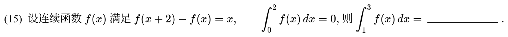

答案与解析

**答案 $\tfrac12$。** 拆分后 $\int_1^3 f=\int_0^2 f+\int_2^3 f-\int_0^1f$。最后两项合为 $\int_0^1[f(x+2)-f(x)]dx=\int_0^1x\,dx$。

---

### 06 · 2022年

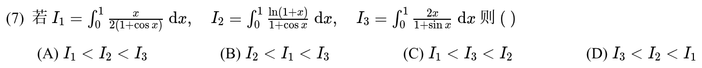

答案与解析

**答案 A。** 对 $0<x<1$，$\ln(1+x)>x/2$（积分 $\int_0^xdt/(1+t)$），故 $I_2>I_1$。另一方面 $\ln(1+x)/(1+\cos x)<x$，而 $2x/(1+\sin x)>x$，所以 $I_3>I_2$。

---

### 07 · 2022年

答案与解析

**答案 $\dfrac{8\pi}{3\sqrt3}$。** 分子拆成 $(2x-1)+4$，第一项积分为 $[\ln(x^2-x+1)]_0^1=0$。余下用 $(x-1/2)^2+3/4$ 配方，得 $(8/\sqrt3)[\arctan((2x-1)/\sqrt3)]_0^1=8\pi/(3\sqrt3)$。

---

### 08 · 2021年

答案与解析

**触发条件与第一步落笔**

- **触发条件**：已知 $f(x)$ 在 $[0,1]$ 上连续（保证黎曼可积，任意取点与分法极限均相等），要求从四个黎曼和中选出等于 $\int_0^1 f(x)\,\mathrm{d}x$ 的一项。
- **第一步怎么落笔**：逐项核对“项数 $N$”与“步长 $\Delta x = \frac{1}{N}$”，并检查 $\xi_k$ 是否落在第 $k$ 个子区间内。

**完整推演**

对区间 $[0,1]$ 作 $n$ 等分，第 $k$ 个子区间为 $\left[\frac{k-1}{n}, \frac{k}{n}\right]$（$k=1,2,\dots,n$），每个子区间长度为
$$\Delta x_k = \frac{1}{n}.$$
取每个子区间的中点作为样点：
$$\xi_k = \frac{1}{2}\left(\frac{k-1}{n} + \frac{k}{n}\right) = \frac{2k-1}{2n} \in \left[\frac{k-1}{n}, \frac{k}{n}\right].$$
因为 $f(x)$ 在 $[0,1]$ 上连续，由定积分定义：
$$\int_0^1 f(x)\,\mathrm{d}x = \lim_{n\to\infty} \sum_{k=1}^{n} f\left(\frac{2k-1}{2n}\right)\frac{1}{n}.$$
故选择 **（B）**。

**选择题干扰项拆解（含 $f(x)\equiv 1$ 速验）**

- **（A）$\lim_{n\to\infty}\sum_{k=1}^{n} f\left(\frac{2k-1}{2n}\right)\frac{1}{2n}$**：看到 $\frac{2k-1}{2n}$ 分母有 $2n$，误把步长当成 $\frac{1}{2n}$。实际上相邻两点间距是 $\frac{2(k+1)-1}{2n} - \frac{2k-1}{2n} = \frac{1}{n}$，故（A）$= \frac{1}{2}\int_0^1 f(x)\,\mathrm{d}x$（取 $f\equiv 1$ 得 $n\cdot\frac{1}{2n}=\frac{1}{2}$）。
- **（C）$\lim_{n\to\infty}\sum_{k=1}^{2n} f\left(\frac{k-1}{2n}\right)\frac{1}{n}$**：把 $[0,1]$ 分成了 $2n$ 等份，正确步长应是 $\frac{1}{2n}$，而题中乘的是 $\frac{1}{n} = 2\cdot\frac{1}{2n}$，故（C）$= 2\int_0^1 f(x)\,\mathrm{d}x$（取 $f\equiv 1$ 得 $2n\cdot\frac{1}{n}=2$）。
- **（D）$\lim_{n\to\infty}\sum_{k=1}^{2n} f\left(\frac{k}{2n}\right)\frac{2}{n}$**：同样是 $2n$ 等份，乘的是 $\frac{2}{n} = 4\cdot\frac{1}{2n}$，故（D）$= 4\int_0^1 f(x)\,\mathrm{d}x$（取 $f\equiv 1$ 得 $2n\cdot\frac{2}{n}=4$）。

---

### 09 · 2021年

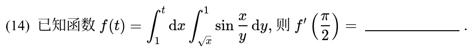

答案与解析

**按当前题面，答案为 $\displaystyle -\frac{\pi}{2}\int_{\sqrt{\pi/2}}^{\pi/2}\frac{\sin u}{u^2}\,du$。** 只对外层用变上限公式，得到 $\int_{\sqrt{\pi/2}}^1\sin(\pi/(2y))\,dy$。换元 $u=\pi/(2y)$ 得上述结果。原内层积分下限大于上限，所以结果为负。

---

### 10 · 2020年

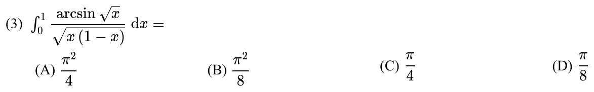

答案与解析

**答案 A，$\pi^2/4$。** 令 $x=\sin^2t$，$t\in[0,\pi/2]$，则 $dx/\sqrt{x(1-x)}=2dt$ 且 $\arcsin\sqrt x=t$。积分化为 $2\int_0^{\pi/2}t\,dt$，原积分的端点用反常积分极限处理。

---

### 11 · 2020年

> *抽象连续函数极值大题。利用极限条件把 $f(x)$ 在 0 点的局部性质看作 $f(x) \sim x$，变上限积分求导找驻点，利用二阶导正负判断极值。*

答案与解析

**解。** $x\ne0$ 时，$g(x)=x^{-1}\int_0^x f(u)\,du$，所以
$$
g'(x)=\frac{f(x)}x-\frac{1}{x^2}\int_0^x f(u)\,du.
$$
极限条件与连续性给出 $f(0)=0$、$f(u)=u+o(|u|)$。因此 $\int_0^x f(u)\,du=x^2/2+o(x^2)$（两侧均用 $|f(u)-u|\le\varepsilon |u|$ 估计）。故 $g'(0)=\lim g(x)/x=1/2$，而上式也趋于 $1-1/2$，证明连续。

---

### 12 · 2019年

答案与解析

**答案 $(\cos1-1)/4$。** 写内层为 $-\int_x^1(\sin t^2)/t\,dt$，换序得 $-\int_0^1 [(\sin t^2)/t]\int_0^t x\,dx\,dt=-\frac12\int_0^1 t\sin t^2\,dt$。换元 $u=t^2$ 即得。靠近 0 的内层被积函数 $\sin(t^2)/t\sim t$，可连续延拓。

---

### 13 · 2018年

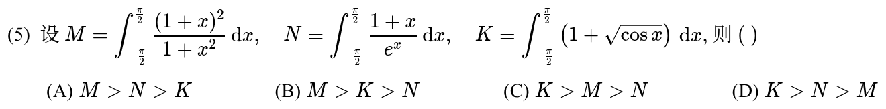

答案与解析

**答案 C，$K>M>N$。** $M$ 把奇项 $2x/(1+x^2)$ 积掉，得 $\pi$；$K>\pi$。令 $a=\pi/2$，将 $N$ 的正负半区配对，得到 $\int_0^a2(\cosh x-x\sinh x)\,dx$。括号内在 $0$ 为 1，导数为 $-x\cosh x<0$，所以 $N<2a=\pi$。

---

### 14 · 2016年

> *定积分不等式与中值大题。利用积分均值定理与导数单调性，构造辅助函数将定积分与端点值联系起来，两小问层层递进。*

答案与解析

**解。** （1）记 $b=3\pi/2$。利用 $f(0)=0$，分部积分得
$$
\int_0^b f(x)dx=\int_0^b(b-x)f'(x)dx=-\tfrac12\int_0^b\cos x\,dx=\tfrac12.
$$
故平均值 $1/(3\pi)$。$f$ 在 $b$ 连续，分部积分的端点项可先在 $b-\varepsilon$ 处计算再取极限。

（2）由 $f'$ 的符号，$f$ 从 0 严格减到 $x=\pi/2$，随后严格增加。平均值为正保证后半段出现正值，故介值定理与单调性给出唯一内点零点。

---

### 15 · 2015年

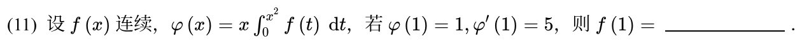

答案与解析

**答案 $2$。** $\varphi'(x)=\int_0^{x^2}f(t)dt+2x^2f(x^2)$，用 $\varphi(1)=1$ 确定该积分为 1，进而 $5=1+2f(1)$。

---

### 16 · 2014年

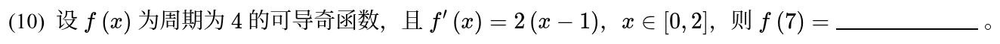

答案与解析

**答案 $1$。** 周期性给 $f(7)=f(-1)$，奇性给 $f(-1)=-f(1)$ 及 $f(0)=0$。由 $f(1)=\int_0^1 2(x-1)dx=-1$，得到结果。

---

### 17 · 2014年

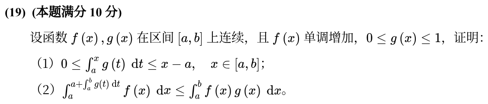

答案与解析

**证明。** （1）由 $0\le g\le1$ 直接积分得 $0\le\int_a^x g\le x-a$。

（2）令 $c=a+\int_a^b g$，由（1）知 $c\in[a,b]$，且 $\int_c^b g=\int_a^c(1-g)$。把右边减左边，得到 $\int_c^b f(x)g(x)dx-\int_a^c f(x)(1-g(x))dx$。前项下界是 $f(c)\int_c^b g$，后项上界是 $f(c)\int_a^c(1-g)$，二者相等，故差非负。

---

### 18 · 2013年

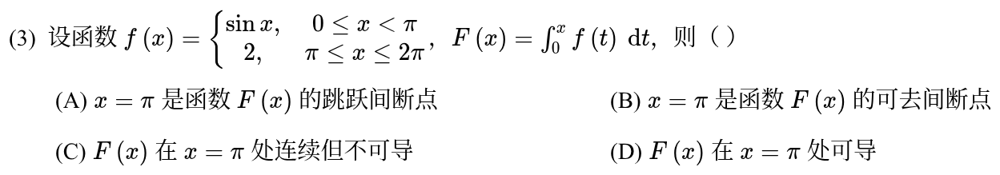

答案与解析

**答案 C。** $F$ 为有界函数的变上限积分，故连续。其在 $\pi$ 的左右差商分别收敛到被积函数的左右极限 $0,2$，因此不可导。单点 $f(\pi)$ 的取值不影响积分。

---

### 19 · 2012年

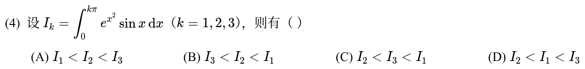

答案与解析

**答案 D，$I_2<I_1<I_3$。** 记每个长度 $\pi$ 的区间上的绝对积分为 $a_j$。逐段平移回 $[0,\pi]$ 后 $|\sin x|$ 相同，$e^{x^2}$ 严格增大，故 $0<a_1<a_2<a_3$。于是 $I_1=a_1$、$I_2=a_1-a_2$、$I_3=I_1-a_2+a_3$。

---

### 20 · 2011年

答案与解析

**答案 B，$I<K<J$。** 在 $0<x<\pi/4$，$\sin x<\cos x<1<\cot x$，取对数后逐点比较即可。端点的对数发散是可积的，因为 $\sin x\sim x$。

---

### 21 · 2010年

> *对数幂次积分比较与极限。第一问比较大小直接在被积区间 $[0,1]$ 上比被积函数大小；第二问通过分部积分找到递推关系式，用夹逼定理求极限。*

答案与解析

**解。** （I）在 $0<t<1$，$0<\ln(1+t)<t$，乘上正的 $|\ln t|$ 并积分，第一积分严格小于第二个。

（II）分部积分得 $\int_0^1t^n|\ln t|\,dt=1/(n+1)^2$，因为 $t^{n+1}\ln t\to0$。故 $0<u_n<1/(n+1)^2$，极限为零。

---

[« 不定积分与原函数](10-antiderivatives.md)　　[反常积分 »](12-improper-integrals.md)
