[« 不定积分与原函数](10-antiderivatives.md)　　[反常积分 »](12-improper-integrals.md)

# 高等数学 · 定积分、变上限积分与积分性质

> 2010—2026年 · 21 道完整真题 · 年份从新到旧（2026→2010）  
> 题型分布：选择题 8 题 · 填空题 7 题 · 解答题 6 题  
> 考查范围：定积分计算、变上限求导、积分比较、平均值及积分定义

---

## 2026年

### 01 · 2026-15 · 填空题

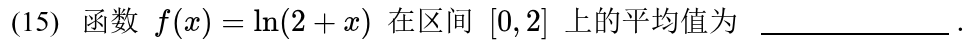

---

### 02 · 2026-18 · 解答题

> 开篇变限积分大题。被积函数含复合项 ，先换元  把变量  提出来剥离干净再求导；第二问连续性注意在  处必须用极限定义验证。

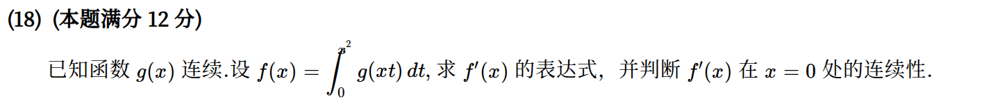

*关联章节：[导数、微分与求导法则](04-derivatives.md) · [连续与间断点](03-continuity.md)*

---

## 2025年

### 03 · 2025-17 · 解答题

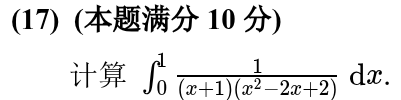

---

## 2024年

### 04 · 2024-03 · 选择题

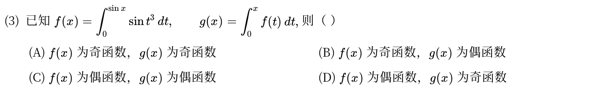

*关联章节：[函数极限与无穷小](01-limits.md)*

---

## 2023年

### 05 · 2023-15 · 填空题

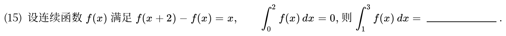

---

## 2022年

### 06 · 2022-07 · 选择题

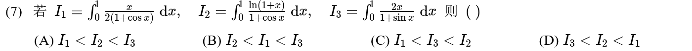

---

### 07 · 2022-13 · 填空题

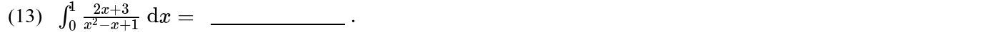

---

## 2021年

### 08 · 2021-07 · 选择题

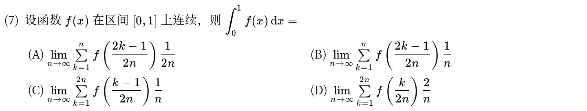

*关联章节：[数列极限与求和极限](02-sequences.md)*

---

### 09 · 2021-14 · 填空题

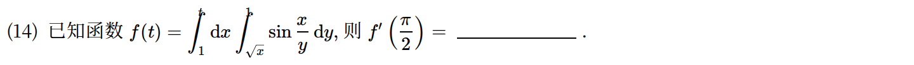

*关联章节：[二重积分](19-double-integrals.md)*

---

## 2020年

### 10 · 2020-03 · 选择题

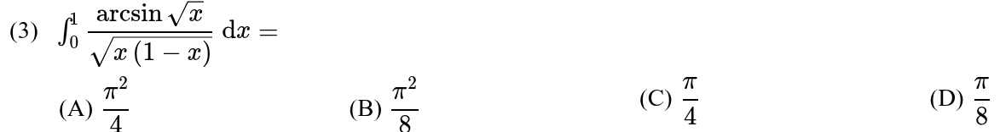

---

### 11 · 2020-16 · 解答题

> 抽象连续函数极值大题。利用极限条件把  在 0 点的局部性质看作 ，变上限积分求导找驻点，利用二阶导正负判断极值。

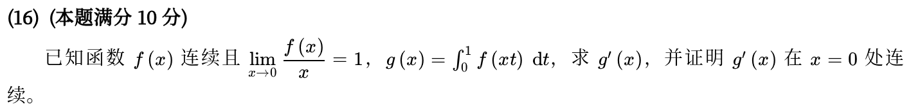

*关联章节：[导数、微分与求导法则](04-derivatives.md) · [连续与间断点](03-continuity.md)*

---

## 2019年

### 12 · 2019-13 · 填空题

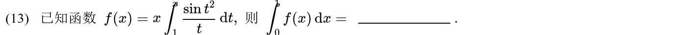

---

## 2018年

### 13 · 2018-05 · 选择题

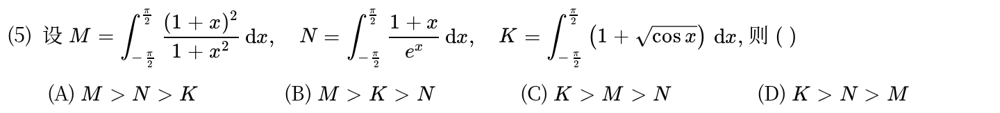

---

## 2016年

### 14 · 2016-21 · 解答题

> 定积分不等式与中值大题。利用积分均值定理与导数单调性，构造辅助函数将定积分与端点值联系起来，两小问层层递进。

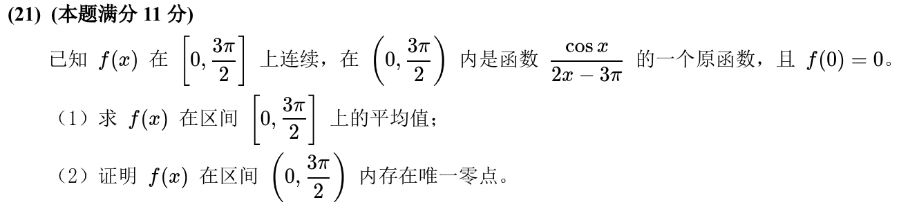

*关联章节：[中值定理、零点与不等式证明](05-mean-value-proofs.md) · [单调性、极值与零点个数](06-monotonicity-extrema.md)*

---

## 2015年

### 15 · 2015-11 · 填空题

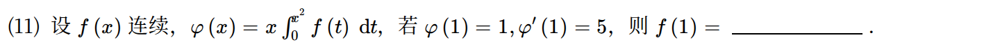

*关联章节：[导数、微分与求导法则](04-derivatives.md)*

---

## 2014年

### 16 · 2014-10 · 填空题

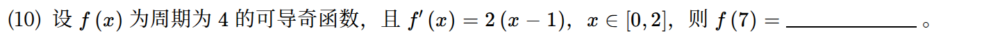

*关联章节：[函数极限与无穷小](01-limits.md)*

---

### 17 · 2014-19 · 解答题

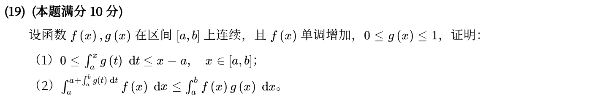

*关联章节：[中值定理、零点与不等式证明](05-mean-value-proofs.md)*

---

## 2013年

### 18 · 2013-03 · 选择题

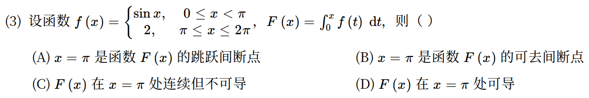

*关联章节：[连续与间断点](03-continuity.md) · [导数、微分与求导法则](04-derivatives.md)*

---

## 2012年

### 19 · 2012-04 · 选择题

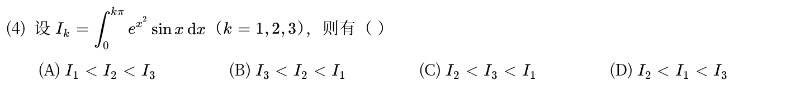

---

## 2011年

### 20 · 2011-06 · 选择题

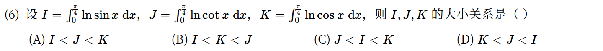

---

## 2010年

### 21 · 2010-16 · 解答题

> 对数幂次积分比较与极限。第一问比较大小直接在被积区间  上比被积函数大小；第二问通过分部积分找到递推关系式，用夹逼定理求极限。

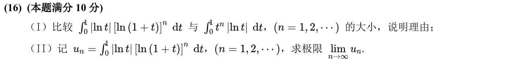

*关联章节：[数列极限与求和极限](02-sequences.md) · [中值定理、零点与不等式证明](05-mean-value-proofs.md)*

---

## 交叉考点索引

以下题目主归其他章节，点击跳转到对应章节题目；不计入本章主收录题数：

- [2026年 · 第4题](13-integral-applications.md)（主章节：定积分应用）
- [2026年 · 第6题](04-derivatives.md)（主章节：导数、微分与求导法则）
- [2025年 · 第1题](17-chain-implicit.md)（主章节：多元复合函数与隐函数求导）
- [2025年 · 第2题](06-monotonicity-extrema.md)（主章节：单调性、极值与零点个数）
- [2025年 · 第13题](02-sequences.md)（主章节：数列极限与求和极限）
- [2025年 · 第14题](04-derivatives.md)（主章节：导数、微分与求导法则）
- [2024年 · 第18题](15-higher-order-ode.md)（主章节：高阶微分方程）
- [2024年 · 第21题](05-mean-value-proofs.md)（主章节：中值定理、零点与不等式证明）
- [2023年 · 第12题](13-integral-applications.md)（主章节：定积分应用）
- [2022年 · 第4题](17-chain-implicit.md)（主章节：多元复合函数与隐函数求导）
- [2022年 · 第21题](07-convexity.md)（主章节：凹凸性与拐点）
- [2021年 · 第1题](01-limits.md)（主章节：函数极限与无穷小）
- [2021年 · 第17题](01-limits.md)（主章节：函数极限与无穷小）
- [2020年 · 第1题](01-limits.md)（主章节：函数极限与无穷小）
- [2020年 · 第20题](05-mean-value-proofs.md)（主章节：中值定理、零点与不等式证明）
- [2019年 · 第21题](05-mean-value-proofs.md)（主章节：中值定理、零点与不等式证明）
- [2018年 · 第4题](07-convexity.md)（主章节：凹凸性与拐点）
- [2018年 · 第16题](14-first-order-ode.md)（主章节：一阶微分方程）
- [2017年 · 第2题](07-convexity.md)（主章节：凹凸性与拐点）
- [2017年 · 第15题](01-limits.md)（主章节：函数极限与无穷小）
- [2017年 · 第17题](02-sequences.md)（主章节：数列极限与求和极限）
- [2016年 · 第10题](02-sequences.md)（主章节：数列极限与求和极限）
- [2016年 · 第12题](08-taylor.md)（主章节：泰勒公式与高阶导数）
- [2016年 · 第16题](06-monotonicity-extrema.md)（主章节：单调性、极值与零点个数）
- [2015年 · 第19题](06-monotonicity-extrema.md)（主章节：单调性、极值与零点个数）
- [2014年 · 第15题](01-limits.md)（主章节：函数极限与无穷小）
- [2014年 · 第20题](02-sequences.md)（主章节：数列极限与求和极限）
- [2013年 · 第10题](04-derivatives.md)（主章节：导数、微分与求导法则）
- [2012年 · 第10题](02-sequences.md)（主章节：数列极限与求和极限）
- [2012年 · 第19题](15-higher-order-ode.md)（主章节：高阶微分方程）
- [2011年 · 第15题](01-limits.md)（主章节：函数极限与无穷小）
- [2010年 · 第6题](02-sequences.md)（主章节：数列极限与求和极限）
- [2010年 · 第15题](06-monotonicity-extrema.md)（主章节：单调性、极值与零点个数）

[« 不定积分与原函数](10-antiderivatives.md)　　[反常积分 »](12-improper-integrals.md)
