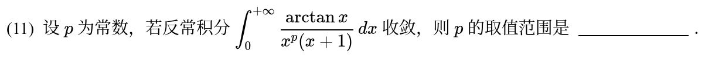
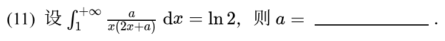
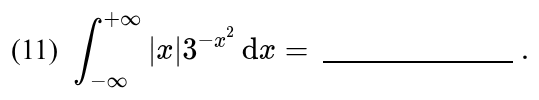
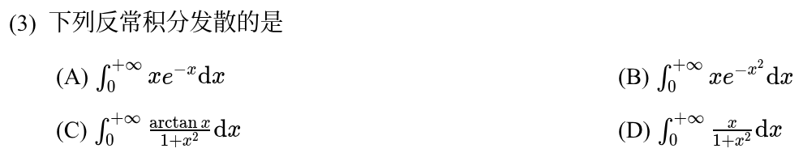
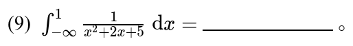
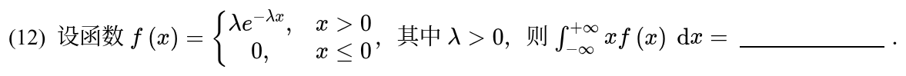

[« 定积分、变上限积分与积分性质](11-definite-integrals.md)　　[定积分应用 »](13-integral-applications.md)

# 高等数学 · 反常积分

> **本章共 15 题**
> 
> - **核心必做（建议按顺序攻克关键方法）**：  
>   [第 11 题](#q11)（幂函数与指数的敛散） → [第 01 题](#q01)（零点和无穷远两端比较） → [第 05 题](#q05)（两端含参数判敛） → [第 06 题](#q06)（对称性与无穷区间求值） → [第 09 题](#q09)（分部积分与边界极限）
> 
> - **分流与刷题建议**：  
>   - **较难挑战**：[第 04 题](#q04)（积分收敛范围接参数最值）  
>   - **重在看思路**：[第 03 题](#q03)（反例辨认比较判别法的边界）  
>   - **首轮可跳过**：[第 15 题](#q15)（技巧较偏或综合度高，首轮不必死磕）  
> 
> - **过关目标**：先拆坏点再比阶；两端条件取交集，求值必须写清极限。

---

### 01 · 2026年

> *含参反常积分收敛性。区间拆成 $[0,1]$ 和 $[1,+\infty)$ 两段：0 处看瑕点（等价无穷小为 $x^{1-p}$），无穷远看衰减阶数（为 $1/x^{p+1}$），两端同时收敛交出 $p$ 范围。*

答案与解析

1. **拆全两个反常点**（$x=0^+$ 与 $x=+\infty$）：拆成 $\int_0^1 + \int_1^{+\infty}$，被积函数在 $(0,+\infty)$ 恒正。
2. **$x \to 0^+$**：$\frac{\arctan x}{x^p(x+1)} \sim \frac{x}{x^p} = \frac{1}{x^{p-1}}$，收敛 $\iff p - 1 < 1 \iff p < 2$。
3. **$x \to +\infty$**：$\frac{\arctan x}{x^p(x+1)} \sim \frac{\pi/2}{x^{p+1}}$，收敛 $\iff p + 1 > 1 \iff p > 0$。
4. 取交集得：$p \in (0, 2)$（或写 $0 < p < 2$）。

---

### 02 · 2025年

答案与解析

**答案 $2$。** 对 $a\le-2$，积分区间内或端点有不可积的极点。对 $a>-2$，$\frac{a}{x(2x+a)}=\frac1x-\frac2{2x+a}$，故积分为 $[\ln x-\ln(2x+a)]_1^\infty=\ln((2+a)/2)$。令其等于 $\ln2$ 得 $a=2$。

---

### 03 · 2024年

> *反常积分真假命题。注意无穷区间上反常积分收敛不代表被积函数趋向 0（可能有窄高尖峰）；被积函数非负且单调时才成立。用尖峰反例迅速判断。*

答案与解析

**答案 B，只有②。** ① 取 $f=(1+x)^{-1}$，平方可积而原函数不可积。② 由 $x^pf(x)$ 有有限极限得到尾段 $f(x)\le Cx^{-p}$，比较即可。③ 取 $f(x)=1/[(x+e)\ln^2(x+e)]$，积分收敛，但任意 $p>1$ 都有 $x^pf(x)\to+\infty$。

---

### 04 · 2023年

答案与解析

**答案 A。** 换元 $u=\ln x$，积分只在 $a>0$ 时收敛，$f(a)=(\ln 2)^{-a}/a$。对数求导得 $f'/f=-\ln(\ln2)-1/a$，此式严格递增且从负变正，于 $a=-1/\ln(\ln2)$ 取唯一最小值。

---

### 05 · 2022年

> *双瑕点反常积分。0 和 1 两个端点都是瑕点，必须两端都收敛。0 点处 $\ln x$ 不影响 $p$ 判别法则，1 点处利用 $\ln x \sim x-1$ 转化为 $p$ 积分判别。*

答案与解析

**触发条件与第一步落笔**

- **触发条件**：有限区间 $[0,1]$ 上的含参反常积分，分母同时含有 $x^p$ 和 $(1-x)^{1-p}$，分子含有 $\ln x$。
- **第一步怎么落笔**：**先拆分两个潜在瑕点 $x=0^+$ 与 $x=1^-$**！取中间点 $\frac{1}{2}$ 将原积分拆成
  $$I = \int_0^{1/2} \frac{\ln x}{x^p(1-x)^{1-p}}\,\mathrm{d}x + \int_{1/2}^{1} \frac{\ln x}{x^p(1-x)^{1-p}}\,\mathrm{d}x = I_1 + I_2.$$
  同时注意在 $(0,1)$ 上 $\ln x < 0$，被积函数恒负不变号，因此可以直接对正函数 $g(x) = \frac{-\ln x}{x^p(1-x)^{1-p}}$ 使用等价无穷小比较审敛法。

**完整推演**

1. **检查左端点 $x \to 0^+$（$I_1$ 的敛散性）**：
   当 $x \to 0^+$ 时，$(1-x)^{1-p} \to 1$，所以
   $$g(x) = \frac{-\ln x}{x^p(1-x)^{1-p}} \sim \frac{-\ln x}{x^p} = \frac{1}{x^p \left(\ln\frac{1}{x}\right)^{-1}}.$$
   对照有限瑕点 $p$-$q$ 标尺（此处 $q = -1 < 1$）：
   - 当 $p < 1$ 时，$I_1$ **收敛**（取 $\alpha \in (p, 1)$，有 $\lim_{x\to 0^+} x^\alpha \cdot \frac{-\ln x}{x^p} = \lim_{x\to 0^+} x^{\alpha - p}(-\ln x) = 0$，而 $\int_0^{1/2}\frac{\mathrm{d}x}{x^\alpha}$ 收敛）；
   - 当 $p = 1$ 时，$\int_0^{1/2}\frac{-\ln x}{x}\,\mathrm{d}x = \left.-\frac{1}{2}(\ln x)^2\right|_0^{1/2} = +\infty$，**发散**；
   - 当 $p > 1$ 时，比 $p=1$ 更大，显然**发散**。
   故 $I_1$ 收敛 $\iff$ **$p < 1$**。

2. **检查右端点 $x \to 1^-$（$I_2$ 的敛散性）**：
   当 $x \to 1^-$ 时，$x^p \to 1$，且分子 $\ln x = \ln\big(1 - (1-x)\big) \sim -(1-x)$，所以
   $$g(x) = \frac{-\ln x}{x^p(1-x)^{1-p}} \sim \frac{1-x}{(1-x)^{1-p}} = \frac{1}{(1-x)^{-p}}.$$
   对照有限瑕点标尺 $\int_{1/2}^1 \frac{\mathrm{d}x}{(1-x)^{\lambda}}$ 收敛 $\iff \lambda < 1$：
   此处 $\lambda = -p < 1 \iff$ **$p > -1$**。

3. **取交集**：
   原积分收敛 $\iff I_1$ 与 $I_2$ 同时收敛 $\iff p < 1$ 且 $p > -1$，即 $p \in (-1, 1)$。故选择 **（A）**。

**选择题干扰项拆解**

- **（C）$(-\infty, 1)$（最常见错选）**：只查了左端点 $x \to 0^+$ 得到 $p < 1$，**忘了检查右端点 $x \to 1^-$**！
- **（B）$(-1, 2)$**：在 $x \to 0^+$ 时把 $-\ln x$ 当成 $x$ 的正幂次抵消了一阶，或者在 $x \to 1^-$ 时把符号算反。
- **（D）$(-\infty, 2)$**：既漏查了 $x \to 1^-$，又在 $x \to 0^+$ 算错了临界指数。

---

### 06 · 2021年

答案与解析

**答案 $1/\ln3$。** 由偶对称，原式为 $2\int_0^\infty x3^{-x^2}\,dx$。令 $u=x^2$，变成 $\int_0^\infty e^{-u\ln3}du=1/\ln3$。

---

### 07 · 2019年

答案与解析

**答案 D。** D 的原函数为 $\frac12\ln(1+x^2)$，上端发散。A 用分部积分得到有限值，B 用 $u=x^2$ 化为指数积分，C 用 $u=\arctan x$ 化为有限区间上的 $\int_0^{\pi/2}u\,du$。

---

### 08 · 2018年

答案与解析

**答案 $\tfrac12\ln2$。** 裂项 $\frac1{(x-1)(x-3)}=\frac12(\frac1{x-3}-\frac1{x-1})$。原函数是 $\frac12\ln[(x-3)/(x-1)]$，上端趋于 0，下端给 $-\frac12\ln2$。

---

### 09 · 2017年

答案与解析

**答案 $1$。** 令 $u=1+x$，分部积分得 $[-\ln u/u]_1^\infty+\int_1^\infty du/u^2=1$。边界项两端均为零。

---

### 10 · 2016年

答案与解析

**答案 B。** 被积函数的原函数为 $-e^{1/x}$。在 $x\to\pm\infty$，原函数趋于 $-1$；当 $x\to0^-$ 趋于 0，当 $x\to0^+$ 则趋于 $-\infty$。所以左区间收敛到 1，右区间发散。

---

### 11 · 2015年

答案与解析

**触发条件与第一步落笔**

- **触发条件**：四个选项都是 $[2, +\infty)$ 上的正项无穷限反常积分（下限 $2 > 1$，避开了 $x=0$ 与 $x=1$ 的瑕点，唯一反常点只有 $+\infty$）。
- **第一步怎么落笔**：直接按 $x \to +\infty$ 的 $p$-$q$ 标尺与指数阶比较，逐项秒判，必要时直接算原函数验算。

**完整推演与干扰项拆解**

- **（A）$\int_2^{+\infty} \frac{1}{\sqrt{x}}\,\mathrm{d}x$**：对应 $p = \frac{1}{2} \le 1$，**发散**（原函数 $2\sqrt{x} \to +\infty$）。
- **（B）$\int_2^{+\infty} \frac{\ln x}{x}\,\mathrm{d}x$**：对应 $p = 1, q = -1 \le 1$，**发散**；也可直接凑微分验证：
  $$\int_2^{+\infty} \ln x\,\mathrm{d}(\ln x) = \left.\frac{1}{2}(\ln x)^2\right|_2^{+\infty} = +\infty.$$
- **（C）$\int_2^{+\infty} \frac{1}{x\ln x}\,\mathrm{d}x$**：对应 $p = 1, q = 1 \le 1$，恰好踩在临界线上，**发散**；凑微分验证：
  $$\int_2^{+\infty} \frac{\mathrm{d}(\ln x)}{\ln x} = \left.\ln(\ln x)\right|_2^{+\infty} = +\infty.$$
- **（D）$\int_2^{+\infty} \frac{x}{e^x}\,\mathrm{d}x$**：指数衰减远快于任何幂函数，因为 $\lim_{x\to+\infty} x^2 \cdot \frac{x}{e^x} = \lim_{x\to+\infty} \frac{x^3}{e^x} = 0$，由比较审敛法（与 $\int_2^{+\infty} \frac{\mathrm{d}x}{x^2}$ 比）知其**收敛**。直接分部积分也可算出精确值：
  $$\int_2^{+\infty} x e^{-x}\,\mathrm{d}x = \left.-(x+1)e^{-x}\right|_2^{+\infty} = 0 - (-3e^{-2}) = \frac{3}{e^2}.$$

故选择 **（D）**。

---

### 12 · 2014年

答案与解析

**答案 $3\pi/8$。** 配方 $x^2+2x+5=(x+1)^2+4$，原函数为 $\frac12\arctan[(x+1)/2]$。上端角度 $\pi/4$，下端 $-\pi/2$。

---

### 13 · 2013年

答案与解析

**答案 D。** 在 $1^+$，幂型瑕积分要求 $\alpha-1<1$，即 $\alpha<2$。在无穷远换元 $u=\ln x$ 后为 $\int_1^\infty u^{-\alpha-1}du$，要求 $\alpha>0$。两端都收敛才可合并。

---

### 14 · 2011年

答案与解析

**答案 $1/\lambda$。** 只需积分 $\int_0^\infty x\lambda e^{-\lambda x}dx$。分部积分边界项 $[-xe^{-\lambda x}]_0^\infty=0$，余下 $\int_0^\infty e^{-\lambda x}dx=1/\lambda$。

---

### 15 · 2010年

答案与解析

**答案 D。** 在 0 处，$\ln(1-x)\sim-x$，故被积函数等价于 $x^{2/m-1/n}$，指数严格大于 $-1$。在 1 处，令 $u=-\ln(1-x)$，对数的任意正幂乘上 $e^{-u}$ 仍可积。因此两个端点对任意正整数 $m,n$ 都收敛。

---

[« 定积分、变上限积分与积分性质](11-definite-integrals.md)　　[定积分应用 »](13-integral-applications.md)
