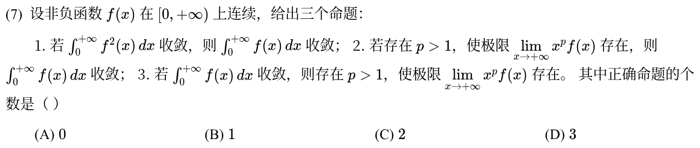
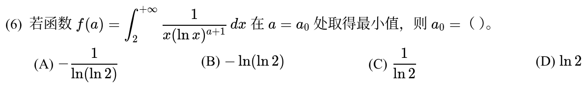
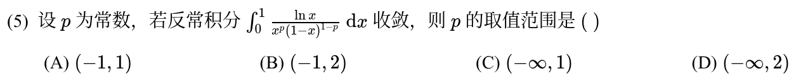
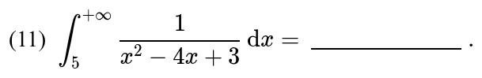
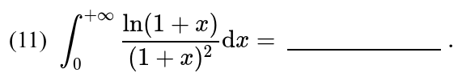
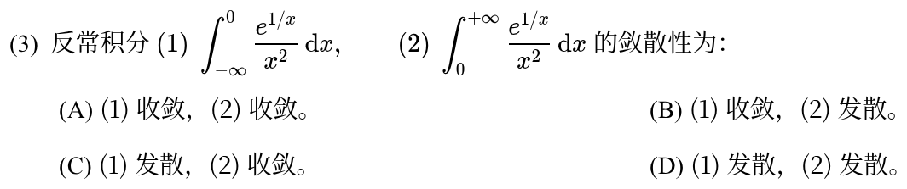
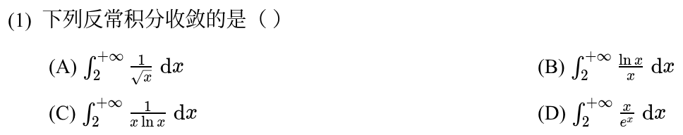
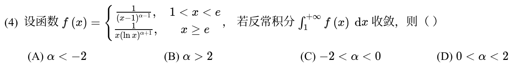
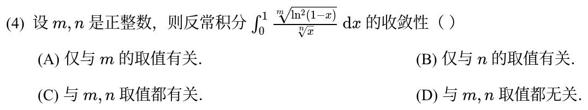

[« 定积分、变上限积分与积分性质](11-definite-integrals.md)　　[定积分应用 »](13-integral-applications.md)

# 高等数学 · 反常积分

> **本章共 15 题**
> 
> - **核心必做（建议按顺序攻克关键方法）**：  
>   [第 11 题](#q11)（幂函数与指数的敛散） → [第 01 题](#q01)（零点和无穷远两端比较） → [第 05 题](#q05)（两端含参数判敛） → [第 06 题](#q06)（对称性与无穷区间求值） → [第 09 题](#q09)（分部积分与边界极限）
> 
> - **分流与刷题建议**：  
>   - **较难挑战**：[第 04 题](#q04)（积分收敛范围接参数最值）  
>   - **重在看思路**：[第 03 题](#q03)（反例辨认比较判别法的边界）  
>   - **首轮可跳过**：[第 15 题](#q15)（技巧较偏或综合度高，首轮不必死磕）  
> 
> - **过关目标**：先拆坏点再比阶；两端条件取交集，求值必须写清极限。

---

### 01 · 2026年

> *含参反常积分收敛性。区间拆成 $[0,1]$ 和 $[1,+\infty)$ 两段：0 处看瑕点（等价无穷小为 $x^{1-p}$），无穷远看衰减阶数（为 $1/x^{p+1}$），两端同时收敛交出 $p$ 范围。*

答案与解析

1. **拆全两个反常点**（$x=0^+$ 与 $x=+\infty$）：拆成 $\int_0^1 + \int_1^{+\infty}$，被积函数在 $(0,+\infty)$ 恒正。
2. **$x \to 0^+$**：$\frac{\arctan x}{x^p(x+1)} \sim \frac{x}{x^p} = \frac{1}{x^{p-1}}$，收敛 $\iff p - 1 < 1 \iff p < 2$。
3. **$x \to +\infty$**：$\frac{\arctan x}{x^p(x+1)} \sim \frac{\pi/2}{x^{p+1}}$，收敛 $\iff p + 1 > 1 \iff p > 0$。
4. 取交集得：$p \in (0, 2)$（或写 $0 < p < 2$）。

---

### 02 · 2025年

答案与解析

**答案**：$2$

- **切入点与推演**：
  1. **先定收敛域**：反常积分收敛要求分母 $2x+a$ 在 $[1,+\infty)$ 上无零点，即 $a > -2$（若 $a\le -2$，则在 $x = -\frac{a}{2}\ge 1$ 处出现不可积的一阶极点，积分发散）。
  2. **裂项直接求积分**：当 $a > -2$ 时，
     $$
     \frac{a}{x(2x+a)} = \frac{1}{x} - \frac{2}{2x+a}.
     $$
     积分得
     $$
     \int_1^{+\infty} \frac{a}{x(2x+a)}\,\mathrm{d}x
     = \left[\ln\frac{x}{2x+a}\right]_1^{+\infty}
     = \ln\frac{1}{2} - \ln\frac{1}{2+a}
     = \ln\frac{2+a}{2}.
     $$
  3. **解方程**：由 $\ln\dfrac{2+a}{2} = \ln 2$ 得 $\dfrac{2+a}{2} = 2 \implies a = 2$（满足 $a>-2$）。
- **易错点**：计算 $\int_1^{+\infty}\left(\frac{1}{x}-\frac{2}{2x+a}\right)\mathrm{d}x$ 时切勿拆成两个发散积分分别计算，必须先合并为 $\ln\frac{x}{2x+a}$ 再取上限极限。

---

### 03 · 2024年

> *反常积分真假命题。注意无穷区间上反常积分收敛不代表被积函数趋向 0（可能有窄高尖峰）；被积函数非负且单调时才成立。用尖峰反例迅速判断。*

答案与解析

**答案**：**（B）** $1$（仅命题 2 正确）

- **切入点与推演**：逐条判别非负连续函数在无穷区间上的敛散性命题：
  - **命题 1（错）**：取 $f(x) = \dfrac{1}{1+x}$，则 $\displaystyle\int_0^{+\infty} f^2(x)\,\mathrm{d}x = \int_0^{+\infty}\frac{\mathrm{d}x}{(1+x)^2} = 1$ 收敛，但 $\displaystyle\int_0^{+\infty}\frac{\mathrm{d}x}{1+x} = +\infty$ 发散。
  - **命题 2（对）**：设 $\lim_{x\to+\infty} x^p f(x) = A \in [0,+\infty)$（$p>1$）。由极限的局部有界性，存在 $X > 0$，使当 $x \ge X$ 时有
    $$
    0 \le f(x) \le \frac{A+1}{x^p}.
    $$
    因 $p>1$ 时 $\displaystyle\int_X^{+\infty}\frac{\mathrm{d}x}{x^p}$ 收敛，由比较判别法知 $\displaystyle\int_X^{+\infty} f(x)\,\mathrm{d}x$ 收敛，结合 $f$ 在 $[0,X]$ 上连续，故 $\displaystyle\int_0^{+\infty} f(x)\,\mathrm{d}x$ 收敛。
  - **命题 3（错）**：取 $f(x) = \dfrac{1}{(x+e)\ln^2(x+e)}$，则 $\displaystyle\int_0^{+\infty} f(x)\,\mathrm{d}x = \left[-\frac{1}{\ln(x+e)}\right]_0^{+\infty} = 1$ 收敛；但对任意 $p>1$，都有
    $$
    \lim_{x\to+\infty} x^p f(x) = \lim_{x\to+\infty} \frac{x^{p-1}}{\ln^2(x+e)}\cdot\frac{x}{x+e} = +\infty,
    $$
    极限不存在。
  综上，仅有 $1$ 个正确命题，选（B）。
- **干扰项 / 易错提示**：命题 3 是高频反例坑——收敛的非负函数不必按幂函数 $x^{-p}$ ($p>1$) 衰减，对数阶 $\dfrac{1}{x\ln^2 x}$ 衰减得比任何 $x^{-p}$ ($p>1$) 都慢却依然可积。

---

### 04 · 2023年

答案与解析

**答案**：**（A）** $-\dfrac{1}{\ln(\ln 2)}$

- **切入点与推演**：
  1. **换元显式算出 $f(a)$ 并定定义域**：令 $u = \ln x$（$\mathrm{d}u = \frac{\mathrm{d}x}{x}$），则
     $$
     f(a) = \int_{\ln 2}^{+\infty} \frac{\mathrm{d}u}{u^{a+1}}.
     $$
     该 $p$-积分收敛当且仅当 $a + 1 > 1$，即 $a > 0$。此时
     $$
     f(a) = \left[-\frac{u^{-a}}{a}\right]_{\ln 2}^{+\infty} = \frac{(\ln 2)^{-a}}{a},\qquad a > 0.
     $$
  2. **对数求导求最小值点**：两边取自然对数得 $\ln f(a) = -a\ln(\ln 2) - \ln a$，对 $a$ 求导：
     $$
     \frac{f'(a)}{f(a)} = -\ln(\ln 2) - \frac{1}{a}.
     $$
     因为 $0 < \ln 2 < 1$，所以 $\ln(\ln 2) < 0$，令 $f'(a) = 0$ 得唯一驻点
     $$
     a_0 = -\frac{1}{\ln(\ln 2)} > 0.
     $$
     当 $0 < a < a_0$ 时 $f'(a) < 0$，当 $a > a_0$ 时 $f'(a) > 0$，故 $f(a)$ 在 $a_0 = -\dfrac{1}{\ln(\ln 2)}$ 处取得最小值，选（A）。
- **干扰项 / 易错提示**：因为 $\ln 2 \approx 0.693 < 1$，所以 $\ln(\ln 2) < 0$，带负号的 $-\dfrac{1}{\ln(\ln 2)}$ 实际上是**正数**，切勿因为看到负号就误以为不在定义域 $a>0$ 内而排除（A）。

---

### 05 · 2022年

> *双瑕点反常积分。0 和 1 两个端点都是瑕点，必须两端都收敛。0 点处 $\ln x$ 不影响 $p$ 判别法则，1 点处利用 $\ln x \sim x-1$ 转化为 $p$ 积分判别。*

答案与解析

**触发条件与第一步落笔**

- **触发条件**：有限区间 $[0,1]$ 上的含参反常积分，分母同时含有 $x^p$ 和 $(1-x)^{1-p}$，分子含有 $\ln x$。
- **第一步怎么落笔**：**先拆分两个潜在瑕点 $x=0^+$ 与 $x=1^-$**！取中间点 $\frac{1}{2}$ 将原积分拆成
  $$I = \int_0^{1/2} \frac{\ln x}{x^p(1-x)^{1-p}}\,\mathrm{d}x + \int_{1/2}^{1} \frac{\ln x}{x^p(1-x)^{1-p}}\,\mathrm{d}x = I_1 + I_2.$$
  同时注意在 $(0,1)$ 上 $\ln x < 0$，被积函数恒负不变号，因此可以直接对正函数 $g(x) = \frac{-\ln x}{x^p(1-x)^{1-p}}$ 使用等价无穷小比较审敛法。

**完整推演**

1. **检查左端点 $x \to 0^+$（$I_1$ 的敛散性）**：
   当 $x \to 0^+$ 时，$(1-x)^{1-p} \to 1$，所以
   $$g(x) = \frac{-\ln x}{x^p(1-x)^{1-p}} \sim \frac{-\ln x}{x^p} = \frac{1}{x^p \left(\ln\frac{1}{x}\right)^{-1}}.$$
   对照有限瑕点 $p$-$q$ 标尺（此处 $q = -1 < 1$）：
   - 当 $p < 1$ 时，$I_1$ **收敛**（取 $\alpha \in (p, 1)$，有 $\lim_{x\to 0^+} x^\alpha \cdot \frac{-\ln x}{x^p} = \lim_{x\to 0^+} x^{\alpha - p}(-\ln x) = 0$，而 $\int_0^{1/2}\frac{\mathrm{d}x}{x^\alpha}$ 收敛）；
   - 当 $p = 1$ 时，$\int_0^{1/2}\frac{-\ln x}{x}\,\mathrm{d}x = \left.-\frac{1}{2}(\ln x)^2\right|_0^{1/2} = +\infty$，**发散**；
   - 当 $p > 1$ 时，比 $p=1$ 更大，显然**发散**。
   故 $I_1$ 收敛 $\iff$ **$p < 1$**。

2. **检查右端点 $x \to 1^-$（$I_2$ 的敛散性）**：
   当 $x \to 1^-$ 时，$x^p \to 1$，且分子 $\ln x = \ln\big(1 - (1-x)\big) \sim -(1-x)$，所以
   $$g(x) = \frac{-\ln x}{x^p(1-x)^{1-p}} \sim \frac{1-x}{(1-x)^{1-p}} = \frac{1}{(1-x)^{-p}}.$$
   对照有限瑕点标尺 $\int_{1/2}^1 \frac{\mathrm{d}x}{(1-x)^{\lambda}}$ 收敛 $\iff \lambda < 1$：
   此处 $\lambda = -p < 1 \iff$ **$p > -1$**。

3. **取交集**：
   原积分收敛 $\iff I_1$ 与 $I_2$ 同时收敛 $\iff p < 1$ 且 $p > -1$，即 $p \in (-1, 1)$。故选择 **（A）**。

**选择题干扰项拆解**

- **（C）$(-\infty, 1)$（最常见错选）**：只查了左端点 $x \to 0^+$ 得到 $p < 1$，**忘了检查右端点 $x \to 1^-$**！
- **（B）$(-1, 2)$**：在 $x \to 0^+$ 时把 $-\ln x$ 当成 $x$ 的正幂次抵消了一阶，或者在 $x \to 1^-$ 时把符号算反。
- **（D）$(-\infty, 2)$**：既漏查了 $x \to 1^-$，又在 $x \to 0^+$ 算错了临界指数。

---

### 06 · 2021年

答案与解析

**答案**：$\dfrac{1}{\ln 3}$

- **切入点与推演**：被积函数 $|x|3^{-x^2}$ 为偶函数，利用对称区间偶函数性质化到 $[0,+\infty)$ 后凑微分：
  $$
  \int_{-\infty}^{+\infty} |x|3^{-x^2}\,\mathrm{d}x
  = 2\int_0^{+\infty} x\cdot 3^{-x^2}\,\mathrm{d}x
  = \int_0^{+\infty} 3^{-x^2}\,\mathrm{d}(x^2).
  $$
  令 $u = x^2$，得
  $$
  \int_0^{+\infty} 3^{-u}\,\mathrm{d}u
  = \left[-\frac{3^{-u}}{\ln 3}\right]_0^{+\infty}
  = 0 - \left(-\frac{1}{\ln 3}\right) = \frac{1}{\ln 3}.
  $$
- **易错点**：偶函数翻倍出来的系数 $2$ 恰好与 $\mathrm{d}(x^2) = 2x\,\mathrm{d}x$ 的系数 $2$ 抵消，别多乘或多除一个 $2$；同时注意 $3^{-u}$ 的原函数是 $-\dfrac{3^{-u}}{\ln 3}$ 而非 $-3^{-u}$。

---

### 07 · 2019年

答案与解析

**答案**：**（D）** $\displaystyle\int_0^{+\infty}\frac{x}{1+x^2}\,\mathrm{d}x$

- **切入点与推演**：直接求（D）的原函数或看无穷远阶数：
  $$
  \int_0^{+\infty} \frac{x}{1+x^2}\,\mathrm{d}x = \left[\frac{1}{2}\ln(1+x^2)\right]_0^{+\infty} = +\infty,
  $$
  故（D）发散（也可由 $x\to+\infty$ 时 $\dfrac{x}{1+x^2}\sim\dfrac{1}{x}$ 直接判发散）。
- **干扰项 / 易错提示**：其余三项均可直接算出有限值而收敛：
  - （A）$\displaystyle\int_0^{+\infty} x e^{-x}\,\mathrm{d}x = \Gamma(2) = 1$；
  - （B）$\displaystyle\int_0^{+\infty} x e^{-x^2}\,\mathrm{d}x = \frac{1}{2}\int_0^{+\infty} e^{-u}\,\mathrm{d}u = \frac{1}{2}$；
  - （C）$\displaystyle\int_0^{+\infty} \frac{\arctan x}{1+x^2}\,\mathrm{d}x = \left[\frac{1}{2}(\arctan x)^2\right]_0^{+\infty} = \frac{\pi^2}{8}$。

---

### 08 · 2018年

答案与解析

**答案**：$\dfrac{1}{2}\ln 2$

- **切入点与推演**：分母因式分解为 $x^2 - 4x + 3 = (x-1)(x-3)$，在 $[5,+\infty)$ 上无零点，直接裂项积分：
  $$
  \frac{1}{(x-1)(x-3)} = \frac{1}{2}\left(\frac{1}{x-3} - \frac{1}{x-1}\right).
  $$
  合并对数后代入上下限：
  $$
  \begin{aligned}
  \int_5^{+\infty} \frac{\mathrm{d}x}{x^2-4x+3}
  &= \frac{1}{2}\left[\ln\frac{x-3}{x-1}\right]_5^{+\infty} \\
  &= \frac{1}{2}\left(\lim_{x\to+\infty}\ln\frac{1-3/x}{1-1/x} - \ln\frac{2}{4}\right) \\
  &= \frac{1}{2}\left(0 - \ln\frac{1}{2}\right) = \frac{1}{2}\ln 2.
  \end{aligned}
  $$
- **易错点**：裂项系数 $\frac{1}{2}$ 与下限代值时的减号（$-\ln\frac{1}{2}=+\ln 2$）容易出错，合并为一个对数后再取极限最稳妥。

---

### 09 · 2017年

答案与解析

**答案**：$1$

- **切入点与推演**：令 $u = 1 + x$，积分限变为 $1 \to +\infty$，再用分部积分（将 $\dfrac{\mathrm{d}u}{u^2} = \mathrm{d}\!\left(-\dfrac{1}{u}\right)$ 凑入微分）：
  $$
  \begin{aligned}
  \int_0^{+\infty}\frac{\ln(1+x)}{(1+x)^2}\,\mathrm{d}x
  &= \int_1^{+\infty} \frac{\ln u}{u^2}\,\mathrm{d}u
   = \left[-\frac{\ln u}{u}\right]_1^{+\infty} + \int_1^{+\infty}\frac{\mathrm{d}u}{u^2} \\
  &= (0 - 0) + \left[-\frac{1}{u}\right]_1^{+\infty} = 1.
  \end{aligned}
  $$
- **易错点**：换元 $u=1+x$ 时别忘记把下限从 $0$ 改成 $1$，且 $\lim_{u\to+\infty}\dfrac{\ln u}{u} = 0$。

---

### 10 · 2016年

答案与解析

**答案**：**（B）** (1) 收敛，(2) 发散

- **切入点与推演**：注意到 $\left(-e^{\frac{1}{x}}\right)' = \dfrac{e^{\frac{1}{x}}}{x^2}$，原函数可直接写出为 $-e^{\frac{1}{x}}$，分别考察两个反常积分在无穷远与 $x=0$ 两侧的极限：
  - **(1) 在 $(-\infty, 0)$ 上**：当 $x\to 0^-$ 时，$\frac{1}{x}\to -\infty \implies e^{\frac{1}{x}} \to 0$；当 $x\to -\infty$ 时，$\frac{1}{x}\to 0 \implies e^{\frac{1}{x}} \to 1$。因此
    $$
    \int_{-\infty}^{0}\frac{e^{1/x}}{x^2}\,\mathrm{d}x
    = \lim_{b\to 0^-}\left(-e^{\frac{1}{b}}\right) - \lim_{a\to -\infty}\left(-e^{\frac{1}{a}}\right)
    = 0 - (-1) = 1,
    $$
    **收敛**。
  - **(2) 在 $(0, +\infty)$ 上**：当 $x\to 0^+$ 时，$\frac{1}{x}\to +\infty \implies e^{\frac{1}{x}} \to +\infty$，故
    $$
    \int_{0}^{+\infty}\frac{e^{1/x}}{x^2}\,\mathrm{d}x
    = \lim_{b\to +\infty}\left(-e^{\frac{1}{b}}\right) - \lim_{a\to 0^+}\left(-e^{\frac{1}{a}}\right)
    = -1 - (-\infty) = +\infty,
    $$
    **发散**。
  综上选（B）。
- **干扰项 / 易错提示**：$e^{1/x}$ 在 $x=0^-$ 与 $x=0^+$ 的单侧极限截然不同（分别是 $0$ 与 $+\infty$），切忌把两个端点混为一谈。

---

### 11 · 2015年

答案与解析

**触发条件与第一步落笔**

- **触发条件**：四个选项都是 $[2, +\infty)$ 上的正项无穷限反常积分（下限 $2 > 1$，避开了 $x=0$ 与 $x=1$ 的瑕点，唯一反常点只有 $+\infty$）。
- **第一步怎么落笔**：直接按 $x \to +\infty$ 的 $p$-$q$ 标尺与指数阶比较，逐项秒判，必要时直接算原函数验算。

**完整推演与干扰项拆解**

- **（A）$\int_2^{+\infty} \frac{1}{\sqrt{x}}\,\mathrm{d}x$**：对应 $p = \frac{1}{2} \le 1$，**发散**（原函数 $2\sqrt{x} \to +\infty$）。
- **（B）$\int_2^{+\infty} \frac{\ln x}{x}\,\mathrm{d}x$**：对应 $p = 1, q = -1 \le 1$，**发散**；也可直接凑微分验证：
  $$\int_2^{+\infty} \ln x\,\mathrm{d}(\ln x) = \left.\frac{1}{2}(\ln x)^2\right|_2^{+\infty} = +\infty.$$
- **（C）$\int_2^{+\infty} \frac{1}{x\ln x}\,\mathrm{d}x$**：对应 $p = 1, q = 1 \le 1$，恰好踩在临界线上，**发散**；凑微分验证：
  $$\int_2^{+\infty} \frac{\mathrm{d}(\ln x)}{\ln x} = \left.\ln(\ln x)\right|_2^{+\infty} = +\infty.$$
- **（D）$\int_2^{+\infty} \frac{x}{e^x}\,\mathrm{d}x$**：指数衰减远快于任何幂函数，因为 $\lim_{x\to+\infty} x^2 \cdot \frac{x}{e^x} = \lim_{x\to+\infty} \frac{x^3}{e^x} = 0$，由比较审敛法（与 $\int_2^{+\infty} \frac{\mathrm{d}x}{x^2}$ 比）知其**收敛**。直接分部积分也可算出精确值：
  $$\int_2^{+\infty} x e^{-x}\,\mathrm{d}x = \left.-(x+1)e^{-x}\right|_2^{+\infty} = 0 - (-3e^{-2}) = \frac{3}{e^2}.$$

故选择 **（D）**。

---

### 12 · 2014年

答案与解析

**答案**：$\dfrac{3\pi}{8}$

- **切入点与推演**：对分母配方 $x^2 + 2x + 5 = (x+1)^2 + 2^2$，套用标准公式 $\displaystyle\int\frac{\mathrm{d}u}{u^2+a^2} = \frac{1}{a}\arctan\frac{u}{a} + C$：
  $$
  \begin{aligned}
  \int_{-\infty}^{1}\frac{\mathrm{d}x}{x^2+2x+5}
  &= \int_{-\infty}^{1}\frac{\mathrm{d}(x+1)}{(x+1)^2 + 2^2}
   = \left[\frac{1}{2}\arctan\frac{x+1}{2}\right]_{-\infty}^{1} \\
  &= \frac{1}{2}\left[\arctan 1 - \left(-\frac{\pi}{2}\right)\right]
   = \frac{1}{2}\left(\frac{\pi}{4} + \frac{\pi}{2}\right) = \frac{3\pi}{8}.
  \end{aligned}
  $$
- **易错点**：下限是 $-\infty$，对应 $\arctan(-\infty) = -\dfrac{\pi}{2}$，减去负值变加号，别错算成 $\frac{\pi}{4}-\frac{\pi}{2}$ 或漏掉前面的系数 $\frac{1}{2}$。

---

### 13 · 2013年

答案与解析

**答案**：**（D）** $0 < \alpha < 2$

- **切入点与推演**：按分段点 $x = e$ 将反常积分拆成两段，要求两段**同时收敛**：
  1. **瑕积分段 $\displaystyle\int_1^e \frac{\mathrm{d}x}{(x-1)^{\alpha-1}}$**：瑕点在 $x = 1^+$，由 $p$-积分判别法，收敛当且仅当
     $$
     \alpha - 1 < 1 \iff \alpha < 2.
     $$
  2. **无穷积分段 $\displaystyle\int_e^{+\infty} \frac{\mathrm{d}x}{x(\ln x)^{\alpha+1}}$**：令 $u = \ln x$，积分化为 $\displaystyle\int_1^{+\infty}\frac{\mathrm{d}u}{u^{\alpha+1}}$，收敛当且仅当
     $$
     \alpha + 1 > 1 \iff \alpha > 0.
     $$
  联立两条件得 $0 < \alpha < 2$，选（D）。
- **干扰项 / 易错提示**：切记瑕点处（$1^+$）要求指数 $< 1$，无穷远处（$+\infty$）要求指数 $> 1$，方向恰好相反；且本题指数分别是 $\alpha-1$ 与 $\alpha+1$ 而非 $\alpha$，务必带偏移量解不等式。

---

### 14 · 2011年

答案与解析

**答案**：$\dfrac{1}{\lambda}$

- **切入点与推演**：因 $x \le 0$ 时 $f(x) = 0$，积分区间缩为 $[0,+\infty)$，再用分部积分（$\lambda e^{-\lambda x}\,\mathrm{d}x = \mathrm{d}(-e^{-\lambda x})$）：
  $$
  \begin{aligned}
  \int_{-\infty}^{+\infty} x f(x)\,\mathrm{d}x
  &= \int_0^{+\infty} x\lambda e^{-\lambda x}\,\mathrm{d}x
   = \left[-x e^{-\lambda x}\right]_0^{+\infty} + \int_0^{+\infty} e^{-\lambda x}\,\mathrm{d}x \\
  &= 0 + \left[-\frac{1}{\lambda}e^{-\lambda x}\right]_0^{+\infty} = \frac{1}{\lambda}.
  \end{aligned}
  $$
- **易错点**：由 $\lambda > 0$ 才保证 $\lim_{x\to+\infty} x e^{-\lambda x} = 0$ 与 $\lim_{x\to+\infty} e^{-\lambda x} = 0$；熟悉概率论的话也可一眼认出这是参数为 $\lambda$ 的指数分布的数学期望 $E(X)=\frac{1}{\lambda}$。

---

### 15 · 2010年

答案与解析

**答案**：**（D）** 与 $m, n$ 取值都无关

- **切入点与推演**：被积函数在 $(0,1)$ 内连续非负，潜在瑕点为左端点 $x = 0^+$ 和右端点 $x = 1^-$，拆成 $\displaystyle\int_0^{1/2} + \int_{1/2}^1$ 分别判别：
  1. **左端点 $x \to 0^+$**：由 $\ln(1-x) \sim -x$，有
     $$
     \frac{\sqrt[m]{\ln^2(1-x)}}{\sqrt[n]{x}} \sim \frac{x^{\frac{2}{m}}}{x^{\frac{1}{n}}} = \frac{1}{x^{\frac{1}{n} - \frac{2}{m}}}.
     $$
     因为 $m, n$ 为正整数（$m \ge 1,\; n \ge 1$），恒有
     $$
     \frac{1}{n} - \frac{2}{m} < \frac{1}{n} \le 1,
     $$
     故在 $x = 0^+$ 处对任意正整数 $m,n$ **恒收敛**。
  2. **右端点 $x \to 1^-$**：此时 $\sqrt[n]{x} \to 1$，取 $p = \frac{1}{2} \in (0,1)$ 作极限比较：
     $$
     \lim_{x\to 1^-} (1-x)^{\frac{1}{2}}\cdot\frac{\bigl[-\ln(1-x)\bigr]^{\frac{2}{m}}}{\sqrt[n]{x}} = \lim_{t\to 0^+} t^{\frac{1}{2}}(-\ln t)^{\frac{2}{m}} = 0.
     $$
     因 $\displaystyle\int_{1/2}^1 \frac{\mathrm{d}x}{(1-x)^{1/2}}$ 收敛，故在 $x = 1^-$ 处对任意正整数 $m,n$ **恒收敛**。
  综上，该反常积分对所有正整数 $m,n$ 均收敛，其收敛性与 $m,n$ 的取值都无关，选（D）。
- **干扰项 / 易错提示**：最易漏判右端点 $x=1^-$ 的对数瑕点，或误以为 $n=1$ 时左端点 $\frac{1}{x}$ 发散——实际上分子的 $\ln^2(1-x)\sim x^2$ 贡献了正幂次 $x^{\frac{2}{m}}$，把分母的 $x^{\frac{1}{n}}$ 的阶数严格压低到 $1$ 以下。

---

[« 定积分、变上限积分与积分性质](11-definite-integrals.md)　　[定积分应用 »](13-integral-applications.md)
