[« 定积分、变上限积分与积分性质](11-definite-integrals.md)　　[定积分应用 »](13-integral-applications.md)

# 高等数学 · 反常积分

> **必会·按此顺序**：[2015-01](#q2015-1)（幂函数与指数的敛散） → [2026-11](#q2026-11)（零点和无穷远两端比较） → [2022-05](#q2022-5)（两端含参数判敛） → [2021-11](#q2021-11)（对称性与无穷区间求值） → [2017-11](#q2017-11)（分部积分与边界极限）  
> **冲一冲**：[2023-06](#q2023-6)（积分收敛范围接参数最值）  
> **见识·先会开题**：[2024-07](#q2024-7)（反例辨认比较判别法的边界）  
> **首轮过关**：先拆坏点再比阶；两端条件取交集，求值必须写清极限。

---

## 2026年

### 01 · 2026-11 · 填空题

> 含参反常积分收敛性。区间拆成  和  两段：0 处看瑕点（等价无穷小为 ），无穷远看衰减阶数（为 ），两端同时收敛交出  范围。

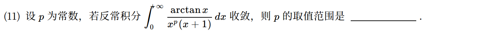

---

## 2025年

### 02 · 2025-11 · 填空题

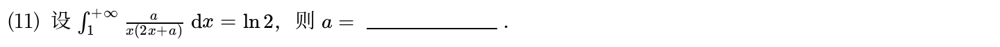

---

## 2024年

### 03 · 2024-07 · 选择题

> 反常积分真假命题。注意无穷区间上反常积分收敛不代表被积函数趋向 0（可能有窄高尖峰）；被积函数非负且单调时才成立。用尖峰反例迅速判断。

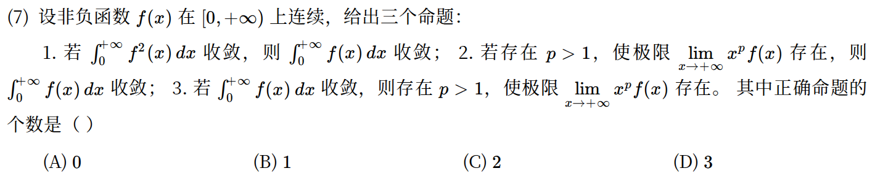

---

## 2023年

### 04 · 2023-06 · 选择题

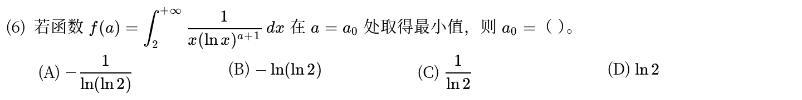

*关联章节：[单调性、极值与零点个数](06-monotonicity-extrema.md)*

---

## 2022年

### 05 · 2022-05 · 选择题

> 双瑕点反常积分。0 和 1 两个端点都是瑕点，必须两端都收敛。0 点处  不影响  判别法则，1 点处利用  转化为  积分判别。

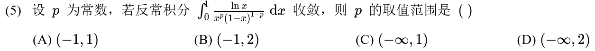

---

## 2021年

### 06 · 2021-11 · 填空题

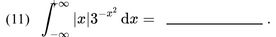

---

## 2019年

### 07 · 2019-03 · 选择题

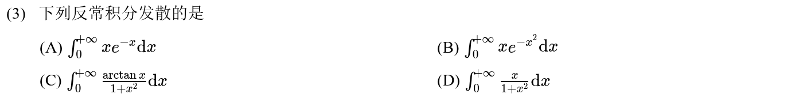

---

## 2018年

### 08 · 2018-11 · 填空题

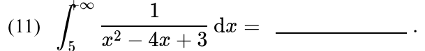

---

## 2017年

### 09 · 2017-11 · 填空题

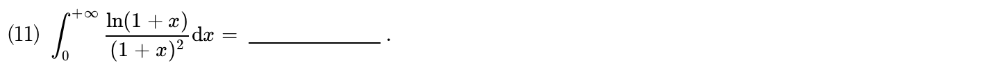

---

## 2016年

### 10 · 2016-03 · 选择题

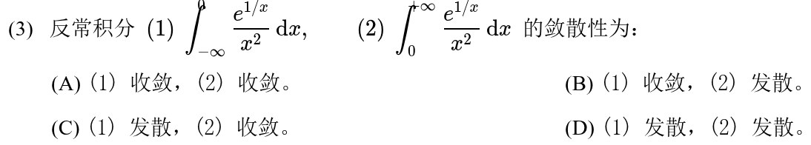

---

## 2015年

### 11 · 2015-01 · 选择题

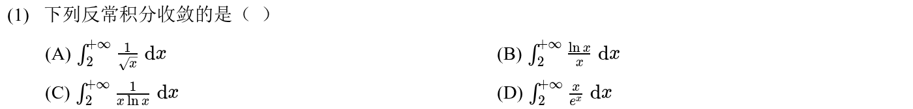

---

## 2014年

### 12 · 2014-09 · 填空题

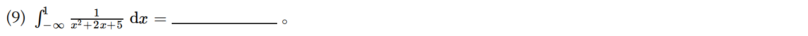

---

## 2013年

### 13 · 2013-04 · 选择题

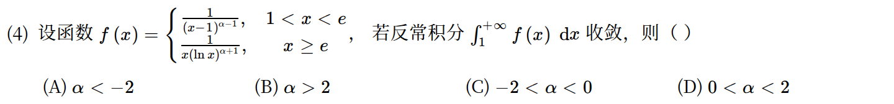

---

## 2011年

### 14 · 2011-12 · 填空题

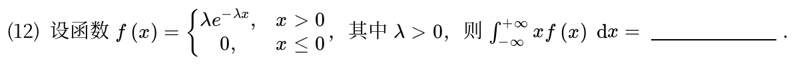

---

## 2010年

### 15 · 2010-04 · 选择题

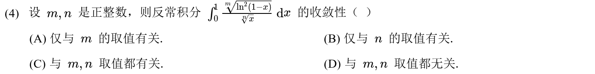

---

## 交叉考点索引

以下题目主归其他章节，点击跳转到对应章节题目；不计入本章主收录题数：

- [2026年 · 第20题](13-integral-applications.md)（主章节：定积分应用）
- [2025年 · 第3题](15-higher-order-ode.md)（主章节：高阶微分方程）
- [2023年 · 第19题](13-integral-applications.md)（主章节：定积分应用）
- [2020年 · 第13题](15-higher-order-ode.md)（主章节：高阶微分方程）
- [2019年 · 第19题](13-integral-applications.md)（主章节：定积分应用）

[« 定积分、变上限积分与积分性质](11-definite-integrals.md)　　[定积分应用 »](13-integral-applications.md)
