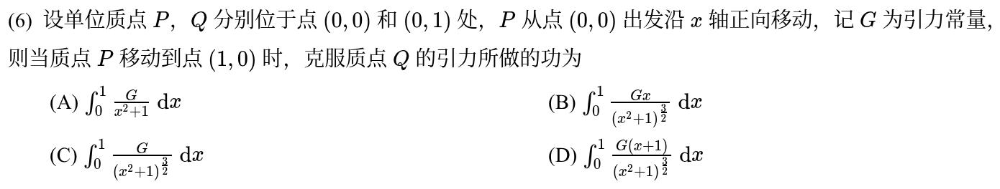
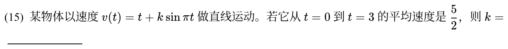
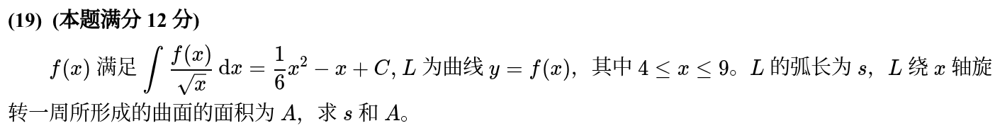
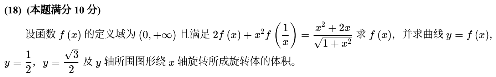
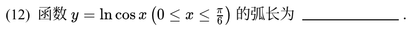
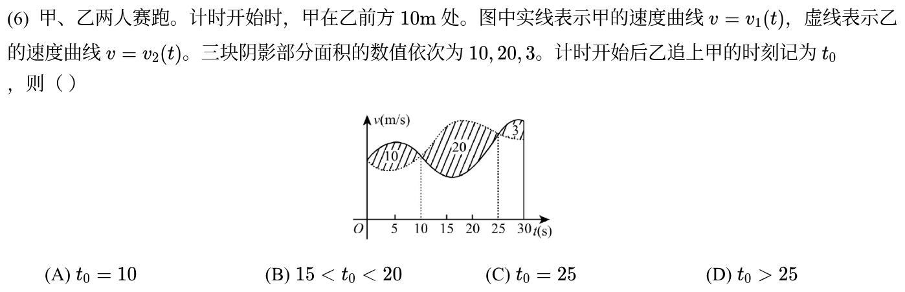
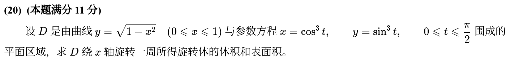
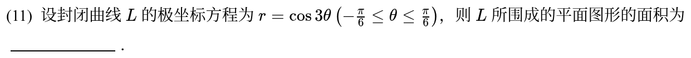
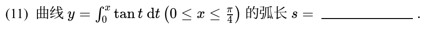
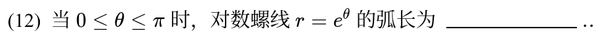

[« 反常积分](12-improper-integrals.md)　　[一阶微分方程 »](14-first-order-ode.md)

# 高等数学 · 定积分应用

> **本章共 27 题**
> 
> - **核心必做（建议按顺序攻克关键方法）**：  
>   [第 21 题](#q21)（分清两种旋转轴） → [第 12 题](#q12)（弧长列式） → [第 08 题](#q08)（极坐标面积） → [第 18 题](#q18)（质心的加权积分） → [第 01 题](#q01)（引力的方向分量） → [第 05 题](#q05)（旋转体体积再求最值）
> 
> - **分流与刷题建议**：  
>   - **较难挑战**：[第 09 题](#q09)（弧长与旋转曲面面积）  
>   - **重在看思路**：[第 25 题](#q25)（抽水做功按高度切片建模）  
>   - **首轮可跳过**：[第 11 题](#q11)、[第 13 题](#q13)、[第 16 题](#q16)、[第 19 题](#q19)、[第 22 题](#q22)、[第 23 题](#q23)、[第 27 题](#q27)（技巧较偏或综合度高，首轮不必死磕）  
> 
> - **过关目标**：先画图、列微元；面积、体积、曲面面积不能混用公式。

---

### 01 · 2026年

> *排在前面的物理题。别被物理名词吓退，建立直角坐标系，利用对称性可知水平分力对消为 0，写出微元 $dF_y$ 直接算定积分。*

答案与解析

**答案**：**（D）** $\displaystyle\int_0^1 \frac{2Gm}{(x^2+1)^{3/2}}\,\mathrm{d}x$

- **切入点与推演**：连续体对质点的万有引力是矢量积分，先取质量微元再做正交分解。
  1. 在细棒 $[-1,1]$ 上任取微元 $[x, x+\mathrm{d}x]$，其质量 $\mathrm{d}m = 1\cdot\mathrm{d}x = \mathrm{d}x$，到质点 $(0,1)$ 的距离 $r = \sqrt{x^2+1}$。
  2. 微元对质点的引力大小为
     $$\mathrm{d}F = \frac{Gm\,\mathrm{d}x}{r^2} = \frac{Gm\,\mathrm{d}x}{x^2+1}.$$
  3. **矢量投影**：由细棒关于 $y$ 轴对称，水平方向分量相互抵消，即 $F_x = 0$；竖直向下方向与连线夹角 $\theta$ 满足 $\cos\theta = \dfrac{1}{\sqrt{x^2+1}}$，因此竖直分量微元为
     $$\mathrm{d}F_y = \mathrm{d}F\cdot\cos\theta = \frac{Gm\,\mathrm{d}x}{x^2+1}\cdot\frac{1}{\sqrt{x^2+1}} = \frac{Gm}{(x^2+1)^{3/2}}\,\mathrm{d}x.$$
  4. 利用被积函数为偶函数的对称性，总引力大小为
     $$F = \int_{-1}^{1}\frac{Gm}{(x^2+1)^{3/2}}\,\mathrm{d}x = \int_0^1 \frac{2Gm}{(x^2+1)^{3/2}}\,\mathrm{d}x.$$
  故选择 **（D）**。
- **干扰项 / 易错提示**：干扰项 **（C）** 错把竖直投影因子 $\cos\theta = \dfrac{1}{\sqrt{x^2+1}}$ 写成了水平投影因子 $\sin\theta = \dfrac{x}{\sqrt{x^2+1}}$；**（A）（B）** 均漏掉了距离平方项，分母幂次错误。

---

### 02 · 2026年

> *拐点与旋转体体积综合大题。先求二阶导求出拐点坐标，无界区域绕 $x$ 轴旋转体积按广义积分做，切忌把线段 $OM$ 产生的圆锥体积漏掉。*

答案与解析

**结论速览**：$V = \dfrac{\pi^2}{6} - \dfrac{\sqrt{3}\pi}{16}$

- **完整解答**：
  1. **求拐点 $M(x_0, y_0)$**：对 $y = (1+x^2)^{-1}$（$x\ge 0$）求一、二阶导数：
     $$y' = -\frac{2x}{(1+x^2)^2}, \qquad y'' = \frac{-2(1+x^2)^2 + 2x\cdot 4x(1+x^2)}{(1+x^2)^4} = \frac{2(3x^2-1)}{(1+x^2)^3}.$$
     在 $x \ge 0$ 上令 $y'' = 0$ 得唯一驻点 $x_0 = \dfrac{1}{\sqrt{3}}$。当 $0\le x < x_0$ 时 $y'' < 0$，当 $x > x_0$ 时 $y'' > 0$，故 $M\!\left(\dfrac{1}{\sqrt{3}}, \dfrac{3}{4}\right)$ 为曲线拐点。
  2. **分段求旋转体体积**：以 $x = x_0$ 为界，区域 $D$ 分为两部分：
     - **左侧 $[0, x_0]$**：上边界为线段 $OM$，绕 $x$ 轴旋转得到底面半径 $r = y_0 = \dfrac{3}{4}$、高 $h = x_0 = \dfrac{1}{\sqrt{3}}$ 的圆锥，体积为
       $$V_1 = \frac{1}{3}\pi r^2 h = \frac{1}{3}\pi\cdot\left(\frac{3}{4}\right)^2\cdot\frac{1}{\sqrt{3}} = \frac{\sqrt{3}\pi}{16}.$$
     - **右侧 $[x_0, +\infty)$**：上边界为曲线 $y = \dfrac{1}{1+x^2}$，由圆盘法并作三角代换 $x = \tan t$（$x=x_0 \Rightarrow t=\dfrac{\pi}{6}$，$x\to+\infty \Rightarrow t\to\dfrac{\pi}{2}$）：
       $$\begin{aligned}
       V_2 &= \pi\int_{\frac{1}{\sqrt{3}}}^{+\infty} \frac{\mathrm{d}x}{(1+x^2)^2}
            = \pi\int_{\frac{\pi}{6}}^{\frac{\pi}{2}} \cos^2 t\,\mathrm{d}t
            = \frac{\pi}{2}\int_{\frac{\pi}{6}}^{\frac{\pi}{2}} (1+\cos 2t)\,\mathrm{d}t \\
           &= \frac{\pi}{2}\left[t + \frac{1}{2}\sin 2t\right]_{\frac{\pi}{6}}^{\frac{\pi}{2}}
            = \frac{\pi}{2}\left[\left(\frac{\pi}{2} - \frac{\pi}{6}\right) - \frac{\sqrt{3}}{4}\right]
            = \frac{\pi^2}{6} - \frac{\sqrt{3}\pi}{8}.
       \end{aligned}$$
  3. **合并总体积**：
     $$V = V_1 + V_2 = \frac{\sqrt{3}\pi}{16} + \left(\frac{\pi^2}{6} - \frac{\sqrt{3}\pi}{8}\right) = \frac{\pi^2}{6} - \frac{\sqrt{3}\pi}{16}.$$
- **核心思路与避坑**：切勿漏掉判断 $y''$ 在 $x_0$ 两侧变号以确认拐点；左侧线段 $OM$ 旋转直接套圆锥体积公式 $\frac{1}{3}\pi r^2 h$ 既快又不易算错；右侧反常积分用 $x=\tan t$ 化为 $\int\cos^2 t\,\mathrm{d}t$ 最稳妥。

---

### 03 · 2025年

答案与解析

**答案**：**（B）** $\displaystyle\int_0^1 \frac{Gx}{(x^2+1)^{\frac{3}{2}}}\,\mathrm{d}x$

- **切入点与推演**：质点 $P$ 沿 $x$ 轴从 $(0,0)$ 移动到 $(1,0)$，位移微元沿 $x$ 轴正向，因此只需把引力分解到 $x$ 轴方向求功。
  1. 当 $P$ 位于 $(x,0)$ 时，与 $Q(0,1)$ 的距离 $r = \sqrt{x^2+1}$，两单位质点间的万有引力大小为
     $$F = \frac{G\cdot 1\cdot 1}{r^2} = \frac{G}{x^2+1},$$
     方向由 $P(x,0)$ 指向 $Q(0,1)$。
  2. 沿 $x$ 轴正向的单位方向向量为 $(1,0)$，由 $P$ 指向 $Q$ 的单位向量为 $\left(-\dfrac{x}{\sqrt{x^2+1}}, \dfrac{1}{\sqrt{x^2+1}}\right)$，故引力在位移方向上的分量为
     $$F_x = -\frac{G}{x^2+1}\cdot\frac{x}{\sqrt{x^2+1}} = -\frac{Gx}{(x^2+1)^{\frac{3}{2}}}.$$
  3. **克服引力做功**等于外力（至少为 $-F_x$）沿位移方向所做的功：
     $$W = \int_0^1 (-F_x)\,\mathrm{d}x = \int_0^1 \frac{Gx}{(x^2+1)^{\frac{3}{2}}}\,\mathrm{d}x.$$
  故选择 **（B）**。
- **干扰项 / 易错提示**：引力在 $y$ 方向的分量 $\dfrac{G}{(x^2+1)^{3/2}}$ 与 $x$ 轴位移垂直，不做功，切勿误选 **（C）** 或把两分量直接相加选 **（D）**；也可用势能差复核：$\int_0^1 \dfrac{Gx}{(x^2+1)^{3/2}}\,\mathrm{d}x = G\!\left(1 - \dfrac{1}{\sqrt{2}}\right) = \left(-\dfrac{G}{r_2}\right) - \left(-\dfrac{G}{r_1}\right)$。

---

### 04 · 2024年

答案与解析

**答案**：$\dfrac{3\pi}{2}$

- **切入点与推演**：直线运动在 $[0,3]$ 上的平均速度等于总位移除以总时间，即速度函数在 $[0,3]$ 上的平均值：
  $$\bar{v} = \frac{1}{3-0}\int_0^3 (t + k\sin\pi t)\,\mathrm{d}t = \frac{5}{2}.$$
  分别计算两项定积分：
  $$\int_0^3 t\,\mathrm{d}t = \left[\frac{t^2}{2}\right]_0^3 = \frac{9}{2}, \qquad \int_0^3 \sin\pi t\,\mathrm{d}t = \left[-\frac{\cos\pi t}{\pi}\right]_0^3 = \frac{-\cos 3\pi + \cos 0}{\pi} = \frac{2}{\pi}.$$
  代入方程得：
  $$\frac{1}{3}\left(\frac{9}{2} + \frac{2k}{\pi}\right) = \frac{5}{2} \implies \frac{3}{2} + \frac{2k}{3\pi} = \frac{5}{2} \implies \frac{2k}{3\pi} = 1 \implies k = \frac{3\pi}{2}.$$
- **易错点**：计算 $\int_0^3 \sin\pi t\,\mathrm{d}t$ 时注意 $\cos 3\pi = -1$ 而非 $1$，容易误以为该积分为 $0$；同时不要漏除时间长度 $3$。

---

### 05 · 2024年

> *定积分求体积极值。先用旋转体体积公式写出关于截距 $t$ 的函数 $V(t)$，再对 $t$ 求导找极大值点，几何计算和导数极值两段都很规整。*

答案与解析

**触发条件与第一步落笔**

- **触发条件**：$t > 0$，积分上下限均为 $t$ 的函数（$[t, 2t]$），目标是求旋转体体积 $V(t)$ 的最大值。
- **第一步怎么落笔**：写出绕 $x$ 轴旋转的体积变限积分表达式，**直接对 $t$ 求导**。

**完整推演**

1. **列出 $V(t)$ 的变限积分表达式**：
   对 $x \in [t, 2t]$（$t > 0$），$y = \sqrt{x}e^{-x} > 0$，绕 $x$ 轴旋转的体积为
   $$V(t) = \pi \int_t^{2t} \left(\sqrt{x}e^{-x}\right)^2\,\mathrm{d}x = \pi \int_t^{2t} x e^{-2x}\,\mathrm{d}x, \qquad t > 0.$$

2. **变限积分求导，确定唯一最大值点**：
   $$V'(t) = \pi \Big[ (2t)e^{-4t} \cdot (2t)' - t e^{-2t} \cdot (t)' \Big] = \pi \left(4t e^{-4t} - t e^{-2t}\right) = \pi t e^{-4t} \left(4 - e^{2t}\right).$$
   因为 $t > 0$ 时 $\pi t e^{-4t} > 0$，所以 $V'(t)$ 的符号完全由 $4 - e^{2t}$ 决定：
   - 令 $V'(t) = 0 \implies e^{2t} = 4 \implies t = \ln 2$；
   - 当 $0 < t < \ln 2$ 时，$e^{2t} < 4 \implies V'(t) > 0$，$V(t)$ 严格单调递增；
   - 当 $t > \ln 2$ 时，$e^{2t} > 4 \implies V'(t) < 0$，$V(t)$ 严格单调递减。
   因此 $t = \ln 2$ 是 $V(t)$ 在 $(0, +\infty)$ 上的**唯一极大值点，也是全局最大值点**。

3. **代入 $t = \ln 2$ 计算最大值 $V(\ln 2)$**：
   先用分部积分求原函数：
   $$\int x e^{-2x}\,\mathrm{d}x = -\frac{1}{2}\int x\,\mathrm{d}(e^{-2x}) = -\frac{1}{2}x e^{-2x} + \frac{1}{2}\int e^{-2x}\,\mathrm{d}x = -\frac{2x+1}{4}e^{-2x} + C.$$
   将上下限 $x = \ln 2$（此时 $e^{-2x} = e^{-2\ln 2} = \frac{1}{4}$）与 $x = 2\ln 2$（此时 $e^{-2x} = e^{-4\ln 2} = \frac{1}{16}$）代入：
   $$V(\ln 2) = \pi \left[-\frac{2x+1}{4}e^{-2x}\right]_{\ln 2}^{2\ln 2} = \pi \left(\frac{2\ln 2 + 1}{4}\cdot\frac{1}{4} - \frac{4\ln 2 + 1}{4}\cdot\frac{1}{16}\right)$$
   $$= \frac{\pi}{64}\Big(4(2\ln 2 + 1) - (4\ln 2 + 1)\Big) = \frac{\pi(4\ln 2 + 3)}{64}.$$

---

### 06 · 2023年

答案与解析

**答案**：$\sqrt{3} + \dfrac{4\pi}{3}$

- **切入点与推演**：曲线由变上限积分给出，先确定其自然定义域 $[-\sqrt{3}, \sqrt{3}]$（保证根号内 $3-t^2 \ge 0$），再求导套用直角坐标弧长公式 $s = \int_a^b \sqrt{1+(y')^2}\,\mathrm{d}x$。
  由变上限积分求导公式得 $y' = \sqrt{3-x^2}$，于是弧长元为
  $$\sqrt{1+(y')^2} = \sqrt{1 + (3-x^2)} = \sqrt{4-x^2}.$$
  因此弧长为
  $$s = \int_{-\sqrt{3}}^{\sqrt{3}} \sqrt{4-x^2}\,\mathrm{d}x = 2\int_0^{\sqrt{3}} \sqrt{4-x^2}\,\mathrm{d}x.$$
  令 $x = 2\sin\theta$（$x=0\Rightarrow\theta=0$，$x=\sqrt{3}\Rightarrow\theta=\dfrac{\pi}{3}$）：
  $$s = 2\int_0^{\frac{\pi}{3}} 4\cos^2\theta\,\mathrm{d}\theta = 4\int_0^{\frac{\pi}{3}} (1+\cos 2\theta)\,\mathrm{d}\theta = 4\left[\theta + \frac{1}{2}\sin 2\theta\right]_0^{\frac{\pi}{3}} = 4\left(\frac{\pi}{3} + \frac{\sqrt{3}}{4}\right) = \sqrt{3} + \frac{4\pi}{3}.$$
- **易错点**：题目未显式写出 $x$ 的范围，需从被积函数 $\sqrt{3-t^2}$ 自行识别自然定义域 $[-\sqrt{3},\sqrt{3}]$，切勿把上限误写成 $2$。

---

### 07 · 2023年

答案与解析

**结论速览**：（1）面积 $S = \ln(1+\sqrt{2})$；（2）旋转体体积 $V = \pi\!\left(1 - \dfrac{\pi}{4}\right)$

- **（1）求区域 $D$ 的面积 $S$**：
  区域 $D$ 为无界区域，面积由反常积分给出：
  $$S = \int_1^{+\infty} \frac{\mathrm{d}x}{x\sqrt{1+x^2}}.$$
  作倒代换 $u = \dfrac{1}{x}$（则 $x = \dfrac{1}{u}$，$\mathrm{d}x = -\dfrac{\mathrm{d}u}{u^2}$；当 $x=1$ 时 $u=1$，当 $x\to+\infty$ 时 $u\to 0^+$）：
  $$S = \int_1^0 \frac{-\frac{1}{u^2}\,\mathrm{d}u}{\frac{1}{u}\sqrt{1+\frac{1}{u^2}}} = \int_0^1 \frac{\mathrm{d}u}{\sqrt{u^2+1}} = \Big[\ln\bigl(u + \sqrt{u^2+1}\bigr)\Big]_0^1 = \ln(1+\sqrt{2}).$$
- **（2）求 $D$ 绕 $x$ 轴旋转所成旋转体的体积 $V$**：
  由圆盘法，将分式拆分后直接求反常积分：
  $$\begin{aligned}
  V &= \pi\int_1^{+\infty} \left(\frac{1}{x\sqrt{1+x^2}}\right)^2\mathrm{d}x
     = \pi\int_1^{+\infty} \frac{\mathrm{d}x}{x^2(1+x^2)} \\
    &= \pi\int_1^{+\infty} \left(\frac{1}{x^2} - \frac{1}{1+x^2}\right)\mathrm{d}x
     = \pi\Big[-\frac{1}{x} - \arctan x\Big]_1^{+\infty} \\
    &= \pi\left[\left(0 - \frac{\pi}{2}\right) - \left(-1 - \frac{\pi}{4}\right)\right] = \pi\left(1 - \frac{\pi}{4}\right).
  \end{aligned}$$
- **核心思路与避坑**：第（1）问被积函数含 $x\sqrt{1+x^2}$ 时，倒代换 $u = 1/x$ 一步化为标准积分 $\int_0^1 \frac{\mathrm{d}u}{\sqrt{1+u^2}}$，比三角代换更快；第（2）问裂项 $\frac{1}{x^2(1+x^2)} = \frac{1}{x^2} - \frac{1}{1+x^2}$ 直接出结果，注意 $\arctan(+\infty) = \frac{\pi}{2}$。

---

### 08 · 2022年

答案与解析

**触发条件与第一步落笔**

- **触发条件**：极坐标方程 $r = \sin 3\theta$，给定角度范围 $0 \le \theta \le \frac{\pi}{3}$。
- **第一步怎么落笔**：先检查 $3\theta \in [0, \pi]$ 时 $\sin 3\theta \ge 0$，且 $\theta=0$ 与 $\theta=\frac{\pi}{3}$ 处 $r=0$，说明曲线恰好围成一个完整的封闭叶形区域（三叶玫瑰线的一叶），无重叠，直接套极坐标面积公式。

**完整推演**

$$S = \frac{1}{2}\int_0^{\frac{\pi}{3}} r^2(\theta)\,\mathrm{d}\theta = \frac{1}{2}\int_0^{\frac{\pi}{3}} \sin^2(3\theta)\,\mathrm{d}\theta.$$
利用降幂公式 $\sin^2(3\theta) = \frac{1 - \cos 6\theta}{2}$：
$$S = \frac{1}{4}\int_0^{\frac{\pi}{3}} (1 - \cos 6\theta)\,\mathrm{d}\theta = \frac{1}{4}\left[\theta - \frac{1}{6}\sin 6\theta\right]_0^{\frac{\pi}{3}} = \frac{1}{4}\left(\frac{\pi}{3} - 0\right) = \frac{\pi}{12}.$$
（也可换元 $u = 3\theta$，利用华里士公式：$S = \frac{1}{6}\int_0^\pi \sin^2 u\,\mathrm{d}u = \frac{1}{3}\int_0^{\frac{\pi}{2}}\sin^2 u\,\mathrm{d}u = \frac{1}{3}\cdot\frac{1}{2}\cdot\frac{\pi}{2} = \frac{\pi}{12}$。）

---

### 09 · 2021年

> *积分与弧长综合大题。两端同时求导解出 $f(x)$，套用直角坐标弧长积分公式 $\sqrt{1+y'^2}$，根号下正好能配成完全平方直接开方。*

答案与解析

**结论速览**：弧长 $s = \dfrac{22}{3}$，旋转曲面面积 $A = \dfrac{425\pi}{9}$

- **完整解答**：
  1. **求 $f(x)$ 与弧长元**：对不定积分等式两边关于 $x$ 求导：
     $$\frac{f(x)}{\sqrt{x}} = \frac{1}{3}x - 1 \implies f(x) = \frac{1}{3}x^{\frac{3}{2}} - x^{\frac{1}{2}} \quad (4 \le x \le 9).$$
     求导得
     $$f'(x) = \frac{1}{2}x^{\frac{1}{2}} - \frac{1}{2}x^{-\frac{1}{2}} = \frac{x-1}{2\sqrt{x}}.$$
     进而配成完全平方求弧长元：
     $$\sqrt{1 + [f'(x)]^2} = \sqrt{1 + \frac{(x-1)^2}{4x}} = \sqrt{\frac{(x+1)^2}{4x}} = \frac{x+1}{2\sqrt{x}} \quad (x > 0).$$
  2. **求弧长 $s$**：
     $$s = \int_4^9 \frac{x+1}{2\sqrt{x}}\,\mathrm{d}x = \frac{1}{2}\int_4^9 \left(x^{\frac{1}{2}} + x^{-\frac{1}{2}}\right)\mathrm{d}x = \left[\frac{1}{3}x^{\frac{3}{2}} + x^{\frac{1}{2}}\right]_4^9 = \left(9 + 3\right) - \left(\frac{8}{3} + 2\right) = \frac{22}{3}.$$
  3. **求旋转曲面面积 $A$**：当 $x\in[4,9]$ 时，$\dfrac{1}{3}x - 1 \ge \dfrac{1}{3} > 0$，故 $f(x) > 0$，可直接代入侧面积公式 $A = 2\pi\int_a^b |f(x)|\sqrt{1+[f'(x)]^2}\,\mathrm{d}x$：
     $$\begin{aligned}
     A &= 2\pi\int_4^9 \sqrt{x}\left(\frac{1}{3}x - 1\right)\cdot\frac{x+1}{2\sqrt{x}}\,\mathrm{d}x
        = \pi\int_4^9 \left(\frac{1}{3}x^2 - \frac{2}{3}x - 1\right)\mathrm{d}x \\
       &= \pi\left[\frac{1}{9}x^3 - \frac{1}{3}x^2 - x\right]_4^9
        = \pi\left[(81 - 27 - 9) - \left(\frac{64}{9} - \frac{16}{3} - 4\right)\right] \\
       &= \pi\left(45 + \frac{20}{9}\right) = \frac{425\pi}{9}.
     \end{aligned}$$
- **核心思路与避坑**：本题核心技巧是 $\left(\dfrac{x-1}{2\sqrt{x}}\right)^2 + 1 = \left(\dfrac{x+1}{2\sqrt{x}}\right)^2$ 凑完全平方开根号；计算 $A$ 时先核实 $f(x) \ge 0$ 再去绝对值，且注意旋转曲面面积系数是 $2\pi$ 而非 $\pi$。

---

### 10 · 2020年

答案与解析

**答案**：$\dfrac{1}{3}\rho g a^3$

- **切入点与推演**：建立竖直向下的深度坐标 $h$（以水面为 $h=0$），用水平细条微元法求静水压力。
  1. 等腰直角三角形斜边长为 $2a$，则斜边上的高（即底顶点在水面下的最大深度）为 $a$。
  2. 在深度 $h\in[0,a]$ 处取厚度为 $\mathrm{d}h$ 的水平细条，由相似三角形比例关系，该处水平宽度 $l(h)$ 满足
     $$\frac{l(h)}{2a} = \frac{a-h}{a} \implies l(h) = 2(a-h).$$
  3. 该细条所受水压强为 $p(h) = \rho g h$，压力微元为 $\mathrm{d}F = \rho g h \cdot 2(a-h)\,\mathrm{d}h$，积分得总压力：
     $$F = \int_0^a 2\rho g h(a-h)\,\mathrm{d}h = 2\rho g \left[\frac{1}{2}a h^2 - \frac{1}{3}h^3\right]_0^a = 2\rho g\cdot\frac{a^3}{6} = \frac{1}{3}\rho g a^3.$$
- **易错点**：注意斜边与水面相齐意味着三角形“倒放”（宽边在上、顶点在下），深度 $h$ 处宽度是 $2(a-h)$ 而非 $2h$。

---

### 11 · 2020年

> *函数方程与旋转体体积。方程里把 $x$ 换成 $1/x$ 联立解出 $f(x)$，求体积时注意积分变量选择，选好绕 $x$ 轴还是 $y$ 轴算壳层微元。*

答案与解析

**结论速览**：$f(x) = \dfrac{x}{\sqrt{1+x^2}}$（$x > 0$），旋转体体积 $V = \dfrac{\pi^2}{6}$

- **（1）求函数 $f(x)$**：
  已知对任意 $x > 0$ 有
  $$2f(x) + x^2 f\!\left(\frac{1}{x}\right) = \frac{x^2 + 2x}{\sqrt{1+x^2}}. \tag{1}$$
  在 $(1)$ 式中将 $x$ 替换为 $\dfrac{1}{x}$（因 $x > 0$，仍有 $\dfrac{1}{x} > 0$）：
  $$2f\!\left(\frac{1}{x}\right) + \frac{1}{x^2}f(x) = \frac{\frac{1}{x^2} + \frac{2}{x}}{\sqrt{1+\frac{1}{x^2}}} = \frac{1 + 2x}{x\sqrt{1+x^2}}.$$
  两边同乘 $x^2$，得
  $$f(x) + 2x^2 f\!\left(\frac{1}{x}\right) = \frac{x + 2x^2}{\sqrt{1+x^2}}. \tag{2}$$
  用 $2\times(1) - (2)$ 消去 $x^2 f\!\left(\dfrac{1}{x}\right)$：
  $$3f(x) = \frac{2(x^2 + 2x) - (x + 2x^2)}{\sqrt{1+x^2}} = \frac{3x}{\sqrt{1+x^2}} \implies f(x) = \frac{x}{\sqrt{1+x^2}} \quad (x > 0).$$
- **（2）求旋转体的体积 $V$**：
  当 $x > 0$ 时，$y = \dfrac{x}{\sqrt{1+x^2}}\in(0,1)$ 严格单调递增，反解出 $x$ 关于 $y$ 的表达式：
  $$y^2(1+x^2) = x^2 \implies x = \frac{y}{\sqrt{1-y^2}} \quad \left(\frac{1}{2} \le y \le \frac{\sqrt{3}}{2}\right).$$
  该区域由 $y$ 轴（$x=0$）、曲线 $x = \dfrac{y}{\sqrt{1-y^2}}$ 及两水平线 $y = \dfrac{1}{2},\ y = \dfrac{\sqrt{3}}{2}$ 围成。绕 $x$ 轴旋转采用**圆柱壳法**（高度 $h(y) = x(y)$，旋转半径为 $y$）：
  $$V = 2\pi\int_{\frac{1}{2}}^{\frac{\sqrt{3}}{2}} y\cdot\frac{y}{\sqrt{1-y^2}}\,\mathrm{d}y = 2\pi\int_{\frac{1}{2}}^{\frac{\sqrt{3}}{2}} \frac{y^2}{\sqrt{1-y^2}}\,\mathrm{d}y.$$
  令 $y = \sin t$（$y=\dfrac{1}{2}\Rightarrow t=\dfrac{\pi}{6}$，$y=\dfrac{\sqrt{3}}{2}\Rightarrow t=\dfrac{\pi}{3}$，$\mathrm{d}y = \cos t\,\mathrm{d}t$）：
  $$\begin{aligned}
  V &= 2\pi\int_{\frac{\pi}{6}}^{\frac{\pi}{3}} \sin^2 t\,\mathrm{d}t
     = \pi\int_{\frac{\pi}{6}}^{\frac{\pi}{3}} (1 - \cos 2t)\,\mathrm{d}t \\
    &= \pi\left[t - \frac{1}{2}\sin 2t\right]_{\frac{\pi}{6}}^{\frac{\pi}{3}}
     = \pi\left[\left(\frac{\pi}{3} - \frac{\sqrt{3}}{4}\right) - \left(\frac{\pi}{6} - \frac{\sqrt{3}}{4}\right)\right] = \frac{\pi^2}{6}.
  \end{aligned}$$
- **核心思路与避坑**：函数方程含 $f(x)$ 与 $f(1/x)$ 时，标准解法是令 $x\mapsto 1/x$ 联立消元；第（2）问区域按 $y$ 方向边界最规整，绕 $x$ 轴旋转直接对 $y$ 用柱壳法 $V = 2\pi\int_c^d y x(y)\,\mathrm{d}y$，比按 $x$ 分两段用圆盘法简洁得多。

---

### 12 · 2019年

答案与解析

**触发条件与第一步落笔**

- **触发条件**：显式直角坐标曲线 $y = \ln\cos x$，$x \in \left[0, \frac{\pi}{6}\right]$，求弧长。
- **第一步怎么落笔**：求导 $y'$，代入直角坐标弧长公式 $s = \int_a^b \sqrt{1+(y')^2}\,\mathrm{d}x$。

**完整推演**

1. 求导与化简被积函数：
   $$y' = \frac{-\sin x}{\cos x} = -\tan x,$$
   $$\sqrt{1 + (y')^2} = \sqrt{1 + \tan^2 x} = \sqrt{\sec^2 x} = |\sec x|.$$
2. 核对区间符号：当 $x \in \left[0, \frac{\pi}{6}\right]$ 时，$\cos x > 0$，故 $\sec x > 0$，直接去掉绝对值得 $\sec x$。
3. 计算定积分：
   $$s = \int_0^{\frac{\pi}{6}} \sec x\,\mathrm{d}x = \Big[\ln|\sec x + \tan x|\Big]_0^{\frac{\pi}{6}} = \ln\left(\frac{2}{\sqrt{3}} + \frac{1}{\sqrt{3}}\right) - \ln(1 + 0) = \ln\sqrt{3} = \frac{1}{2}\ln 3.$$

---

### 13 · 2019年

答案与解析

**结论速览**：$S_n = \dfrac{(1+e^{-\pi})(1-e^{-n\pi})}{2(1-e^{-\pi})}$，$\lim\limits_{n\to\infty} S_n = \dfrac{1+e^{-\pi}}{2(1-e^{-\pi})}$

- **完整解答**：
  1. **分段去绝对值**：曲线与 $x$ 轴所围面积必须对被积函数取绝对值：
     $$S_n = \int_0^{n\pi} e^{-x}|\sin x|\,\mathrm{d}x = \sum_{k=0}^{n-1}\int_{k\pi}^{(k+1)\pi} e^{-x}|\sin x|\,\mathrm{d}x.$$
     对第 $k$ 段作平移换元 $x = t + k\pi$（$t\in[0,\pi]$），此时 $|\sin(t+k\pi)| = \sin t$，故
     $$\int_{k\pi}^{(k+1)\pi} e^{-x}|\sin x|\,\mathrm{d}x = e^{-k\pi}\int_0^\pi e^{-t}\sin t\,\mathrm{d}t.$$
  2. **计算首段积分**：利用两次分部积分（或待定系数法）求原函数：
     $$\int e^{-t}\sin t\,\mathrm{d}t = -\frac{1}{2}e^{-t}(\sin t + \cos t) + C.$$
     代入上下限 $[0,\pi]$：
     $$I_0 = \int_0^\pi e^{-t}\sin t\,\mathrm{d}t = \left[-\frac{1}{2}e^{-t}(\sin t + \cos t)\right]_0^\pi = \frac{1}{2}e^{-\pi} - \left(-\frac{1}{2}\right) = \frac{1+e^{-\pi}}{2}.$$
  3. **等比数列求和与取极限**：公比 $q = e^{-\pi}\in(0,1)$，因此
     $$S_n = I_0\sum_{k=0}^{n-1} e^{-k\pi} = \frac{1+e^{-\pi}}{2}\cdot\frac{1-e^{-n\pi}}{1-e^{-\pi}} = \frac{(1+e^{-\pi})(1-e^{-n\pi})}{2(1-e^{-\pi})}.$$
     令 $n\to\infty$，由于 $e^{-n\pi}\to 0$，得
     $$\lim_{n\to\infty} S_n = \frac{1+e^{-\pi}}{2(1-e^{-\pi})}.$$
- **核心思路与避坑**：求“曲线与 $x$ 轴之间图形的面积”一定要加绝对值 $|\sin x|$，若漏加绝对值会把正负区间抵消；分段平移把 $e^{-k\pi}$ 提到积分号外化为等比数列是此类周期衰减积分的标准套路。

---

### 14 · 2018年

答案与解析

**结论速览**：$\left.\dfrac{\mathrm{d}S}{\mathrm{d}t}\right|_{x=3} = 10$

- **完整解答**：
  1. **用动点横坐标 $x$ 表示面积 $S$**：设动点 $P$ 的坐标为 $\left(x, \dfrac{4}{9}x^2\right)$（$x > 0$）。因为抛物线 $y = \dfrac{4}{9}x^2$ 严格下凸，连接 $A(0,1)$ 与 $P\!\left(x, \dfrac{4}{9}x^2\right)$ 的线段 $AP$ 始终位于抛物线上方。
     因此，直线 $OA$（$y$ 轴从 $0$ 到 $1$）、线段 $AP$ 与曲线 $L$ 所围图形的面积 $S$ 等于直角梯形（上底 $1$、下底 $\dfrac{4}{9}x^2$、高 $x$）的面积减去曲线 $L$ 下方的曲边三角形面积：
     $$S(x) = \frac{1}{2}\left(1 + \frac{4}{9}x^2\right)x - \int_0^x \frac{4}{9}u^2\,\mathrm{d}u = \frac{1}{2}x + \frac{2}{9}x^3 - \frac{4}{27}x^3 = \frac{1}{2}x + \frac{2}{27}x^3.$$
  2. **利用链式法则求相关变化率**：
     $$\frac{\mathrm{d}S}{\mathrm{d}t} = \frac{\mathrm{d}S}{\mathrm{d}x}\cdot\frac{\mathrm{d}x}{\mathrm{d}t} = \left(\frac{1}{2} + \frac{2}{9}x^2\right)\frac{\mathrm{d}x}{\mathrm{d}t}.$$
     当 $P$ 运动到 $(3,4)$ 时，$x = 3$，且已知沿 $x$ 轴正向的速度 $\dfrac{\mathrm{d}x}{\mathrm{d}t} = 4$，代入得
     $$\left.\frac{\mathrm{d}S}{\mathrm{d}t}\right|_{x=3} = \left(\frac{1}{2} + \frac{2}{9}\cdot 9\right)\cdot 4 = \frac{5}{2}\cdot 4 = 10.$$
- **核心思路与避坑**：不必写出直线 $AP$ 的斜截式方程再积分，直接用“梯形面积减曲边梯形面积”既直观又省计算；审题时注意“沿 $x$ 轴正向的速度是 $4$”指 $\dfrac{\mathrm{d}x}{\mathrm{d}t}=4$，而非合速度 $\dfrac{\mathrm{d}s}{\mathrm{d}t}=4$。

---

### 15 · 2017年

答案与解析

**答案**：**（C）** $t_0 = 25$

- **切入点与推演**：速度曲线所围阴影面积的代数和等于位移差。记乙相对甲的位移增量为
  $$\Delta s(t) = \int_0^t \bigl[v_2(\tau) - v_1(\tau)\bigr]\,\mathrm{d}\tau.$$
  计时开始时甲在乙前方 $10\,\mathrm{m}$，故乙追上甲的充要条件是 $\Delta s(t_0) = 10$。结合题图分段考察 $\Delta s(t)$ 的变化：
  - **$t\in[0,10]$**：实线 $v_1$ 在虚线 $v_2$ 上方，阴影面积为 $10$，故 $\Delta s(t)$ 单调递减，且 $\Delta s(10) = -10$（此时甲领先乙 $20\,\mathrm{m}$）。
  - **$t\in[10,25]$**：虚线 $v_2$ 在实线 $v_1$ 上方，阴影面积为 $20$，故 $\Delta s(t)$ 严格单调递增，且
    $$\Delta s(25) = \Delta s(10) + 20 = -10 + 20 = 10.$$
  由于在 $(10,25)$ 内 $\Delta s(t) < 10$，在 $t=25$ 时恰好首次满足 $\Delta s(25) = 10$，即乙在 $t_0 = 25$ 时追上甲。故选择 **（C）**。
- **干扰项 / 易错提示**：最常见错因是忘记前 $10\,\mathrm{s}$ 甲又多跑了 $10\,\mathrm{m}$（把需要追赶的距离误当成初始的 $10\,\mathrm{m}$ 而不是 $20\,\mathrm{m}$），从而误选 **（B）**。

---

### 16 · 2016年

答案与解析

**结论速览**：旋转体体积 $V = \dfrac{18\pi}{35}$，表面积 $S = \dfrac{16\pi}{5}$

- **完整解答**：
  1. **判别内外边界**：在第一象限中，外曲线为四分之一圆 $y_1 = \sqrt{1-x^2}$（$0\le x\le 1$）；内曲线为星形线 $x = \cos^3 t, y = \sin^3 t$（$0\le t\le\dfrac{\pi}{2}$），消参得 $x^{\frac{2}{3}} + y^{\frac{2}{3}} = 1$，即 $y_2 = (1-x^{\frac{2}{3}})^{\frac{3}{2}}$。因为对 $x\in(0,1)$ 有 $x^{\frac{2}{3}} > x^2$，故 $y_2 < y_1$，区域 $D$ 夹在两者之间。
  2. **求旋转体体积 $V$**：用外体积减内体积（垫片法）：
     - 四分之一圆绕 $x$ 轴旋转得到半径为 $1$ 的半球，体积 $V_1 = \dfrac{2}{3}\pi$。
     - 星形线弧段绕 $x$ 轴旋转的体积用参数方程计算（$x$ 从 $0$ 到 $1$ 对应 $t$ 从 $\dfrac{\pi}{2}$ 到 $0$，且 $\mathrm{d}x = -3\cos^2 t\sin t\,\mathrm{d}t$）：
       $$\begin{aligned}
       V_2 &= \pi\int_0^1 y_2^2\,\mathrm{d}x
            = \pi\int_{\frac{\pi}{2}}^0 \sin^6 t\cdot(-3\cos^2 t\sin t)\,\mathrm{d}t
            = 3\pi\int_0^{\frac{\pi}{2}} \sin^7 t(1-\sin^2 t)\,\mathrm{d}t \\
           &= 3\pi\left(\frac{6\cdot 4\cdot 2}{7\cdot 5\cdot 3} - \frac{8\cdot 6\cdot 4\cdot 2}{9\cdot 7\cdot 5\cdot 3}\right)
            = 3\pi\cdot\frac{16}{35}\left(1 - \frac{8}{9}\right) = \frac{16\pi}{105}.
       \end{aligned}$$
     - 因此总体积为
       $$V = V_1 - V_2 = \frac{2\pi}{3} - \frac{16\pi}{105} = \frac{54\pi}{105} = \frac{18\pi}{35}.$$
  3. **求旋转体表面积 $S$**：旋转体的表面由外半球面与内星形线旋转面组成（在 $x=0$ 处两曲线交于 $(0,1)$，在 $x=1$ 处交于 $(1,0)$，无额外平面底面）：
     - 外表面为半径 $1$ 的半球面，面积 $S_1 = 2\pi\cdot 1^2 = 2\pi$。
     - 内表面用参数方程弧长元：
       $$\mathrm{d}s = \sqrt{\bigl(x'(t)\bigr)^2 + \bigl(y'(t)\bigr)^2}\,\mathrm{d}t = \sqrt{9\cos^4 t\sin^2 t + 9\sin^4 t\cos^2 t}\,\mathrm{d}t = 3\sin t\cos t\,\mathrm{d}t \quad \left(0\le t\le\frac{\pi}{2}\right).$$
       故内表面积为
       $$S_2 = 2\pi\int_0^{\frac{\pi}{2}} y(t)\,\mathrm{d}s = 2\pi\int_0^{\frac{\pi}{2}} \sin^3 t\cdot 3\sin t\cos t\,\mathrm{d}t = 6\pi\left[\frac{\sin^5 t}{5}\right]_0^{\frac{\pi}{2}} = \frac{6\pi}{5}.$$
     - 因此总表面积为
       $$S = S_1 + S_2 = 2\pi + \frac{6\pi}{5} = \frac{16\pi}{5}.$$
- **核心思路与避坑**：求表面积时外表面与内表面是**相加**而非相减（体积才是外减内）；用点火公式（Wallis 公式）计算 $\int_0^{\pi/2}\sin^7 t\,\mathrm{d}t$ 与 $\int_0^{\pi/2}\sin^9 t\,\mathrm{d}t$ 可大幅减少代数展开出错的概率。

---

### 17 · 2015年

答案与解析

**结论速览**：$A = \dfrac{8}{\pi}$

- **完整解答**：
  1. **求绕 $x$ 轴旋转的体积 $V_1$（圆盘法）**：
     $$V_1 = \pi\int_0^{\frac{\pi}{2}} (A\sin x)^2\,\mathrm{d}x = \pi A^2\int_0^{\frac{\pi}{2}} \frac{1-\cos 2x}{2}\,\mathrm{d}x = \pi A^2\cdot\frac{\pi}{4} = \frac{\pi^2 A^2}{4}.$$
  2. **求绕 $y$ 轴旋转的体积 $V_2$（柱壳法）**：
     $$V_2 = 2\pi\int_0^{\frac{\pi}{2}} x\cdot A\sin x\,\mathrm{d}x = 2\pi A\Big[-x\cos x + \sin x\Big]_0^{\frac{\pi}{2}} = 2\pi A(0 + 1 - 0) = 2\pi A.$$
  3. **联立求 $A$**：由 $V_1 = V_2$ 得
     $$\frac{\pi^2 A^2}{4} = 2\pi A.$$
     因为 $A > 0$，两边同除以 $\pi A$ 解得 $A = \dfrac{8}{\pi}$。
- **核心思路与避坑**：绕 $y$ 轴旋转直接用柱壳法 $V_2 = 2\pi\int_a^b x f(x)\,\mathrm{d}x$ 可避开求反函数 $\arcsin(y/A)$ 的繁琐计算；注意保留 $A>0$ 舍去零解的说明。

---

### 18 · 2014年

答案与解析

**答案**：$\dfrac{11}{20}$

- **切入点与推演**：一维非均匀细棒的质心坐标公式为 $\bar{x} = \dfrac{\int_0^1 x\rho(x)\,\mathrm{d}x}{\int_0^1 \rho(x)\,\mathrm{d}x}$，分别计算总质量 $M$ 与静力矩 $M_y$：
  $$M = \int_0^1 (-x^2 + 2x + 1)\,\mathrm{d}x = \left[-\frac{x^3}{3} + x^2 + x\right]_0^1 = -\frac{1}{3} + 1 + 1 = \frac{5}{3},$$
  $$M_y = \int_0^1 x(-x^2 + 2x + 1)\,\mathrm{d}x = \left[-\frac{x^4}{4} + \frac{2x^3}{3} + \frac{x^2}{2}\right]_0^1 = -\frac{1}{4} + \frac{2}{3} + \frac{1}{2} = \frac{11}{12}.$$
  因此质心坐标为
  $$\bar{x} = \frac{M_y}{M} = \frac{11/12}{5/3} = \frac{11}{20}.$$
- **易错点**：分母是总质量 $\int_0^1 \rho(x)\,\mathrm{d}x$ 而不是棒长 $1$；通分时注意分子分母的符号和约分。

---

### 19 · 2014年

> *偏导与旋转体积大题。对偏导对 $y$ 积分恢复出含有未知函数 $C(x)$ 的表达式，代入条件定出 $f(x,y)$，再画草图看清旋转中心是 $y=-1$。*

答案与解析

**结论速览**：$V = \pi\!\left(2\ln 2 - \dfrac{5}{4}\right)$

- **完整解答**：
  1. **还原函数 $f(x,y)$**：对 $\dfrac{\partial f}{\partial y} = 2(y+1)$ 关于 $y$ 积分，得
     $$f(x,y) = (y+1)^2 + C(x).$$
     代入条件 $f(y,y) = (y+1)^2 - (2-y)\ln y$，得 $C(y) = -(2-y)\ln y$，从而 $C(x) = -(2-x)\ln x$。于是
     $$f(x,y) = (y+1)^2 - (2-x)\ln x.$$
  2. **确定封闭曲线与对称性**：曲线 $f(x,y)=0$ 即
     $$(y+1)^2 = (2-x)\ln x.$$
     右端非负要求 $(2-x)\ln x \ge 0$（且 $x > 0$），解得 $1 \le x \le 2$。
     该封闭曲线关于旋转轴 $y = -1$ 上下对称，其上半支为 $y = -1 + \sqrt{(2-x)\ln x}$，距旋转轴 $y=-1$ 的半径为 $R(x) = \sqrt{(2-x)\ln x}$。
  3. **计算旋转体体积**：由于图形关于旋转轴 $y = -1$ 对称，上半部分绕 $y=-1$ 旋转一周已扫过整个旋转体，故
     $$V = \pi\int_1^2 R(x)^2\,\mathrm{d}x = \pi\int_1^2 (2-x)\ln x\,\mathrm{d}x.$$
     分部积分（令 $u = \ln x$，$\mathrm{d}v = (2-x)\,\mathrm{d}x$，$v = 2x - \dfrac{x^2}{2}$）：
     $$\begin{aligned}
     V &= \pi\left[\left(2x - \frac{x^2}{2}\right)\ln x\right]_1^2 - \pi\int_1^2 \left(2 - \frac{x}{2}\right)\mathrm{d}x \\
       &= \pi(2\ln 2 - 0) - \pi\left[2x - \frac{x^2}{4}\right]_1^2 \\
       &= \pi\left[2\ln 2 - \left(3 - \frac{7}{4}\right)\right] = \pi\left(2\ln 2 - \frac{5}{4}\right).
     \end{aligned}$$
- **核心思路与避坑**：当封闭图形关于旋转轴本身对称时，切勿把上下两半体积相加（那样会多乘 $2$）；此外注意偏积分常数是 $x$ 的函数 $C(x)$，利用 $f(y,y)$ 的恒等关系即可唯一确定。

---

### 20 · 2013年

答案与解析

**答案**：$\dfrac{\pi}{12}$

- **切入点与推演**：在 $\theta\in\left[-\dfrac{\pi}{6}, \dfrac{\pi}{6}\right]$ 上，$3\theta\in\left[-\dfrac{\pi}{2}, \dfrac{\pi}{2}\right]$，故 $r = \cos 3\theta \ge 0$ 且两端点处 $r = 0$，曲线恰好围成三叶玫瑰线的一叶。直接套用极坐标面积公式：
  $$S = \frac{1}{2}\int_{-\frac{\pi}{6}}^{\frac{\pi}{6}} r^2\,\mathrm{d}\theta = \frac{1}{2}\int_{-\frac{\pi}{6}}^{\frac{\pi}{6}} \cos^2 3\theta\,\mathrm{d}\theta = \int_0^{\frac{\pi}{6}} \frac{1 + \cos 6\theta}{2}\,\mathrm{d}\theta = \frac{1}{2}\left[\theta + \frac{1}{6}\sin 6\theta\right]_0^{\frac{\pi}{6}} = \frac{\pi}{12}.$$
- **易错点**：极坐标面积公式前面有系数 $\dfrac{1}{2}$，降幂公式 $\cos^2 3\theta = \dfrac{1+\cos 6\theta}{2}$ 又引入 $\dfrac{1}{2}$，容易漏乘其中一个 $\dfrac{1}{2}$。

---

### 21 · 2013年

答案与解析

**触发条件与第一步落笔**

- **触发条件**：曲边三角形 $D = \{(x,y)\mid 0 \le x \le a,\ 0 \le y \le x^{1/3}\}$（$a>0$），同时求 $V_x$ 和 $V_y$ 并通过 $V_y = 10 V_x$ 反求参数 $a$。
- **第一步怎么落笔**：确定积分区间 $[0,a]$，写出 $V_x$（圆盘法）与 $V_y$（柱壳法）两个积分表达式。

**完整推演**

1. **求绕 $x$ 轴旋转体积 $V_x$（圆盘法）**：
   $$V_x = \pi \int_0^a \left(x^{\frac{1}{3}}\right)^2 \,\mathrm{d}x = \pi \int_0^a x^{\frac{2}{3}}\,\mathrm{d}x = \pi \left[\frac{3}{5} x^{\frac{5}{3}}\right]_0^a = \frac{3\pi}{5} a^{\frac{5}{3}}.$$

2. **求绕 $y$ 轴旋转体积 $V_y$（柱壳法）**：
   $$V_y = 2\pi \int_0^a x \cdot x^{\frac{1}{3}}\,\mathrm{d}x = 2\pi \int_0^a x^{\frac{4}{3}}\,\mathrm{d}x = 2\pi \left[\frac{3}{7} x^{\frac{7}{3}}\right]_0^a = \frac{6\pi}{7} a^{\frac{7}{3}}.$$
   （用圆环法交叉验算：曲线 $x = y^3$，$y \in [0, a^{1/3}]$，外半径 $a$，内半径 $y^3$，则
   $V_y = \pi \int_0^{a^{1/3}} (a^2 - y^6)\,\mathrm{d}y = \pi\left[a^2 y - \frac{1}{7}y^7\right]_0^{a^{1/3}} = \pi\left(a^{\frac{7}{3}} - \frac{1}{7}a^{\frac{7}{3}}\right) = \frac{6\pi}{7}a^{\frac{7}{3}}$，完全一致。）

3. **由 $V_y = 10 V_x$ 解出 $a$**：
   $$\frac{6\pi}{7} a^{\frac{7}{3}} = 10 \cdot \frac{3\pi}{5} a^{\frac{5}{3}} = 6\pi a^{\frac{5}{3}}.$$
   因为 $a > 0$，两边同除以 $6\pi a^{\frac{5}{3}}$ 得
   $$\frac{1}{7} a^{\frac{2}{3}} = 1 \implies a^{\frac{2}{3}} = 7 \implies a = 7^{\frac{3}{2}} = 7\sqrt{7}.$$

---

### 22 · 2013年

答案与解析

**结论速览**：（1）弧长 $s = \dfrac{e^2 + 1}{4}$；（2）形心横坐标 $\bar{x} = \dfrac{3(e^4 - 2e^2 - 3)}{4(e^3 - 7)}$

- **（1）求曲线 $L$ 的弧长 $s$**：
  对 $y = \dfrac{1}{4}x^2 - \dfrac{1}{2}\ln x$（$1\le x\le e$）求导，并化简弧长元：
  $$y' = \frac{1}{2}x - \frac{1}{2x} = \frac{1}{2}\left(x - \frac{1}{x}\right),$$
  $$\sqrt{1 + (y')^2} = \sqrt{1 + \frac{1}{4}\left(x^2 - 2 + \frac{1}{x^2}\right)} = \sqrt{\frac{1}{4}\left(x + \frac{1}{x}\right)^2} = \frac{1}{2}\left(x + \frac{1}{x}\right) \quad (x > 0).$$
  代入弧长公式得：
  $$s = \int_1^e \frac{1}{2}\left(x + \frac{1}{x}\right)\mathrm{d}x = \frac{1}{2}\left[\frac{x^2}{2} + \ln x\right]_1^e = \frac{1}{2}\left[\left(\frac{e^2}{2} + 1\right) - \frac{1}{2}\right] = \frac{e^2 + 1}{4}.$$
- **（2）求区域 $D$ 的形心横坐标 $\bar{x}$**：
  先确认曲线在 $x$ 轴上方：因为 $y' = \frac{x^2-1}{2x} \ge 0$ 在 $[1,e]$ 上成立，故 $y(x) \ge y(1) = \frac{1}{4} > 0$。
  由平面图形形心横坐标公式 $\bar{x} = \dfrac{\int_1^e x y(x)\,\mathrm{d}x}{\int_1^e y(x)\,\mathrm{d}x}$，分别计算面积 $S$ 与静力矩 $M_y$：
  - **面积（分母）**：
    $$\begin{aligned}
    S &= \int_1^e \left(\frac{1}{4}x^2 - \frac{1}{2}\ln x\right)\mathrm{d}x
       = \left[\frac{1}{12}x^3\right]_1^e - \frac{1}{2}\Big[x\ln x - x\Big]_1^e \\
      &= \frac{e^3 - 1}{12} - \frac{1}{2}\bigl[(e - e) - (0 - 1)\bigr]
       = \frac{e^3 - 1}{12} - \frac{1}{2} = \frac{e^3 - 7}{12}.
    \end{aligned}$$
  - **静力矩（分子）**：利用 $\int x\ln x\,\mathrm{d}x = \dfrac{x^2}{2}\ln x - \dfrac{x^2}{4} + C$，得
    $$\begin{aligned}
    M_y &= \int_1^e \left(\frac{1}{4}x^3 - \frac{1}{2}x\ln x\right)\mathrm{d}x
         = \left[\frac{1}{16}x^4\right]_1^e - \frac{1}{2}\left[\frac{x^2}{2}\ln x - \frac{x^2}{4}\right]_1^e \\
        &= \frac{e^4 - 1}{16} - \frac{1}{2}\left(\frac{e^2}{4} + \frac{1}{4}\right)
         = \frac{e^4 - 2e^2 - 3}{16}.
    \end{aligned}$$
  因此形心横坐标为
  $$\bar{x} = \frac{M_y}{S} = \frac{(e^4 - 2e^2 - 3)/16}{(e^3 - 7)/12} = \frac{3(e^4 - 2e^2 - 3)}{4(e^3 - 7)}.$$
- **核心思路与避坑**：计算 $S$ 和 $M_y$ 时，下限 $x=1$ 处 $-\frac{1}{2}[x\ln x - x]_{x=1}$ 与 $-\frac{1}{2}[\frac{x^2}{2}\ln x - \frac{x^2}{4}]_{x=1}$ 均不为 $0$，切记仔细核对下限减号，避免丢掉常数项 $-7$ 与 $-3$。

---

### 23 · 2012年

答案与解析

**结论速览**：面积 $S = 2$，旋转体体积 $V = \dfrac{2\pi}{3}(e^2 - 1)$

- **完整解答**：
  1. **求点 $A, B$ 坐标及区域 $D$ 边界**：
     设切点 $A(x_0, \ln x_0)$，曲线 $y=\ln x$ 在 $A$ 处的切线斜率为 $\dfrac{1}{x_0}$，切线方程为
     $$y - \ln x_0 = \frac{1}{x_0}(x - x_0) \implies y = \frac{x}{x_0} + \ln x_0 - 1.$$
     因为切线过点 $(0,1)$，代入得 $\ln x_0 - 1 = 1 \implies x_0 = e^2$，故 $A(e^2, 2)$。
     曲线 $L: y=\ln x$ 与 $x$ 轴的交点为 $B(1,0)$。直线 $AB$ 的方程为
     $$y = \ell(x) = \frac{2}{e^2-1}(x-1).$$
     在 $[1, e^2]$ 上，$y=\ln x$ 严格上凸（$y'' = -1/x^2 < 0$），故曲线 $L$ 在弦 $AB$ 上方，区域 $D$ 为 $1\le x\le e^2$ 且 $\ell(x) \le y \le \ln x$。
  2. **求区域 $D$ 的面积 $S$**：
     $$S = \int_1^{e^2} \bigl[\ln x - \ell(x)\bigr]\,\mathrm{d}x = \int_1^{e^2} \ln x\,\mathrm{d}x - \frac{1}{2}(e^2-1)\cdot 2.$$
     由 $\int_1^{e^2}\ln x\,\mathrm{d}x = \Big[x\ln x - x\Big]_1^{e^2} = (2e^2 - e^2) - (0 - 1) = e^2 + 1$，得
     $$S = (e^2 + 1) - (e^2 - 1) = 2.$$
  3. **求 $D$ 绕 $x$ 轴旋转的体积 $V$**：用外旋转体减内圆锥（底面半径 $r=2$、高 $h=e^2-1$）：
     $$V = \pi\int_1^{e^2} (\ln x)^2\,\mathrm{d}x - \frac{1}{3}\pi\cdot 2^2\cdot(e^2-1).$$
     用两次分部积分计算 $\int_1^{e^2}(\ln x)^2\,\mathrm{d}x$：
     $$\int_1^{e^2} (\ln x)^2\,\mathrm{d}x = \Big[x(\ln x)^2\Big]_1^{e^2} - 2\int_1^{e^2} \ln x\,\mathrm{d}x = 4e^2 - 2(e^2+1) = 2e^2 - 2.$$
     因此
     $$V = \pi(2e^2 - 2) - \frac{4\pi}{3}(e^2 - 1) = \frac{2\pi}{3}(e^2 - 1).$$
- **核心思路与避坑**：直线 $AB$ 下方就是直角三角形，面积与绕 $x$ 轴旋转体积直接套三角形与圆锥公式，可大幅简化运算；同时注意 $y=\ln x$ 严格上凸，积分时是 $\ln x$ 减 $\ell(x)$。

---

### 24 · 2011年

答案与解析

**答案**：$\ln(1+\sqrt{2})$

- **切入点与推演**：由变上限积分求导公式得 $y' = \tan x$。在 $x\in\left[0, \dfrac{\pi}{4}\right]$ 上 $\cos x > 0$，故弧长元为
  $$\sqrt{1+(y')^2} = \sqrt{1+\tan^2 x} = \sec x.$$
  直接套用弧长公式及常用积分 $\int\sec x\,\mathrm{d}x = \ln|\sec x + \tan x| + C$：
  $$s = \int_0^{\frac{\pi}{4}} \sec x\,\mathrm{d}x = \Big[\ln(\sec x + \tan x)\Big]_0^{\frac{\pi}{4}} = \ln(\sqrt{2}+1) - \ln(1+0) = \ln(1+\sqrt{2}).$$
- **易错点**：切勿先尝试求出 $y = -\ln\cos x$ 再求导，直接用变上限积分求导一步到位；同时要记住 $\sec\dfrac{\pi}{4}=\sqrt{2}$。

---

### 25 · 2011年

答案与解析

**结论速览**：（I）容积 $V = \dfrac{9\pi}{4}\,\mathrm{m}^3$；（II）至少需做功 $W = 3375\pi g\,\mathrm{J}$

- **（I）求容器的容积**：
  先确定曲线分段交点与纵坐标范围：
  - 下半圆 $x^2 + y^2 = 1$（$y \le \dfrac{1}{2}$）的最低点为 $y = -1$，在 $y\in\left[-1, \dfrac{1}{2}\right]$ 上横截面圆半径的平方为 $x^2 = 1 - y^2$；
  - 上半圆 $x^2 + y^2 = 2y$（即 $x^2 + (y-1)^2 = 1$，$y \ge \dfrac{1}{2}$）的最高点为 $y = 2$，在 $y\in\left[\dfrac{1}{2}, 2\right]$ 上横截面圆半径的平方为 $x^2 = 2y - y^2$。
  两圆在 $y = \dfrac{1}{2}$ 处光滑相接（半径平方均为 $\dfrac{3}{4}$）。由水平切片法（绕 $y$ 轴旋转体积）：
  $$\begin{aligned}
  V &= \pi\int_{-1}^{\frac{1}{2}} (1 - y^2)\,\mathrm{d}y + \pi\int_{\frac{1}{2}}^{2} (2y - y^2)\,\mathrm{d}y \\
    &= \pi\left[y - \frac{y^3}{3}\right]_{-1}^{\frac{1}{2}} + \pi\left[y^2 - \frac{y^3}{3}\right]_{\frac{1}{2}}^{2} \\
    &= \pi\left(\frac{11}{24} + \frac{2}{3}\right) + \pi\left(\frac{4}{3} - \frac{5}{24}\right) = \pi\left(\frac{9}{8} + \frac{9}{8}\right) = \frac{9\pi}{4}\,(\mathrm{m}^3).
  \end{aligned}$$
  （注：由两圆半径相同且关于 $y=\dfrac{1}{2}$ 上下对称，两段体积必相等，可快速复核。）
- **（II）求抽水至少需做的功**：
  在高度 $y$ 处取厚度为 $\mathrm{d}y$ 的水平水层，其体积为 $\mathrm{d}V = \pi x^2\,\mathrm{d}y$，质量为 $\mathrm{d}m = \rho\,\mathrm{d}V$（$\rho = 10^3\,\mathrm{kg/m}^3$）。将其抽到容器顶部 $y=2$ 处需提升高度 $2 - y$，做功微元为 $\mathrm{d}W = \rho g (2-y)\pi x^2\,\mathrm{d}y$。分段积分：
  $$\begin{aligned}
  W &= \rho g\pi\left[\int_{-1}^{\frac{1}{2}} (2-y)(1-y^2)\,\mathrm{d}y + \int_{\frac{1}{2}}^{2} (2-y)(2y-y^2)\,\mathrm{d}y\right] \\
    &= 10^3\pi g\left[\int_{-1}^{\frac{1}{2}} (2 - y - 2y^2 + y^3)\,\mathrm{d}y + \int_{\frac{1}{2}}^{2} (4y - 4y^2 + y^3)\,\mathrm{d}y\right] \\
    &= 10^3\pi g\left[\left(2y - \frac{y^2}{2} - \frac{2y^3}{3} + \frac{y^4}{4}\right)_{-1}^{\frac{1}{2}} + \left(2y^2 - \frac{4y^3}{3} + \frac{y^4}{4}\right)_{\frac{1}{2}}^{2}\right] \\
    &= 10^3\pi g\left(\frac{147}{64} + \frac{69}{64}\right) = 10^3\pi g\cdot\frac{27}{8} = 3375\pi g\,(\mathrm{J}).
  \end{aligned}$$
  （巧妙复核：因容器关于平面 $y=\dfrac{1}{2}$ 上下对称，满水重心位于 $y_c = \dfrac{1}{2}$，提升到顶部 $y=2$ 的平均高度为 $2 - \dfrac{1}{2} = \dfrac{3}{2}$，故 $W = \rho g V \cdot\dfrac{3}{2} = 10^3 g\cdot\dfrac{9\pi}{4}\cdot\dfrac{3}{2} = 3375\pi g\,\mathrm{J}$！）
- **核心思路与避坑**：利用容器关于 $y=\dfrac{1}{2}$ 的对称性，不仅能快速验算（I）的两段体积相等，更能用“重心提升法 $W = mg(y_{\text{顶}} - y_c)$”秒验（II）的繁琐多项式积分，避免考场算术失误。

---

### 26 · 2010年

答案与解析

**答案**：$\sqrt{2}(e^\pi - 1)$

- **切入点与推演**：极坐标曲线 $r = r(\theta)$ 的弧长公式为 $s = \int_\alpha^\beta \sqrt{r^2 + (r')^2}\,\mathrm{d}\theta$。
  已知 $r(\theta) = e^\theta$，则 $r'(\theta) = e^\theta$，弧长元为
  $$\sqrt{r^2 + (r')^2}\,\mathrm{d}\theta = \sqrt{e^{2\theta} + e^{2\theta}}\,\mathrm{d}\theta = \sqrt{2}e^\theta\,\mathrm{d}\theta.$$
  在 $[0,\pi]$ 上积分得
  $$s = \int_0^\pi \sqrt{2}e^\theta\,\mathrm{d}\theta = \sqrt{2}\Big[e^\theta\Big]_0^\pi = \sqrt{2}(e^\pi - 1).$$
- **易错点**：套用极坐标弧长公式时切勿误写成直角坐标形式 $\sqrt{1+(r')^2}$；代入下限 $\theta=0$ 时 $e^0 = 1$ 不能漏减。

---

### 27 · 2010年

> *柱体贮油罐质量物理题。横截面是椭圆，油罐平放时积分变量沿高度积，微元面积是一块椭圆弦长弓形，利用椭圆对称性化简积分。*

答案与解析

**结论速览**：油的质量 $m = ab\rho l\!\left(\dfrac{2\pi}{3} + \dfrac{\sqrt{3}}{4}\right)\,\mathrm{kg}$

- **完整解答**：
  1. **建立截面坐标系**：由题意及题图，贮油罐平放时截面椭圆的短轴竖直、长轴水平。以椭圆中心为原点建立平面直角坐标系，截面椭圆方程为
     $$\frac{x^2}{a^2} + \frac{y^2}{b^2} = 1.$$
     椭圆底部位于 $y = -b$；油面高度为 $\dfrac{3}{2}b$，故油面位于 $y = -b + \dfrac{3}{2}b = \dfrac{b}{2}$。
  2. **求油占截面面积 $S$**：在高度 $y\in\left[-b, \dfrac{b}{2}\right]$ 处，截面水平弦长为 $2x = 2a\sqrt{1-\dfrac{y^2}{b^2}}$，故油的横截面积为
     $$S = \int_{-b}^{\frac{b}{2}} 2a\sqrt{1 - \frac{y^2}{b^2}}\,\mathrm{d}y.$$
     令 $y = b\sin t$（当 $y=-b$ 时 $t=-\dfrac{\pi}{2}$，当 $y=\dfrac{b}{2}$ 时 $t=\dfrac{\pi}{6}$，$\mathrm{d}y = b\cos t\,\mathrm{d}t$）：
     $$\begin{aligned}
     S &= 2ab\int_{-\frac{\pi}{2}}^{\frac{\pi}{6}} \cos^2 t\,\mathrm{d}t
        = ab\int_{-\frac{\pi}{2}}^{\frac{\pi}{6}} (1 + \cos 2t)\,\mathrm{d}t \\
       &= ab\left[t + \frac{1}{2}\sin 2t\right]_{-\frac{\pi}{2}}^{\frac{\pi}{6}}
        = ab\left[\left(\frac{\pi}{6} + \frac{\sqrt{3}}{4}\right) - \left(-\frac{\pi}{2} + 0\right)\right]
        = ab\left(\frac{2\pi}{3} + \frac{\sqrt{3}}{4}\right).
     \end{aligned}$$
  3. **计算油的质量 $m$**：柱体贮油罐长度为 $l$、油的密度为 $\rho$，故
     $$m = \rho l S = ab\rho l\left(\frac{2\pi}{3} + \frac{\sqrt{3}}{4}\right)\,(\mathrm{kg}).$$
- **核心思路与避坑**：平放柱体的液体体积等于“截面积 $\times$ 柱长”，关键是确定油面对应的纵坐标 $y = -b + \frac{3}{2}b = \frac{b}{2}$（而不是直接把 $\frac{3}{2}b$ 当成积分上限）；另外可用仿射缩放快速验算：把椭圆压成半径 $1$ 的单位圆，下半圆面积 $\frac{\pi}{2}$ 加上 $y\in[0,\frac{1}{2}]$ 弓形带面积 $\frac{\pi}{6} + \frac{\sqrt{3}}{4}$，总和 $\frac{2\pi}{3} + \frac{\sqrt{3}}{4}$，再乘面积缩放比 $ab$ 即得。

---

[« 反常积分](12-improper-integrals.md)　　[一阶微分方程 »](14-first-order-ode.md)
