[« 反常积分](12-improper-integrals.md)　　[一阶微分方程 »](14-first-order-ode.md)

# 高等数学 · 定积分应用

> **必会·按此顺序**：[2013-16](#q2013-16)（分清两种旋转轴） → [2019-12](#q2019-12)（弧长列式） → [2022-15](#q2022-15)（极坐标面积） → [2014-13](#q2014-13)（质心的加权积分） → [2026-04](#q2026-4)（引力的方向分量） → [2024-19](#q2024-19)（旋转体体积再求最值）  
> **冲一冲**：[2021-19](#q2021-19)（弧长与旋转曲面面积）  
> **见识·先会开题**：[2011-20](#q2011-20)（抽水做功按高度切片建模）  
> **首轮过关**：先画图、列微元；面积、体积、曲面面积不能混用公式。

---

## 2026年

### 01 · 2026-04 · 选择题

> 排在前面的物理题。别被物理名词吓退，建立直角坐标系，利用对称性可知水平分力对消为 0，写出微元  直接算定积分。

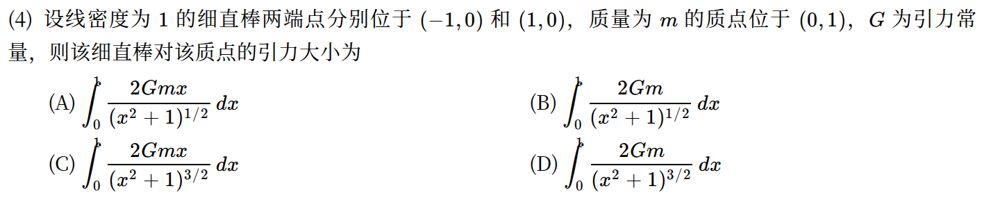

*关联章节：[定积分、变上限积分与积分性质](11-definite-integrals.md)*

---

### 02 · 2026-20 · 解答题

> 拐点与旋转体体积综合大题。先求二阶导求出拐点坐标，无界区域绕  轴旋转体积按广义积分做，切忌把线段  产生的圆锥体积漏掉。

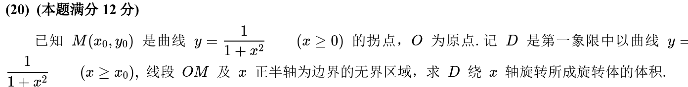

*关联章节：[凹凸性与拐点](07-convexity.md) · [反常积分](12-improper-integrals.md)*

---

## 2025年

### 03 · 2025-06 · 选择题

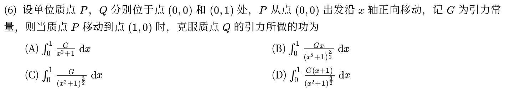

---

## 2024年

### 04 · 2024-15 · 填空题

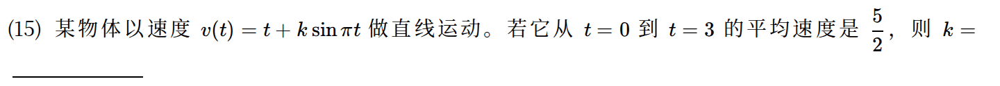

---

### 05 · 2024-19 · 解答题

> 定积分求体积极值。先用旋转体体积公式写出关于截距  的函数 ，再对  求导找极大值点，几何计算和导数极值两段都很规整。

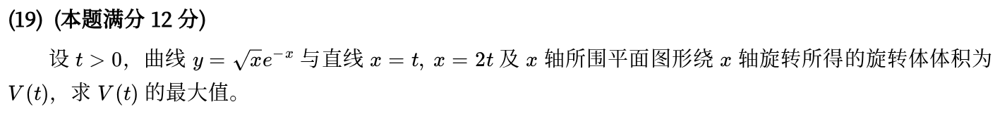

*关联章节：[单调性、极值与零点个数](06-monotonicity-extrema.md)*

---

## 2023年

### 06 · 2023-12 · 填空题

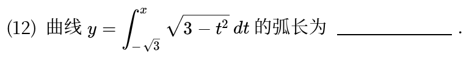

*关联章节：[定积分、变上限积分与积分性质](11-definite-integrals.md)*

---

### 07 · 2023-19 · 解答题

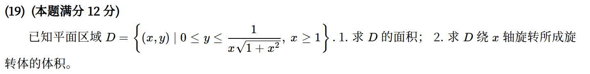

*关联章节：[反常积分](12-improper-integrals.md)*

---

## 2022年

### 08 · 2022-15 · 填空题

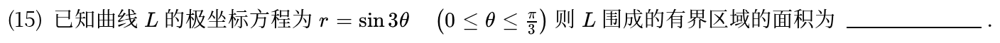

---

## 2021年

### 09 · 2021-19 · 解答题

> 积分与弧长综合大题。两端同时求导解出 ，套用直角坐标弧长积分公式 ，根号下正好能配成完全平方直接开方。

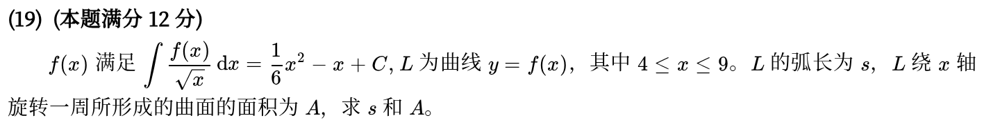

*关联章节：[不定积分与原函数](10-antiderivatives.md)*

---

## 2020年

### 10 · 2020-12 · 填空题

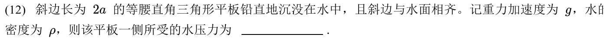

---

### 11 · 2020-18 · 解答题

> 函数方程与旋转体体积。方程里把  换成  联立解出 ，求体积时注意积分变量选择，选好绕  轴还是  轴算壳层微元。

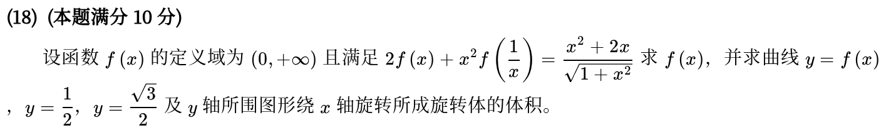

*关联章节：[函数极限与无穷小](01-limits.md)*

---

## 2019年

### 12 · 2019-12 · 填空题

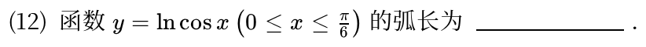

---

### 13 · 2019-19 · 解答题

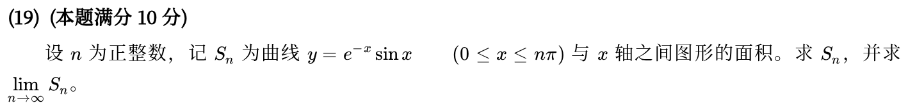

*关联章节：[数列极限与求和极限](02-sequences.md) · [反常积分](12-improper-integrals.md)*

---

## 2018年

### 14 · 2018-20 · 解答题

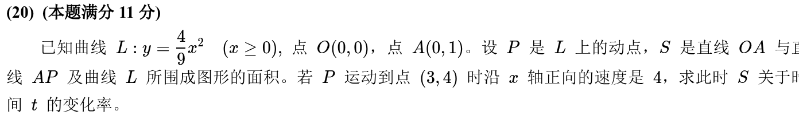

*关联章节：[导数、微分与求导法则](04-derivatives.md)*

---

## 2017年

### 15 · 2017-06 · 选择题

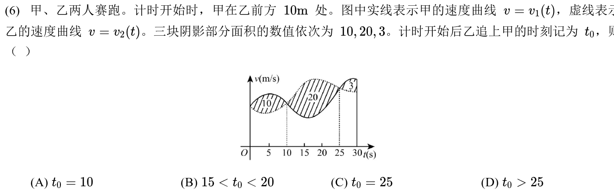

---

## 2016年

### 16 · 2016-20 · 解答题

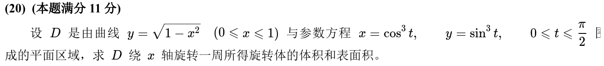

---

## 2015年

### 17 · 2015-16 · 解答题

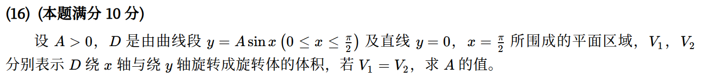

---

## 2014年

### 18 · 2014-13 · 填空题

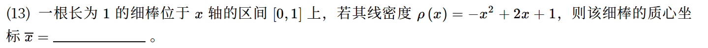

---

### 19 · 2014-21 · 解答题

> 偏导与旋转体积大题。对偏导对  积分恢复出含有未知函数  的表达式，代入条件定出 ，再画草图看清旋转中心是 。

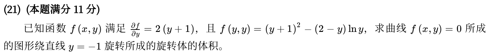

*关联章节：[多元函数极限、偏导与全微分](16-multivariable-basics.md)*

---

## 2013年

### 20 · 2013-11 · 填空题

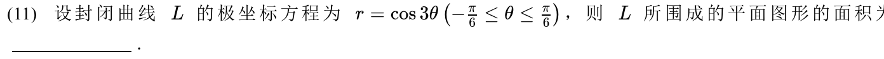

---

### 21 · 2013-16 · 解答题

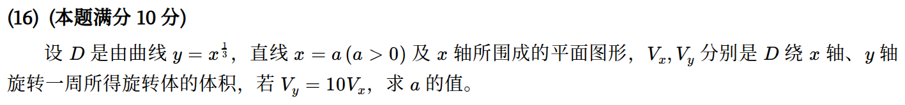

---

### 22 · 2013-21 · 解答题

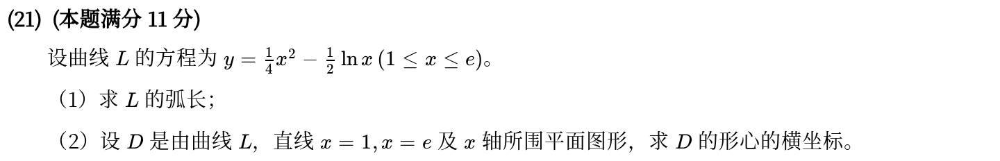

---

## 2012年

### 23 · 2012-17 · 解答题

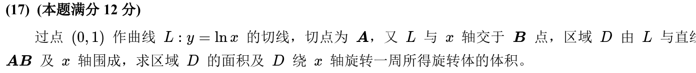

*关联章节：[切线、法线、渐近线与曲率](09-curve-geometry.md)*

---

## 2011年

### 24 · 2011-11 · 填空题

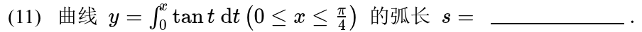

---

### 25 · 2011-20 · 解答题

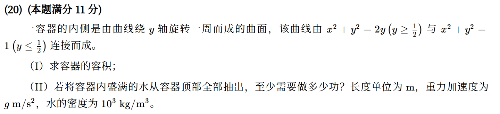

---

## 2010年

### 26 · 2010-12 · 填空题

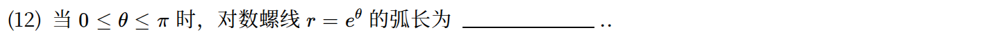

---

### 27 · 2010-18 · 解答题

> 柱体贮油罐质量物理题。横截面是椭圆，油罐平放时积分变量沿高度积，微元面积是一块椭圆弦长弓形，利用椭圆对称性化简积分。

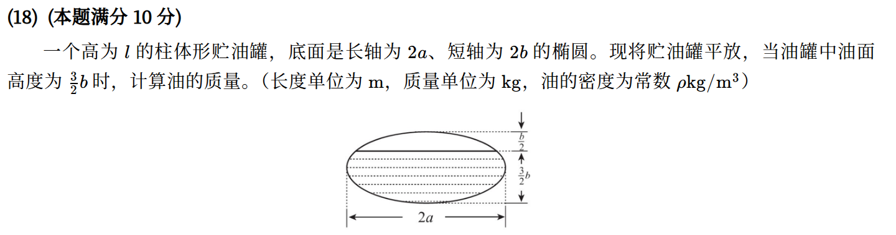

---

## 交叉考点索引

以下题目主归其他章节，点击跳转到对应章节题目；不计入本章主收录题数：

- [2022年 · 第18题](14-first-order-ode.md)（主章节：一阶微分方程）
- [2020年 · 第21题](14-first-order-ode.md)（主章节：一阶微分方程）
- [2019年 · 第17题](14-first-order-ode.md)（主章节：一阶微分方程）
- [2014年 · 第20题](02-sequences.md)（主章节：数列极限与求和极限）

[« 反常积分](12-improper-integrals.md)　　[一阶微分方程 »](14-first-order-ode.md)
