[« 反常积分](12-improper-integrals.md)　　[一阶微分方程 »](14-first-order-ode.md)

# 高等数学 · 定积分应用

> **本章共 27 题**
> 
> - **核心必做（建议按顺序攻克关键方法）**：  
>   [第 21 题](#q21)（分清两种旋转轴） → [第 12 题](#q12)（弧长列式） → [第 08 题](#q08)（极坐标面积） → [第 18 题](#q18)（质心的加权积分） → [第 01 题](#q01)（引力的方向分量） → [第 05 题](#q05)（旋转体体积再求最值）
> 
> - **分流与刷题建议**：  
>   - **较难挑战**：[第 09 题](#q09)（弧长与旋转曲面面积）  
>   - **重在看思路**：[第 25 题](#q25)（抽水做功按高度切片建模）  
>   - **首轮可跳过**：[第 11 题](#q11)、[第 13 题](#q13)、[第 16 题](#q16)、[第 19 题](#q19)、[第 22 题](#q22)、[第 23 题](#q23)、[第 27 题](#q27)（技巧较偏或综合度高，首轮不必死磕）  
> 
> - **过关目标**：先画图、列微元；面积、体积、曲面面积不能混用公式。

---

### 01 · 2026年

> *排在前面的物理题。别被物理名词吓退，建立直角坐标系，利用对称性可知水平分力对消为 0，写出微元 $dF_y$ 直接算定积分。*

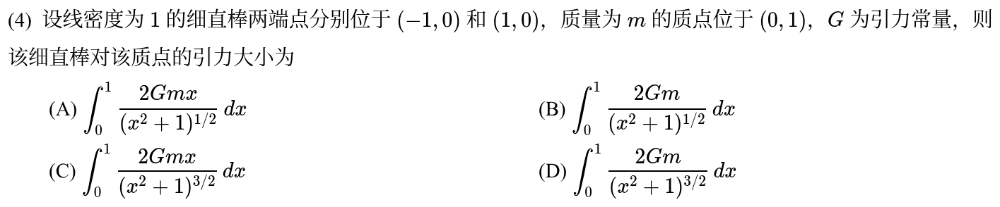

答案与解析

1. 在细棒上取微元 $[x, x+\mathrm{d}x]$（$x\in[-1,1]$），微元质量 $\mathrm{d}m = 1\cdot\mathrm{d}x$，到质点 $(0,1)$ 的距离 $r = \sqrt{x^2+1}$。
2. 引力微元大小 $\mathrm{d}F = \frac{Gm\,\mathrm{d}x}{x^2+1}$。
3. **矢量投影**：由细棒关于 $y$ 轴对称，水平分量 $F_x = 0$；竖直向下分量需乘夹角余弦 $\cos\theta = \frac{1}{\sqrt{x^2+1}}$（注意不是 $\frac{x}{\sqrt{x^2+1}}$！），故
   $$\mathrm{d}F_y = \frac{Gm\,\mathrm{d}x}{x^2+1}\cdot\frac{1}{\sqrt{x^2+1}} = \frac{Gm}{(x^2+1)^{3/2}}\,\mathrm{d}x.$$
4. 利用偶函数对称性：$F = \int_{-1}^{1} \frac{Gm}{(x^2+1)^{3/2}}\,\mathrm{d}x = \int_0^1 \frac{2Gm}{(x^2+1)^{3/2}}\,\mathrm{d}x$。
5. 答案：**（D）**。（干扰项（C）错把竖直投影余弦写成了水平投影正弦 $\frac{x}{\sqrt{x^2+1}}$；（A）（B）分母幂次错。）

---

### 02 · 2026年

> *拐点与旋转体体积综合大题。先求二阶导求出拐点坐标，无界区域绕 $x$ 轴旋转体积按广义积分做，切忌把线段 $OM$ 产生的圆锥体积漏掉。*

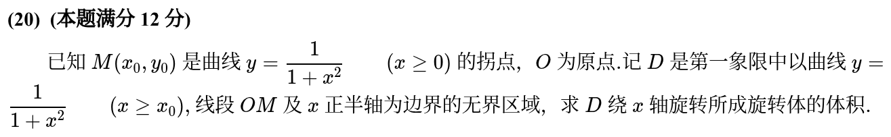

答案与解析

**答案 $\dfrac{\pi^2}{6}-\dfrac{\sqrt3\pi}{16}$。** 由 $y''=2(3x^2-1)/(1+x^2)^3$ 变号，得 $x_0=1/\sqrt3$、$y_0=3/4$。在 $[0,x_0]$ 上旋转的是线段 $OM$ 下方区域，体积为 $\pi x_0y_0^2/3=\sqrt3\pi/16$。在 $[x_0,\infty)$ 上则是曲线下方，体积为
$$
\pi\int_{1/\sqrt3}^{\infty}\frac{dx}{(1+x^2)^2}
=\pi\left[\frac{x}{2(1+x^2)}+\frac12\arctan x\right]_{1/\sqrt3}^{\infty}
=\frac{\pi^2}{6}-\frac{\sqrt3\pi}{8}.
$$
两部分相加即得。

---

### 03 · 2025年

答案与解析

**答案 B。** 引力大小为 $G/(1+x^2)$，在运动方向上的投影为 $-Gx/(1+x^2)^{3/2}$。克服引力做功取其相反数积分，得 $G(1-1/\sqrt2)$。竖直分量与位移垂直，不做功。

---

### 04 · 2024年

答案与解析

**答案 $\tfrac{3\pi}{2}$。** 平均速度是位移除以时间，故 $\tfrac13\int_0^3(t+k\sin\pi t)\,dt=\tfrac32+\tfrac{2k}{3\pi}=\tfrac52$，解得结果。

---

### 05 · 2024年

> *定积分求体积极值。先用旋转体体积公式写出关于截距 $t$ 的函数 $V(t)$，再对 $t$ 求导找极大值点，几何计算和导数极值两段都很规整。*

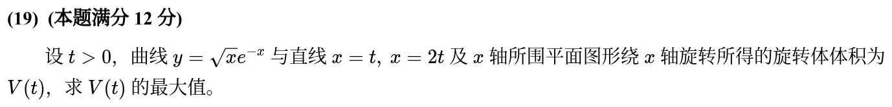

答案与解析

**触发条件与第一步落笔**

- **触发条件**：$t > 0$，积分上下限均为 $t$ 的函数（$[t, 2t]$），目标是求旋转体体积 $V(t)$ 的最大值。
- **第一步怎么落笔**：写出绕 $x$ 轴旋转的体积变限积分表达式，**直接对 $t$ 求导**。

**完整推演**

1. **列出 $V(t)$ 的变限积分表达式**：
   对 $x \in [t, 2t]$（$t > 0$），$y = \sqrt{x}e^{-x} > 0$，绕 $x$ 轴旋转的体积为
   $$V(t) = \pi \int_t^{2t} \left(\sqrt{x}e^{-x}\right)^2\,\mathrm{d}x = \pi \int_t^{2t} x e^{-2x}\,\mathrm{d}x, \qquad t > 0.$$

2. **变限积分求导，确定唯一最大值点**：
   $$V'(t) = \pi \Big[ (2t)e^{-4t} \cdot (2t)' - t e^{-2t} \cdot (t)' \Big] = \pi \left(4t e^{-4t} - t e^{-2t}\right) = \pi t e^{-4t} \left(4 - e^{2t}\right).$$
   因为 $t > 0$ 时 $\pi t e^{-4t} > 0$，所以 $V'(t)$ 的符号完全由 $4 - e^{2t}$ 决定：
   - 令 $V'(t) = 0 \implies e^{2t} = 4 \implies t = \ln 2$；
   - 当 $0 < t < \ln 2$ 时，$e^{2t} < 4 \implies V'(t) > 0$，$V(t)$ 严格单调递增；
   - 当 $t > \ln 2$ 时，$e^{2t} > 4 \implies V'(t) < 0$，$V(t)$ 严格单调递减。
   因此 $t = \ln 2$ 是 $V(t)$ 在 $(0, +\infty)$ 上的**唯一极大值点，也是全局最大值点**。

3. **代入 $t = \ln 2$ 计算最大值 $V(\ln 2)$**：
   先用分部积分求原函数：
   $$\int x e^{-2x}\,\mathrm{d}x = -\frac{1}{2}\int x\,\mathrm{d}(e^{-2x}) = -\frac{1}{2}x e^{-2x} + \frac{1}{2}\int e^{-2x}\,\mathrm{d}x = -\frac{2x+1}{4}e^{-2x} + C.$$
   将上下限 $x = \ln 2$（此时 $e^{-2x} = e^{-2\ln 2} = \frac{1}{4}$）与 $x = 2\ln 2$（此时 $e^{-2x} = e^{-4\ln 2} = \frac{1}{16}$）代入：
   $$V(\ln 2) = \pi \left[-\frac{2x+1}{4}e^{-2x}\right]_{\ln 2}^{2\ln 2} = \pi \left(\frac{2\ln 2 + 1}{4}\cdot\frac{1}{4} - \frac{4\ln 2 + 1}{4}\cdot\frac{1}{16}\right)$$
   $$= \frac{\pi}{64}\Big(4(2\ln 2 + 1) - (4\ln 2 + 1)\Big) = \frac{\pi(4\ln 2 + 3)}{64}.$$

---

### 06 · 2023年

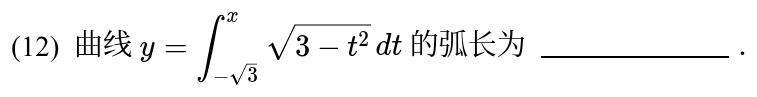

答案与解析

**答案 $\sqrt3+4\pi/3$。** 自然定义域为 $[-\sqrt3,\sqrt3]$。由微积分基本定理 $y'=\sqrt{3-x^2}$，弧长为 $\int_{-\sqrt3}^{\sqrt3}\sqrt{4-x^2}\,dx$。用原函数 $x\sqrt{4-x^2}/2+2\arcsin(x/2)$ 代上下限即得。

---

### 07 · 2023年

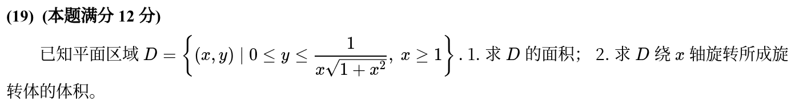

答案与解析

**解。** （1）面积换元 $u=1/x$，得 $\int_1^\infty dx/[x\sqrt{1+x^2}]=\int_0^1du/\sqrt{1+u^2}=\ln(1+\sqrt2)$。

（2）圆盘法给 $V=\pi\int_1^\infty dx/[x^2(1+x^2)]$。拆成 $1/x^2-1/(1+x^2)$，得 $V=\pi(1-\pi/4)$。体积积分取半径平方。

---

### 08 · 2022年

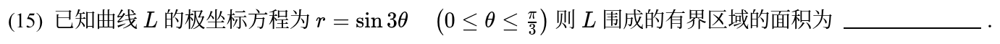

答案与解析

**触发条件与第一步落笔**

- **触发条件**：极坐标方程 $r = \sin 3\theta$，给定角度范围 $0 \le \theta \le \frac{\pi}{3}$。
- **第一步怎么落笔**：先检查 $3\theta \in [0, \pi]$ 时 $\sin 3\theta \ge 0$，且 $\theta=0$ 与 $\theta=\frac{\pi}{3}$ 处 $r=0$，说明曲线恰好围成一个完整的封闭叶形区域（三叶玫瑰线的一叶），无重叠，直接套极坐标面积公式。

**完整推演**

$$S = \frac{1}{2}\int_0^{\frac{\pi}{3}} r^2(\theta)\,\mathrm{d}\theta = \frac{1}{2}\int_0^{\frac{\pi}{3}} \sin^2(3\theta)\,\mathrm{d}\theta.$$
利用降幂公式 $\sin^2(3\theta) = \frac{1 - \cos 6\theta}{2}$：
$$S = \frac{1}{4}\int_0^{\frac{\pi}{3}} (1 - \cos 6\theta)\,\mathrm{d}\theta = \frac{1}{4}\left[\theta - \frac{1}{6}\sin 6\theta\right]_0^{\frac{\pi}{3}} = \frac{1}{4}\left(\frac{\pi}{3} - 0\right) = \frac{\pi}{12}.$$
（也可换元 $u = 3\theta$，利用华里士公式：$S = \frac{1}{6}\int_0^\pi \sin^2 u\,\mathrm{d}u = \frac{1}{3}\int_0^{\frac{\pi}{2}}\sin^2 u\,\mathrm{d}u = \frac{1}{3}\cdot\frac{1}{2}\cdot\frac{\pi}{2} = \frac{\pi}{12}$。）

---

### 09 · 2021年

> *积分与弧长综合大题。两端同时求导解出 $f(x)$，套用直角坐标弧长积分公式 $\sqrt{1+y'^2}$，根号下正好能配成完全平方直接开方。*

答案与解析

**解。** 求导还原 $f(x)=\sqrt x(x/3-1)$，于是 $f'(x)=(x-1)/(2\sqrt x)$，且弧长元 $\sqrt{1+(f')^2}=(x+1)/(2\sqrt x)$。所以
$$
s=\left[\frac{x^{3/2}}3+\sqrt x\right]_4^9=\frac{22}3,\qquad
A=2\pi\int_4^9 f(x)\sqrt{1+(f')^2}\,dx
=\pi\int_4^9(x/3-1)(x+1)\,dx=\frac{425\pi}9.
$$
在 $[4,9]$，$f(x)>0$，可直接作为旋转半径。

---

### 10 · 2020年

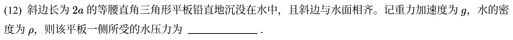

答案与解析

**答案 $\rho ga^3/3$。** 以水面以下深度 $h$ 为变量。三角形的高为 $a$，深度 $h$ 处水平宽度 $2(a-h)$。水压强为 $\rho gh$，压力为 $\int_0^a 2\rho gh(a-h)\,dh$。

---

### 11 · 2020年

> *函数方程与旋转体体积。方程里把 $x$ 换成 $1/x$ 联立解出 $f(x)$，求体积时注意积分变量选择，选好绕 $x$ 轴还是 $y$ 轴算壳层微元。*

答案与解析

**解。** 把原式的 $x$ 换成 $1/x$ 再乘 $x^2$，得到 $f(x)+2x^2 f(1/x)=(x+2x^2)/\sqrt{1+x^2}$。联立得 $f(x)=x/\sqrt{1+x^2}$。

用绕 $x$ 轴的圆柱壳。由反函数 $x=y/\sqrt{1-y^2}$，该层壳高为 $x$，半径为 $y$，所以
$$
V=2\pi\int_{1/2}^{\sqrt3/2}\frac{y^2}{\sqrt{1-y^2}}\,dy
=\pi[\arcsin y-y\sqrt{1-y^2}]_{1/2}^{\sqrt3/2}
=\frac{\pi^2}{6}.
$$

---

### 12 · 2019年

答案与解析

**触发条件与第一步落笔**

- **触发条件**：显式直角坐标曲线 $y = \ln\cos x$，$x \in \left[0, \frac{\pi}{6}\right]$，求弧长。
- **第一步怎么落笔**：求导 $y'$，代入直角坐标弧长公式 $s = \int_a^b \sqrt{1+(y')^2}\,\mathrm{d}x$。

**完整推演**

1. 求导与化简被积函数：
   $$y' = \frac{-\sin x}{\cos x} = -\tan x,$$
   $$\sqrt{1 + (y')^2} = \sqrt{1 + \tan^2 x} = \sqrt{\sec^2 x} = |\sec x|.$$
2. 核对区间符号：当 $x \in \left[0, \frac{\pi}{6}\right]$ 时，$\cos x > 0$，故 $\sec x > 0$，直接去掉绝对值得 $\sec x$。
3. 计算定积分：
   $$s = \int_0^{\frac{\pi}{6}} \sec x\,\mathrm{d}x = \Big[\ln|\sec x + \tan x|\Big]_0^{\frac{\pi}{6}} = \ln\left(\frac{2}{\sqrt{3}} + \frac{1}{\sqrt{3}}\right) - \ln(1 + 0) = \ln\sqrt{3} = \frac{1}{2}\ln 3.$$

---

### 13 · 2019年

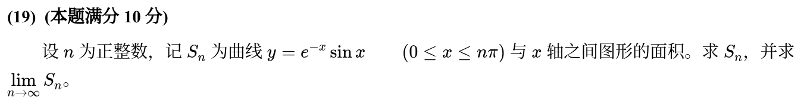

答案与解析

**答案 $S_n=\frac{(1+e^{-\pi})(1-e^{-n\pi})}{2(1-e^{-\pi})}$，极限为 $\frac{1+e^{-\pi}}{2(1-e^{-\pi})}$。** 面积对 $\sin x$ 取绝对值。每个长为 $\pi$ 的区间通过平移化成第一段的 $e^{-k\pi}$ 倍，第一段的面积由原函数 $-\frac12e^{-x}(\sin x+\cos x)$ 得 $(1+e^{-\pi})/2$，最后求等比和。

---

### 14 · 2018年

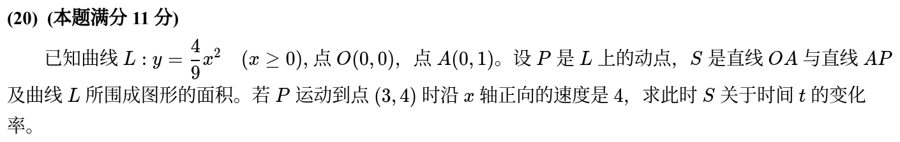

答案与解析

**答案 $10$。** 记 $P=(u,4u^2/9)$。弦 $AP$ 在抛物线上方，面积是弦下梯形减曲线下方面积，即 $S=\frac u2(1+4u^2/9)-4u^3/27=u/2+2u^3/27$。因此在 $u=3$ 时 $dS/dt=(1/2+2u^2/9)\cdot4=10$。

---

### 15 · 2017年

答案与解析

**答案 C，$t_0=25$。** 乙相对甲的位移等于 $\int_0^t(v_2-v_1)\,dt$。前 10 秒虚线在下，相对位移为 $-10$；从 10 秒到 25 秒虚线在上，净增加 20，到 25 秒恰好达到初始间距 10。中间段严格增加，因此此前没有追上。

---

### 16 · 2016年

答案与解析

**解。** 外半径为 $\sqrt{1-x^2}$，内半径为 $(1-x^{2/3})^{3/2}$，垫片法给
$$
V=\pi\int_0^1[1-x^2-(1-x^{2/3})^3]dx=18\pi/35.
$$
外表面是半径 1 的半球曲面，面积 $2\pi$。内表面用星形线参数，弧长元为 $3\sin t\cos t\,dt$，半径为 $\sin^3t$，所以内表面积为 $6\pi\int_0^{\pi/2}\sin^4t\cos t\,dt=6\pi/5$。总表面积为 $16\pi/5$。

---

### 17 · 2015年

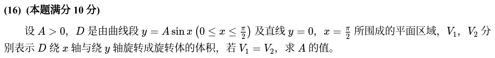

答案与解析

**答案 $A=8/\pi$。** 绕横轴用圆盘法，$V_1=\pi A^2\int_0^{\pi/2}\sin^2x\,dx=\pi^2A^2/4$。绕纵轴用圆柱壳，$V_2=2\pi A\int_0^{\pi/2}x\sin x\,dx=2\pi A$。由 $A>0$ 和两体积相等解出结果。

---

### 18 · 2014年

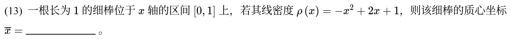

答案与解析

1. 线密度质心公式：$\bar{x} = \frac{\int_0^1 x\rho(x)\,\mathrm{d}x}{\int_0^1 \rho(x)\,\mathrm{d}x}$。
2. 总质量 $M = \int_0^1 (-x^2 + 2x + 1)\,\mathrm{d}x = -\frac{1}{3} + 1 + 1 = \frac{5}{3}$。
3. 静力矩 $M_y = \int_0^1 (-x^3 + 2x^2 + x)\,\mathrm{d}x = -\frac{1}{4} + \frac{2}{3} + \frac{1}{2} = \frac{11}{12}$。
4. 质心坐标：$\bar{x} = \frac{11/12}{5/3} = \frac{11}{20}$。

---

### 19 · 2014年

> *偏导与旋转体积大题。对偏导对 $y$ 积分恢复出含有未知函数 $C(x)$ 的表达式，代入条件定出 $f(x,y)$，再画草图看清旋转中心是 $y=-1$。*

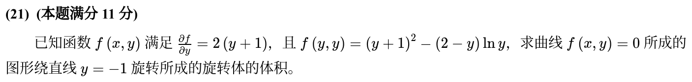

答案与解析

**答案 $\pi(2\ln2-5/4)$。** 沿 $y$ 积分得 $f=(y+1)^2+C(x)$，对角条件给 $C(x)=-(2-x)\ln x$。封闭区域在 $1\le x\le2$，围绕轴 $y=-1$ 的圆盘半径平方为 $(2-x)\ln x$，故
$$
V=\pi\int_1^2(2-x)\ln x\,dx
=\pi\left[(2x-x^2/2)\ln x-2x+x^2/4\right]_1^2.
$$

---

### 20 · 2013年

答案与解析

**答案 $\pi/12$。** 极坐标面积为 $\frac12\int_{-\pi/6}^{\pi/6}\cos^2(3\theta)d\theta$。降幂后常数项给 $\pi/12$，余弦项端点相消。

---

### 21 · 2013年

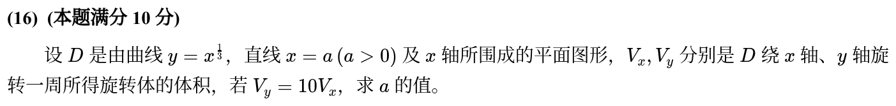

答案与解析

**触发条件与第一步落笔**

- **触发条件**：曲边三角形 $D = \{(x,y)\mid 0 \le x \le a,\ 0 \le y \le x^{1/3}\}$（$a>0$），同时求 $V_x$ 和 $V_y$ 并通过 $V_y = 10 V_x$ 反求参数 $a$。
- **第一步怎么落笔**：确定积分区间 $[0,a]$，写出 $V_x$（圆盘法）与 $V_y$（柱壳法）两个积分表达式。

**完整推演**

1. **求绕 $x$ 轴旋转体积 $V_x$（圆盘法）**：
   $$V_x = \pi \int_0^a \left(x^{\frac{1}{3}}\right)^2 \,\mathrm{d}x = \pi \int_0^a x^{\frac{2}{3}}\,\mathrm{d}x = \pi \left[\frac{3}{5} x^{\frac{5}{3}}\right]_0^a = \frac{3\pi}{5} a^{\frac{5}{3}}.$$

2. **求绕 $y$ 轴旋转体积 $V_y$（柱壳法）**：
   $$V_y = 2\pi \int_0^a x \cdot x^{\frac{1}{3}}\,\mathrm{d}x = 2\pi \int_0^a x^{\frac{4}{3}}\,\mathrm{d}x = 2\pi \left[\frac{3}{7} x^{\frac{7}{3}}\right]_0^a = \frac{6\pi}{7} a^{\frac{7}{3}}.$$
   （用圆环法交叉验算：曲线 $x = y^3$，$y \in [0, a^{1/3}]$，外半径 $a$，内半径 $y^3$，则
   $V_y = \pi \int_0^{a^{1/3}} (a^2 - y^6)\,\mathrm{d}y = \pi\left[a^2 y - \frac{1}{7}y^7\right]_0^{a^{1/3}} = \pi\left(a^{\frac{7}{3}} - \frac{1}{7}a^{\frac{7}{3}}\right) = \frac{6\pi}{7}a^{\frac{7}{3}}$，完全一致。）

3. **由 $V_y = 10 V_x$ 解出 $a$**：
   $$\frac{6\pi}{7} a^{\frac{7}{3}} = 10 \cdot \frac{3\pi}{5} a^{\frac{5}{3}} = 6\pi a^{\frac{5}{3}}.$$
   因为 $a > 0$，两边同除以 $6\pi a^{\frac{5}{3}}$ 得
   $$\frac{1}{7} a^{\frac{2}{3}} = 1 \implies a^{\frac{2}{3}} = 7 \implies a = 7^{\frac{3}{2}} = 7\sqrt{7}.$$

---

### 22 · 2013年

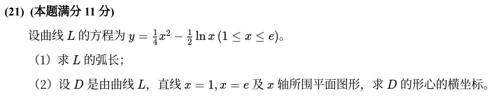

答案与解析

**解。** （1）$y'=(x-1/x)/2$，因此 $\sqrt{1+(y')^2}=(x+1/x)/2$，弧长为 $(e^2+1)/4$。

（2）曲线在区间内为正。形心横坐标是 $\bar x=\int_1^e xy\,dx/\int_1^e y\,dx$。分部积分得分母 $(e^3-7)/12$，分子 $(e^4-2e^2-3)/16$，所以
$$
\bar x=\frac{3(e^4-2e^2-3)}{4(e^3-7)}.
$$

---

### 23 · 2012年

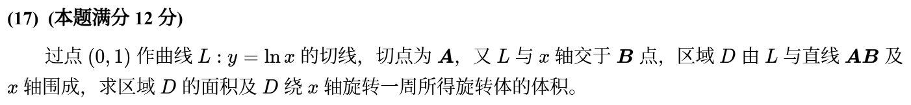

答案与解析

**解。** 切点横坐标 $u$ 满足纵截距 $\ln u-1=1$，所以 $A=(e^2,2)$；$B=(1,0)$。在 $[1,e^2]$ 上，$\ln x$ 在弦 $\ell(x)=2(x-1)/(e^2-1)$ 上方。
$$
S=\int_1^{e^2}(\ln x-\ell(x))\,dx=(e^2+1)-(e^2-1)=2.
$$
垫片法给 $V=\pi\int_1^{e^2}[(\ln x)^2-\ell(x)^2]\,dx$。两项分别为 $2(e^2-1)$ 和 $4(e^2-1)/3$，所以 $V=2\pi(e^2-1)/3$。

---

### 24 · 2011年

答案与解析

**答案 $\ln(1+\sqrt2)$。** $y'=\tan x$，弧长元为 $\sec x$，在给定区间余弦为正。用原函数 $\ln(\sec x+\tan x)$ 代端点。

---

### 25 · 2011年

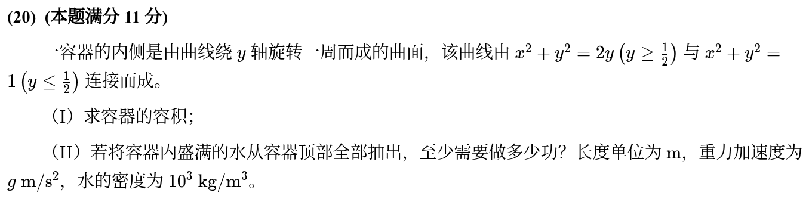

答案与解析

**解。** 底部为 $y=-1$，顶部为 $y=2$。水平横截面是圆盘，半径平方在 $[-1,1/2]$ 为 $1-y^2$，在 $[1/2,2]$ 为 $2y-y^2$，因此
$$
V=\pi\left[\int_{-1}^{1/2}(1-y^2)dy+\int_{1/2}^2(2y-y^2)dy\right]=\frac{9\pi}{4}.
$$
每层水至少提升 $2-y$，故最小做功是在上述两项被积式中分别乘 $2-y$，再乘密度和重力加速度。计算得 $W=10^3g\pi\cdot27/8=3375\pi g$ 焦耳。

---

### 26 · 2010年

答案与解析

**答案 $\sqrt2(e^\pi-1)$。** 极坐标弧长元为 $\sqrt{r^2+(dr/d\theta)^2}\,d\theta=\sqrt2e^\theta\,d\theta$，从 0 积到 $\pi$。

---

### 27 · 2010年

> *柱体贮油罐质量物理题。横截面是椭圆，油罐平放时积分变量沿高度积，微元面积是一块椭圆弦长弓形，利用椭圆对称性化简积分。*

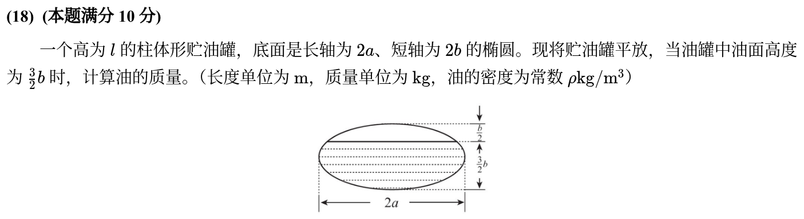

答案与解析

**解。** 题图中短轴竖直，截面椭圆写成 $x^2/a^2+y^2/b^2=1$。底部 $y=-b$，油面为 $y=b/2$。深度方向积分截面宽度，再乘罐长与密度：
$$
m=2a\rho l\int_{-b}^{b/2}\sqrt{1-y^2/b^2}\,dy
=ab\rho l\left(\frac{2\pi}{3}+\frac{\sqrt3}{4}\right).
$$
最后一步用 $y=b\sin t$。

---

[« 反常积分](12-improper-integrals.md)　　[一阶微分方程 »](14-first-order-ode.md)
