[« 定积分应用](13-integral-applications.md)　　[高阶微分方程 »](15-higher-order-ode.md)

# 高等数学 · 一阶微分方程

> 2010—2026年 · 16 道完整真题 · 年份从新到旧（2026→2010）  
> 题型分布：选择题 1 题 · 填空题 5 题 · 解答题 10 题  
> 考查范围：可分离变量、线性及变量代换、初值问题与几何物理建模

---

## 2025年

### 01 · 2025-15 · 填空题

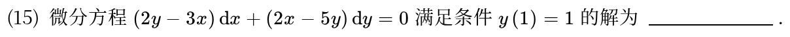

---

## 2024年

### 02 · 2024-13 · 填空题

> 变量代换型微分方程。看到  捆在一起，果断设新变量 ，方程立刻化成分离变量方程，千万别直接硬解。

*关联章节：[多元复合函数与隐函数求导](17-chain-implicit.md)*

---

## 2023年

### 03 · 2023-17 · 解答题

> 切线与微分方程综合大题。根据切线法线斜率列出一阶线性方程求出曲线，第二问求极值严格按导数符号讨论。

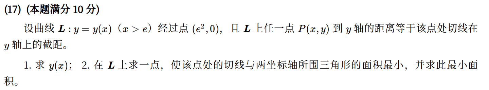

*关联章节：[单调性、极值与零点个数](06-monotonicity-extrema.md) · [切线、法线、渐近线与曲率](09-curve-geometry.md)*

---

## 2022年

### 04 · 2022-18 · 解答题

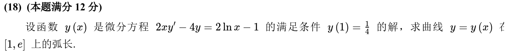

*关联章节：[定积分应用](13-integral-applications.md)*

---

## 2021年

### 05 · 2021-20 · 解答题

> 一阶线性方程与法线截距。第一问套公式求通解；第二问写出法线方程令  得到截距函数 ，求导求最小值即可。

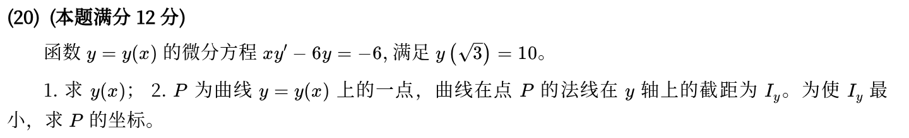

*关联章节：[切线、法线、渐近线与曲率](09-curve-geometry.md) · [单调性、极值与零点个数](06-monotonicity-extrema.md)*

---

## 2020年

### 06 · 2020-21 · 解答题

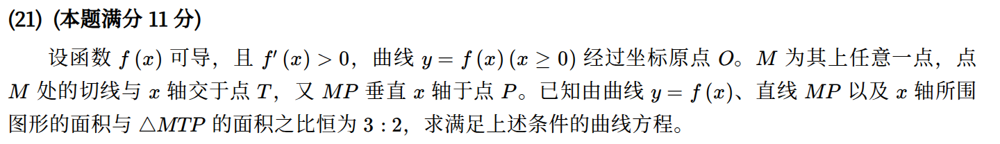

*关联章节：[定积分应用](13-integral-applications.md) · [切线、法线、渐近线与曲率](09-curve-geometry.md)*

---

## 2019年

### 07 · 2019-17 · 解答题

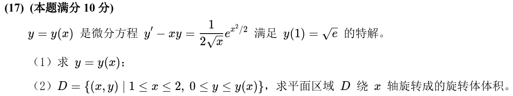

*关联章节：[定积分应用](13-integral-applications.md)*

---

## 2018年

### 08 · 2018-16 · 解答题

> 积分方程求导题。第二项积分做变量代换  剥离外层 ，两端同时求导脱去变限积分符号，转化成一阶线性微分方程。

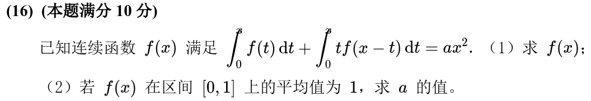

*关联章节：[定积分、变上限积分与积分性质](11-definite-integrals.md)*

---

## 2017年

### 09 · 2017-21 · 解答题

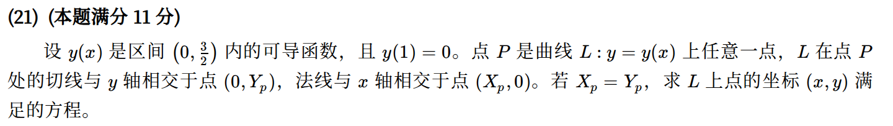

*关联章节：[切线、法线、渐近线与曲率](09-curve-geometry.md)*

---

## 2016年

### 10 · 2016-11 · 填空题

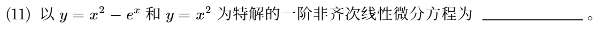

---

## 2015年

### 11 · 2015-20 · 解答题

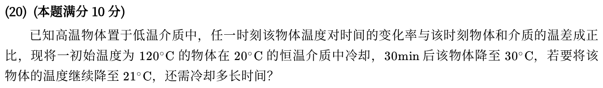

---

## 2014年

### 12 · 2014-16 · 解答题

*关联章节：[单调性、极值与零点个数](06-monotonicity-extrema.md)*

---

## 2012年

### 13 · 2012-12 · 填空题

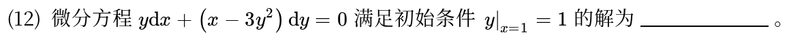

---

## 2011年

### 14 · 2011-10 · 填空题

---

### 15 · 2011-18 · 解答题

> 别被倾角唬住，，两边求导就是 。令  当一阶方程算。

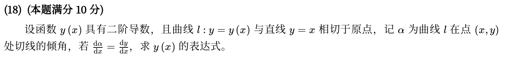

*关联章节：[切线、法线、渐近线与曲率](09-curve-geometry.md)*

---

## 2010年

### 16 · 2010-02 · 选择题

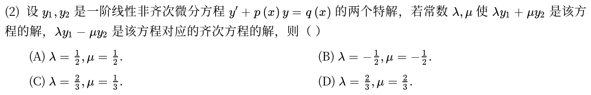

---

## 交叉考点索引

以下题目主归其他章节，点击跳转到对应章节题目；不计入本章主收录题数：

- [2026年 · 第21题](15-higher-order-ode.md)（主章节：高阶微分方程）
- [2016年 · 第12题](08-taylor.md)（主章节：泰勒公式与高阶导数）
- [2010年 · 第17题](15-higher-order-ode.md)（主章节：高阶微分方程）

[« 定积分应用](13-integral-applications.md)　　[高阶微分方程 »](15-higher-order-ode.md)
