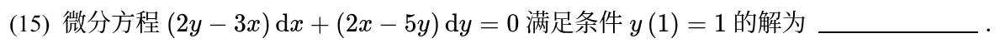
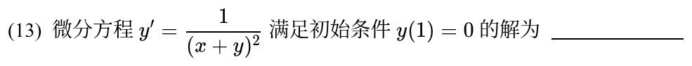
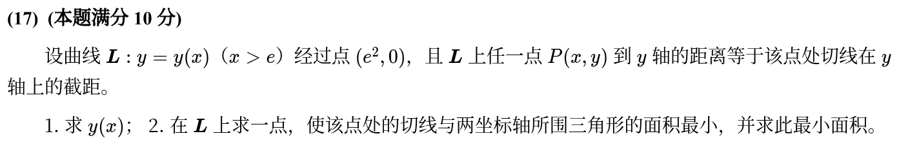
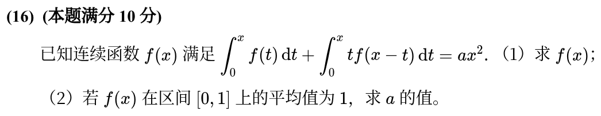
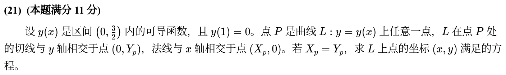
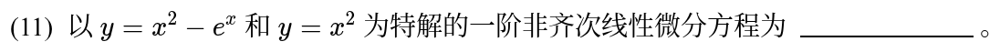
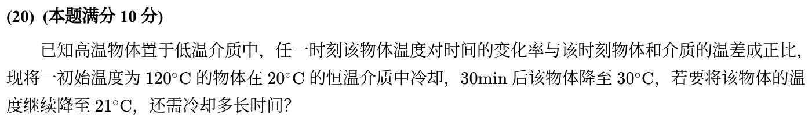
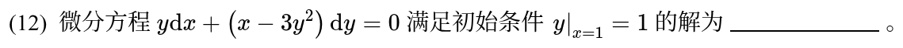

[« 定积分应用](13-integral-applications.md)　　[高阶微分方程 »](15-higher-order-ode.md)

# 高等数学 · 一阶微分方程

> **本章共 16 题**
> 
> - **核心必做（建议按顺序攻克关键方法）**：  
>   [第 14 题](#q14)（一阶线性方程） → [第 12 题](#q12)（分离变量并判极值） → [第 13 题](#q13)（改把横坐标当未知函数） → [第 02 题](#q02)（整体换元后分离变量） → [第 11 题](#q11)（冷却问题建模与初值）
> 
> - **分流与刷题建议**：  
>   - **较难挑战**：[第 03 题](#q03)（切线截距建方程再优化）  
>   - **重在看思路**：[第 08 题](#q08)（积分方程经换元求导化成微分方程）  
>   - **首轮可跳过**：[第 06 题](#q06)、[第 09 题](#q09)、[第 15 题](#q15)（技巧较偏或综合度高，首轮不必死磕）  
> 
> - **过关目标**：先识别类型再解；初值用于定常数，最后代回原方程检验。

---

### 01 · 2025年

答案与解析

**答案**：$y = \dfrac{2x + \sqrt{20 - 11x^2}}{5}$（隐式形式：$5y^2 - 4xy + 3x^2 = 4$，取过 $(1,1)$ 的支）

- **切入点与推演**：检验全微分方程条件：记 $P(x,y) = 2y - 3x$，$Q(x,y) = 2x - 5y$，有
  $$\frac{\partial P}{\partial y} = 2 = \frac{\partial Q}{\partial x},$$
  故左端为全微分，直接分组凑微分（无需用齐次方程繁琐换元）：
  $$(2y\,\mathrm{d}x + 2x\,\mathrm{d}y) - 3x\,\mathrm{d}x - 5y\,\mathrm{d}y = \mathrm{d}\!\left(2xy - \frac{3}{2}x^2 - \frac{5}{2}y^2\right) = 0.$$
  两边积分得通解 $4xy - 3x^2 - 5y^2 = C$。代入初始条件 $y(1) = 1$：
  $$4 - 3 - 5 = C \implies C = -4 \implies 5y^2 - 4xy + 3x^2 - 4 = 0.$$
  视作关于 $y$ 的一元二次方程求解：
  $$y = \frac{4x \pm \sqrt{16x^2 - 20(3x^2 - 4)}}{10} = \frac{2x \pm \sqrt{20 - 11x^2}}{5}.$$
  由 $y(1) = 1 = \dfrac{2 + 3}{5}$ 知应取正号，故所求特解为 $y = \dfrac{2x + \sqrt{20 - 11x^2}}{5}$。
- **易错点**：此题既是一阶齐次方程也是全微分方程，直接凑全微分只需两步；写成显式解时必须代入初值 $(1,1)$ 确定根号前的正负号。

---

### 02 · 2024年

> *变量代换型微分方程。看到 $x+y$ 捆在一起，果断设新变量 $u = x+y$，方程立刻化成分离变量方程，千万别直接硬解。*

答案与解析

**答案**：$y - \arctan(x+y) = -\dfrac{\pi}{4}$（等价写作 $\arctan(x+y) - y = \dfrac{\pi}{4}$）

- **切入点与推演**：方程右端仅含线性组合 $x+y$，触发整体换元 $u = x + y$，则 $y' = u' - 1$。代入原方程得：
  $$u' - 1 = \frac{1}{u^2} \implies \frac{\mathrm{d}u}{\mathrm{d}x} = \frac{u^2 + 1}{u^2}.$$
  分离变量并两边积分：
  $$\frac{u^2}{u^2 + 1}\,\mathrm{d}u = \mathrm{d}x \implies \int\left(1 - \frac{1}{u^2 + 1}\right)\mathrm{d}u = \int \mathrm{d}x \implies u - \arctan u = x + C.$$
  回代 $u = x + y$，两边消去 $x$ 得通解 $y - \arctan(x+y) = C$。
  代入初始条件 $y(1) = 0$：
  $$0 - \arctan(1 + 0) = C \implies C = -\frac{\pi}{4}.$$
  故所求特解为 $y - \arctan(x+y) = -\dfrac{\pi}{4}$。
- **易错点**：换元 $u = x+y$ 后注意 $y' = u' - 1$ 而非 $u'$；回代 $u = x+y$ 后要把等式两端的 $x$ 约掉以化到最简形式。

---

### 03 · 2023年

> *切线与微分方程综合大题。根据切线法线斜率列出一阶线性方程求出曲线，第二问求极值严格按导数符号讨论。*

答案与解析

**结论速览**：（1）$y(x) = x(2 - \ln x)$（$x > e$）；（2）切点为 $\left(e^{\frac{3}{2}}, \dfrac{1}{2}e^{\frac{3}{2}}\right)$，最小面积为 $e^3$

- **（1）求曲线方程 $y(x)$**：
  在点 $P(x, y)$（$x > e > 0$）处，曲线切线方程为 $Y - y = y'(X - x)$，令 $X = 0$ 得切线在 $y$ 轴上的截距为 $Y_0 = y - xy'$。
  点 $P$ 到 $y$ 轴的距离为 $x$（因 $x > e > 0$）。由题意得一阶线性微分方程：
  $$y - xy' = x \implies \frac{xy' - y}{x^2} = -\frac{1}{x} \implies \left(\frac{y}{x}\right)' = -\frac{1}{x}.$$
  两边积分得 $\dfrac{y}{x} = -\ln x + C \implies y = x(C - \ln x)$。
  代入曲线经过点 $(e^2, 0)$：
  $$0 = e^2(C - 2) \implies C = 2.$$
  故所求曲线方程为 $y(x) = x(2 - \ln x)$（$x > e$）。
- **（2）求使切线与两坐标轴所围三角形面积最小的点及最小面积**：
  由 $y(x) = x(2 - \ln x)$ 得 $y'(x) = 1 - \ln x$。因为 $x > e$，所以 $y'(x) = 1 - \ln x < 0$。
  点 $P(x, y)$ 处的切线方程为 $Y = (1 - \ln x)X + x$：
  - 在 $y$ 轴上的截距为 $Y_0 = x > 0$；
  - 令 $Y = 0$，得在 $x$ 轴上的截距为 $X_0 = \dfrac{x}{\ln x - 1} > 0$。
  因此切线与两坐标轴所围三角形的面积为
  $$S(x) = \frac{1}{2}X_0 Y_0 = \frac{x^2}{2(\ln x - 1)} \qquad (x > e).$$
  对 $S(x)$ 求导：
  $$S'(x) = \frac{2x(\ln x - 1) - x^2\cdot\frac{1}{x}}{2(\ln x - 1)^2} = \frac{x(2\ln x - 3)}{2(\ln x - 1)^2}.$$
  令 $S'(x) = 0$，在 $(e, +\infty)$ 内得唯一驻点 $x = e^{\frac{3}{2}}$。
  当 $e < x < e^{\frac{3}{2}}$ 时 $S'(x) < 0$；当 $x > e^{\frac{3}{2}}$ 时 $S'(x) > 0$。故 $x = e^{\frac{3}{2}}$ 是 $S(x)$ 在 $(e, +\infty)$ 上的唯一最小值点。
  此时纵坐标 $y = e^{\frac{3}{2}}\!\left(2 - \dfrac{3}{2}\right) = \dfrac{1}{2}e^{\frac{3}{2}}$，最小面积为
  $$S_{\min} = S\!\left(e^{\frac{3}{2}}\right) = \frac{e^3}{2\left(\frac{3}{2} - 1\right)} = e^3.$$
  故所求点为 $\left(e^{\frac{3}{2}}, \dfrac{1}{2}e^{\frac{3}{2}}\right)$，最小面积为 $e^3$。
- **核心思路与避坑**：第（1）问识别出 $\frac{xy'-y}{x^2} = (y/x)'$ 可免去套一阶线性通解公式；第（2）问注意利用 $x > e \implies \ln x - 1 > 0$ 确认两截距均为正，从而去掉面积绝对值。

---

### 04 · 2022年

答案与解析

**结论速览**：弧长 $s = \dfrac{e^2 + 1}{4}$

- **完整解答**：
  1. **求微分方程特解 $y(x)$**：在 $x\in[1,e]$ 上将方程化为一阶线性微分方程标准形式：
     $$y' - \frac{2}{x}y = \frac{2\ln x - 1}{2x}.$$
     求积分因子 $\mu(x) = e^{\int -\frac{2}{x}\,\mathrm{d}x} = x^{-2}$，两边同乘 $x^{-2}$：
     $$\left(\frac{y}{x^2}\right)' = \frac{\ln x}{x^3} - \frac{1}{2x^3}.$$
     两边积分（用分部积分求 $\int \dfrac{\ln x}{x^3}\,\mathrm{d}x = -\dfrac{\ln x}{2x^2} + \int \dfrac{\mathrm{d}x}{2x^3}$，恰好与 $-\dfrac{1}{2x^3}$ 抵消）：
     $$\frac{y}{x^2} = -\frac{\ln x}{2x^2} + C \implies y = Cx^2 - \frac{1}{2}\ln x.$$
     代入初值 $y(1) = \dfrac{1}{4}$，得 $C = \dfrac{1}{4}$，因此
     $$y(x) = \frac{1}{4}x^2 - \frac{1}{2}\ln x.$$
  2. **求曲线在 $[1,e]$ 上的弧长 $s$**：先求导并化简弧长元：
     $$y'(x) = \frac{1}{2}x - \frac{1}{2x} = \frac{1}{2}\left(x - \frac{1}{x}\right),$$
     $$\sqrt{1 + [y'(x)]^2} = \sqrt{1 + \frac{1}{4}\left(x^2 - 2 + \frac{1}{x^2}\right)} = \sqrt{\frac{1}{4}\left(x + \frac{1}{x}\right)^2} = \frac{1}{2}\left(x + \frac{1}{x}\right) \quad (x > 0).$$
     代入弧长公式得：
     $$s = \int_1^e \frac{1}{2}\left(x + \frac{1}{x}\right)\mathrm{d}x = \frac{1}{2}\left[\frac{x^2}{2} + \ln x\right]_1^e = \frac{1}{2}\left[\left(\frac{e^2}{2} + 1\right) - \frac{1}{2}\right] = \frac{e^2 + 1}{4}.$$
- **核心思路与避坑**：积分 $\int\left(\dfrac{\ln x}{x^3} - \dfrac{1}{2x^3}\right)\mathrm{d}x$ 时只需对第一项分部积分，第二项会自动消去，不要拆开硬算；弧长元 $\sqrt{1+\frac{1}{4}(x-\frac{1}{x})^2} = \frac{1}{2}(x+\frac{1}{x})$ 是考研高频完全平方结构。

---

### 05 · 2021年

> *一阶线性方程与法线截距。第一问套公式求通解；第二问写出法线方程令 $x=0$ 得到截距函数 $I_y(x)$，求导求最小值即可。*

答案与解析

**结论速览**：（1）$y(x) = 1 + \dfrac{1}{3}x^6$；（2）使 $I_y$ 最小的点 $P$ 为 $\left(1, \dfrac{4}{3}\right)$ 和 $\left(-1, \dfrac{4}{3}\right)$（若仅限初值所在正半轴 $x > 0$，则为 $\left(1, \dfrac{4}{3}\right)$）

- **（1）求 $y(x)$**：
  将方程改写为可分离变量形式 $xy' = 6(y - 1)$：
  $$\frac{\mathrm{d}y}{y - 1} = \frac{6}{x}\,\mathrm{d}x \implies \ln|y - 1| = 6\ln|x| + C_1 \implies y = 1 + Cx^6.$$
  代入初始条件 $y(\sqrt{3}) = 10$：
  $$1 + C(\sqrt{3})^6 = 10 \implies 1 + 27C = 10 \implies C = \frac{1}{3}.$$
  因此所求特解为 $y(x) = 1 + \dfrac{1}{3}x^6$（易验算该函数在 $(-\infty, +\infty)$ 上均满足原微分方程）。
- **（2）求使法线在 $y$ 轴上截距 $I_y$ 最小的点 $P$ 的坐标**：
  求导得 $y'(x) = 2x^5$。当 $x = 0$ 时切线水平，法线即 $y$ 轴，无唯一纵截距，故只需考虑 $x \ne 0$。
  在点 $P(x, y)$（$x \ne 0$）处，法线斜率为 $-\dfrac{1}{y'} = -\dfrac{1}{2x^5}$，法线方程为
  $$Y - y = -\frac{1}{2x^5}(X - x).$$
  令 $X = 0$，得法线在 $y$ 轴上的截距：
  $$I_y(x) = y + \frac{x}{2x^5} = 1 + \frac{1}{3}x^6 + \frac{1}{2x^4} \qquad (x \ne 0).$$
  注意 $I_y(x)$ 为偶函数，求导得：
  $$I_y'(x) = 2x^5 - \frac{2}{x^5} = \frac{2(x^{10} - 1)}{x^5}.$$
  令 $I_y'(x) = 0$ 得两个驻点 $x = 1$ 与 $x = -1$：
  - 当 $x \in (-\infty, -1)$ 时 $I_y'(x) < 0$，当 $x \in (-1, 0)$ 时 $I_y'(x) > 0$，故 $x = -1$ 为 $(-\infty, 0)$ 上的唯一最小值点；
  - 当 $x \in (0, 1)$ 时 $I_y'(x) < 0$，当 $x \in (1, +\infty)$ 时 $I_y'(x) > 0$，故 $x = 1$ 为 $(0, +\infty)$ 上的唯一最小值点。
  （也可用均值不等式直接秒判：$\frac{1}{3}x^6 + \frac{1}{2x^4} = \frac{1}{6}x^6 + \frac{1}{6}x^6 + \frac{1}{6x^4} + \frac{1}{6x^4} + \frac{1}{6x^4} \ge 5\cdot\frac{1}{6} = \frac{5}{6}$，等号成立当且仅当 $x^6 = x^{-4} \iff x = \pm 1$。）
  代入 $y(x)$ 得 $y(\pm 1) = \dfrac{4}{3}$。故所求点 $P$ 的坐标为 $\left(1, \dfrac{4}{3}\right)$ 和 $\left(-1, \dfrac{4}{3}\right)$。
- **核心思路与避坑**：本题最大易错点是漏掉对称点 $\left(-1, \dfrac{4}{3}\right)$！因为 $y = 1 + \frac{1}{3}x^6$ 与 $I_y(x) = 1 + \frac{1}{3}x^6 + \frac{1}{2x^4}$ 均为偶函数，方程 $x^{10} = 1$ 有两个实根 $x = \pm 1$（若题设限定在初值所在的极大区间 $x>0$ 则仅取 $(1, \frac{4}{3})$，但真题标准答案两对称点均计入）。

---

### 06 · 2020年

答案与解析

**结论速览**：曲线方程为 $y = Cx^3$（$x \ge 0$，$C > 0$ 为任意正实数）

- **完整解答**：
  1. **根据几何面积比建立微分方程**：
     因为 $f(0) = 0$ 且 $f'(x) > 0$，所以当 $x > 0$ 时 $f(x) > 0$。
     设曲线上任一点 $M(x, f(x))$（$x > 0$），过 $M$ 的切线方程为
     $$Y - f(x) = f'(x)(X - x).$$
     令 $Y = 0$ 得切线与 $x$ 轴交点 $T$ 的横坐标为 $x_T = x - \dfrac{f(x)}{f'(x)}$，因此 $|TP| = x - x_T = \dfrac{f(x)}{f'(x)} > 0$。
     - 曲边三角形面积：$S_1 = \displaystyle\int_0^x f(t)\,\mathrm{d}t$；
     - 直角三角形 $\triangle MTP$ 面积：$S_2 = \dfrac{1}{2}|TP|\cdot |MP| = \dfrac{[f(x)]^2}{2f'(x)}$。
     由题意 $S_1 : S_2 = 3 : 2$，得
     $$2\int_0^x f(t)\,\mathrm{d}t = \frac{3[f(x)]^2}{2f'(x)} \implies 4 f'(x)\int_0^x f(t)\,\mathrm{d}t = 3[f(x)]^2.$$
  2. **引入原函数降阶求解**：
     记 $F(x) = \displaystyle\int_0^x f(t)\,\mathrm{d}t$，则 $F(0) = 0$，$F'(x) = f(x) > 0$，$F''(x) = f'(x) > 0$（$x > 0$），方程化为
     $$4 F(x) F''(x) = 3 [F'(x)]^2 \implies \frac{F''(x)}{F'(x)} = \frac{3}{4}\cdot\frac{F'(x)}{F(x)}.$$
     两边关于 $x$ 积分得
     $$\ln F'(x) = \frac{3}{4}\ln F(x) + C_1 \implies F'(x) = k\,[F(x)]^{\frac{3}{4}} \quad (k = e^{C_1} > 0).$$
     再次分离变量并积分：
     $$[F(x)]^{-\frac{3}{4}}\,\mathrm{d}F = k\,\mathrm{d}x \implies 4[F(x)]^{\frac{1}{4}} = kx + C_2.$$
     由 $F(0) = 0$ 得 $C_2 = 0$，于是 $F(x) = \left(\dfrac{k}{4}\right)^4 x^4$。求导即得
     $$f(x) = F'(x) = Cx^3 \quad (x \ge 0,\ C > 0).$$
     （注：直接验算知 $S_1 = \frac{1}{4}Cx^4$，$S_2 = \frac{1}{6}Cx^4$，$S_1:S_2 = 3:2$；在 $x>0$ 上严格满足 $f'(x) = 3Cx^2 > 0$。）
- **核心思路与避坑**：方程同时含 $\int_0^x f(t)\,\mathrm{d}t$、$f(x)$ 与 $f'(x)$ 时，不要直接对积分方程再求导（那样会出现 $f''$ 更难处理），而是设 $F(x)=\int_0^x f(t)\,\mathrm{d}t$ 化为二阶齐次型 $4FF'' = 3(F')^2$，再利用对数导数 $\frac{F''}{F'} = \frac{3}{4}\frac{F'}{F}$ 一次降阶；最后勿忘标明参数 $C > 0$。

---

### 07 · 2019年

答案与解析

**结论速览**：（1）$y(x) = \sqrt{x}\,e^{\frac{x^2}{2}}$；（2）旋转体体积 $V = \dfrac{\pi}{2}(e^4 - e)$

- **（1）求特解 $y = y(x)$**：
  原方程 $y' - xy = \dfrac{1}{2\sqrt{x}}e^{\frac{x^2}{2}}$（$x > 0$）为一阶线性微分方程，积分因子为 $\mu(x) = e^{\int (-x)\,\mathrm{d}x} = e^{-\frac{x^2}{2}}$。两边同乘 $e^{-\frac{x^2}{2}}$：
  $$\left(y e^{-\frac{x^2}{2}}\right)' = \frac{1}{2\sqrt{x}}.$$
  两边积分得
  $$y e^{-\frac{x^2}{2}} = \sqrt{x} + C \implies y(x) = (\sqrt{x} + C)e^{\frac{x^2}{2}}.$$
  代入初始条件 $y(1) = \sqrt{e}$：
  $$(1 + C)e^{\frac{1}{2}} = e^{\frac{1}{2}} \implies C = 0.$$
  故所求特解为 $y(x) = \sqrt{x}\,e^{\frac{x^2}{2}}$。
- **（2）求区域 $D$ 绕 $x$ 轴旋转成的旋转体体积 $V$**：
  在 $[1,2]$ 上 $y(x) > 0$，由圆盘法并凑微分 $\mathrm{d}(x^2) = 2x\,\mathrm{d}x$：
  $$V = \pi\int_1^2 [y(x)]^2\,\mathrm{d}x = \pi\int_1^2 x e^{x^2}\,\mathrm{d}x = \frac{\pi}{2}\int_1^2 e^{x^2}\,\mathrm{d}(x^2) = \frac{\pi}{2}\Big[e^{x^2}\Big]_1^2 = \frac{\pi}{2}(e^4 - e).$$
- **核心思路与避坑**：看到方程右端含 $e^{x^2/2}$ 而左端是 $y' - xy$，直接两边同乘积分因子 $e^{-x^2/2}$ 即可瞬间消去指数项；第（2）问平方后恰好出现 $xe^{x^2}$ 可直接凑微分，注意上下限代入 $x^2$ 得 $e^4 - e$ 而非 $e^2 - e$。

---

### 08 · 2018年

> *积分方程求导题。第二项积分做变量代换 $u=x-t$ 剥离外层 $x$，两端同时求导脱去变限积分符号，转化成一阶线性微分方程。*

答案与解析

**结论速览**：（1）$f(x) = 2a(1 - e^{-x})$；（2）$a = \dfrac{e}{2}$

- **（1）求函数 $f(x)$**：
  对第二项作换元 $u = x - t$（$\mathrm{d}t = -\mathrm{d}u$；$t=0\Rightarrow u=x$，$t=x\Rightarrow u=0$），把 $x$ 移出被积函数：
  $$\int_0^x t f(x-t)\,\mathrm{d}t = \int_0^x (x - u)f(u)\,\mathrm{d}u = x\int_0^x f(u)\,\mathrm{d}u - \int_0^x u f(u)\,\mathrm{d}u.$$
  代入原方程得：
  $$\int_0^x f(t)\,\mathrm{d}t + x\int_0^x f(u)\,\mathrm{d}u - \int_0^x u f(u)\,\mathrm{d}u = ax^2.$$
  两边关于 $x$ 求导（$f$ 连续，故各变上限积分均可导）：
  $$f(x) + \int_0^x f(u)\,\mathrm{d}u + x f(x) - x f(x) = 2ax \implies f(x) + \int_0^x f(u)\,\mathrm{d}u = 2ax. \tag{1}$$
  在 $(1)$ 式中令 $x = 0$ 得初值 $f(0) = 0$；同时由 $(1)$ 式知 $f(x) = 2ax - \int_0^x f(u)\,\mathrm{d}u$ 可导，再次两边求导得一阶线性微分方程：
  $$f'(x) + f(x) = 2a.$$
  求解该常系数一阶线性方程，通解为 $f(x) = C e^{-x} + 2a$。代入 $f(0) = 0$ 得 $C = -2a$，故
  $$f(x) = 2a(1 - e^{-x}).$$
- **（2）求常数 $a$ 的值**：
  由 $f(x)$ 在 $[0,1]$ 上的平均值为 $1$，得
  $$\frac{1}{1 - 0}\int_0^1 2a(1 - e^{-x})\,\mathrm{d}x = 1.$$
  计算定积分：
  $$2a\Big[x + e^{-x}\Big]_0^1 = 2a\bigl[(1 + e^{-1}) - (0 + 1)\bigr] = \frac{2a}{e} = 1 \implies a = \frac{e}{2}.$$
- **核心思路与避坑**：卷积型积分方程 $\int_0^x t f(x-t)\,\mathrm{d}t$ 第一步必做换元 $u=x-t$；求一次导后必须及时令 $x=0$ 提取隐含初值 $f(0)=0$，否则二次求导后会丢失定常数条件。

---

### 09 · 2017年

答案与解析

**结论速览**：$\arctan\dfrac{y}{x} + \dfrac{1}{2}\ln(x^2 + y^2) = 0$（过点 $(1,0)$ 的分支）

- **完整解答**：
  1. **根据截距条件建立微分方程**：
     在曲线 $L$ 上任一点 $P(x, y)$（$x\in\left(0, \dfrac{3}{2}\right)$）处：
     - 切线方程为 $Y - y = y'(X - x)$，令 $X = 0$ 得切线在 $y$ 轴上的截距 $Y_p = y - xy'$；
     - 法线方程为 $(X - x) + y'(Y - y) = 0$（对 $y'=0$ 亦成立），令 $Y = 0$ 得法线在 $x$ 轴上的截距 $X_p = x + yy'$。
     由 $X_p = Y_p$ 得：
     $$x + yy' = y - xy' \implies (x + y)y' = y - x.$$
     （注：若某点满足 $x + y = 0$，则由方程得 $y - x = 0 \implies x = y = 0$，与 $x\in\left(0, \dfrac{3}{2}\right)$ 矛盾，故 $x + y \ne 0$。）
  2. **化为一阶齐次微分方程求解**：
     方程写作 $y' = \dfrac{y - x}{x + y} = \dfrac{\frac{y}{x} - 1}{1 + \frac{y}{x}}$。令 $u = \dfrac{y}{x}$（即 $y = ux$，$y' = u + xu'$），代入得：
     $$u + xu' = \frac{u - 1}{1 + u} \implies x\frac{\mathrm{d}u}{\mathrm{d}x} = -\frac{1 + u^2}{1 + u}.$$
     分离变量并两边积分（因 $x > 0$）：
     $$\frac{1 + u}{1 + u^2}\,\mathrm{d}u = -\frac{\mathrm{d}x}{x} \implies \int\left(\frac{1}{1 + u^2} + \frac{u}{1 + u^2}\right)\mathrm{d}u = -\int\frac{\mathrm{d}x}{x},$$
     $$\arctan u + \frac{1}{2}\ln(1 + u^2) = -\ln x + C.$$
     回代 $u = \dfrac{y}{x}$，并合并对数项 $\dfrac{1}{2}\ln\!\left(1 + \dfrac{y^2}{x^2}\right) + \ln x = \dfrac{1}{2}\ln(x^2 + y^2)$：
     $$\arctan\frac{y}{x} + \frac{1}{2}\ln(x^2 + y^2) = C.$$
  3. **代入初始条件定常数**：
     将 $y(1) = 0$ 代入得 $\arctan 0 + \dfrac{1}{2}\ln(1 + 0) = C \implies C = 0$。
     故曲线 $L$ 上点的坐标 $(x,y)$ 满足的方程为
     $$\arctan\frac{y}{x} + \frac{1}{2}\ln(x^2 + y^2) = 0.$$
- **核心思路与避坑**：写切、法线截距时，用法线的点法式 $(X-x) + y'(Y-y) = 0$ 直接得 $X_p = x + yy'$，可避免讨论 $y'=0$；另外注意把 $\frac{1}{2}\ln(1+y^2/x^2) + \ln x$ 合并化简为 $\frac{1}{2}\ln(x^2+y^2)$，书写更简洁规范。

---

### 10 · 2016年

答案与解析

**答案**：$y' - y = 2x - x^2$

- **切入点与推演**：设所求一阶非齐次线性微分方程的标准形式为 $y' + p(x)y = q(x)$。
  1. **利用解的结构求 $p(x)$**：两个非齐次特解之差必为对应齐次方程 $y' + p(x)y = 0$ 的解。记
     $$y_0 = x^2 - (x^2 - e^x) = e^x,$$
     代入齐次方程得 $(e^x)' + p(x)e^x = 0 \implies p(x) = -1$。
  2. **代入简单特解求 $q(x)$**：将 $y = x^2$ 代入 $y' - y = q(x)$，得
     $$q(x) = (x^2)' - x^2 = 2x - x^2.$$
  故所求微分方程为 $y' - y = 2x - x^2$。
- **易错点**：不要忘记把方程写成标准首一形式 $y' + p(x)y = q(x)$（系数确定唯一）；代入 $y=x^2$ 求 $q(x)$ 比代入 $y=x^2-e^x$ 简洁得多。

---

### 11 · 2015年

答案与解析

**触发条件与第一步落笔**

- **触发条件**：牛顿冷却定律文字题——变化率与温差成正比，给初温、介质温度和 $30\text{ min}$ 后的温度，问继续降到 $21^\circ\text{C}$ **还需**多长时间。
- **第一步怎么落笔**：设 $t\text{ min}$ 时物体温度为 $T(t)$（$^\circ\text{C}$），列出微分方程与两个已知条件。

**完整推演**

1. **建立微分方程模型**：
   由题意，物体温度 $T(t) > 20$ 且随时间下降，故
   $$\frac{\mathrm{d}T}{\mathrm{d}t} = -k(T - 20) \quad (k > 0), \qquad T(0) = 120, \quad T(30) = 30.$$

2. **分离变量求解**：
   $$\frac{\mathrm{d}(T - 20)}{T - 20} = -k\,\mathrm{d}t \implies \ln(T - 20) = -kt + C_1 \implies T(t) - 20 = C e^{-kt}.$$
   - 代入 $T(0) = 120$：$120 - 20 = C \implies C = 100$，即
     $$T(t) = 20 + 100 e^{-kt}.$$
   - 代入 $T(30) = 30$：$30 - 20 = 100 e^{-30k} \implies e^{-30k} = \frac{1}{10}$。

3. **求降至 $21^\circ\text{C}$ 的时刻与“还需时间”**：
   设降至 $21^\circ\text{C}$ 时的总时间为 $t_1$，则
   $$21 = 20 + 100 e^{-k t_1} \implies e^{-k t_1} = \frac{1}{100} = \left(\frac{1}{10}\right)^2 = \left(e^{-30k}\right)^2 = e^{-60k}.$$
   因为 $k > 0$，故 $t_1 = 60\text{ (min)}$。
   题目问的是“**还需冷却多长时间**”，故还需时间为
   $$\Delta t = t_1 - 30 = 60 - 30 = 30\text{ (min)}.$$

---

### 12 · 2014年

答案与解析

**触发条件与第一步落笔**

- **触发条件**：方程 $x^2 + y^2 y' = 1 - y'$ 中 $y'$ 可以直接提公因式，且题目只问 $y(x)$ 的极大值与极小值，不要求写出显式表达式。
- **第一步怎么落笔**：合并含 $y'$ 的项，把方程改写成可分离变量形式。

**完整推演**

1. **分离变量并求特解**：
   由 $x^2 + y^2 y' = 1 - y'$ 移项合并得
   $$(1 + y^2)y' = 1 - x^2 \implies (1 + y^2)\,\mathrm{d}y = (1 - x^2)\,\mathrm{d}x.$$
   两边积分：
   $$y + \frac{1}{3}y^3 = x - \frac{1}{3}x^3 + C.$$
   代入初值 $y(2) = 0$：
   $$0 = 2 - \frac{8}{3} + C \implies C = \frac{2}{3}.$$
   两边同乘 $3$，得隐式特解方程：
   $$y^3 + 3y = -x^3 + 3x + 2.$$
   （注：令 $G(y) = y^3 + 3y$，因为 $G'(y) = 3y^2 + 3 > 0$ 恒成立，对任意 $x\in\mathbb{R}$ 该方程唯一确定一个光滑函数 $y(x)$。）

2. **用原方程的 $y'$ 找驻点并判单调性**：
   由原方程直接得
   $$y' = \frac{1 - x^2}{1 + y^2}.$$
   因为分母 $1 + y^2 \ge 1 > 0$ 恒成立，$y'$ 的正负完全取决于分子 $1 - x^2$：
   - 令 $y' = 0 \implies 1 - x^2 = 0 \implies$ 驻点为 $x = -1$ 和 $x = 1$；
   - 当 $x < -1$ 时，$y' < 0$（递减）；
   - 当 $-1 < x < 1$ 时，$y' > 0$（递增）；
   - 当 $x > 1$ 时，$y' < 0$（递减）。
   因此：$x = -1$ 为极小值点，$x = 1$ 为极大值点。

3. **代回隐式方程算极值**：
   - 将 $x = -1$ 代入 $y^3 + 3y = -x^3 + 3x + 2$：
     $$y^3 + 3y = 1 - 3 + 2 = 0 \implies y(y^2 + 3) = 0 \implies y(-1) = 0.$$
   - 将 $x = 1$ 代入 $y^3 + 3y = -x^3 + 3x + 2$：
     $$y^3 + 3y = -1 + 3 + 2 = 4 \implies y^3 + 3y - 4 = 0 \implies (y - 1)(y^2 + y + 4) = 0.$$
     因 $y^2 + y + 4 = \left(y+\frac{1}{2}\right)^2 + \frac{15}{4} > 0$ 无实根，故唯一实根为 $y(1) = 1$。

   综上，$y(x)$ 的**极小值为 $y(-1) = 0$，极大值为 $y(1) = 1$**。

---

### 13 · 2012年

答案与解析

**答案**：$y = \sqrt{x}$

- **切入点与推演**：观察方程 $y\,\mathrm{d}x + (x - 3y^2)\,\mathrm{d}y = 0$，恰好可直接凑全微分（或视 $x$ 为 $y$ 的函数化为一阶线性方程）：
  $$(y\,\mathrm{d}x + x\,\mathrm{d}y) - 3y^2\,\mathrm{d}y = \mathrm{d}(xy - y^3) = 0.$$
  两边积分得通解 $xy - y^3 = C$。代入初始条件 $y|_{x=1} = 1$：
  $$1\cdot 1 - 1^3 = C \implies C = 0.$$
  于是 $y(x - y^2) = 0$。结合初始条件 $y(1) = 1 > 0$，排除 $y \equiv 0$ 及负支 $y = -\sqrt{x}$，得过点 $(1,1)$ 的唯一解支：
  $$y = \sqrt{x} \quad (x > 0).$$
- **易错点**：由 $y(x-y^2)=0$ 解出 $y$ 时，必须用初始条件 $y(1)=1$ 唯一确定解支 $y=\sqrt{x}$，不要把含多余零解与负支的 $xy-y^3=0$ 当最终显式特解。

---

### 14 · 2011年

答案与解析

**触发条件与第一步落笔**

- **触发条件**：标准一阶线性非齐次方程 $y' - y = e^x\cos x$，$P(x) = -1$，$Q(x) = e^x\cos x$，且右端含 $e^x$。
- **第一步怎么落笔**：方程两边同乘积分因子 $e^{\int (-1)\,\mathrm{d}x} = e^{-x}$，把左边合并成乘积的导数。

**完整推演**

1. 两边同乘 $e^{-x}$：
   $$e^{-x} y' - e^{-x} y = \cos x \implies \left(e^{-x} y\right)' = \cos x.$$
2. 两边积分（务必带常数 $C$）：
   $$e^{-x} y = \int \cos x\,\mathrm{d}x = \sin x + C \implies y = e^x(\sin x + C).$$
3. 代入初值条件 $y(0) = 0$：
   $$0 = e^0(\sin 0 + C) = C \implies C = 0.$$
   故所求解为
   $$y = e^x \sin x.$$
   （复核：$y' - y = (e^x\sin x + e^x\cos x) - e^x\sin x = e^x\cos x$，且 $y(0)=0$，完全正确。）

---

### 15 · 2011年

> *别被倾角唬住，$\tan\alpha = y'$，两边求导就是 $\alpha' = \frac{y''}{1+y'^2}$。令 $p=y'$ 当一阶方程算。*

答案与解析

**结论速览**：$y(x) = \arcsin\!\left(\dfrac{\sqrt{2}}{2}e^x\right) - \dfrac{\pi}{4}$（$x < \dfrac{1}{2}\ln 2$）

- **完整解答**：
  1. **提取初始条件**：曲线 $l: y=y(x)$ 与直线 $y=x$ 相切于原点，故
     $$y(0) = 0, \qquad y'(0) = 1.$$
     因为 $\alpha$ 为切线倾角，满足 $\tan\alpha = y'(x)$ 且 $\alpha\in\left(-\dfrac{\pi}{2}, \dfrac{\pi}{2}\right)$，所以 $\alpha(0) = \dfrac{\pi}{4}$。
  2. **消去 $\alpha$ 得到一阶微分方程**：由 $\dfrac{\mathrm{d}\alpha}{\mathrm{d}x} = \dfrac{\mathrm{d}y}{\mathrm{d}x}$，两边积分得
     $$\alpha = y + C_1.$$
     代入 $x = 0$ 时的初值 $\alpha(0) = \dfrac{\pi}{4}$、$y(0) = 0$，得 $C_1 = \dfrac{\pi}{4}$，即 $\alpha = y + \dfrac{\pi}{4}$。
     从而 $y(x)$ 满足可分离变量方程：
     $$\frac{\mathrm{d}y}{\mathrm{d}x} = \tan\alpha = \tan\!\left(y + \frac{\pi}{4}\right).$$
  3. **分离变量求解**：
     $$\cot\!\left(y + \frac{\pi}{4}\right)\mathrm{d}y = \mathrm{d}x \implies \ln\left|\sin\!\left(y + \frac{\pi}{4}\right)\right| = x + C_2.$$
     在原点附近 $y + \dfrac{\pi}{4}\in\left(0, \dfrac{\pi}{2}\right)$，正弦为正。代入 $x=0, y=0$ 得 $C_2 = \ln\dfrac{\sqrt{2}}{2}$，因此
     $$\sin\!\left(y + \frac{\pi}{4}\right) = \frac{\sqrt{2}}{2}e^x.$$
     由 $y + \dfrac{\pi}{4}\in\left(0, \dfrac{\pi}{2}\right)$ 取反三角函数主值，得
     $$y(x) = \arcsin\!\left(\frac{\sqrt{2}}{2}e^x\right) - \frac{\pi}{4} \quad \left(x < \frac{1}{2}\ln 2\right).$$
- **核心思路与避坑**：利用 $\dfrac{\mathrm{d}\alpha}{\mathrm{d}x}=\dfrac{\mathrm{d}y}{\mathrm{d}x}$ 先积分得 $\alpha = y + \frac{\pi}{4}$，比直接代入 $\alpha = \arctan y'$ 化为二阶方程 $y''/(1+(y')^2) = y'$ 简洁得多；求显式解时注意 $x$ 的定义域受限于 $\frac{\sqrt{2}}{2}e^x < 1$（即 $x < \frac{1}{2}\ln 2$）。

---

### 16 · 2010年

答案与解析

**答案**：**（A）** $\lambda = \dfrac{1}{2},\ \mu = \dfrac{1}{2}$

- **切入点与推演**：利用一阶线性微分算子的线性叠加性质。记 $L[y] = y' + p(x)y$，由已知 $y_1, y_2$ 均为非齐次方程的特解，有 $L[y_1] = q(x)$ 且 $L[y_2] = q(x)$（其中 $q(x) \not\equiv 0$）。
  1. 因为 $\lambda y_1 + \mu y_2$ 是原非齐次方程的解：
     $$L[\lambda y_1 + \mu y_2] = \lambda L[y_1] + \mu L[y_2] = (\lambda + \mu)q(x) = q(x) \implies \lambda + \mu = 1.$$
  2. 因为 $\lambda y_1 - \mu y_2$ 是对应齐次方程的解：
     $$L[\lambda y_1 - \mu y_2] = \lambda L[y_1] - \mu L[y_2] = (\lambda - \mu)q(x) = 0 \implies \lambda - \mu = 0.$$
  联立解得 $\lambda = \dfrac{1}{2},\ \mu = \dfrac{1}{2}$，故选择 **（A）**。
- **干扰项 / 易错提示**：记住线性非齐次方程解的叠加规律——若干特解的线性组合仍是原非齐次方程的解当且仅当系数之和为 $1$，是对应齐次方程的解当且仅当系数之和为 $0$，由此可直接秒杀本题并排除 **（B）（C）（D）**。

---

[« 定积分应用](13-integral-applications.md)　　[高阶微分方程 »](15-higher-order-ode.md)
