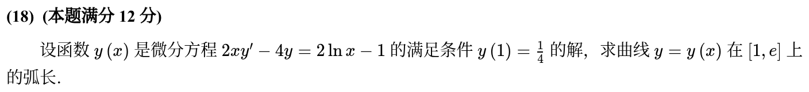
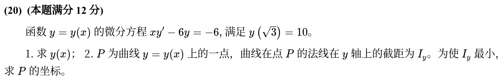
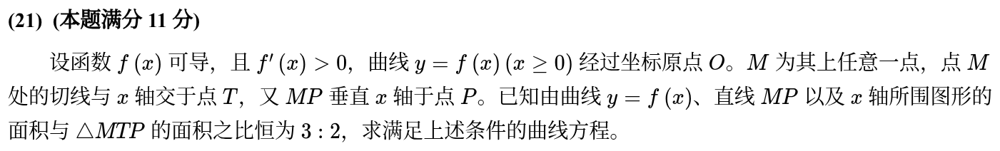
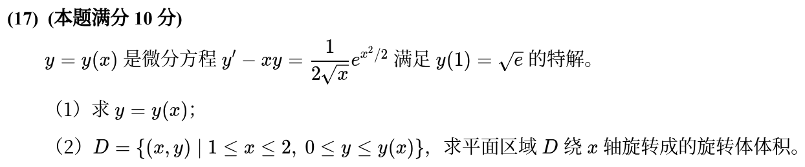
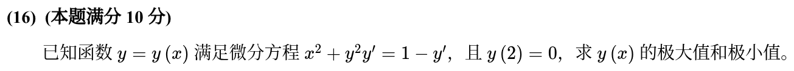
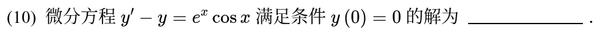
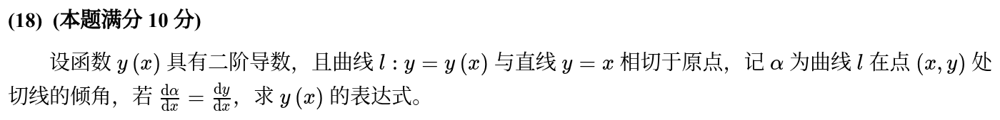
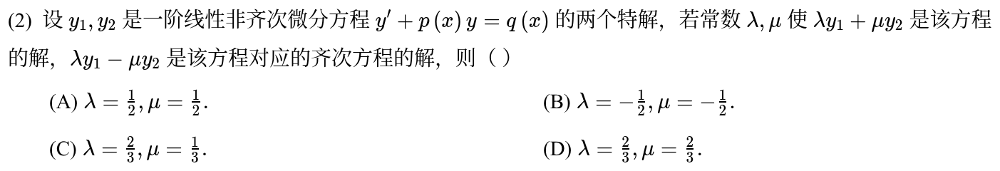

[« 定积分应用](13-integral-applications.md)　　[高阶微分方程 »](15-higher-order-ode.md)

# 高等数学 · 一阶微分方程

> **本章共 16 题**
> 
> - **核心必做（建议按顺序攻克关键方法）**：  
>   [第 14 题](#q14)（一阶线性方程） → [第 12 题](#q12)（分离变量并判极值） → [第 13 题](#q13)（改把横坐标当未知函数） → [第 02 题](#q02)（整体换元后分离变量） → [第 11 题](#q11)（冷却问题建模与初值）
> 
> - **分流与刷题建议**：  
>   - **较难挑战**：[第 03 题](#q03)（切线截距建方程再优化）  
>   - **重在看思路**：[第 08 题](#q08)（积分方程经换元求导化成微分方程）  
>   - **首轮可跳过**：[第 06 题](#q06)、[第 09 题](#q09)、[第 15 题](#q15)（技巧较偏或综合度高，首轮不必死磕）  
> 
> - **过关目标**：先识别类型再解；初值用于定常数，最后代回原方程检验。

---

### 01 · 2025年

答案与解析

**答案 $y=(2x+\sqrt{20-11x^2})/5$（取含 $x=1$ 的局部支）。** 左边是 $d(2xy-\tfrac32x^2-\tfrac52y^2)$，初值给出 $4xy-3x^2-5y^2=-4$。解关于 $y$ 的二次方程，再由 $y(1)=1$ 选正号。

---

### 02 · 2024年

> *变量代换型微分方程。看到 $x+y$ 捆在一起，果断设新变量 $u = x+y$，方程立刻化成分离变量方程，千万别直接硬解。*

答案与解析

1. 右端只含 $x+y$，令 $u = x + y$，则 $y' = u' - 1$。
2. 代入原方程：$u' - 1 = \frac{1}{u^2} \implies u' = \frac{u^2 + 1}{u^2}$，分离变量得 $\frac{u^2}{u^2 + 1}\,\mathrm{d}u = \mathrm{d}x$。
3. 两边积分：$\int \left(1 - \frac{1}{u^2+1}\right)\mathrm{d}u = \int \mathrm{d}x \implies u - \arctan u = x + C$。
4. 回代 $u = x + y$，两边的 $x$ 约掉：$y - \arctan(x + y) = C$。
5. 代入初值 $y(1) = 0$：$0 - \arctan 1 = C \implies C = -\frac{\pi}{4}$。
6. 答案：$y - \arctan(x + y) = -\frac{\pi}{4}$（或写作 $\arctan(x + y) - y = \frac{\pi}{4}$）。

---

### 03 · 2023年

> *切线与微分方程综合大题。根据切线法线斜率列出一阶线性方程求出曲线，第二问求极值严格按导数符号讨论。*

答案与解析

**解。** （1）切线的纵截距是 $y-xy'$，故 $y-xy'=x$，即 $(y/x)'=-1/x$。积分并代入 $(e^2,0)$ 得 $y=x(2-\ln x)$。

（2）在 $x>e$ 上，切线斜率 $1-\ln x<0$，纵截距 $x$、横截距 $x/(\ln x-1)$。面积 $S=x^2/[2(\ln x-1)]$，导数符号由 $2\ln x-3$ 决定，故唯一极小值也是全局最小值。点为 $(e^{3/2},e^{3/2}/2)$，面积为 $e^3$。

---

### 04 · 2022年

答案与解析

**答案 $(e^2+1)/4$。** 方程为 $y'-2y/x=(\ln x-1/2)/x$。可直接看出特解 $-\frac12\ln x$，齐次解 $Cx^2$，由初值 $C=1/4$。故 $y'=(x-1/x)/2$，而弧长元恰化成 $(x+1/x)/2$，在 $[1,e]$ 积分得 $(e^2+1)/4$。

---

### 05 · 2021年

> *一阶线性方程与法线截距。第一问套公式求通解；第二问写出法线方程令 $x=0$ 得到截距函数 $I_y(x)$，求导求最小值即可。*

答案与解析

**解。** （1）在含 $\sqrt3$ 的正半轴上，分离变量得 $y=1+Cx^6$，代初值 $C=1/3$。

（2）法线斜率 $-1/y'$，纵截距 $I_y=y+x/y'=1+x^6/3+1/(2x^4)$。其导数 $2x^5-2x^{-5}$ 在 $x=1$ 左负右正，故最小点为 $P=(1,4/3)$。

---

### 06 · 2020年

答案与解析

**解。** 对 $x>0$ 记 $F(x)=\int_0^xf(t)\,dt$。切线与横轴的交点横坐标为 $x-f/f'$，三角形面积为 $f^2/(2f')$。面积比例给出 $FF''=\frac34(F')^2$。因 $F>0$，这恰等价于 $(F^{1/4})''=0$。再由 $F(0)=0$，得 $F=kx^4$、$f(x)=Cx^3$，$C>0$。代回有面积比 $3:2$。严格的 $f'>0$ 在正半轴成立；端点右导数为 0。

---

### 07 · 2019年

答案与解析

**解。** （1）乘积分因子 $e^{-x^2/2}$，左边成为 $(ye^{-x^2/2})'$。积分得 $y=e^{x^2/2}(\sqrt x+C)$，用初值 $C=0$。

（2）绕横轴用圆盘法，$V=\pi\int_1^2 y^2dx=\pi\int_1^2 xe^{x^2}dx=\frac\pi2(e^4-e)$。

---

### 08 · 2018年

> *积分方程求导题。第二项积分做变量代换 $u=x-t$ 剥离外层 $x$，两端同时求导脱去变限积分符号，转化成一阶线性微分方程。*

答案与解析

**解。** （1）换元后第二项为 $\int_0^x(x-u)f(u)\,du$，对原式求导得到 $f(x)+\int_0^xf(u)du=2ax$，特别地 $f(0)=0$。再导得到 $f'+f=2a$，故 $f(x)=2a(1-e^{-x})$。

（2）$\int_0^1f=2a/e=1$，所以 $a=e/2$。

---

### 09 · 2017年

答案与解析

**解。** 两截距分别为 $Y_p=y-xy'$ 与 $X_p=x+yy'$（法线可用方向向量 $(-y',1)$ 表示）。因此 $(x+y)y'=y-x$，且在解上 $x+y\ne0$（否则右端为 $-2x$）。

令 $u=y/x$，则 $xu'=-(1+u^2)/(1+u)$。分离变量积分得 $\arctan u+\tfrac12\ln(1+u^2)=-\ln x+C$，初值 $(1,0)$ 给 $C=0$。所求为通过 $(1,0)$ 的分支
$$
\arctan(y/x)+\frac12\ln(x^2+y^2)=0.
$$

---

### 10 · 2016年

答案与解析

**答案 $y'-y=2x-x^2$。** 两非齐次特解之差 $e^x$ 是对应齐次解，故标准形式 $y'+p(x)y=q(x)$ 有 $p=-1$。代入较简单的特解 $y=x^2$ 得右端。

---

### 11 · 2015年

答案与解析

**触发条件与第一步落笔**

- **触发条件**：牛顿冷却定律文字题——变化率与温差成正比，给初温、介质温度和 $30\text{ min}$ 后的温度，问继续降到 $21^\circ\text{C}$ **还需**多长时间。
- **第一步怎么落笔**：设 $t\text{ min}$ 时物体温度为 $T(t)$（$^\circ\text{C}$），列出微分方程与两个已知条件。

**完整推演**

1. **建立微分方程模型**：
   由题意，物体温度 $T(t) > 20$ 且随时间下降，故
   $$\frac{\mathrm{d}T}{\mathrm{d}t} = -k(T - 20) \quad (k > 0), \qquad T(0) = 120, \quad T(30) = 30.$$

2. **分离变量求解**：
   $$\frac{\mathrm{d}(T - 20)}{T - 20} = -k\,\mathrm{d}t \implies \ln(T - 20) = -kt + C_1 \implies T(t) - 20 = C e^{-kt}.$$
   - 代入 $T(0) = 120$：$120 - 20 = C \implies C = 100$，即
     $$T(t) = 20 + 100 e^{-kt}.$$
   - 代入 $T(30) = 30$：$30 - 20 = 100 e^{-30k} \implies e^{-30k} = \frac{1}{10}$。

3. **求降至 $21^\circ\text{C}$ 的时刻与“还需时间”**：
   设降至 $21^\circ\text{C}$ 时的总时间为 $t_1$，则
   $$21 = 20 + 100 e^{-k t_1} \implies e^{-k t_1} = \frac{1}{100} = \left(\frac{1}{10}\right)^2 = \left(e^{-30k}\right)^2 = e^{-60k}.$$
   因为 $k > 0$，故 $t_1 = 60\text{ (min)}$。
   题目问的是“**还需冷却多长时间**”，故还需时间为
   $$\Delta t = t_1 - 30 = 60 - 30 = 30\text{ (min)}.$$

---

### 12 · 2014年

答案与解析

**触发条件与第一步落笔**

- **触发条件**：方程 $x^2 + y^2 y' = 1 - y'$ 中 $y'$ 可以直接提公因式，且题目只问 $y(x)$ 的极大值与极小值，不要求写出显式表达式。
- **第一步怎么落笔**：合并含 $y'$ 的项，把方程改写成可分离变量形式。

**完整推演**

1. **分离变量并求特解**：
   由 $x^2 + y^2 y' = 1 - y'$ 移项合并得
   $$(1 + y^2)y' = 1 - x^2 \implies (1 + y^2)\,\mathrm{d}y = (1 - x^2)\,\mathrm{d}x.$$
   两边积分：
   $$y + \frac{1}{3}y^3 = x - \frac{1}{3}x^3 + C.$$
   代入初值 $y(2) = 0$：
   $$0 = 2 - \frac{8}{3} + C \implies C = \frac{2}{3}.$$
   两边同乘 $3$，得隐式特解方程：
   $$y^3 + 3y = -x^3 + 3x + 2.$$
   （注：令 $G(y) = y^3 + 3y$，因为 $G'(y) = 3y^2 + 3 > 0$ 恒成立，对任意 $x\in\mathbb{R}$ 该方程唯一确定一个光滑函数 $y(x)$。）

2. **用原方程的 $y'$ 找驻点并判单调性**：
   由原方程直接得
   $$y' = \frac{1 - x^2}{1 + y^2}.$$
   因为分母 $1 + y^2 \ge 1 > 0$ 恒成立，$y'$ 的正负完全取决于分子 $1 - x^2$：
   - 令 $y' = 0 \implies 1 - x^2 = 0 \implies$ 驻点为 $x = -1$ 和 $x = 1$；
   - 当 $x < -1$ 时，$y' < 0$（递减）；
   - 当 $-1 < x < 1$ 时，$y' > 0$（递增）；
   - 当 $x > 1$ 时，$y' < 0$（递减）。
   因此：$x = -1$ 为极小值点，$x = 1$ 为极大值点。

3. **代回隐式方程算极值**：
   - 将 $x = -1$ 代入 $y^3 + 3y = -x^3 + 3x + 2$：
     $$y^3 + 3y = 1 - 3 + 2 = 0 \implies y(y^2 + 3) = 0 \implies y(-1) = 0.$$
   - 将 $x = 1$ 代入 $y^3 + 3y = -x^3 + 3x + 2$：
     $$y^3 + 3y = -1 + 3 + 2 = 4 \implies y^3 + 3y - 4 = 0 \implies (y - 1)(y^2 + y + 4) = 0.$$
     因 $y^2 + y + 4 = \left(y+\frac{1}{2}\right)^2 + \frac{15}{4} > 0$ 无实根，故唯一实根为 $y(1) = 1$。

   综上，$y(x)$ 的**极小值为 $y(-1) = 0$，极大值为 $y(1) = 1$**。

---

### 13 · 2012年

答案与解析

**答案 $xy-y^3=0$，过 $(1,1)$ 的支为 $y=\sqrt x$。** 原微分式是 $d(xy-y^3)=0$，初值得积分常数 0。分解 $y(x-y^2)=0$ 后，初值排除 $y=0$ 并选取正号。

---

### 14 · 2011年

答案与解析

**触发条件与第一步落笔**

- **触发条件**：标准一阶线性非齐次方程 $y' - y = e^x\cos x$，$P(x) = -1$，$Q(x) = e^x\cos x$，且右端含 $e^x$。
- **第一步怎么落笔**：方程两边同乘积分因子 $e^{\int (-1)\,\mathrm{d}x} = e^{-x}$，把左边合并成乘积的导数。

**完整推演**

1. 两边同乘 $e^{-x}$：
   $$e^{-x} y' - e^{-x} y = \cos x \implies \left(e^{-x} y\right)' = \cos x.$$
2. 两边积分（务必带常数 $C$）：
   $$e^{-x} y = \int \cos x\,\mathrm{d}x = \sin x + C \implies y = e^x(\sin x + C).$$
3. 代入初值条件 $y(0) = 0$：
   $$0 = e^0(\sin 0 + C) = C \implies C = 0.$$
   故所求解为
   $$y = e^x \sin x.$$
   （复核：$y' - y = (e^x\sin x + e^x\cos x) - e^x\sin x = e^x\cos x$，且 $y(0)=0$，完全正确。）

---

### 15 · 2011年

> *别被倾角唬住，$\tan\alpha = y'$，两边求导就是 $\alpha' = \frac{y''}{1+y'^2}$。令 $p=y'$ 当一阶方程算。*

答案与解析

**解。** 由相切条件 $y(0)=0,y'(0)=1,\alpha(0)=\pi/4$。题意给 $(\alpha-y)'=0$，所以在通过原点的分支上 $\alpha=y+\pi/4$。$y'=\tan(y+\pi/4)$，分离变量后有 $\ln\sin(y+\pi/4)=x-\tfrac12\ln2$。选取经过原点的反三角分支得到 $y=\arcsin(e^x/\sqrt2)-\pi/4$（$x<\ln\sqrt2$）。右端达到 1 时切线竖直。

---

### 16 · 2010年

答案与解析

**答案 A。** 对线性算子 $L[y]=y'+py$，有 $L[y_1]=L[y_2]=q$，因此两组合分别映到 $(\lambda+\mu)q$、$(\lambda-\mu)q$。因 $q$ 不恒为零，分别令系数为 1、0，解得 $\lambda=\mu=1/2$。

---

[« 定积分应用](13-integral-applications.md)　　[高阶微分方程 »](15-higher-order-ode.md)
