[« 一阶微分方程](14-first-order-ode.md)　　[多元函数极限、偏导与全微分 »](16-multivariable-basics.md)

# 高等数学 · 高阶微分方程

> **本章共 17 题**
> 
> - **核心必做（建议按顺序攻克关键方法）**：  
>   [第 16 题](#q16)（特征根与通解） → [第 12 题](#q12)（极值条件转成初值） → [第 10 题](#q10)（特解遇重根需调整） → [第 01 题](#q01)（齐次与非齐次解的组合） → [第 04 题](#q04)（欧拉方程换元）
> 
> - **分流与刷题建议**：  
>   - **较难挑战**：[第 02 题](#q02)（不显含原函数的非线性降阶）  
>   - **重在看思路**：[第 11 题](#q11)（已知一个解再找第二个解）  
>   - **首轮可跳过**：[第 03 题](#q03)、[第 05 题](#q05)、[第 14 题](#q14)（技巧较偏或综合度高，首轮不必死磕）  
> 
> - **过关目标**：通解不漏独立解；特解形式先查是否与齐次解重复。

---

### 01 · 2026年

> *非齐次线性方程解的性质。非齐次特解做线性组合，组合系数和为 1 依然是非齐次特解，组合系数和为 0 则是齐次方程的特解，秒列方程解 $\lambda, \mu$。*

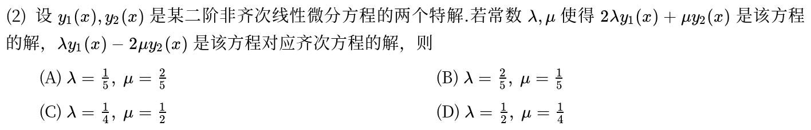

---

### 02 · 2026年

> *最新真题大题。方程不显含 $y$，令 $p=y'$ 降为关于 $p$ 的一阶方程，先分离变量求出 $y'$ 再积分求 $y$。步步为营，核心在别算错负号。*

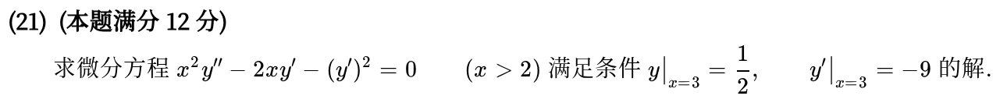

---

### 03 · 2025年

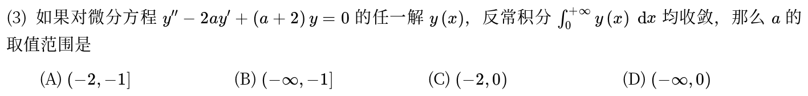

---

### 04 · 2024年

> *欧拉方程经典大题。作变换 $x=e^t$ 把自变量换为 $t$，降为常系数线性方程，求出齐次通解再求特解；第二问直接代入三角代换做定积分。*

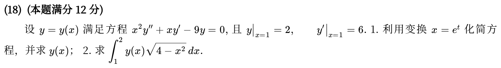

---

### 05 · 2023年

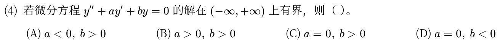

---

### 06 · 2022年

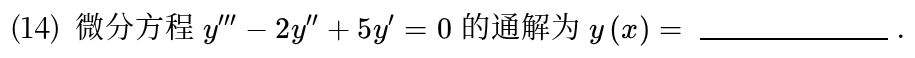

---

### 07 · 2021年

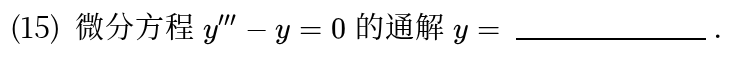

---

### 08 · 2020年

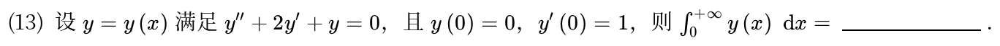

---

### 09 · 2019年

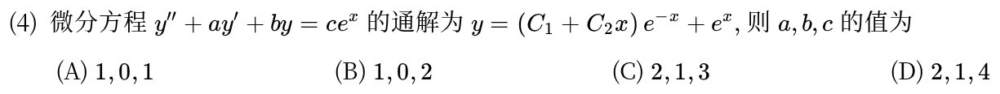

---

### 10 · 2017年

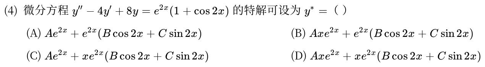

---

### 11 · 2016年

> *已知特解求高阶方程未知系数。已知 $y_1=e^x$ 是解，代入方程定出系数关系；再用刘维尔公式或设 $y_2=u(x)e^x$ 降阶求出第二个特解。*

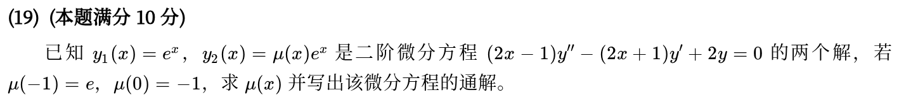

---

### 12 · 2015年

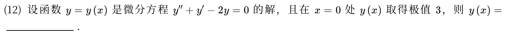

---

### 13 · 2013年

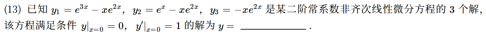

---

### 14 · 2012年

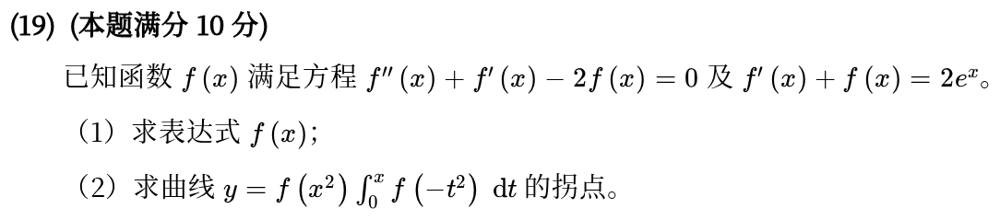

---

### 15 · 2011年

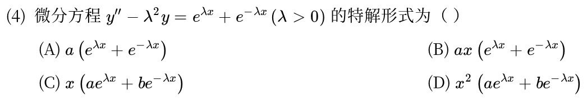

---

### 16 · 2010年

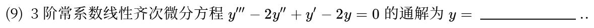

---

### 17 · 2010年

> *参数方程二阶导与高阶方程。用参数方程二阶导公式求出 $\frac{d^2y}{dx^2}$，与右端相等化为关于 $\psi'(t)$ 的一阶线性微分方程。*

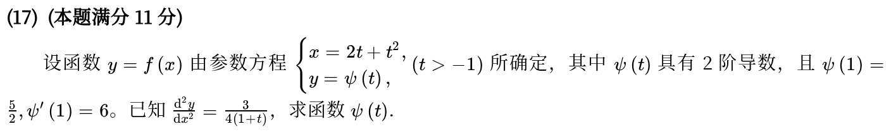

---

[« 一阶微分方程](14-first-order-ode.md)　　[多元函数极限、偏导与全微分 »](16-multivariable-basics.md)
