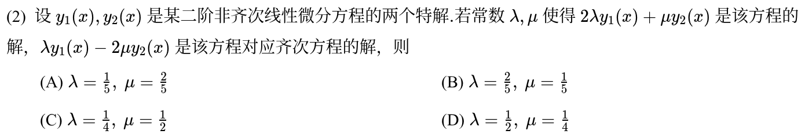
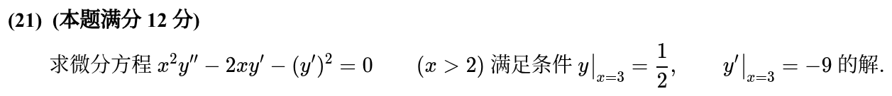
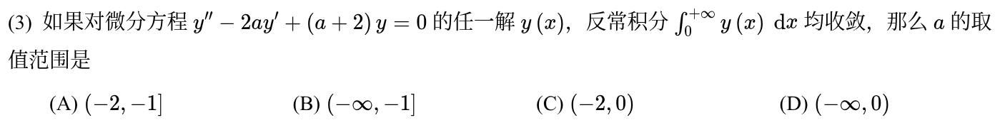
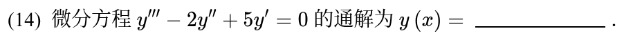
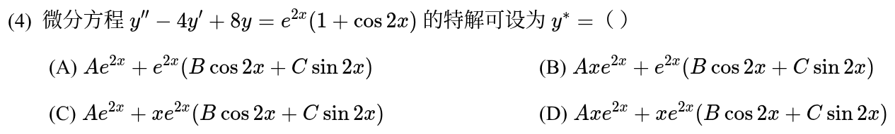
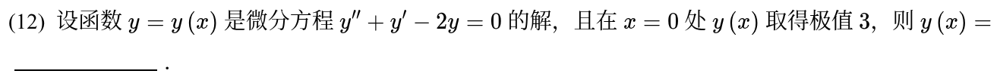
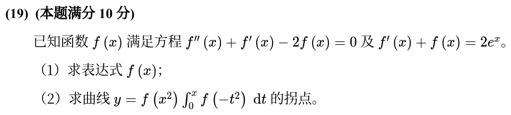
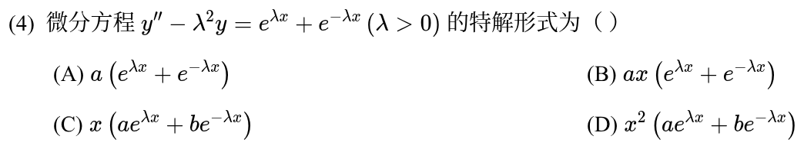
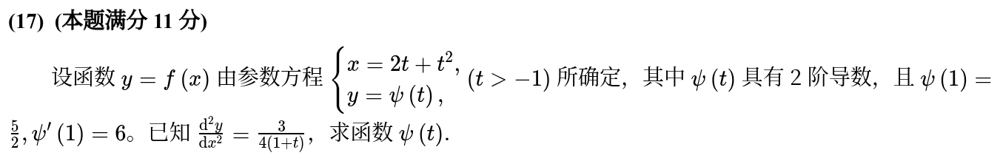

[« 一阶微分方程](14-first-order-ode.md)　　[多元函数极限、偏导与全微分 »](16-multivariable-basics.md)

# 高等数学 · 高阶微分方程

> **本章共 17 题**
> 
> - **核心必做（建议按顺序攻克关键方法）**：  
>   [第 16 题](#q16)（特征根与通解） → [第 12 题](#q12)（极值条件转成初值） → [第 10 题](#q10)（特解遇重根需调整） → [第 01 题](#q01)（齐次与非齐次解的组合） → [第 04 题](#q04)（欧拉方程换元）
> 
> - **分流与刷题建议**：  
>   - **较难挑战**：[第 02 题](#q02)（不显含原函数的非线性降阶）  
>   - **重在看思路**：[第 11 题](#q11)（已知一个解再找第二个解）  
>   - **首轮可跳过**：[第 03 题](#q03)、[第 05 题](#q05)、[第 14 题](#q14)（技巧较偏或综合度高，首轮不必死磕）  
> 
> - **过关目标**：通解不漏独立解；特解形式先查是否与齐次解重复。

---

### 01 · 2026年

> *非齐次线性方程解的性质。非齐次特解做线性组合，组合系数和为 1 依然是非齐次特解，组合系数和为 0 则是齐次方程的特解，秒列方程解 $\lambda, \mu$。*

答案与解析

1. 设非齐次方程为 $L[y] = f(x)$（$f(x) \not\equiv 0$），已知 $L[y_1] = f(x),\ L[y_2] = f(x)$。
2. 由线性算子性质：
   - $2\lambda y_1 + \mu y_2$ 是原非齐次方程的解 $\implies L[2\lambda y_1 + \mu y_2] = (2\lambda + \mu)f(x) = f(x) \implies 2\lambda + \mu = 1$；
   - $\lambda y_1 - 2\mu y_2$ 是对应齐次方程的解 $\implies L[\lambda y_1 - 2\mu y_2] = (\lambda - 2\mu)f(x) = 0 \implies \lambda - 2\mu = 0$。
3. 联立解得 $\lambda = 2\mu \implies 5\mu = 1 \implies \mu = \frac{1}{5},\ \lambda = \frac{2}{5}$。
4. 答案：**（B）**。

---

### 02 · 2026年

> *最新真题大题。方程不显含 $y$，令 $p=y'$ 降为关于 $p$ 的一阶方程，先分离变量求出 $y'$ 再积分求 $y$。步步为营，核心在别算错负号。*

答案与解析

**解。** 令 $v=y'/x^2$，方程化成 $v'=v^2$，且 $v(3)=-1$。分离变量得 $v=-1/(x-2)$。于是 $y'=-x^2/(x-2)=-x-2-4/(x-2)$，由 $y(3)=1/2$ 定出
$$
y=11-\frac{x^2}{2}-2x-4\ln(x-2),\qquad x>2.
$$

---

### 03 · 2025年

答案与解析

**答案 C，$-2<a<0$。** 任意解都可积，要求两个特征根的实部都严格小于零。零根给常数解，纯虚根给无衰减正弦、余弦，正实部给增长解，这些都不能满足要求。特征多项式 $r^2-2ar+a+2$ 的两根同为负实部，等价于根和 $2a<0$、根积 $a+2>0$。

---

### 04 · 2024年

> *欧拉方程经典大题。作变换 $x=e^t$ 把自变量换为 $t$，降为常系数线性方程，求出齐次通解再求特解；第二问直接代入三角代换做定积分。*

答案与解析

**触发条件与第一步落笔**

- **触发条件**：典型的二阶齐次欧拉方程 $x^2 y'' + x y' - 9y = 0$，题干已直接提示用变换 $x = e^t$；第（2）问依赖第（1）问的结果。
- **第一步怎么落笔**：按链式法则推导出 $xy'$ 与 $x^2y''$ 对 $t$ 的表达式（解答题建议写出推导过程，不漏步骤分）。

**完整推演**

##### 第（1）问：化简方程并求 $y(x)$

由初值在 $x=1>0$ 处，令 $x = e^t$（即 $t = \ln x$），则：
$$\frac{\mathrm{d}y}{\mathrm{d}x} = \frac{\mathrm{d}y}{\mathrm{d}t}\cdot\frac{\mathrm{d}t}{\mathrm{d}x} = \frac{1}{x}\frac{\mathrm{d}y}{\mathrm{d}t} \implies x y' = \frac{\mathrm{d}y}{\mathrm{d}t},$$
$$\frac{\mathrm{d}^2y}{\mathrm{d}x^2} = \frac{\mathrm{d}}{\mathrm{d}x}\left(\frac{1}{x}\frac{\mathrm{d}y}{\mathrm{d}t}\right) = -\frac{1}{x^2}\frac{\mathrm{d}y}{\mathrm{d}t} + \frac{1}{x^2}\frac{\mathrm{d}^2y}{\mathrm{d}t^2} \implies x^2 y'' = \frac{\mathrm{d}^2y}{\mathrm{d}t^2} - \frac{\mathrm{d}y}{\mathrm{d}t}.$$
代入原方程 $x^2 y'' + xy' - 9y = 0$，一阶导项恰好抵消：
$$\left(\frac{\mathrm{d}^2y}{\mathrm{d}t^2} - \frac{\mathrm{d}y}{\mathrm{d}t}\right) + \frac{\mathrm{d}y}{\mathrm{d}t} - 9y = 0 \implies \frac{\mathrm{d}^2y}{\mathrm{d}t^2} - 9y = 0.$$
特征方程为 $r^2 - 9 = 0$，特征根 $r_1 = 3,\ r_2 = -3$，故通解为
$$y = C_1 e^{3t} + C_2 e^{-3t} = C_1 x^3 + C_2 x^{-3}.$$
求导得 $y'(x) = 3C_1 x^2 - 3C_2 x^{-4}$。代入初值 $y|_{x=1}=2,\ y'|_{x=1}=6$：
$$\begin{cases} C_1 + C_2 = 2, \\ 3C_1 - 3C_2 = 6 \implies C_1 - C_2 = 2. \end{cases}$$
解得 $C_1 = 2,\ C_2 = 0$。因此
$$y(x) = 2x^3.$$
（复核：$x^2(12x) + x(6x^2) - 9(2x^3) = 18x^3 - 18x^3 = 0$，且 $y(1)=2, y'(1)=6$，完全无误。）

##### 第（2）问：计算 $\int_1^2 y(x)\sqrt{4-x^2}\,\mathrm{d}x$

代入 $y(x) = 2x^3$：
$$I = \int_1^2 2x^3\sqrt{4-x^2}\,\mathrm{d}x.$$
注意到 $x^3\,\mathrm{d}x = x^2\cdot (x\,\mathrm{d}x)$，令 $u = \sqrt{4-x^2}$（则 $x^2 = 4 - u^2$，$x\,\mathrm{d}x = -u\,\mathrm{d}u$）。
当 $x = 1$ 时 $u = \sqrt{3}$；当 $x = 2$ 时 $u = 0$。于是
$$I = 2\int_{\sqrt{3}}^{0} (4 - u^2)\cdot u \cdot (-u\,\mathrm{d}u) = 2\int_0^{\sqrt{3}} (4u^2 - u^4)\,\mathrm{d}u$$
$$= 2\left[\frac{4}{3}u^3 - \frac{1}{5}u^5\right]_0^{\sqrt{3}} = 2\left(\frac{4}{3}\cdot 3\sqrt{3} - \frac{1}{5}\cdot 9\sqrt{3}\right) = 2\left(4\sqrt{3} - \frac{9}{5}\sqrt{3}\right) = \frac{22\sqrt{3}}{5}.$$

---

### 05 · 2023年

答案与解析

**答案 C。** 整条实轴上通解有界，排除实部非零的特征根，也排除产生 $x$ 项的二重零根。实系数二阶方程仅剩一对非零纯虚根，要求 $a=0,b>0$，此时通解为有界的正弦、余弦组合。

---

### 06 · 2022年

答案与解析

**答案 $y=C_1+e^x(C_2\cos2x+C_3\sin2x)$。** 特征方程 $r(r^2-2r+5)=0$ 有根 $0,1\pm2i$，分别贡献常数和一对带 $e^x$ 的三角函数。

---

### 07 · 2021年

答案与解析

**答案 $y=C_1e^x+e^{-x/2}[C_2\cos(\sqrt3 x/2)+C_3\sin(\sqrt3 x/2)]$。** 特征方程为 $(r-1)(r^2+r+1)=0$，根为 $1,-1/2\pm i\sqrt3/2$。

---

### 08 · 2020年

答案与解析

**答案 $1$。** 重根 $-1$ 给出 $y=(C_1+C_2x)e^{-x}$，初值给 $C_1=0,C_2=1$。积分为 $[-(x+1)e^{-x}]_0^\infty=1$。

---

### 09 · 2019年

答案与解析

**答案 D。** 齐次部分出现 $e^{-x},xe^{-x}$，说明特征根 $-1$ 为二重根，故 $a=2,b=1$。把特解 $y=e^x$ 代回，系数 $c=1+2+1=4$。

---

### 10 · 2017年

答案与解析

**触发条件与第一步落笔**

- **触发条件**：二阶常系数非齐次方程，右端 $e^{2x}(1 + \cos 2x)$ 可拆成两项之和，只问特解形式。
- **第一步怎么落笔**：解特征方程 $r^2 - 4r + 8 = 0$，同时把右端拆成 $f_1(x) = e^{2x}$ 和 $f_2(x) = e^{2x}\cos 2x$。

**完整推演**

1. **求特征根**：
   $$r^2 - 4r + 8 = 0 \implies (r - 2)^2 = -4 \implies r_{1,2} = 2 \pm 2i.$$
2. **逐项设特解**：
   - 对 $f_1(x) = e^{2x}$：对应参数 $\lambda = 2$（即 $2 + 0i$）。因为特征根是 $2 \pm 2i$，所以 $\lambda = 2$ **不是特征根**（$k = 0$），故设
     $$y_1^* = A e^{2x}.$$
   - 对 $f_2(x) = e^{2x}\cos 2x$：对应参数 $\alpha \pm i\beta = 2 \pm 2i$，**恰好是特征方程的单根**（$k = 1$），故必须乘一个 $x$，设
     $$y_2^* = x e^{2x}(B\cos 2x + C\sin 2x).$$
3. **由叠加原理合并**：
   $$y^* = y_1^* + y_2^* = A e^{2x} + x e^{2x}(B\cos 2x + C\sin 2x).$$
故选择 **（C）**。

**选择题干扰项拆解**

- **（A）**：两项都没乘 $x$——忘了检查 $2\pm 2i$ 是特征根。
- **（B）**：把 $k=1$ 乘错了项——误以为特征根实部是 $2$，就给 $e^{2x}$ 乘了 $x$，却没给 $e^{2x}\cos 2x$ 乘 $x$。
- **（D）**：两项都乘了 $x$——没有把 $e^{2x}(1+\cos 2x)$ 拆开单独判重数，而是把整个右端一锅端乘了 $x$。

---

### 11 · 2016年

> *已知特解求高阶方程未知系数。已知 $y_1=e^x$ 是解，代入方程定出系数关系；再用刘维尔公式或设 $y_2=u(x)e^x$ 降阶求出第二个特解。*

答案与解析

**解。** 置 $y=e^x\mu$ 后消去零阶项，得 $(2x-1)\mu''+(2x-3)\mu'=0$。先解一阶方程得 $\mu'=C(2x-1)e^{-x}$，再积分得 $\mu=c_1+c_2(2x+1)e^{-x}$。由两给定值解得 $c_1=0,c_2=-1$，故 $\mu=-(2x+1)e^{-x}$，原方程通解是 $y=C_1e^x+C_2(2x+1)$。若跨过 $x=1/2$，二阶导在该点存在要求左右解的系数一致。

---

### 12 · 2015年

答案与解析

**答案 $y=2e^x+e^{-2x}$。** 特征根是 $1,-2$，通解 $C_1e^x+C_2e^{-2x}$。极值给 $y(0)=3$ 和 $y'(0)=0$，即 $C_1+C_2=3$、$C_1-2C_2=0$，解得两常数。并且 $y''(0)=6>0$。

---

### 13 · 2013年

答案与解析

**答案 $y=e^{3x}-e^x-xe^{2x}$。** 由 $y_1-y_3$、$y_2-y_3$ 得两个线性无关的齐次解 $e^{3x},e^x$，故通解为 $C_1e^{3x}+C_2e^x-xe^{2x}$。初值给 $C_1+C_2=0$、$3C_1+C_2-1=1$，所以 $C_1=1,C_2=-1$。

---

### 14 · 2012年

答案与解析

**解。** （1）特征根 $1,-2$ 给 $f=C_1e^x+C_2e^{-2x}$；代入 $f'+f=2e^x$ 得 $C_1=1,C_2=0$。

（2）令 $y=e^{x^2}\int_0^x e^{-t^2}dt$，则 $y'=2xy+1$、$y''=(2+4x^2)y+2x$。$y$ 与 $x$ 同号，故 $y''$ 在 0 左负右正，只在 $(0,0)$ 有拐点。

---

### 15 · 2011年

答案与解析

**答案 C。** 齐次特征根 $\pm\lambda$ 都是单根，所以右端两个指数项都要乘一次 $x$，并允许不同系数。代入得 $(D^2-\lambda^2)(xe^{\pm\lambda x})=\pm2\lambda e^{\pm\lambda x}$，两系数为 $1/(2\lambda),-1/(2\lambda)$。

---

### 16 · 2010年

答案与解析

**答案 $y=C_1e^{2x}+C_2\cos x+C_3\sin x$。** 特征多项式为 $(r-2)(r^2+1)$，根分别为 $2,\pm i$。

---

### 17 · 2010年

> *参数方程二阶导与高阶方程。用参数方程二阶导公式求出 $\frac{d^2y}{dx^2}$，与右端相等化为关于 $\psi'(t)$ 的一阶线性微分方程。*

答案与解析

**答案 $\psi(t)=t^3+\tfrac32t^2$。** $dx/dt=2(1+t)$，链式法则给 $\frac{d}{dt}(dy/dx)=3/2$。在 $t=1$，$dy/dx=\psi'(1)/4=3/2$，故 $dy/dx=3t/2$。再乘 $dx/dt$ 得 $\psi'=3t(1+t)$，积分后以 $\psi(1)=5/2$ 定常数为零。

---

[« 一阶微分方程](14-first-order-ode.md)　　[多元函数极限、偏导与全微分 »](16-multivariable-basics.md)
