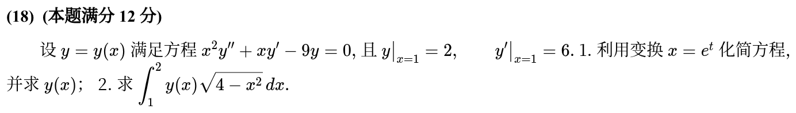
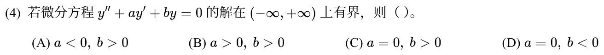
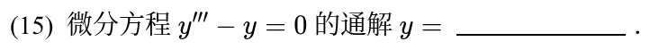
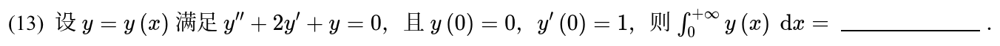
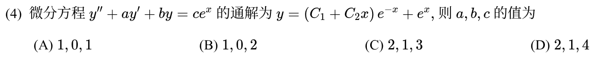
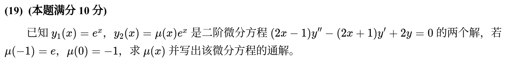
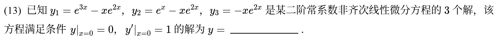
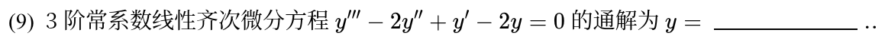

[« 一阶微分方程](14-first-order-ode.md)　　[多元函数极限、偏导与全微分 »](16-multivariable-basics.md)

# 高等数学 · 高阶微分方程

> **本章共 17 题**
> 
> - **核心必做（建议按顺序攻克关键方法）**：  
>   [第 16 题](#q16)（特征根与通解） → [第 12 题](#q12)（极值条件转成初值） → [第 10 题](#q10)（特解遇重根需调整） → [第 01 题](#q01)（齐次与非齐次解的组合） → [第 04 题](#q04)（欧拉方程换元）
> 
> - **分流与刷题建议**：  
>   - **较难挑战**：[第 02 题](#q02)（不显含原函数的非线性降阶）  
>   - **重在看思路**：[第 11 题](#q11)（已知一个解再找第二个解）  
>   - **首轮可跳过**：[第 03 题](#q03)、[第 05 题](#q05)、[第 14 题](#q14)（技巧较偏或综合度高，首轮不必死磕）  
> 
> - **过关目标**：通解不漏独立解；特解形式先查是否与齐次解重复。

---

### 01 · 2026年

> *非齐次线性方程解的性质。非齐次特解做线性组合，组合系数和为 1 依然是非齐次特解，组合系数和为 0 则是齐次方程的特解，秒列方程解 $\lambda, \mu$。*

答案与解析

**答案**：**（B）** $\lambda = \dfrac{2}{5},\ \mu = \dfrac{1}{5}$

- **切入点与推演**：记二阶非齐次线性微分方程为 $L[y] = f(x)$（$f(x) \not\equiv 0$）。已知 $y_1, y_2$ 为该方程的特解，即 $L[y_1] = L[y_2] = f(x)$。利用微分算子 $L$ 的线性性质：
  1. $2\lambda y_1 + \mu y_2$ 是原非齐次方程的解：
     $$L[2\lambda y_1 + \mu y_2] = (2\lambda + \mu)f(x) = f(x) \implies 2\lambda + \mu = 1.$$
  2. $\lambda y_1 - 2\mu y_2$ 是对应齐次方程的解：
     $$L[\lambda y_1 - 2\mu y_2] = (\lambda - 2\mu)f(x) = 0 \implies \lambda - 2\mu = 0.$$
  联立解得 $\lambda = 2\mu \implies 5\mu = 1 \implies \mu = \dfrac{1}{5},\ \lambda = \dfrac{2}{5}$，故选择 **（B）**。
- **干扰项 / 易错提示**：可直接套用“非齐次特解线性组合仍是特解 $\Leftrightarrow$ 系数和为 $1$，是齐次解 $\Leftrightarrow$ 系数和为 $0$”快速列方程；注意别把 $\lambda$ 与 $\mu$ 的数值写反从而误选 **（A）**。

---

### 02 · 2026年

> *最新真题大题。方程不显含 $y$，令 $p=y'$ 降为关于 $p$ 的一阶方程，先分离变量求出 $y'$ 再积分求 $y$。步步为营，核心在别算错负号。*

答案与解析

**结论速览**：$y = 11 - \dfrac{x^2}{2} - 2x - 4\ln(x-2)$（$x > 2$）

- **完整解答**：
  1. **降阶化为一阶方程**：方程不显含未知函数 $y$，令 $p = y'$，则 $y'' = p'$，原方程化为
     $$x^2 p' - 2xp = p^2 \quad (x > 2).$$
     两端同除以 $x^4$，左端恰好凑成商的导数 $\left(\dfrac{p}{x^2}\right)'$：
     $$\frac{x^2 p' - 2xp}{x^4} = \left(\frac{p}{x^2}\right)^2 \implies \left(\frac{p}{x^2}\right)' = \left(\frac{p}{x^2}\right)^2.$$
     （等价做法：视作伯努利方程 $p' - \dfrac{2}{x}p = \dfrac{p^2}{x^2}$，令 $u = p^{-1}$ 化为一阶线性方程求解。）
  2. **求 $p = y'$**：令 $v = \dfrac{p}{x^2}$，则 $v' = v^2$，且初值 $v(3) = \dfrac{y'(3)}{3^2} = \dfrac{-9}{9} = -1 \ne 0$。分离变量并积分：
     $$\frac{\mathrm{d}v}{v^2} = \mathrm{d}x \implies -\frac{1}{v} = x + C_1.$$
     代入 $v(3) = -1$ 得 $1 = 3 + C_1 \implies C_1 = -2$，因此 $v = -\dfrac{1}{x-2}$，从而
     $$y' = p = -\frac{x^2}{x-2} = -\frac{(x^2 - 4) + 4}{x-2} = -x - 2 - \frac{4}{x-2} \quad (x > 2).$$
  3. **积分求 $y(x)$**：两边关于 $x$ 积分（因为 $x > 2$，故 $|x-2| = x-2$）：
     $$y = -\frac{x^2}{2} - 2x - 4\ln(x-2) + C_2.$$
     代入初值 $y(3) = \dfrac{1}{2}$：
     $$-\frac{9}{2} - 6 - 4\ln 1 + C_2 = \frac{1}{2} \implies C_2 = 11.$$
     故所求特解为
     $$y = 11 - \frac{x^2}{2} - 2x - 4\ln(x-2) \quad (x > 2).$$
- **核心思路与避坑**：看到 $x^2 p' - 2xp$ 立即联想到商的求导分子 $\left(\frac{p}{x^2}\right)' = \frac{x^2 p' - 2xp}{x^4}$，比硬套伯努利公式快一倍；最后求 $y$ 时别忘先对假分式 $\dfrac{x^2}{x-2}$ 做多项式除法再积分。

---

### 03 · 2025年

答案与解析

**答案**：**（C）** $(-2, 0)$

- **切入点与推演**：常系数齐次线性微分方程 $y'' - 2ay' + (a+2)y = 0$ 的特征方程为
  $$r^2 - 2ar + (a+2) = 0.$$
  要求**任一解** $y(x)$ 的反常积分 $\int_0^{+\infty} y(x)\,\mathrm{d}x$ 均收敛，充要条件是特征方程的两个根 $r_1, r_2$ 的实部均严格小于 $0$（即 $\operatorname{Re}(r_1) < 0$ 且 $\operatorname{Re}(r_2) < 0$）：
  - 若存在实部 $> 0$ 的根，指数增长解导致积分发散；
  - 若存在 $r = 0$，常数解 $y\equiv 1$ 导致积分发散；
  - 若存在纯虚根 $r = \pm i\omega$（$\omega > 0$），$\cos\omega x$ 与 $\sin\omega x$ 在 $[0,+\infty)$ 上反常积分发散；
  - 反之，若 $\operatorname{Re}(r_{1,2}) < 0$，则任意解均以负指数衰减（含 $e^{\alpha x}, xe^{\alpha x}, e^{\alpha x}\cos\beta x, e^{\alpha x}\sin\beta x$，$\alpha < 0$），在 $[0,+\infty)$ 上均绝对可积。
  对实系数二次方程 $r^2 - 2ar + (a+2) = 0$，两根实部均严格小于 $0$ 的充要条件是系数全为正（韦达定理）：
  $$\begin{cases} r_1 + r_2 = 2a < 0, \\ r_1 r_2 = a + 2 > 0 \end{cases} \iff -2 < a < 0.$$
  故选择 **（C）**。
- **干扰项 / 易错提示**：不要误以为需要判别式 $\Delta \ge 0$（即误加限制 $a \le -1$ 而错选 **（A）**）；当 $-1 < a < 0$ 时特征根为负实部共轭复根 $a \pm i\sqrt{a+2-a^2}$，对应的衰减振荡解 $e^{ax}\cos\beta x$ 积分依然收敛！

---

### 04 · 2024年

> *欧拉方程经典大题。作变换 $x=e^t$ 把自变量换为 $t$，降为常系数线性方程，求出齐次通解再求特解；第二问直接代入三角代换做定积分。*

答案与解析

**触发条件与第一步落笔**

- **触发条件**：典型的二阶齐次欧拉方程 $x^2 y'' + x y' - 9y = 0$，题干已直接提示用变换 $x = e^t$；第（2）问依赖第（1）问的结果。
- **第一步怎么落笔**：按链式法则推导出 $xy'$ 与 $x^2y''$ 对 $t$ 的表达式（解答题建议写出推导过程，不漏步骤分）。

**完整推演**

##### 第（1）问：化简方程并求 $y(x)$

由初值在 $x=1>0$ 处，令 $x = e^t$（即 $t = \ln x$），则：
$$\frac{\mathrm{d}y}{\mathrm{d}x} = \frac{\mathrm{d}y}{\mathrm{d}t}\cdot\frac{\mathrm{d}t}{\mathrm{d}x} = \frac{1}{x}\frac{\mathrm{d}y}{\mathrm{d}t} \implies x y' = \frac{\mathrm{d}y}{\mathrm{d}t},$$
$$\frac{\mathrm{d}^2y}{\mathrm{d}x^2} = \frac{\mathrm{d}}{\mathrm{d}x}\left(\frac{1}{x}\frac{\mathrm{d}y}{\mathrm{d}t}\right) = -\frac{1}{x^2}\frac{\mathrm{d}y}{\mathrm{d}t} + \frac{1}{x^2}\frac{\mathrm{d}^2y}{\mathrm{d}t^2} \implies x^2 y'' = \frac{\mathrm{d}^2y}{\mathrm{d}t^2} - \frac{\mathrm{d}y}{\mathrm{d}t}.$$
代入原方程 $x^2 y'' + xy' - 9y = 0$，一阶导项恰好抵消：
$$\left(\frac{\mathrm{d}^2y}{\mathrm{d}t^2} - \frac{\mathrm{d}y}{\mathrm{d}t}\right) + \frac{\mathrm{d}y}{\mathrm{d}t} - 9y = 0 \implies \frac{\mathrm{d}^2y}{\mathrm{d}t^2} - 9y = 0.$$
特征方程为 $r^2 - 9 = 0$，特征根 $r_1 = 3,\ r_2 = -3$，故通解为
$$y = C_1 e^{3t} + C_2 e^{-3t} = C_1 x^3 + C_2 x^{-3}.$$
求导得 $y'(x) = 3C_1 x^2 - 3C_2 x^{-4}$。代入初值 $y|_{x=1}=2,\ y'|_{x=1}=6$：
$$\begin{cases} C_1 + C_2 = 2, \\ 3C_1 - 3C_2 = 6 \implies C_1 - C_2 = 2. \end{cases}$$
解得 $C_1 = 2,\ C_2 = 0$。因此
$$y(x) = 2x^3.$$
（复核：$x^2(12x) + x(6x^2) - 9(2x^3) = 18x^3 - 18x^3 = 0$，且 $y(1)=2, y'(1)=6$，完全无误。）

##### 第（2）问：计算 $\int_1^2 y(x)\sqrt{4-x^2}\,\mathrm{d}x$

代入 $y(x) = 2x^3$：
$$I = \int_1^2 2x^3\sqrt{4-x^2}\,\mathrm{d}x.$$
注意到 $x^3\,\mathrm{d}x = x^2\cdot (x\,\mathrm{d}x)$，令 $u = \sqrt{4-x^2}$（则 $x^2 = 4 - u^2$，$x\,\mathrm{d}x = -u\,\mathrm{d}u$）。
当 $x = 1$ 时 $u = \sqrt{3}$；当 $x = 2$ 时 $u = 0$。于是
$$I = 2\int_{\sqrt{3}}^{0} (4 - u^2)\cdot u \cdot (-u\,\mathrm{d}u) = 2\int_0^{\sqrt{3}} (4u^2 - u^4)\,\mathrm{d}u$$
$$= 2\left[\frac{4}{3}u^3 - \frac{1}{5}u^5\right]_0^{\sqrt{3}} = 2\left(\frac{4}{3}\cdot 3\sqrt{3} - \frac{1}{5}\cdot 9\sqrt{3}\right) = 2\left(4\sqrt{3} - \frac{9}{5}\sqrt{3}\right) = \frac{22\sqrt{3}}{5}.$$

---

### 05 · 2023年

答案与解析

**答案**：**（C）** $a = 0,\ b > 0$

- **切入点与推演**：考查二阶常系数齐次线性微分方程 $y'' + ay' + by = 0$ 的解在整条实轴 $(-\infty, +\infty)$ 上的有界性。记特征方程为 $r^2 + ar + b = 0$：
  - 若特征根含有非零实部 $\alpha \ne 0$，则 $e^{\alpha x}$ 在 $x\to+\infty$（$\alpha>0$）或 $x\to-\infty$（$\alpha<0$）时无界；
  - 若特征根为二重零根 $r_1 = r_2 = 0$（即 $a = b = 0$），通解 $y = C_1 + C_2 x$ 在 $(-\infty, +\infty)$ 上无界；
  - 若特征根为一零根一非零实根，非零实根对应的指数项无界；
  - 仅当特征根为一对非零纯虚根 $r = \pm i\sqrt{b}$ 时，通解为 $y = C_1\cos\sqrt{b}x + C_2\sin\sqrt{b}x$，在 $(-\infty, +\infty)$ 上恒有界。
  特征方程有一对非零纯虚根的充要条件为 $a = 0$ 且 $b > 0$，故选择 **（C）**。
- **干扰项 / 易错提示**：注意区间是**全实轴** $(-\infty, +\infty)$ 而非半轴 $[0, +\infty)$；若在 $[0,+\infty)$ 上有界则选 $a>0, b>0$（干扰项 B），但在 $(-\infty, +\infty)$ 上 $e^{-x}$ 在 $x\to-\infty$ 时趋于 $+\infty$ 同样无界。

---

### 06 · 2022年

答案与解析

**答案**：$C_1 + e^x(C_2\cos 2x + C_3\sin 2x)$

- **切入点与推演**：写出三阶常系数齐次线性微分方程的特征方程并因式分解：
  $$r^3 - 2r^2 + 5r = 0 \implies r(r^2 - 2r + 5) = 0.$$
  解得特征根：
  $$r_1 = 0, \qquad r_{2,3} = \frac{2 \pm \sqrt{4 - 20}}{2} = 1 \pm 2i.$$
  由实根 $r_1=0$ 对应常数项 $C_1$，共轭复根 $1 \pm 2i$ 对应 $e^x(C_2\cos 2x + C_3\sin 2x)$，故通解为
  $$y(x) = C_1 + e^x(C_2\cos 2x + C_3\sin 2x).$$
- **易错点**：三阶方程通解必须包含 $3$ 个独立任意常数 $C_1, C_2, C_3$，切勿漏掉零根对应的 $C_1$，或把共轭复根的虚部 $2$ 误写成 $4$。

---

### 07 · 2021年

答案与解析

**答案**：$C_1 e^x + e^{-\frac{1}{2}x}\!\left(C_2\cos\dfrac{\sqrt{3}}{2}x + C_3\sin\dfrac{\sqrt{3}}{2}x\right)$

- **切入点与推演**：写出特征方程并用立方差公式分解：
  $$r^3 - 1 = (r - 1)(r^2 + r + 1) = 0.$$
  解得三个特征根：
  $$r_1 = 1, \qquad r_{2,3} = \frac{-1 \pm \sqrt{1 - 4}}{2} = -\frac{1}{2} \pm \frac{\sqrt{3}}{2}i.$$
  分别对应基本解 $e^x$ 与 $e^{-\frac{1}{2}x}\cos\dfrac{\sqrt{3}}{2}x,\ e^{-\frac{1}{2}x}\sin\dfrac{\sqrt{3}}{2}x$，故通解为
  $$y = C_1 e^x + e^{-\frac{1}{2}x}\left(C_2\cos\frac{\sqrt{3}}{2}x + C_3\sin\frac{\sqrt{3}}{2}x\right).$$
- **易错点**：共轭复根实部为 $-\dfrac{1}{2}$（带负号），虚部为 $\dfrac{\sqrt{3}}{2}$，写指数项和三角函数宗量时注意符号与因子 $\dfrac{1}{2}$。

---

### 08 · 2020年

答案与解析

**答案**：$1$

- **切入点与推演**：先解二阶常系数齐次线性微分方程初值问题，再算反常积分。
  1. **求特解 $y(x)$**：特征方程 $r^2 + 2r + 1 = (r+1)^2 = 0$ 有二重实根 $r_1 = r_2 = -1$，故通解为
     $$y(x) = (C_1 + C_2 x)e^{-x}.$$
     由 $y(0) = 0$ 得 $C_1 = 0$，于是 $y(x) = C_2 x e^{-x}$，$y'(x) = C_2(1-x)e^{-x}$。再由 $y'(0) = 1$ 得 $C_2 = 1$，即 $y(x) = x e^{-x}$。
  2. **求反常积分**：分部积分（或直接用伽马函数 $\Gamma(2)=1!$）：
     $$\int_0^{+\infty} x e^{-x}\,\mathrm{d}x = \Big[-(x+1)e^{-x}\Big]_0^{+\infty} = 0 - (-1) = 1.$$
- **易错点**：二重实根通解形式为 $(C_1 + C_2 x)e^{-x}$，切勿漏乘 $x$；也可用原方程直接积分速解：对 $y'' + 2y' + y = 0$ 在 $[0,+\infty)$ 积分，因 $y(+\infty)=y'(+\infty)=0$，得 $-y'(0) - 2y(0) + \int_0^{+\infty} y(x)\,\mathrm{d}x = 0 \implies \int_0^{+\infty} y(x)\,\mathrm{d}x = 1$！

---

### 09 · 2019年

答案与解析

**答案**：**（D）** $2, 1, 4$

- **切入点与推演**：由非齐次线性方程的通解结构 $y = y_{\text{齐}} + y^*$，分别从齐次通解和特解反推系数 $a, b, c$。
  1. **求 $a, b$**：齐次通解为 $(C_1 + C_2 x)e^{-x}$，表明特征方程 $r^2 + ar + b = 0$ 有二重实根 $r_1 = r_2 = -1$，故特征方程必为
     $$(r + 1)^2 = r^2 + 2r + 1 = 0 \implies a = 2,\quad b = 1.$$
  2. **求 $c$**：特解 $y^* = e^x$ 满足原方程 $y'' + 2y' + y = ce^x$，直接代入得
     $$e^x + 2e^x + e^x = c e^x \implies c = 4.$$
  故 $a, b, c$ 的值依次为 $2, 1, 4$，选择 **（D）**。
- **干扰项 / 易错提示**：把重根 $r = -1$ 展开成 $(r+1)^2 = r^2 + 2r + 1$，别因符号记反写成 $a = -2$；代入特解 $e^x$ 时三项系数相加为 $1 + 2 + 1 = 4$，勿漏中间项系数 $2$。

---

### 10 · 2017年

答案与解析

**触发条件与第一步落笔**

- **触发条件**：二阶常系数非齐次方程，右端 $e^{2x}(1 + \cos 2x)$ 可拆成两项之和，只问特解形式。
- **第一步怎么落笔**：解特征方程 $r^2 - 4r + 8 = 0$，同时把右端拆成 $f_1(x) = e^{2x}$ 和 $f_2(x) = e^{2x}\cos 2x$。

**完整推演**

1. **求特征根**：
   $$r^2 - 4r + 8 = 0 \implies (r - 2)^2 = -4 \implies r_{1,2} = 2 \pm 2i.$$
2. **逐项设特解**：
   - 对 $f_1(x) = e^{2x}$：对应参数 $\lambda = 2$（即 $2 + 0i$）。因为特征根是 $2 \pm 2i$，所以 $\lambda = 2$ **不是特征根**（$k = 0$），故设
     $$y_1^* = A e^{2x}.$$
   - 对 $f_2(x) = e^{2x}\cos 2x$：对应参数 $\alpha \pm i\beta = 2 \pm 2i$，**恰好是特征方程的单根**（$k = 1$），故必须乘一个 $x$，设
     $$y_2^* = x e^{2x}(B\cos 2x + C\sin 2x).$$
3. **由叠加原理合并**：
   $$y^* = y_1^* + y_2^* = A e^{2x} + x e^{2x}(B\cos 2x + C\sin 2x).$$
故选择 **（C）**。

**选择题干扰项拆解**

- **（A）**：两项都没乘 $x$——忘了检查 $2\pm 2i$ 是特征根。
- **（B）**：把 $k=1$ 乘错了项——误以为特征根实部是 $2$，就给 $e^{2x}$ 乘了 $x$，却没给 $e^{2x}\cos 2x$ 乘 $x$。
- **（D）**：两项都乘了 $x$——没有把 $e^{2x}(1+\cos 2x)$ 拆开单独判重数，而是把整个右端一锅端乘了 $x$。

---

### 11 · 2016年

> *已知特解求高阶方程未知系数。已知 $y_1=e^x$ 是解，代入方程定出系数关系；再用刘维尔公式或设 $y_2=u(x)e^x$ 降阶求出第二个特解。*

答案与解析

**结论速览**：$\mu(x) = -(2x+1)e^{-x}$，原微分方程的通解为 $y = C_1 e^x + C_2(2x+1)$

- **完整解答**：
  1. **代入 $y = \mu(x)e^x$ 降阶求 $\mu(x)$**：
     计算导数：
     $$y' = (\mu' + \mu)e^x, \qquad y'' = (\mu'' + 2\mu' + \mu)e^x.$$
     代入原方程 $(2x-1)y'' - (2x+1)y' + 2y = 0$ 并消去 $e^x > 0$：
     $$(2x-1)(\mu'' + 2\mu' + \mu) - (2x+1)(\mu' + \mu) + 2\mu = 0.$$
     合并同类项（$\mu$ 的系数为 $(2x-1)-(2x+1)+2 = 0$，验证了 $e^x$ 是特解）：
     $$(2x-1)\mu'' + (2x-3)\mu' = 0.$$
  2. **两次积分求 $\mu(x)$**：
     令 $p = \mu'$，分离变量（在 $x \ne \frac{1}{2}$ 上）：
     $$\frac{p'}{p} = -\frac{2x-3}{2x-1} = -1 + \frac{2}{2x-1}.$$
     两边积分得 $\ln|p| = -x + \ln|2x-1| + C$，故
     $$\mu'(x) = c_0(2x-1)e^{-x}.$$
     （因为 $\mu$ 在全体实数上二阶可导，左右两侧常数 $c_0$ 必相同。）再对 $\mu'(x)$ 分部积分：
     $$\int (2x-1)e^{-x}\,\mathrm{d}x = -(2x-1)e^{-x} + \int 2e^{-x}\,\mathrm{d}x = -(2x+1)e^{-x} + C.$$
     于是 $\mu(x) = c_1 + c_2(2x+1)e^{-x}$。
     代入条件 $\mu(0) = -1$ 与 $\mu(-1) = e$：
     $$\begin{cases} c_1 + c_2 = -1, \\ c_1 - c_2 e = e \end{cases} \implies c_1 = 0,\quad c_2 = -1.$$
     因此 $\mu(x) = -(2x+1)e^{-x}$。
  3. **写出原方程通解**：
     于是第二个特解为 $y_2(x) = \mu(x)e^x = -(2x+1)$。显然 $y_1(x) = e^x$ 与 $y_2(x) = -(2x+1)$ 线性无关（比值非常数），故原二阶齐次线性方程的通解为
     $$y = C_1 e^x + C_2(2x+1).$$
- **核心思路与避坑**：已知二阶齐次线性方程的一个非零特解 $y_1$，用刘维尔降阶法设 $y = \mu y_1$ 时，代入后 $\mu$ 项系数**必然抵消为 $0$**（若未消掉说明求导或合并有误，可立即自检）；最后写通解时 $-(2x+1)$ 的负号可吸收进任意常数 $C_2$。

---

### 12 · 2015年

答案与解析

**答案**：$2e^x + e^{-2x}$

- **切入点与推演**：微分方程在 $x=0$ 处取得极值 $3$，隐含了两个初始条件：$y(0) = 3$ 且 $y'(0) = 0$。
  1. **求通解**：特征方程 $r^2 + r - 2 = (r-1)(r+2) = 0$，得特征根 $r_1 = 1,\ r_2 = -2$，故通解为
     $$y(x) = C_1 e^x + C_2 e^{-2x}.$$
  2. **定常数并复核极值**：求导得 $y'(x) = C_1 e^x - 2C_2 e^{-2x}$。代入 $y(0)=3,\ y'(0)=0$：
     $$\begin{cases} C_1 + C_2 = 3, \\ C_1 - 2C_2 = 0 \end{cases} \implies C_1 = 2,\quad C_2 = 1.$$
     于是 $y(x) = 2e^x + e^{-2x}$。复核二阶导：$y''(0) = 2 + 4 = 6 > 0$，确在 $x=0$ 处取得极小值 $3$。
- **易错点**：审题时要迅速把“在 $x=0$ 处取得极值 $3$”翻译成双初值 $y(0)=3, y'(0)=0$；解线性方程组时注意 $y'(0)$ 中 $C_2$ 的系数为 $-2$。

---

### 13 · 2013年

答案与解析

**答案**：$e^{3x} - e^x - xe^{2x}$

- **切入点与推演**：无需反求原微分方程，直接利用二阶非齐次线性微分方程的**解的结构**写出通解！
  1. **构造齐次基本解组**：两个非齐次解之差为对应齐次方程的解：
     $$y_1 - y_3 = e^{3x}, \qquad y_2 - y_3 = e^x.$$
     显然 $e^{3x}$ 与 $e^x$ 线性无关，构成二阶齐次方程的基本解组。
  2. **写通解并代入初值**：取 $y_3 = -xe^{2x}$ 作为非齐次特解，通解为
     $$y(x) = C_1 e^{3x} + C_2 e^x - x e^{2x}.$$
     求导得 $y'(x) = 3C_1 e^{3x} + C_2 e^x - (1 + 2x)e^{2x}$。代入 $y(0) = 0,\ y'(0) = 1$：
     $$\begin{cases} C_1 + C_2 = 0, \\ 3C_1 + C_2 - 1 = 1 \end{cases} \implies C_1 = 1,\quad C_2 = -1.$$
     故所求特解为 $y = e^{3x} - e^x - x e^{2x}$。
- **易错点**：求 $y'(0)$ 时不要漏掉特解 $-xe^{2x}$ 在 $x=0$ 处的导数值 $-1$，否则会误把第二个方程写成 $3C_1 + C_2 = 1$。

---

### 14 · 2012年

答案与解析

**结论速览**：（1）$f(x) = e^x$；（2）曲线有唯一拐点 $(0, 0)$

- **（1）求表达式 $f(x)$**：
  二阶常系数齐次线性微分方程 $f''(x) + f'(x) - 2f(x) = 0$ 的特征方程为
  $$r^2 + r - 2 = (r - 1)(r + 2) = 0,$$
  解得特征根 $r_1 = 1,\ r_2 = -2$，故通解为
  $$f(x) = C_1 e^x + C_2 e^{-2x}.$$
  求导得 $f'(x) = C_1 e^x - 2C_2 e^{-2x}$，代入条件 $f'(x) + f(x) = 2e^x$：
  $$(C_1 e^x - 2C_2 e^{-2x}) + (C_1 e^x + C_2 e^{-2x}) = 2C_1 e^x - C_2 e^{-2x} = 2e^x.$$
  由 $e^x$ 与 $e^{-2x}$ 线性无关，比较系数得 $2C_1 = 2,\ -C_2 = 0 \implies C_1 = 1,\ C_2 = 0$。
  故 $f(x) = e^x$。
- **（2）求曲线 $y = f(x^2)\displaystyle\int_0^x f(-t^2)\,\mathrm{d}t$ 的拐点**：
  将 $f(x) = e^x$ 代入，得
  $$y(x) = e^{x^2}\int_0^x e^{-t^2}\,\mathrm{d}t \qquad (x\in(-\infty, +\infty)).$$
  计算一阶导数与二阶导数（利用 $y(x)$ 自身表达式化简）：
  $$y'(x) = 2x e^{x^2}\int_0^x e^{-t^2}\,\mathrm{d}t + e^{x^2}\cdot e^{-x^2} = 2x y(x) + 1,$$
  $$y''(x) = 2y(x) + 2x y'(x) = 2y(x) + 2x\bigl(2x y(x) + 1\bigr) = (4x^2 + 2)y(x) + 2x.$$
  分析 $y''(x)$ 的符号：因为被积函数 $e^{-t^2} > 0$ 且 $e^{x^2} > 0$，所以 $y(x)$ 与 $x$ 严格同号：
  - 当 $x > 0$ 时，$y(x) > 0$，从而 $y''(x) = (4x^2 + 2)y(x) + 2x > 0$；
  - 当 $x < 0$ 时，$y(x) < 0$，从而 $y''(x) = (4x^2 + 2)y(x) + 2x < 0$；
  - 当 $x = 0$ 时，$y(0) = 0$ 且 $y''(0) = 0$。
  因此 $y''(x)$ 仅在 $x = 0$ 处等于 $0$ 并在其两侧变号，故曲线有唯一拐点 $(0, 0)$。
- **核心思路与避坑**：第（2）问求二阶导时切忌保留庞大积分硬算，而是先将 $y'$ 写成 $2xy + 1$，再顺势求导得 $y'' = (4x^2+2)y + 2x$，一步看出 $y''$ 与 $x$ 严格同号，既省时又严密。

---

### 15 · 2011年

答案与解析

**答案**：**（C）** $x(ae^{\lambda x} + be^{-\lambda x})$

- **切入点与推演**：右端自由项为 $e^{\lambda x} + e^{-\lambda x}$，由叠加原理可分别设对应 $e^{\lambda x}$ 与 $e^{-\lambda x}$ 的特解 $y_1^*, y_2^*$ 再相加。
  1. **求特征根**：对应齐次方程 $y'' - \lambda^2 y = 0$ 的特征方程为 $r^2 - \lambda^2 = 0$，因为 $\lambda > 0$，得两个互异单根 $r_1 = \lambda,\ r_2 = -\lambda$。
  2. **分别设特解**：
     - 对自由项 $e^{\lambda x}$，指数系数 $\lambda$ 是特征方程的单根（$k=1$），故设 $y_1^* = a x e^{\lambda x}$；
     - 对自由项 $e^{-\lambda x}$，指数系数 $-\lambda$ 也是特征方程的单根（$k=1$），故设 $y_2^* = b x e^{-\lambda x}$。
  3. **叠加**：原方程特解形式为
     $$y^* = y_1^* + y_2^* = x\left(ae^{\lambda x} + be^{-\lambda x}\right).$$
  故选择 **（C）**。
- **干扰项 / 易错提示**：虽然自由项中 $e^{\lambda x}$ 与 $e^{-\lambda x}$ 的系数均为 $1$，但实际代入后 $(x e^{\pm\lambda x})'' - \lambda^2(x e^{\pm\lambda x}) = \pm 2\lambda e^{\pm\lambda x}$，解得 $a = \dfrac{1}{2\lambda},\ b = -\dfrac{1}{2\lambda}$ 互为相反数，因此两项必须设不同的待定系数 $a, b$，切勿误选 **（B）**！

---

### 16 · 2010年

答案与解析

**答案**：$C_1 e^{2x} + C_2\cos x + C_3\sin x$

- **切入点与推演**：写出三阶常系数齐次线性微分方程的特征方程并分组分解：
  $$r^3 - 2r^2 + r - 2 = r^2(r - 2) + (r - 2) = (r - 2)(r^2 + 1) = 0.$$
  解得特征根 $r_1 = 2,\ r_{2,3} = \pm i$。
  单实根 $2$ 对应 $C_1 e^{2x}$，一对纯虚根 $\pm i$ 对应 $C_2\cos x + C_3\sin x$，故通解为
  $$y = C_1 e^{2x} + C_2\cos x + C_3\sin x.$$
- **易错点**：四项三次多项式优先采用“两两分组提公因式”分解，不要漏掉任意常数 $C_1, C_2, C_3$。

---

### 17 · 2010年

> *参数方程二阶导与高阶方程。用参数方程二阶导公式求出 $\frac{d^2y}{dx^2}$，与右端相等化为关于 $\psi'(t)$ 的一阶线性微分方程。*

答案与解析

**结论速览**：$\psi(t) = t^3 + \dfrac{3}{2}t^2$（$t > -1$）

- **完整解答**：
  1. **用参数方程二阶导数公式化简**：
     由 $x = 2t + t^2$（$t > -1$）得 $\dfrac{\mathrm{d}x}{\mathrm{d}t} = 2 + 2t = 2(1+t) > 0$。
     根据参数方程求导的链式法则：
     $$\frac{\mathrm{d}^2 y}{\mathrm{d}x^2} = \frac{\mathrm{d}}{\mathrm{d}t}\!\left(\frac{\mathrm{d}y}{\mathrm{d}x}\right)\cdot\frac{1}{\frac{\mathrm{d}x}{\mathrm{d}t}} = \frac{1}{2(1+t)}\cdot\frac{\mathrm{d}}{\mathrm{d}t}\!\left(\frac{\mathrm{d}y}{\mathrm{d}x}\right).$$
     代入已知条件 $\dfrac{\mathrm{d}^2 y}{\mathrm{d}x^2} = \dfrac{3}{4(1+t)}$，两边消去 $(1+t) > 0$ 得
     $$\frac{\mathrm{d}}{\mathrm{d}t}\!\left(\frac{\mathrm{d}y}{\mathrm{d}x}\right) = \frac{3}{2}.$$
  2. **逐次积分并代入初值**：
     对上式关于 $t$ 积分：
     $$\frac{\mathrm{d}y}{\mathrm{d}x} = \frac{3}{2}t + C_1.$$
     因为 $\dfrac{\mathrm{d}y}{\mathrm{d}x} = \dfrac{\psi'(t)}{2(1+t)}$，代入 $t = 1$ 及 $\psi'(1) = 6$：
     $$\frac{6}{2(1+1)} = \frac{3}{2}\cdot 1 + C_1 \implies C_1 = 0,$$
     故 $\dfrac{\mathrm{d}y}{\mathrm{d}x} = \dfrac{3}{2}t$，从而
     $$\psi'(t) = \frac{\mathrm{d}y}{\mathrm{d}x}\cdot\frac{\mathrm{d}x}{\mathrm{d}t} = \frac{3}{2}t\cdot 2(1+t) = 3t^2 + 3t.$$
     再关于 $t$ 积分得 $\psi(t) = t^3 + \dfrac{3}{2}t^2 + C_2$。代入 $\psi(1) = \dfrac{5}{2}$：
     $$1 + \frac{3}{2} + C_2 = \frac{5}{2} \implies C_2 = 0.$$
     故 $\psi(t) = t^3 + \dfrac{3}{2}t^2$（$t > -1$）。
- **核心思路与避坑**：直接把 $\dfrac{\mathrm{d}^2 y}{\mathrm{d}x^2}$ 写成 $\dfrac{1}{x'(t)}\dfrac{\mathrm{d}}{\mathrm{d}t}\!\left(\dfrac{\mathrm{d}y}{\mathrm{d}x}\right)$ 可直接消去分母 $1+t$，比展开成 $\dfrac{\psi''x' - \psi'x''}{(x')^3}$ 再解二阶方程简洁得多；定第一个常数 $C_1$ 时注意 $\left.\dfrac{\mathrm{d}y}{\mathrm{d}x}\right|_{t=1} = \dfrac{\psi'(1)}{x'(1)} = \dfrac{6}{4} = \dfrac{3}{2}$，切勿直接把 $\psi'(1)=6$ 当成 $\dfrac{\mathrm{d}y}{\mathrm{d}x}$！

---

[« 一阶微分方程](14-first-order-ode.md)　　[多元函数极限、偏导与全微分 »](16-multivariable-basics.md)
