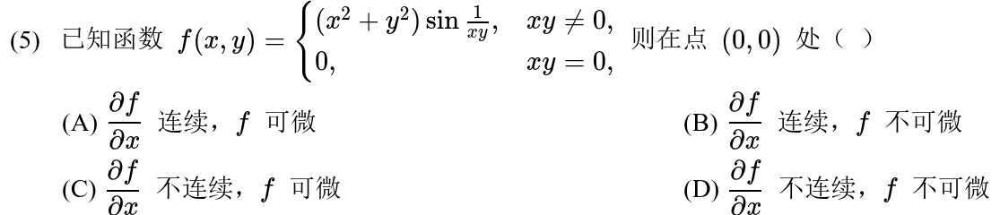
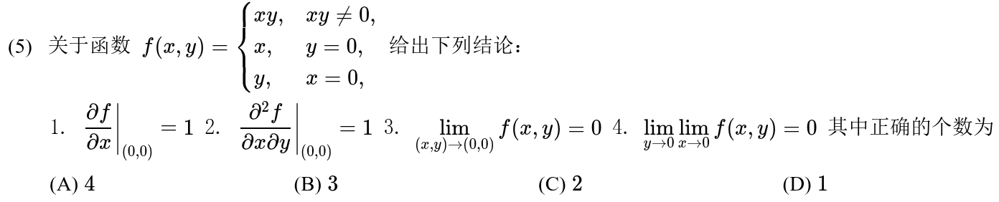
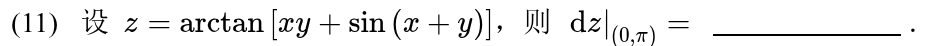
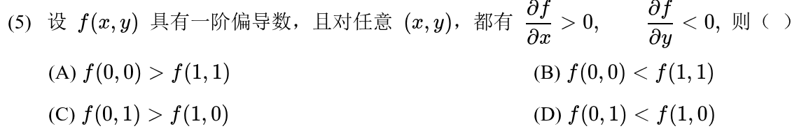
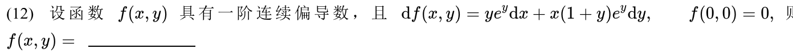
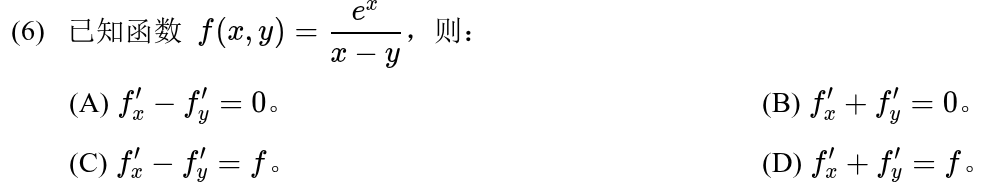
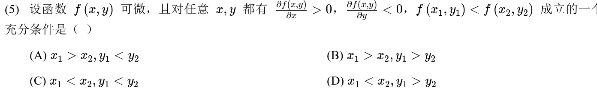

# 高等数学 · 多元函数极限、偏导与全微分

> 2010—2026年 · 7 道完整真题 · 年份从新到旧（2026→2010）  
> 题型分布：选择题 5 题 · 填空题 2 题 · 解答题 0 题  
> 考查范围：二元极限、连续可微关系、偏导数与全微分的基本性质

[查看对应网页版](16-multivariable-basics.html) · [返回章节总目录](../README.md)

---

## 2024年

### 01 · 2024-05 · 选择题

> *分段函数可微性判定。在 $(0,0)$ 处求偏导必须用定义算；判定可微性时验证极限 $\lim \frac{\Delta z - f_x \Delta x - f_y \Delta y}{\rho} = 0$，放缩后极坐标逼近。*

---

## 2020年

### 02 · 2020-05 · 选择题

> *多命题反例辨析。二阶混合偏导相等要求连续，二元极限存在比累次极限强得多。拿经典马鞍面或分段函数逐条对准性质检验。*

---

### 03 · 2020-11 · 填空题

---

## 2017年

### 04 · 2017-05 · 选择题

---

### 05 · 2017-12 · 填空题

*关联章节：[多元复合函数与隐函数求导](17-chain-implicit.md)*

---

## 2016年

### 06 · 2016-06 · 选择题

---

## 2012年

### 07 · 2012-05 · 选择题

*关联章节：[单调性、极值与零点个数](06-monotonicity-extrema.md)*

---

## 交叉考点索引

以下题目主归其他章节，点击跳转到对应章节题目；不计入本章主收录题数：

- [2026年 · 第14题](17-chain-implicit.md)（主章节：多元复合函数与隐函数求导）
- [2025年 · 第19题](18-multivariable-extrema.md)（主章节：多元函数极值与最值）
- [2024年 · 第20题](17-chain-implicit.md)（主章节：多元复合函数与隐函数求导）
- [2022年 · 第20题](18-multivariable-extrema.md)（主章节：多元函数极值与最值）
- [2021年 · 第6题](17-chain-implicit.md)（主章节：多元复合函数与隐函数求导）
- [2019年 · 第20题](17-chain-implicit.md)（主章节：多元复合函数与隐函数求导）
- [2015年 · 第13题](17-chain-implicit.md)（主章节：多元复合函数与隐函数求导）
- [2015年 · 第17题](18-multivariable-extrema.md)（主章节：多元函数极值与最值）
- [2014年 · 第11题](17-chain-implicit.md)（主章节：多元复合函数与隐函数求导）
- [2014年 · 第21题](13-integral-applications.md)（主章节：定积分应用）
- [2010年 · 第19题](17-chain-implicit.md)（主章节：多元复合函数与隐函数求导）
