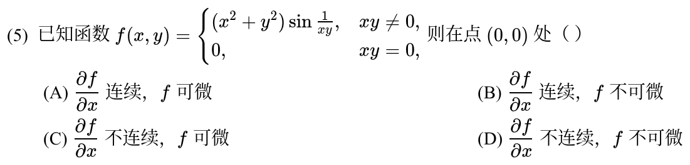
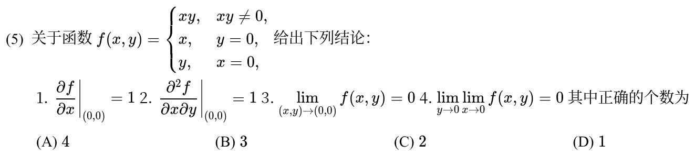
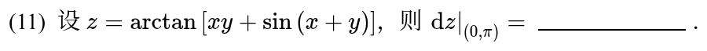
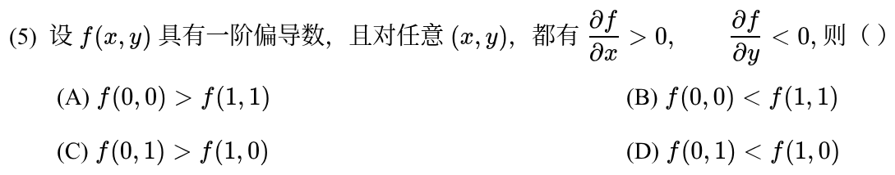
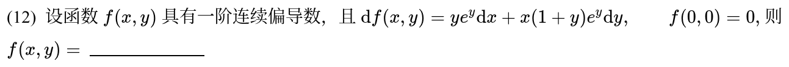
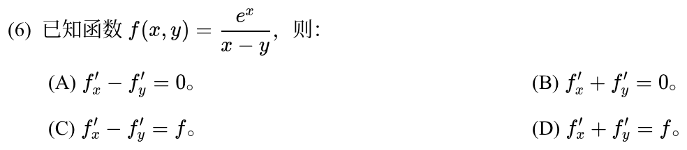
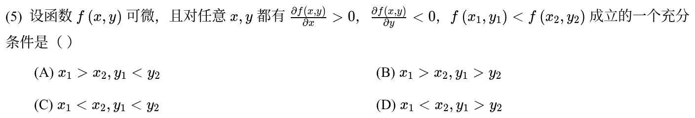

[« 高阶微分方程](15-higher-order-ode.md)　　[多元复合函数与隐函数求导 »](17-chain-implicit.md)

# 高等数学 · 多元函数极限、偏导与全微分

> **本章共 7 题**
> 
> - **核心必做（建议按顺序攻克关键方法）**：  
>   [第 06 题](#q06)（偏导计算基本功） → [第 03 题](#q03)（写全微分） → [第 05 题](#q05)（由全微分还原函数） → [第 01 题](#q01)（可微不要求偏导连续）
> 
> - **分流与刷题建议**：  
>   - **较难挑战**：[第 04 题](#q04)（偏导符号比较函数值）  
>   - **重在看思路**：[第 02 题](#q02)（分段点偏导与累次极限）  
> 
> - **过关目标**：分清偏导存在、偏导连续和可微；分段点先用定义。

---

### 01 · 2024年

> *分段函数可微性判定。在 $(0,0)$ 处求偏导必须用定义算；判定可微性时验证极限 $\lim \frac{\Delta z - f_x \Delta x - f_y \Delta y}{\rho} = 0$，放缩后极坐标逼近。*

答案与解析

**触发条件与第一步**

函数在 $xy=0$（即整条 $x$ 轴与 $y$ 轴）上分段定义为 $0$，询问在 $(0,0)$ 处 $\frac{\partial f}{\partial x}$ 的连续性与 $f$ 的可微性。**第一笔必须先用偏导定义算 $f_x(0,0)$ 和 $f_y(0,0)$**，绝不能直接对 $(x^2+y^2)\sin\frac{1}{xy}$ 求导后代 $(0,0)$。

**完整推演**

1. **按定义求 $(0,0)$ 处的一阶偏导数**：
   因为当 $y=0$ 时 $xy=0$，恒有 $f(x,0)=0$；当 $x=0$ 时 $xy=0$，恒有 $f(0,y)=0$。故
   $$f_x(0,0) = \lim_{x\to 0}\frac{f(x,0)-f(0,0)}{x} = \lim_{x\to 0}\frac{0-0}{x} = 0,$$
   $$f_y(0,0) = \lim_{y\to 0}\frac{f(0,y)-f(0,0)}{y} = \lim_{y\to 0}\frac{0-0}{y} = 0.$$
2. **按定义检验 $f$ 在 $(0,0)$ 处的可微性**：
   线性主部为 $f_x(0,0)x + f_y(0,0)y = 0$，检验余项与 $\rho = \sqrt{x^2+y^2}$ 之比的极限：
   $$\frac{f(x,y) - f(0,0) - f_x(0,0)x - f_y(0,0)y}{\sqrt{x^2+y^2}} = \frac{f(x,y)}{\sqrt{x^2+y^2}}.$$
   分两类点估计绝对值（$(x,y)\neq (0,0)$）：
   - 当 $xy \neq 0$ 时：
     $$\left|\frac{f(x,y)}{\sqrt{x^2+y^2}}\right| = \sqrt{x^2+y^2}\left|\sin\frac{1}{xy}\right| \le \sqrt{x^2+y^2};$$
   - 当 $xy = 0$ 时：$\left|\frac{f(x,y)}{\sqrt{x^2+y^2}}\right| = 0 \le \sqrt{x^2+y^2}$。

   因此对一切 $(x,y) \neq (0,0)$ 都有 $0 \le \left|\frac{f(x,y)}{\sqrt{x^2+y^2}}\right| \le \sqrt{x^2+y^2} \to 0$（当 $(x,y)\to(0,0)$）。由夹逼准则，极限为 $0$，故 **$f$ 在 $(0,0)$ 处可微**。
3. **检验 $\frac{\partial f}{\partial x}$ 在 $(0,0)$ 处的连续性**：
   在 $xy \neq 0$ 的区域内直接求偏导：
   $$f_x(x,y) = 2x\sin\frac{1}{xy} + (x^2+y^2)\cos\frac{1}{xy}\cdot\left(-\frac{1}{x^2 y}\right) = 2x\sin\frac{1}{xy} - \frac{x^2+y^2}{x^2 y}\cos\frac{1}{xy}.$$
   取趋近路径 $y = x \to 0$（满足 $xy = x^2 \neq 0$）：
   $$f_x(x,x) = 2x\sin\frac{1}{x^2} - \frac{2}{x}\cos\frac{1}{x^2}.$$
   再取点列 $x_n = \frac{1}{\sqrt{2n\pi}} \to 0$，则 $\sin\frac{1}{x_n^2}=0$，$\cos\frac{1}{x_n^2}=1$，得
   $$f_x(x_n, x_n) = -2\sqrt{2n\pi} \to -\infty \neq 0 = f_x(0,0).$$
   因此 $\lim_{(x,y)\to(0,0)} f_x(x,y)$ 不存在，**$\frac{\partial f}{\partial x}$ 在 $(0,0)$ 处不连续**。

综上，选 **（C）**。

**选择题干扰项拆解**

- **（D）$\frac{\partial f}{\partial x}$ 不连续，$f$ 不可微（最大陷阱）**：先算出 $f_x$ 不连续后，误以为“偏导不连续 $\implies$ 不可微”，把充分条件当成了充要条件。
- **（A）$\frac{\partial f}{\partial x}$ 连续，$f$ 可微**：先证出 $f$ 可微后，反推误以为“可微 $\implies$ 偏导连续”。
- **（B）$\frac{\partial f}{\partial x}$ 连续，$f$ 不可微**：由本题关于 $x,y$ 的对称性，若 $f_x$ 在 $(0,0)$ 连续则 $f_y$ 也必在 $(0,0)$ 连续，从而 $f$ 必可微，选项本身与定理矛盾，可直接秒排。

---

### 02 · 2020年

> *多命题反例辨析。二阶混合偏导相等要求连续，二元极限存在比累次极限强得多。拿经典马鞍面或分段函数逐条对准性质检验。*

答案与解析

**答案**：**（B）** 结论 1、3、4 正确，共 $3$ 个

- **切入点与推演**：分段函数在坐标轴 $xy=0$ 上单独定义，检验原点处的偏导数、二阶混合偏导数与极限必须回归定义。
  1. **结论 1**：在 $x$ 轴上（$y=0$）恒有 $f(x,0)=x$，特别地 $f(0,0)=0$，故
     $$\left.\frac{\partial f}{\partial x}\right|_{(0,0)} = \lim_{x\to 0}\frac{f(x,0)-f(0,0)}{x} = \lim_{x\to 0}\frac{x-0}{x} = 1,$$
     结论 1 正确。
  2. **结论 2**：$\left.\frac{\partial^2 f}{\partial x\partial y}\right|_{(0,0)} = \lim_{y\to 0}\frac{f_x(0,y)-f_x(0,0)}{y}$，须先考察 $y\neq 0$ 时 $f_x(0,y)$ 是否存在。固定 $y\neq 0$，
     $$f_x(0,y) = \lim_{x\to 0}\frac{f(x,y)-f(0,y)}{x} = \lim_{x\to 0}\frac{xy - y}{x} = \lim_{x\to 0}\left(y - \frac{y}{x}\right),$$
     该极限不存在（同理对 $x\neq 0$，$f_y(x,0)$ 也不存在），故二阶混合偏导数在 $(0,0)$ 处不存在，结论 2 错误。
  3. **结论 3**：对任意 $(x,y)\neq (0,0)$，按三个分支均有
     $$0 \le |f(x,y)| \le \max\{|xy|,\,|x|,\,|y|\} \to 0 \qquad ((x,y)\to(0,0)),$$
     由夹逼准则得 $\lim_{(x,y)\to(0,0)} f(x,y) = 0$，结论 3 正确。
  4. **结论 4**：先固定 $y\neq 0$，当 $x\to 0$（$x\neq 0$）时满足 $xy\neq 0$，从而 $f(x,y)=xy$，于是
     $$\lim_{x\to 0}f(x,y) = \lim_{x\to 0}(xy) = 0 \implies \lim_{y\to 0}\lim_{x\to 0}f(x,y) = \lim_{y\to 0}0 = 0,$$
     结论 4 正确。
- **干扰项 / 易错提示**：最易误选（A），原因是在 $xy\neq 0$ 处直接对 $xy$ 求偏导得到 $\frac{\partial^2 (xy)}{\partial x\partial y}=1$ 后就盲目代入 $(0,0)$，忽略了 $f$ 在非原点坐标轴上根本不连续（$\lim_{x\to 0}f(x,y)=0\neq y=f(0,y)$）。

---

### 03 · 2020年

答案与解析

- **先代点算中间值提速**：令 $u = xy + \sin(x+y)$，在 $(0,\pi)$ 处 $u(0,\pi) = 0 + \sin\pi = 0$，故外层导数 $\frac{1}{1+u^2} = 1$。
- **算偏导（可先代另一变量）**：
  - $u_x(0,\pi) = \left.[y + \cos(x+y)]\right|_{(0,\pi)} = \pi + \cos\pi = \pi - 1$；
  - $u_y(0,\pi) = \left.[x + \cos(x+y)]\right|_{(0,\pi)} = 0 + \cos\pi = -1$。
- **答案**：$\left.\mathrm{d}z\right|_{(0,\pi)} = (\pi - 1)\mathrm{d}x - \mathrm{d}y$（注意不能漏写 $\mathrm{d}x, \mathrm{d}y$）。

---

### 04 · 2017年

答案与解析

**答案**：**（D）** $f(0,1) < f(1,0)$

- **切入点与推演**：由 $\frac{\partial f}{\partial x}>0$ 知固定 $y$ 时 $f$ 关于 $x$ 严格单调递增；由 $\frac{\partial f}{\partial y}<0$ 知固定 $x$ 时 $f$ 关于 $y$ 严格单调递减。通过引入过渡点 $(1,1)$ 将二维比较拆为两次一元单调性比较：
  1. 固定 $y=1$，因 $0<1$ 且 $f_x>0$，有 $f(0,1) < f(1,1)$；
  2. 固定 $x=1$，因 $1>0$ 且 $f_y<0$，有 $f(1,1) < f(1,0)$。

  联立两式即得
  $$f(0,1) < f(1,1) < f(1,0).$$
- **干扰项 / 易错提示**：（A）（B）比较 $(0,0)$ 与 $(1,1)$，从 $(0,0)$ 到 $(1,1)$ 时 $x$ 增大使 $f$ 增大而 $y$ 增大使 $f$ 减小，两者作用相反，无法确定大小（例如取 $f=2x-y$ 与 $f=x-2y$ 即可反证）；（C）不等号方向相反。

---

### 05 · 2017年

答案与解析

**答案**：$xye^y$

- **切入点与推演**：由全微分公式 $\mathrm{d}f = f_x\,\mathrm{d}x + f_y\,\mathrm{d}y$ 读出两个偏导数，再采用“偏积分 + 求导定待定函数”还原 $f(x,y)$：
  $$\begin{cases} f_x(x,y) = ye^y, \\ f_y(x,y) = x(1+y)e^y. \end{cases}$$
  1. 对第一式关于 $x$ 偏积分（把 $y$ 看作常数）：
     $$f(x,y) = xye^y + \varphi(y).$$
  2. 两边对 $y$ 求偏导并与第二式对照：
     $$f_y(x,y) = x(e^y + ye^y) + \varphi'(y) = x(1+y)e^y + \varphi'(y) = x(1+y)e^y \implies \varphi'(y) = 0,$$
     故 $\varphi(y) = C$（常数）。
  3. 代入初值 $f(0,0) = 0$，得 $0 + C = 0 \implies C = 0$，因此 $f(x,y) = xye^y$。
  （也可直接凑微分：$\mathrm{d}f = ye^y\mathrm{d}x + x\,\mathrm{d}(ye^y) = \mathrm{d}(xye^y)$，结合 $f(0,0)=0$ 得 $f(x,y)=xye^y$。）
- **易错点**：对 $x$ 偏积分后容易漏写关于另一变量的待定函数 $\varphi(y)$（误写成常数 $C$），务必通过另一偏导式验证 $\varphi'(y)$ 并用初值定常数。

---

### 06 · 2016年

答案与解析

**触发条件与第一步**

看到分母是 $x-y$、分子只含 $e^x$，第一笔直接分别求 $f'_x$ 与 $f'_y$，重点盯住分母求导后的 $\frac{e^x}{(x-y)^2}$ 项符号，看两者相加还是相减能把二次分母消掉。

**完整推演**

1. **对 $x$ 求偏导**（把 $y$ 视为常数，用商的求导法则）：
   $$f'_x = \frac{e^x(x-y) - e^x \cdot 1}{(x-y)^2} = \frac{e^x}{x-y} - \frac{e^x}{(x-y)^2} = f - \frac{e^x}{(x-y)^2}.$$
2. **对 $y$ 求偏导**（把 $x$ 视为常数，注意链式法则里 $\frac{\partial (x-y)}{\partial y} = -1$）：
   $$f'_y = e^x \cdot \left(-\frac{1}{(x-y)^2}\right)\cdot (-1) = \frac{e^x}{(x-y)^2}.$$
3. **两式相加消去二次分母**：
   $$f'_x + f'_y = \left(f - \frac{e^x}{(x-y)^2}\right) + \frac{e^x}{(x-y)^2} = f.$$

故正确选项为 **（D）**。

**选择题干扰项拆解**

- **（C）$f'_x - f'_y = f$（最高频错选）**：算 $f'_y$ 时漏乘了内层导数 $-1$，把 $f'_y$ 算成了 $-\frac{e^x}{(x-y)^2}$，进而凑出 $f'_x - f'_y = f$。
- **（B）$f'_x + f'_y = 0$**：对 $x$ 求导时只求了分母 $(x-y)^{-1}$ 而漏了对分子 $e^x$ 求导。
- **（A）$f'_x - f'_y = 0$**：同时漏掉了分子求导与 $f'_y$ 的负号。

---

### 07 · 2012年

答案与解析

**答案**：**（D）** $x_1 < x_2,\; y_1 > y_2$

- **切入点与推演**：由 $f_x>0$、$f_y<0$ 可知，$f$ 随 $x$ 增大而严格递增，随 $y$ 减小而严格递增。要保证 $f(x_1,y_1) < f(x_2,y_2)$，只需让从 $(x_1,y_1)$ 到 $(x_2,y_2)$ 的两步坐标变化都使函数值增大，即 $x_1 < x_2$ 且 $y_1 > y_2$。借助过渡点 $(x_2, y_1)$ 验证：
  $$f(x_1, y_1) < f(x_2, y_1) < f(x_2, y_2).$$
- **干扰项 / 易错提示**：（A）使两步变化均减小，推出 $f(x_1,y_1) > f(x_2,y_2)$；（B）（C）中 $x,y$ 的变化方向对函数值的影响相反，均不构成充分条件。

---

[« 高阶微分方程](15-higher-order-ode.md)　　[多元复合函数与隐函数求导 »](17-chain-implicit.md)
