[« 多元函数极限、偏导与全微分](16-multivariable-basics.md)　　[多元函数极值与最值 »](18-multivariable-extrema.md)

# 高等数学 · 多元复合函数与隐函数求导

> **必会·按此顺序**：[2012-11](#q2012-11)（链式法则的内外层） → [2015-13](#q2015-13)（隐函数全微分） → [2023-13](#q2023-13)（隐函数二阶偏导） → [2017-16](#q2017-16)（复合函数二阶导） → [2011-17](#q2011-17)（混合偏导与给定极值条件）  
> **冲一冲**：[2024-20](#q2024-20)（二阶变量替换并恢复函数）  
> **见识·先会开题**：[2010-05](#q2010-5)（齐次结构让偏导组合消去）  
> **待核·暂不安排**：[2015-05](#q2015-5)（目标点与当前换元定义不符，待核） → [2021-06](#q2021-6)（按两条恒等式求导的结果与选项不符，待核）  
> **首轮过关**：二阶求导要保留每一层内导；先求基点再代数值。

---

## 2026年

### 01 · 2026-03 · 选择题

> 一阶隐函数求导。方程两边直接对  和  分别求偏导，把  视为中间变量，直接求出偏导数比值，不要把  硬解出来。

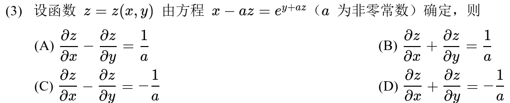

---

### 02 · 2026-14 · 填空题

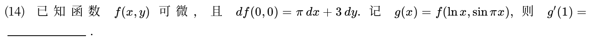

*关联章节：[多元函数极限、偏导与全微分](16-multivariable-basics.md)*

---

## 2025年

### 03 · 2025-01 · 选择题

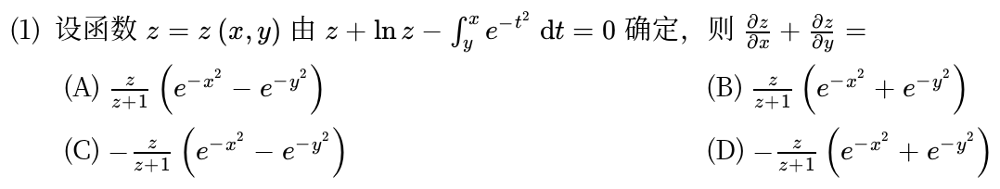

*关联章节：[定积分、变上限积分与积分性质](11-definite-integrals.md)*

---

## 2024年

### 04 · 2024-20 · 解答题

> 复合函数二阶偏导大题。令 ，用链式法则分别算一阶、二阶偏导，代入原偏微分方程，交叉偏导项会相互抵消，化成极简方程。

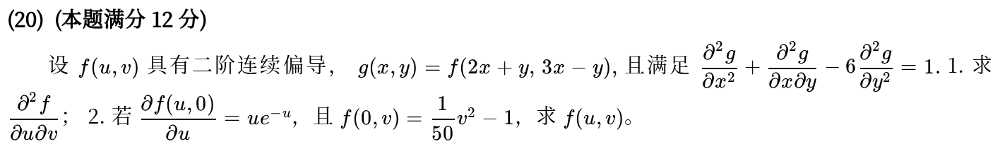

*关联章节：[多元函数极限、偏导与全微分](16-multivariable-basics.md)*

---

## 2023年

### 05 · 2023-13 · 填空题

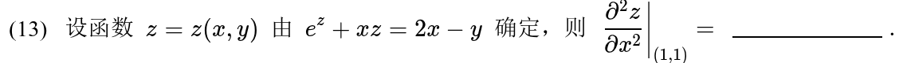

---

## 2022年

### 06 · 2022-04 · 选择题

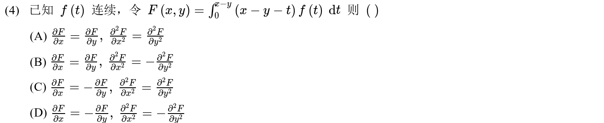

*关联章节：[定积分、变上限积分与积分性质](11-definite-integrals.md)*

---

## 2021年

### 07 · 2021-06 · 选择题

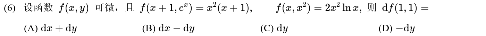

*关联章节：[多元函数极限、偏导与全微分](16-multivariable-basics.md)*

---

### 08 · 2021-13 · 填空题

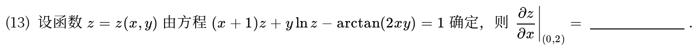

---

## 2019年

### 09 · 2019-11 · 填空题

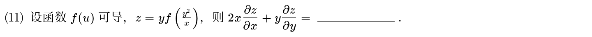

---

### 10 · 2019-20 · 解答题

> 偏微分方程坐标代换化简。做变量代换后，把所有偏导数换为关于新变量  的导数，代入原方程整理，通常会化为标准的常微分方程形式。

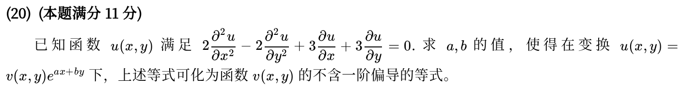

*关联章节：[多元函数极限、偏导与全微分](16-multivariable-basics.md)*

---

## 2018年

### 11 · 2018-13 · 填空题

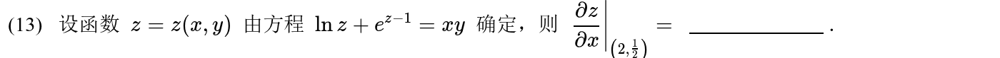

---

## 2017年

### 12 · 2017-16 · 解答题

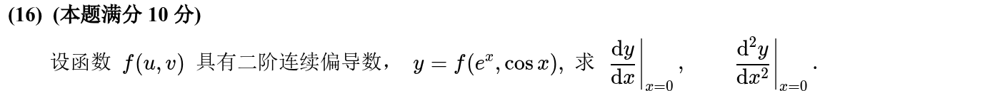

---

## 2015年

### 13 · 2015-05 · 选择题

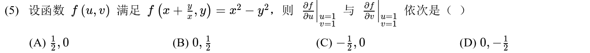

---

### 14 · 2015-13 · 填空题

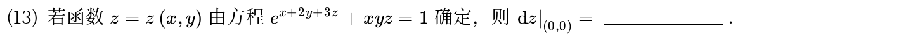

*关联章节：[多元函数极限、偏导与全微分](16-multivariable-basics.md)*

---

## 2014年

### 15 · 2014-11 · 填空题

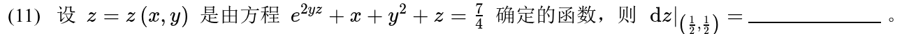

*关联章节：[多元函数极限、偏导与全微分](16-multivariable-basics.md)*

---

### 16 · 2014-18 · 解答题

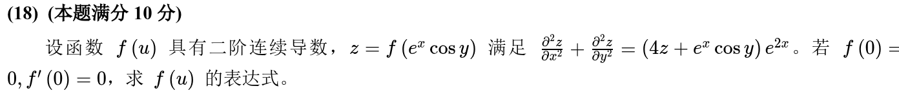

*关联章节：[高阶微分方程](15-higher-order-ode.md)*

---

## 2013年

### 17 · 2013-05 · 选择题

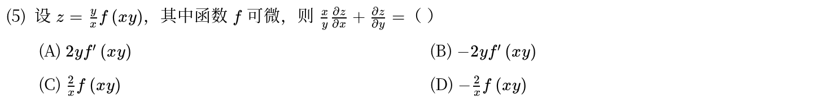

---

## 2012年

### 18 · 2012-11 · 填空题

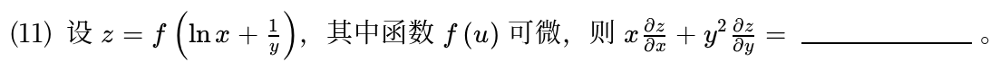

---

## 2011年

### 19 · 2011-17 · 解答题

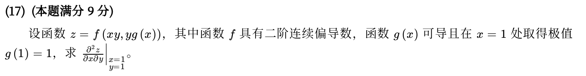

---

## 2010年

### 20 · 2010-05 · 选择题

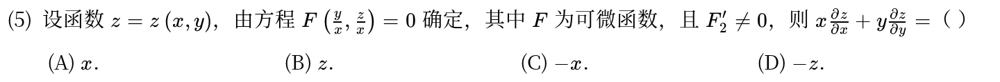

---

### 21 · 2010-19 · 解答题

> 二阶偏导方程化简大题。链式法则展开时切记对每个中间变量逐层求导，利用二阶混合偏导连续性合并同类项，耐心整理系数。

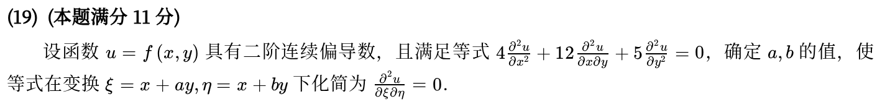

*关联章节：[多元函数极限、偏导与全微分](16-multivariable-basics.md)*

---

## 交叉考点索引

以下题目主归其他章节，点击跳转到对应章节题目；不计入本章主收录题数：

- [2024年 · 第13题](14-first-order-ode.md)（主章节：一阶微分方程）
- [2022年 · 第20题](18-multivariable-extrema.md)（主章节：多元函数极值与最值）
- [2017年 · 第12题](16-multivariable-basics.md)（主章节：多元函数极限、偏导与全微分）
- [2016年 · 第17题](18-multivariable-extrema.md)（主章节：多元函数极值与最值）
- [2013年 · 第19题](18-multivariable-extrema.md)（主章节：多元函数极值与最值）
- [2012年 · 第9题](04-derivatives.md)（主章节：导数、微分与求导法则）
- [2011年 · 第21题](19-double-integrals.md)（主章节：二重积分）

[« 多元函数极限、偏导与全微分](16-multivariable-basics.md)　　[多元函数极值与最值 »](18-multivariable-extrema.md)
