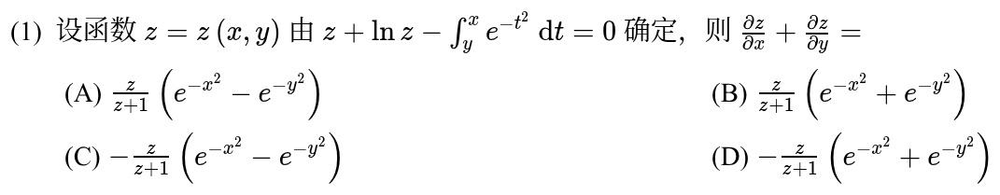
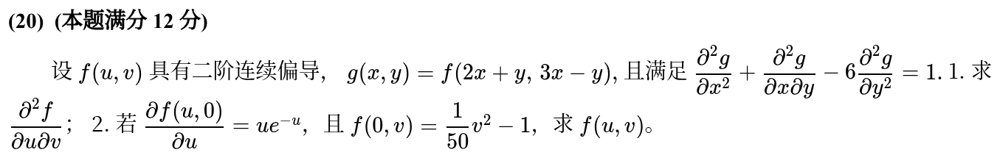
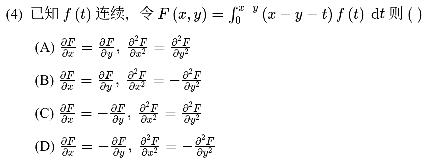
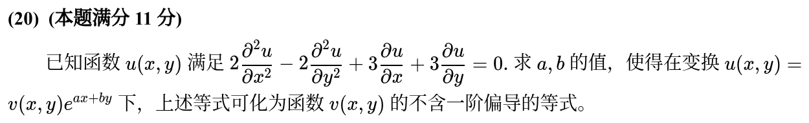
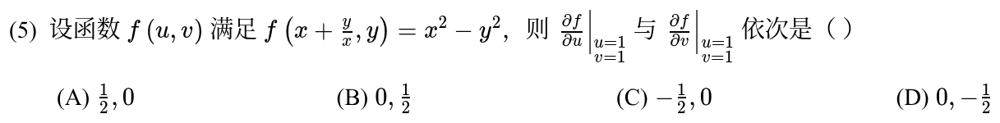
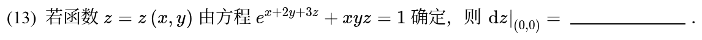
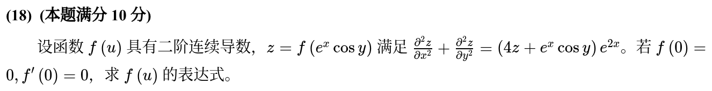
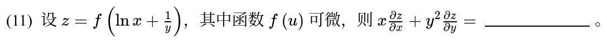
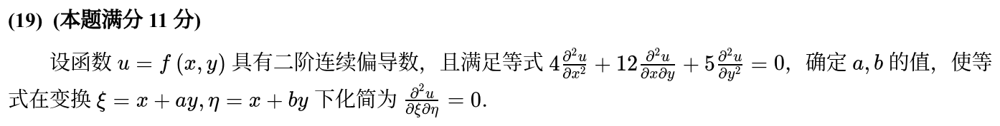

[« 多元函数极限、偏导与全微分](16-multivariable-basics.md)　　[多元函数极值与最值 »](18-multivariable-extrema.md)

# 高等数学 · 多元复合函数与隐函数求导

> **本章共 21 题**
> 
> - **核心必做（建议按顺序攻克关键方法）**：  
>   [第 18 题](#q18)（链式法则的内外层） → [第 14 题](#q14)（隐函数全微分） → [第 05 题](#q05)（隐函数二阶偏导） → [第 12 题](#q12)（复合函数二阶导） → [第 19 题](#q19)（混合偏导与给定极值条件）
> 
> - **分流与刷题建议**：  
>   - **较难挑战**：[第 04 题](#q04)（二阶变量替换并恢复函数）  
>   - **重在看思路**：[第 20 题](#q20)（齐次结构让偏导组合消去）  
>   - **首轮可跳过**：[第 10 题](#q10)、[第 16 题](#q16)、[第 21 题](#q21)（技巧较偏或综合度高，首轮不必死磕）  
>   - **题面存疑暂缓**：[第 13 题](#q13)（目标点与当前换元定义不符，待核）、[第 07 题](#q07)（按两条恒等式求导的结果与选项不符，待核）（原卷转写存疑，首轮暂不安排）  
> 
> - **过关目标**：二阶求导要保留每一层内导；先求基点再代数值。

---

### 01 · 2026年

> *一阶隐函数求导。方程两边直接对 $x$ 和 $y$ 分别求偏导，把 $z$ 视为中间变量，直接求出偏导数比值，不要把 $z$ 硬解出来。*

答案与解析

**答案**：**（A）** $\dfrac{\partial z}{\partial x} - \dfrac{\partial z}{\partial y} = \dfrac{1}{a}$

- **切入点与推演**：方程无法显式解出 $z$，直接对两边分别关于 $x$ 和 $y$ 求偏导，保持两式分母相同即可一眼看出加减消元方向。记 $E = e^{y+az}$：
  1. 两边对 $x$ 求偏导：
     $$1 - a\frac{\partial z}{\partial x} = a E\frac{\partial z}{\partial x} \implies \frac{\partial z}{\partial x} = \frac{1}{a(1 + E)}.$$
  2. 两边对 $y$ 求偏导：
     $$-a\frac{\partial z}{\partial y} = E\left(1 + a\frac{\partial z}{\partial y}\right) \implies -a(1 + E)\frac{\partial z}{\partial y} = E \implies \frac{\partial z}{\partial y} = -\frac{E}{a(1 + E)}.$$
  3. 两式相减消去 $E$：
     $$\frac{\partial z}{\partial x} - \frac{\partial z}{\partial y} = \frac{1 + E}{a(1 + E)} = \frac{1}{a}.$$
- **干扰项 / 易错提示**：求 $\frac{\partial z}{\partial y}$ 时易漏掉指数项对 $y$ 的显式偏导 $1$ 或搞反移项符号，从而误选（B）或（C）。

---

### 02 · 2026年

答案与解析

**答案**：$-2\pi$

- **切入点与推演**：由全微分 $\mathrm{d}f(0,0) = \pi\,\mathrm{d}x + 3\,\mathrm{d}y$ 直接读出 $f_1'(0,0) = \pi$、$f_2'(0,0) = 3$。再对复合函数 $g(x) = f(u(x), v(x))$（其中 $u(x) = \ln x,\; v(x) = \sin\pi x$）应用链式法则：
  1. 当 $x = 1$ 时，$u(1) = \ln 1 = 0$，$v(1) = \sin\pi = 0$，恰好落在已知点 $(0,0)$；
  2. 计算内层导数在 $x = 1$ 处的值：
     $$u'(1) = \left.\frac{1}{x}\right|_{x=1} = 1, \qquad v'(1) = \left.\pi\cos\pi x\right|_{x=1} = \pi\cos\pi = -\pi;$$
  3. 代入链式法则：
     $$g'(1) = f_1'(0,0)u'(1) + f_2'(0,0)v'(1) = \pi\cdot 1 + 3\cdot(-\pi) = -2\pi.$$
- **易错点**：求 $(\sin\pi x)'\big|_{x=1}$ 时容易漏乘内层系数 $\pi$ 或把 $\cos\pi = -1$ 误算成 $+1$。

---

### 03 · 2025年

答案与解析

**答案**：**（A）** $\dfrac{z}{z+1}\left(e^{-x^2} - e^{-y^2}\right)$

- **切入点与推演**：隐函数方程含变限积分 $\int_y^x e^{-t^2}\,\mathrm{d}t$，改写为 $z + \ln z = \int_y^x e^{-t^2}\,\mathrm{d}t$（$z > 0$）后两边分别对 $x, y$ 求偏导：
  1. 对 $x$ 求偏导（上限求导取正号）：
     $$\left(1 + \frac{1}{z}\right)\frac{\partial z}{\partial x} = e^{-x^2} \implies \frac{\partial z}{\partial x} = \frac{z}{z+1}e^{-x^2}.$$
  2. 对 $y$ 求偏导（下限求导取负号）：
     $$\left(1 + \frac{1}{z}\right)\frac{\partial z}{\partial y} = -e^{-y^2} \implies \frac{\partial z}{\partial y} = -\frac{z}{z+1}e^{-y^2}.$$
  3. 两式相加得
     $$\frac{\partial z}{\partial x} + \frac{\partial z}{\partial y} = \frac{z}{z+1}\left(e^{-x^2} - e^{-y^2}\right).$$
- **干扰项 / 易错提示**：最易错选（B），原因是忘记变下限积分求导要添负号（$\frac{\partial}{\partial y}\int_y^x e^{-t^2}\,\mathrm{d}t = -e^{-y^2}$）。

---

### 04 · 2024年

> *复合函数二阶偏导大题。令 $u=2x+y, v=3x-y$，用链式法则分别算一阶、二阶偏导，代入原偏微分方程，交叉偏导项会相互抵消，化成极简方程。*

答案与解析

**结论速览**：（1）$\dfrac{\partial^2 f}{\partial u\partial v} = \dfrac{1}{25}$；（2）$f(u,v) = \dfrac{uv}{25} - (u+1)e^{-u} + \dfrac{1}{50}v^2$。

- **（1）利用二阶复合函数链式法则求 $\dfrac{\partial^2 f}{\partial u\partial v}$**：
  令 $u = 2x + y,\; v = 3x - y$，由链式法则先求一阶偏导：
  $$\frac{\partial g}{\partial x} = 2f_u + 3f_v, \qquad \frac{\partial g}{\partial y} = f_u - f_v.$$
  再分别求二阶偏导（因 $f$ 具有二阶连续偏导数，$f_{uv} = f_{vu}$）：
  $$\begin{aligned}
  \frac{\partial^2 g}{\partial x^2} &= 2(2f_{uu} + 3f_{uv}) + 3(2f_{vu} + 3f_{vv}) = 4f_{uu} + 12f_{uv} + 9f_{vv}, \\
  \frac{\partial^2 g}{\partial x\partial y} &= 2(f_{uu} - f_{uv}) + 3(f_{vu} - f_{vv}) = 2f_{uu} + f_{uv} - 3f_{vv}, \\
  \frac{\partial^2 g}{\partial y^2} &= (f_{uu} - f_{uv}) - (f_{vu} - f_{vv}) = f_{uu} - 2f_{uv} + f_{vv}.
  \end{aligned}$$
  代入已知方程 $\frac{\partial^2 g}{\partial x^2} + \frac{\partial^2 g}{\partial x\partial y} - 6\frac{\partial^2 g}{\partial y^2} = 1$：
  $$(4 + 2 - 6)f_{uu} + (12 + 1 + 12)f_{uv} + (9 - 3 - 6)f_{vv} = 25f_{uv} = 1 \implies \frac{\partial^2 f}{\partial u\partial v} = \frac{1}{25}.$$
- **（2）两次偏积分还原 $f(u,v)$**：
  1. 对 $\dfrac{\partial^2 f}{\partial u\partial v} = \dfrac{1}{25}$ 关于 $v$ 偏积分：
     $$\frac{\partial f(u,v)}{\partial u} = \frac{v}{25} + \varphi(u).$$
     代入 $\dfrac{\partial f(u,0)}{\partial u} = ue^{-u}$，得 $\varphi(u) = ue^{-u}$，故 $\dfrac{\partial f}{\partial u} = \dfrac{v}{25} + ue^{-u}$。
  2. 再对 $u$ 偏积分（分部积分 $\int ue^{-u}\,\mathrm{d}u = -(u+1)e^{-u}$）：
     $$f(u,v) = \frac{uv}{25} - (u+1)e^{-u} + \psi(v).$$
     代入 $f(0,v) = \dfrac{1}{50}v^2 - 1$，得 $-1 + \psi(v) = \dfrac{1}{50}v^2 - 1 \implies \psi(v) = \dfrac{1}{50}v^2$。因此
     $$f(u,v) = \frac{uv}{25} - (u+1)e^{-u} + \frac{1}{50}v^2.$$
- **核心思路与避坑**：代入 $u = 0$ 定 $\psi(v)$ 时注意 $-(0+1)e^0 = -1$ 并非 $0$，切勿漏掉这个常数项而多减一个 $1$。

---

### 05 · 2023年

答案与解析

- **第一步定 $z(1,1)$**：代入 $x=1, y=1$ 得 $e^z + z = 1$，由 $e^z+z$ 严格单调增知唯一解 $z(1,1) = 0$。
- **第二步求一阶式并代值**：两边对 $x$ 求偏导得 $(e^z + x)z_x + z = 2$。代入 $(1,1,0)$ 得 $2z_x(1,1) = 2 \implies z_x(1,1) = 1$。
- **第三步对一阶式再对 $x$ 求偏导**（千万别先代值再求导！）：
  $$(e^z z_x + 1)z_x + (e^z + x)z_{xx} + z_x = 0 \iff (e^z + x)z_{xx} + e^z z_x^2 + 2z_x = 0.$$
  代入 $x=1, z=0, z_x=1$：$2z_{xx} + 1 + 2 = 0 \implies z_{xx}(1,1) = -\frac{3}{2}$。
- **答案**：$-\dfrac{3}{2}$。

---

### 06 · 2022年

答案与解析

**答案**：**（C）** $\dfrac{\partial F}{\partial x} = -\dfrac{\partial F}{\partial y},\; \dfrac{\partial^2 F}{\partial x^2} = \dfrac{\partial^2 F}{\partial y^2}$

- **切入点与推演**：被积函数和积分上限中 $x,y$ 始终以整体 $u = x - y$ 出现，先写成一元复合函数 $F(x,y) = G(x - y)$ 即可极大简化求导。
  1. 令 $u = x - y$，则
     $$G(u) = \int_0^u (u - t)f(t)\,\mathrm{d}t = u\int_0^u f(t)\,\mathrm{d}t - \int_0^u t f(t)\,\mathrm{d}t.$$
     因 $f$ 连续，$G(u)$ 二阶可导：
     $$G'(u) = \int_0^u f(t)\,\mathrm{d}t + u f(u) - u f(u) = \int_0^u f(t)\,\mathrm{d}t, \qquad G''(u) = f(u).$$
  2. 由复合函数求导法则（$u_x = 1,\; u_y = -1$）：
     $$\frac{\partial F}{\partial x} = G'(u), \qquad \frac{\partial F}{\partial y} = -G'(u) \implies \frac{\partial F}{\partial x} = -\frac{\partial F}{\partial y};$$
     $$\frac{\partial^2 F}{\partial x^2} = G''(u), \qquad \frac{\partial^2 F}{\partial y^2} = (-1)^2 G''(u) = G''(u) \implies \frac{\partial^2 F}{\partial x^2} = \frac{\partial^2 F}{\partial y^2}.$$
  故正确选项为 **（C）**。
- **干扰项 / 易错提示**：求 $\frac{\partial^2 F}{\partial y^2}$ 时每对 $y$ 求导一次就多乘一个 $-1$，二阶求导共乘两次 $(-1)^2 = +1$，容易误以为二阶也带负号而错选（D）。

---

### 07 · 2021年

答案与解析

**题面待核**：当前转写中第一式 $f(x+1, e^x) = x^2(x+1)$ 与四个选项矛盾，无法匹配任何选项；若按 2021 年原卷第一式 $f(x+1, e^x) = x(x+1)^2$ 还原，则选 **（C）** $\mathrm{d}y$。

- **按当前转写的推演（矛盾所在）**：
  1. 对第一式 $f(x+1, e^x) = x^2(x+1)$ 两边关于 $x$ 求导并令 $x = 0$（此时 $(x+1, e^x) = (1,1)$）：
     $$f_x(1,1)\cdot 1 + f_y(1,1)\cdot e^0 = \left.(3x^2 + 2x)\right|_{x=0} = 0 \implies f_x(1,1) + f_y(1,1) = 0.$$
  2. 对第二式 $f(x, x^2) = 2x^2\ln x$ 两边关于 $x$ 求导并令 $x = 1$（此时 $(x, x^2) = (1,1)$）：
     $$f_x(1,1)\cdot 1 + f_y(1,1)\cdot 2 = \left.(4x\ln x + 2x)\right|_{x=1} = 2 \implies f_x(1,1) + 2f_y(1,1) = 2.$$
  3. 联立解得 $f_x(1,1) = -2,\; f_y(1,1) = 2$，即 $\mathrm{d}f(1,1) = -2\,\mathrm{d}x + 2\,\mathrm{d}y$，不在（A）–（D）中。
- **按原卷意图 $f(x+1, e^x) = x(x+1)^2$ 的推导**：
  若第一式右端为 $x(x+1)^2$，则在 $x = 0$ 处求导得 $\left.\big((x+1)^2 + 2x(x+1)\big)\right|_{x=0} = 1$，从而
  $$\begin{cases} f_x(1,1) + f_y(1,1) = 1, \\ f_x(1,1) + 2f_y(1,1) = 2 \end{cases} \implies f_x(1,1) = 0,\quad f_y(1,1) = 1,$$
  于是 $\mathrm{d}f(1,1) = \mathrm{d}y$，对应 **（C）**。

---

### 08 · 2021年

答案与解析

**答案**：$1$

- **切入点与推演**：隐函数在具体点处求一阶偏导，先代入坐标定出 $z$ 值，再对原方程两边关于 $x$ 求偏导并代点。
  1. **定基点 $z(0,2)$**：将 $x = 0,\; y = 2$ 代入原方程，得
     $$z + 2\ln z = 1 \qquad (z > 0).$$
     因 $h(z) = z + 2\ln z$ 在 $(0,+\infty)$ 上严格单调递增且 $h(1) = 1$，故唯一解为 $z(0,2) = 1$。
  2. **隐函数对 $x$ 求偏导**：方程两边对 $x$ 求偏导（将 $y$ 看作常数），得
     $$z + (x + 1)\frac{\partial z}{\partial x} + \frac{y}{z}\frac{\partial z}{\partial x} - \frac{2y}{1 + 4x^2 y^2} = 0.$$
  3. **代入 $(x,y,z) = (0,2,1)$**：
     $$1 + 1\cdot\frac{\partial z}{\partial x} + 2\cdot\frac{\partial z}{\partial x} - 4 = 0 \implies 3\left.\frac{\partial z}{\partial x}\right|_{(0,2)} = 3 \implies \left.\frac{\partial z}{\partial x}\right|_{(0,2)} = 1.$$
- **易错点**：对 $(x+1)z$ 求偏导时容易忘记用乘积法则（漏掉 $z$ 项），以及对 $\arctan(2xy)$ 求偏导时漏乘内导 $2y$。

---

### 09 · 2019年

答案与解析

**答案**：$y f\left(\dfrac{y^2}{x}\right)$（或写为 $z$）

- **切入点与推演**：令中间变量 $u = \dfrac{y^2}{x}$，按乘积法则与链式法则分别写出 $z_x$ 与 $z_y$，代入组合式后 $f'(u)$ 项完全抵消：
  $$\frac{\partial z}{\partial x} = y f'(u)\cdot\left(-\frac{y^2}{x^2}\right) = -\frac{y^3}{x^2}f'(u),$$
  $$\frac{\partial z}{\partial y} = f(u) + y f'(u)\cdot\frac{2y}{x} = f(u) + \frac{2y^2}{x}f'(u).$$
  代入所求组合：
  $$2x\frac{\partial z}{\partial x} + y\frac{\partial z}{\partial y} = 2x\left(-\frac{y^3}{x^2}f'(u)\right) + y\left(f(u) + \frac{2y^2}{x}f'(u)\right) = y f\left(\frac{y^2}{x}\right) = z.$$
- **易错点**：求 $z_y$ 时 $y$ 同时出现在外层因子与内层 $u = y^2/x$ 中，切勿漏用乘积法则而丢掉 $f(u)$ 项。

---

### 10 · 2019年

> *偏微分方程坐标代换化简。做变量代换后，把所有偏导数换为关于新变量 $u, v$ 的导数，代入原方程整理，通常会化为标准的常微分方程形式。*

答案与解析

**结论速览**：$a = -\dfrac{3}{4},\; b = \dfrac{3}{4}$（此时原方程化为 $\dfrac{\partial^2 v}{\partial x^2} - \dfrac{\partial^2 v}{\partial y^2} = 0$）。

- **完整解答**：
  1. **计算 $u$ 的各阶偏导数**：由 $u(x,y) = v(x,y)e^{ax+by}$，分别对 $x, y$ 求一阶与二阶偏导：
     $$\begin{aligned}
     u_x &= (v_x + av)e^{ax+by}, & u_{xx} &= (v_{xx} + 2av_x + a^2 v)e^{ax+by}, \\
     u_y &= (v_y + bv)e^{ax+by}, & u_{yy} &= (v_{yy} + 2bv_y + b^2 v)e^{ax+by}.
     \end{aligned}$$
  2. **代入原偏微分方程并约去 $e^{ax+by}$**：
     因 $e^{ax+by} > 0$ 恒成立，代入 $2u_{xx} - 2u_{yy} + 3u_x + 3u_y = 0$ 并约去 $e^{ax+by}$，按 $v$ 的各阶偏导整理得
     $$2v_{xx} - 2v_{yy} + (4a + 3)v_x + (-4b + 3)v_y + (2a^2 - 2b^2 + 3a + 3b)v = 0.$$
  3. **令一阶偏导系数为零定 $a, b$**：
     $$\begin{cases} 4a + 3 = 0, \\ -4b + 3 = 0 \end{cases} \implies a = -\frac{3}{4}, \qquad b = \frac{3}{4}.$$
     （代入检验常数项系数：$2a^2 - 2b^2 + 3a + 3b = 0$，方程同时消去零阶项，化为 $2v_{xx} - 2v_{yy} = 0$。）
- **核心思路与避坑**：乘积型变换 $u = ve^{ax+by}$ 求二阶偏导时可套用莱布尼茨公式 $(ve^{ax})'' = (v'' + 2av' + a^2v)e^{ax}$，注意第二项系数是 $2a$ 而非 $a$。

---

### 11 · 2018年

答案与解析

**答案**：$\dfrac{1}{4}$

- **切入点与推演**：先代入点 $\left(2,\frac{1}{2}\right)$ 确定 $z$ 值，再对方程两边关于 $x$ 求偏导：
  1. **定基点**：将 $x = 2,\; y = \frac{1}{2}$ 代入方程，得 $\ln z + e^{z-1} = 1$（$z > 0$）。因左端在 $(0,+\infty)$ 上严格单调递增且在 $z = 1$ 处取值为 $1$，故唯一解为 $z\left(2,\frac{1}{2}\right) = 1$。
  2. **对 $x$ 求偏导并代点**：两边对 $x$ 求偏导得
     $$\left(\frac{1}{z} + e^{z-1}\right)\frac{\partial z}{\partial x} = y.$$
     代入 $x = 2,\; y = \frac{1}{2},\; z = 1$：
     $$(1 + 1)\left.\frac{\partial z}{\partial x}\right|_{\left(2,\frac{1}{2}\right)} = \frac{1}{2} \implies \left.\frac{\partial z}{\partial x}\right|_{\left(2,\frac{1}{2}\right)} = \frac{1}{4}.$$
- **易错点**：定基点后别忘了把 $y = \frac{1}{2}$ 正确代入右端，同时注意 $e^{1-1} = 1$ 而非 $0$。

---

### 12 · 2017年

答案与解析

**触发条件与第一步**

二元抽象函数 $f(u,v)$ 复合了一元变量 $x$（$u=e^x, v=\cos x$），且要求在 $x=0$ 处的一阶与二阶导数。第一笔先列出依赖链 $y \to (u,v) \to x$，并算出 $x=0$ 时两个中间变量的值：$u(0)=e^0=1$，$v(0)=\cos 0=1$（防止最后把 $(1,1)$ 误写成 $(0,0)$！）。

**完整推演**

1. **求一阶导数及 $x=0$ 处的值**：
   记 $f'_1, f'_2$ 分别表示 $f$ 对第 1、第 2 个自变量的偏导数。由链式法则：
   $$\frac{\mathrm{d}y}{\mathrm{d}x} = f'_1(e^x, \cos x)\cdot e^x + f'_2(e^x, \cos x)\cdot (-\sin x) = e^x f'_1 - \sin x\, f'_2.$$
   令 $x = 0$，此时 $e^0 = 1$，$\cos 0 = 1$，$\sin 0 = 0$，得
   $$\left.\frac{\mathrm{d}y}{\mathrm{d}x}\right|_{x=0} = 1\cdot f'_1(1,1) - 0\cdot f'_2(1,1) = f'_1(1,1).$$
2. **求二阶导数及 $x=0$ 处的值**：
   对 $\frac{\mathrm{d}y}{\mathrm{d}x} = e^x f'_1(e^x,\cos x) - \sin x\, f'_2(e^x,\cos x)$ 两边再次关于 $x$ 求导（**乘积法则 + 链式法则**）：
   $$\begin{aligned}
   \frac{\mathrm{d}^2 y}{\mathrm{d}x^2} &= e^x f'_1 + e^x\Big(f''_{11}\cdot e^x + f''_{12}\cdot (-\sin x)\Big) \\
   &\quad - \cos x\, f'_2 - \sin x\Big(f''_{21}\cdot e^x + f''_{22}\cdot (-\sin x)\Big).
   \end{aligned}$$
   因为 $f(u,v)$ 具有**二阶连续偏导数**，所以 $f''_{12} = f''_{21}$，整理得
   $$\frac{\mathrm{d}^2 y}{\mathrm{d}x^2} = e^x f'_1 - \cos x\, f'_2 + e^{2x} f''_{11} - 2e^x\sin x\, f''_{12} + \sin^2 x\, f''_{22}.$$
   令 $x = 0$（注意此时 $\cos 0 = 1$，因此 $-f'_2(1,1)$ 项**不会消失**！），得
   $$\left.\frac{\mathrm{d}^2 y}{\mathrm{d}x^2}\right|_{x=0} = f'_1(1,1) - f'_2(1,1) + f''_{11}(1,1).$$

> **高频扣分点警示**：不要因为 $\left.\frac{\mathrm{d}y}{\mathrm{d}x}\right|_{x=0}$ 中 $-\sin x\, f'_2$ 这一项在 $x=0$ 时为 $0$，就在求二阶导前把它删掉！$-\sin x$ 求导后变成 $-\cos x$，在 $x=0$ 处贡献了 $-f'_2(1,1)$。

---

### 13 · 2015年

答案与解析

**题面待核**：按当前转写 $f\left(x+\frac{y}{x}, y\right) = x^2 - y^2$，目标点 $(u,v)=(1,1)$ 没有实数原像，无法求偏导；若按 2015 年原卷题干 $f\left(x+y, \frac{y}{x}\right) = x^2 - y^2$ 还原，则选 **（D）** $0,\; -\dfrac{1}{2}$。

- **按当前转写的推演（矛盾所在）**：
  令 $u = x + \frac{y}{x},\; v = y$。要求 $(u,v) = (1,1)$ 时，由 $y = v = 1$ 得
  $$x + \frac{1}{x} = 1 \iff x^2 - x + 1 = 0,$$
  判别式 $\Delta = -3 < 0$，无实数解（事实上当 $y = 1$ 时 $x + \frac{1}{x} \in (-\infty,-2]\cup[2,+\infty)$，在 $(1,1)$ 的任何实邻域内均无定义），故当前转写无法确定该点偏导数。
- **按原卷意图 $f\left(x+y, \frac{y}{x}\right) = x^2 - y^2$ 的推导**：
  令 $u = x + y,\; v = \dfrac{y}{x}$，则 $y = vx$，故 $u = x(1+v)$，解得 $x = \dfrac{u}{1+v},\; y = \dfrac{uv}{1+v}$。代入右端得
  $$f(u,v) = x^2 - y^2 = (x+y)(x-y) = u\cdot\frac{u(1-v)}{1+v} = u^2\frac{1-v}{1+v}.$$
  求偏导并代入 $(u,v) = (1,1)$：
  $$\left.\frac{\partial f}{\partial u}\right|_{(1,1)} = \left.2u\frac{1-v}{1+v}\right|_{(1,1)} = 0, \qquad \left.\frac{\partial f}{\partial v}\right|_{(1,1)} = \left.-\frac{2u^2}{(1+v)^2}\right|_{(1,1)} = -\frac{1}{2},$$
  对应 **（D）**。

---

### 14 · 2015年

答案与解析

**答案**：$-\dfrac{1}{3}\mathrm{d}x - \dfrac{2}{3}\mathrm{d}y$

- **切入点与推演**：求隐函数在某点的全微分，利用“一阶微分形式不变性”直接对方程两边取全微分最快。
  1. **定基点**：代入 $x = 0,\; y = 0$ 得 $e^{3z} = 1 \implies z(0,0) = 0$。
  2. **两边取全微分**：
     $$e^{x+2y+3z}(\mathrm{d}x + 2\,\mathrm{d}y + 3\,\mathrm{d}z) + yz\,\mathrm{d}x + xz\,\mathrm{d}y + xy\,\mathrm{d}z = 0.$$
  3. **代入 $(x,y,z) = (0,0,0)$**：
     $$1\cdot(\mathrm{d}x + 2\,\mathrm{d}y + 3\,\mathrm{d}z) + 0 = 0 \implies \left.\mathrm{d}z\right|_{(0,0)} = -\frac{1}{3}\mathrm{d}x - \frac{2}{3}\mathrm{d}y.$$
- **易错点**：填空题写全微分结果时切勿漏写 $\mathrm{d}x, \mathrm{d}y$，也不要写成等式 $\mathrm{d}z = \cdots$ 以外的纯偏导数值。

---

### 15 · 2014年

答案与解析

**答案**：$-\dfrac{1}{2}\mathrm{d}x - \dfrac{1}{2}\mathrm{d}y$

- **切入点与推演**：先定基点 $z\left(\frac{1}{2},\frac{1}{2}\right)$，再对方程两边取全微分并代点：
  1. **定基点**：代入 $x = \frac{1}{2},\; y = \frac{1}{2}$ 得
     $$e^z + \frac{1}{2} + \frac{1}{4} + z = \frac{7}{4} \implies e^z + z = 1.$$
     因 $e^z + z$ 在 $\mathbb{R}$ 上严格单调递增且 $e^0 + 0 = 1$，唯一解为 $z = 0$。
  2. **两边取全微分**：
     $$e^{2yz}(2z\,\mathrm{d}y + 2y\,\mathrm{d}z) + \mathrm{d}x + 2y\,\mathrm{d}y + \mathrm{d}z = 0.$$
  3. **代入 $\left(\frac{1}{2},\frac{1}{2},0\right)$**：
     $$1\cdot(0 + \mathrm{d}z) + \mathrm{d}x + \mathrm{d}y + \mathrm{d}z = 0 \implies 2\,\mathrm{d}z = -\mathrm{d}x - \mathrm{d}y \implies \left.\mathrm{d}z\right|_{\left(\frac{1}{2},\frac{1}{2}\right)} = -\frac{1}{2}\mathrm{d}x - \frac{1}{2}\mathrm{d}y.$$
- **易错点**：对 $e^{2yz}$ 取微分时易漏掉 $2y\,\mathrm{d}z$ 或漏合并最后一项 $+ \mathrm{d}z$，导致 $\mathrm{d}z$ 的系数算错为 $1$ 而非 $2$。

---

### 16 · 2014年

答案与解析

**结论速览**：$f(u) = \dfrac{1}{16}\left(e^{2u} - e^{-2u}\right) - \dfrac{1}{4}u$。

- **完整解答**：
  1. **用链式法则将偏微分方程化为常微分方程**：令 $u = e^x\cos y$，先算 $u$ 的一阶与二阶偏导：
     $$\begin{aligned}
     u_x &= e^x\cos y, & u_{xx} &= e^x\cos y, \\
     u_y &= -e^x\sin y, & u_{yy} &= -e^x\cos y.
     \end{aligned}$$
     注意到 $u_{xx} + u_{yy} = 0$ 且 $u_x^2 + u_y^2 = e^{2x}(\cos^2 y + \sin^2 y) = e^{2x}$。由链式法则：
     $$\begin{aligned}
     \frac{\partial z}{\partial x} &= f'(u)u_x, & \frac{\partial^2 z}{\partial x^2} &= f''(u)u_x^2 + f'(u)u_{xx}, \\
     \frac{\partial z}{\partial y} &= f'(u)u_y, & \frac{\partial^2 z}{\partial y^2} &= f''(u)u_y^2 + f'(u)u_{yy}.
     \end{aligned}$$
     两式相加得
     $$\frac{\partial^2 z}{\partial x^2} + \frac{\partial^2 z}{\partial y^2} = f''(u)(u_x^2 + u_y^2) + f'(u)(u_{xx} + u_{yy}) = e^{2x}f''(u).$$
     代入原方程 $e^{2x}f''(u) = (4f(u) + u)e^{2x}$，约去 $e^{2x} > 0$ 得二阶常系数线性非齐次微分方程：
     $$f''(u) - 4f(u) = u.$$
  2. **求通解并代入初值定常数**：
     - 特征方程 $r^2 - 4 = 0 \implies r = \pm 2$，齐次通解为 $C_1 e^{2u} + C_2 e^{-2u}$；
     - 设特解 $f^*(u) = Au + B$，代入得 $-4(Au + B) = u \implies A = -\dfrac{1}{4},\; B = 0$；
     - 故通解为 $f(u) = C_1 e^{2u} + C_2 e^{-2u} - \dfrac{1}{4}u$，导数 $f'(u) = 2C_1 e^{2u} - 2C_2 e^{-2u} - \dfrac{1}{4}$。
     - 代入 $f(0) = 0,\; f'(0) = 0$：
       $$\begin{cases} C_1 + C_2 = 0, \\ 2C_1 - 2C_2 - \dfrac{1}{4} = 0 \end{cases} \implies C_1 = \frac{1}{16}, \quad C_2 = -\frac{1}{16}.$$
     因此 $f(u) = \dfrac{1}{16}\left(e^{2u} - e^{-2u}\right) - \dfrac{1}{4}u$。
- **核心思路与避坑**：本题本质是“复合二阶偏导 + 二阶常系数 ODE”两步接力，求 $z_{xx} + z_{yy}$ 时切勿漏掉一阶项 $f'(u)(u_{xx}+u_{yy})$（尽管本题恰好为 $0$，但考场必须显式写出并说明其抵消）。

---

### 17 · 2013年

答案与解析

**答案**：**（A）** $2yf'(xy)$

- **切入点与推演**：直接按乘积法则与链式法则分别求出 $\frac{\partial z}{\partial x}$ 和 $\frac{\partial z}{\partial y}$，代入所求线性组合：
  $$\frac{\partial z}{\partial x} = -\frac{y}{x^2}f(xy) + \frac{y}{x}\cdot y f'(xy) = -\frac{y}{x^2}f(xy) + \frac{y^2}{x}f'(xy),$$
  $$\frac{\partial z}{\partial y} = \frac{1}{x}f(xy) + \frac{y}{x}\cdot x f'(xy) = \frac{1}{x}f(xy) + y f'(xy).$$
  代入 $\dfrac{x}{y}\dfrac{\partial z}{\partial x} + \dfrac{\partial z}{\partial y}$：
  $$\frac{x}{y}\left(-\frac{y}{x^2}f(xy) + \frac{y^2}{x}f'(xy)\right) + \left(\frac{1}{x}f(xy) + y f'(xy)\right) = 2y f'(xy).$$
- **干扰项 / 易错提示**：求 $\frac{\partial}{\partial x}\left(\frac{y}{x}\right)$ 时易丢负号，从而使 $f(xy)$ 项不抵消而误选（C）。

---

### 18 · 2012年

答案与解析

**触发条件与第一步**

外层 $f(u)$ 是一元可微函数，内层 $u = \ln x + \frac{1}{y}$。第一笔直接设中间变量 $u = \ln x + \frac{1}{y}$，分别写出 $\frac{\partial z}{\partial x}$ 与 $\frac{\partial z}{\partial y}$。

**完整推演**

1. 令 $u = \ln x + \frac{1}{y}$，由复合函数链式法则：
   $$\frac{\partial z}{\partial x} = f'(u)\cdot \frac{\partial u}{\partial x} = \frac{1}{x}f'(u),$$
   $$\frac{\partial z}{\partial y} = f'(u)\cdot \frac{\partial u}{\partial y} = -\frac{1}{y^2}f'(u).$$
2. 代入所求表达式：
   $$x\frac{\partial z}{\partial x} + y^2\frac{\partial z}{\partial y} = x\cdot\frac{1}{x}f'(u) + y^2\cdot\left(-\frac{1}{y^2}f'(u)\right) = f'(u) - f'(u) = 0.$$

故应填 **$0$**。

---

### 19 · 2011年

答案与解析

**结论速览**：$\left.\dfrac{\partial^2 z}{\partial x\partial y}\right|_{\substack{x=1\\y=1}} = f_1'(1,1) + f_{11}''(1,1) + f_{12}''(1,1)$。

- **完整解答**：
  1. **提取极值条件**：因 $g(x)$ 在 $x = 1$ 处可导且取得极值 $g(1) = 1$，由费马引理知 $g'(1) = 0$。
  2. **求一阶偏导 $\dfrac{\partial z}{\partial x}$**：记 $u = xy,\; v = y g(x)$（当 $x=1,y=1$ 时，$u=1,v=1$），由链式法则得
     $$\frac{\partial z}{\partial x} = y f_1'(u,v) + y g'(x) f_2'(u,v).$$
  3. **再对 $y$ 求偏导并代点**：对上式关于 $y$ 求偏导（注意乘积法则与 $u_y = x,\; v_y = g(x)$）：
     $$\begin{aligned}
     \frac{\partial^2 z}{\partial x\partial y} &= f_1'(u,v) + y\Big(x f_{11}''(u,v) + g(x) f_{12}''(u,v)\Big) \\
     &\quad + g'(x) f_2'(u,v) + y g'(x)\Big(x f_{21}''(u,v) + g(x) f_{22}''(u,v)\Big).
     \end{aligned}$$
     代入 $x = 1,\; y = 1,\; g(1) = 1,\; g'(1) = 0$，含 $g'(1)$ 的项全部为零，故
     $$\left.\frac{\partial^2 z}{\partial x\partial y}\right|_{\substack{x=1\\y=1}} = f_1'(1,1) + f_{11}''(1,1) + f_{12}''(1,1).$$
- **核心思路与避坑**：本题先对 $x$ 求导再对 $y$ 求导最省事，因为 $g'(x)$ 不含 $y$，求 $\frac{\partial^2 z}{\partial x\partial y}$ 时不会出现 $g''(x)$（题干并未给出 $g$ 二阶可导！）。若反过来先对 $y$ 求导再对 $x$ 求导，在 $y g'(x)$ 处也同样不会产生 $g''(x)$，但切忌在求二阶导前就提前代入 $x=1$。

---

### 20 · 2010年

答案与解析

**答案**：**（B）** $z$

- **切入点与推演**：方程 $F\left(\frac{y}{x},\frac{z}{x}\right)=0$ 两边分别对 $x$ 和 $y$ 求偏导，再按 $x\partial_x + y\partial_y$ 线性组合即可消去 $F_1'$：
  1. 两边对 $x$ 求偏导：
     $$F_1'\cdot\left(-\frac{y}{x^2}\right) + F_2'\cdot\frac{x z_x - z}{x^2} = 0.$$
  2. 两边对 $y$ 求偏导：
     $$F_1'\cdot\frac{1}{x} + F_2'\cdot\frac{z_y}{x} = 0.$$
  3. 第一式乘 $x$、第二式乘 $y$ 后相加：
     $$F_1'\left(-\frac{y}{x} + \frac{y}{x}\right) + F_2'\cdot\frac{x z_x + y z_y - z}{x} = 0 \implies F_2'\cdot\frac{x z_x + y z_y - z}{x} = 0.$$
  4. 因题设 $F_2' \neq 0$，必有 $x\dfrac{\partial z}{\partial x} + y\dfrac{\partial z}{\partial y} = z$，选 **（B）**。
- **干扰项 / 易错提示**：也可用特例法秒杀——取 $F(u,v) = v - u = 0$ 即 $z = y$（满足 $F_2' = 1 \neq 0$），立刻得 $x z_x + y z_y = y = z$，直接锁定（B）。

---

### 21 · 2010年

> *二阶偏导方程化简大题。链式法则展开时切记对每个中间变量逐层求导，利用二阶混合偏导连续性合并同类项，耐心整理系数。*

答案与解析

**结论速览**：$a = -2,\; b = -\dfrac{2}{5}$ 或 $a = -\dfrac{2}{5},\; b = -2$。

- **完整解答**：
  1. **用链式法则表示 $u$ 对 $x,y$ 的各阶偏导**：由 $\xi = x + ay,\; \eta = x + by$，先求一阶偏导：
     $$\frac{\partial u}{\partial x} = u_\xi + u_\eta, \qquad \frac{\partial u}{\partial y} = a u_\xi + b u_\eta.$$
     因 $u$ 具有二阶连续偏导数（$u_{\xi\eta} = u_{\eta\xi}$），再求二阶偏导：
     $$\begin{aligned}
     \frac{\partial^2 u}{\partial x^2} &= u_{\xi\xi} + 2u_{\xi\eta} + u_{\eta\eta}, \\
     \frac{\partial^2 u}{\partial x\partial y} &= a u_{\xi\xi} + (a + b)u_{\xi\eta} + b u_{\eta\eta}, \\
     \frac{\partial^2 u}{\partial y^2} &= a^2 u_{\xi\xi} + 2ab\, u_{\xi\eta} + b^2 u_{\eta\eta}.
     \end{aligned}$$
  2. **代入原方程并合并同类项**：
     $$(5a^2 + 12a + 4)u_{\xi\xi} + 2\big(5ab + 6(a+b) + 4\big)u_{\xi\eta} + (5b^2 + 12b + 4)u_{\eta\eta} = 0.$$
  3. **定出 $a, b$ 并验证变换非退化**：
     为使方程化为 $u_{\xi\eta} = 0$，须令纯二阶项系数为零，即 $a, b$ 均为二次方程
     $$5t^2 + 12t + 4 = (5t + 2)(t + 2) = 0$$
     的根：$t_1 = -2,\; t_2 = -\dfrac{2}{5}$。
     又因坐标变换 $(\xi,\eta) = (x+ay,\, x+by)$ 可逆要求雅可比行列式 $J = b - a \neq 0$，即 $a \neq b$，故必取两互异根：
     $$a = -2,\; b = -\frac{2}{5} \qquad \text{或} \qquad a = -\frac{2}{5},\; b = -2.$$
     此时混合偏导项系数为 $2\left(5\cdot\frac{4}{5} + 6\left(-\frac{12}{5}\right) + 4\right) = -\dfrac{64}{5} \neq 0$，两边同除该系数即得 $\dfrac{\partial^2 u}{\partial\xi\partial\eta} = 0$。
- **核心思路与避坑**：必须明确写出 $a \neq b$（变换非退化，且保证 $u_{\xi\eta}$ 系数非零），不能遗漏对称解 $(a,b) = \left(-\frac{2}{5}, -2\right)$，也不能把 $a = b = -2$ 错当成解。

---

[« 多元函数极限、偏导与全微分](16-multivariable-basics.md)　　[多元函数极值与最值 »](18-multivariable-extrema.md)
