[« 多元函数极限、偏导与全微分](16-multivariable-basics.md)　　[多元函数极值与最值 »](18-multivariable-extrema.md)

# 高等数学 · 多元复合函数与隐函数求导

> **本章共 21 题**
> 
> - **核心必做（建议按顺序攻克关键方法）**：  
>   [第 18 题](#q18)（链式法则的内外层） → [第 14 题](#q14)（隐函数全微分） → [第 05 题](#q05)（隐函数二阶偏导） → [第 12 题](#q12)（复合函数二阶导） → [第 19 题](#q19)（混合偏导与给定极值条件）
> 
> - **分流与刷题建议**：  
>   - **较难挑战**：[第 04 题](#q04)（二阶变量替换并恢复函数）  
>   - **重在看思路**：[第 20 题](#q20)（齐次结构让偏导组合消去）  
>   - **首轮可跳过**：[第 10 题](#q10)、[第 16 题](#q16)、[第 21 题](#q21)（技巧较偏或综合度高，首轮不必死磕）  
>   - **题面存疑暂缓**：[第 13 题](#q13)（目标点与当前换元定义不符，待核）、[第 07 题](#q07)（按两条恒等式求导的结果与选项不符，待核）（原卷转写存疑，首轮暂不安排）  
> 
> - **过关目标**：二阶求导要保留每一层内导；先求基点再代数值。

---

### 01 · 2026年

> *一阶隐函数求导。方程两边直接对 $x$ 和 $y$ 分别求偏导，把 $z$ 视为中间变量，直接求出偏导数比值，不要把 $z$ 硬解出来。*

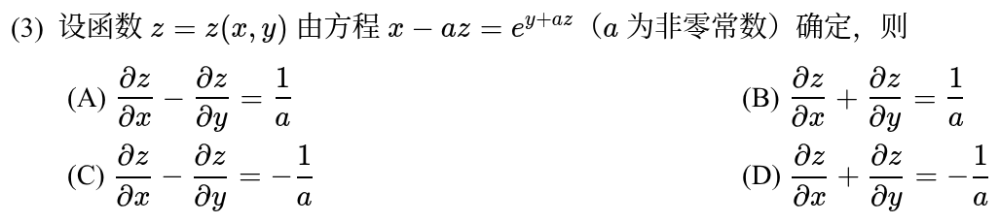

答案与解析

**答案 A。** 记 $E=e^{y+az}$。对 $x$ 求偏导得 $1=a(1+E)z_x$，对 $y$ 求偏导得 $0=E+a(1+E)z_y$。相减立刻得到 $z_x-z_y=1/a$。把两式保留成相同分母，可以直接看出该加还是该减。

---

### 02 · 2026年

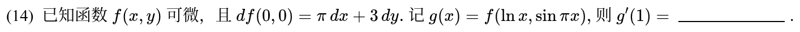

答案与解析

**答案 $-2\pi$。** $x=1$ 对应 $(\ln x,\sin\pi x)=(0,0)$。沿该路径的速度为 $(1,-\pi)$，和梯度 $(\pi,3)$ 作内积得 $\pi-3\pi=-2\pi$。

---

### 03 · 2025年

答案与解析

**答案 A。** 原式等价于 $z+\ln z=\int_y^x e^{-t^2}\,dt$，其中 $z>0$。分别求偏导得 $(1+1/z)z_x=e^{-x^2}$ 和 $(1+1/z)z_y=-e^{-y^2}$，相加即得。下限求导带负号。

---

### 04 · 2024年

> *复合函数二阶偏导大题。令 $u=2x+y, v=3x-y$，用链式法则分别算一阶、二阶偏导，代入原偏微分方程，交叉偏导项会相互抵消，化成极简方程。*

答案与解析

**解。** （1）原算子可分解为 $(\partial_x+3\partial_y)(\partial_x-2\partial_y)$。由 $u=2x+y,v=3x-y$ 代入，两因子分别为 $5\partial_u,5\partial_v$，故 $f_{uv}=1/25$。

（2）沿 $v$ 积分得 $f_u=v/25+ue^{-u}$，再沿 $u$ 积分得 $f=uv/25-(u+1)e^{-u}+C(v)$。代入 $u=0$ 得 $C(v)=v^2/50$，所以
$$
f(u,v)=\frac{uv}{25}-(u+1)e^{-u}+\frac{v^2}{50}.
$$

---

### 05 · 2023年

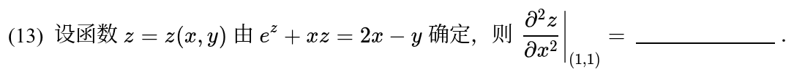

答案与解析

- **第一步定 $z(1,1)$**：代入 $x=1, y=1$ 得 $e^z + z = 1$，由 $e^z+z$ 严格单调增知唯一解 $z(1,1) = 0$。
- **第二步求一阶式并代值**：两边对 $x$ 求偏导得 $(e^z + x)z_x + z = 2$。代入 $(1,1,0)$ 得 $2z_x(1,1) = 2 \implies z_x(1,1) = 1$。
- **第三步对一阶式再对 $x$ 求偏导**（千万别先代值再求导！）：
  $$(e^z z_x + 1)z_x + (e^z + x)z_{xx} + z_x = 0 \iff (e^z + x)z_{xx} + e^z z_x^2 + 2z_x = 0.$$
  代入 $x=1, z=0, z_x=1$：$2z_{xx} + 1 + 2 = 0 \implies z_{xx}(1,1) = -\frac{3}{2}$。
- **答案**：$-\dfrac{3}{2}$。

---

### 06 · 2022年

答案与解析

**答案 C。** 写成 $F(x,y)=G(x-y)$，其中 $G(u)=u\int_0^u f(t)\,dt-\int_0^u t f(t)\,dt$。求导时边界项相消，$G'(u)=\int_0^u f(t)\,dt$、$G''(u)=f(u)$。$y$ 的链式因子 $-1$ 在一阶出现一次，在二阶出现两次。

---

### 07 · 2021年

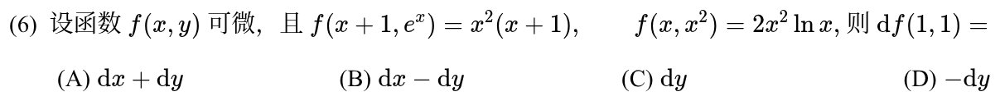

答案与解析

**题面待核。** 按当前转写，第一式在 $x=0$ 求导得到 $f_x+f_y=0$，第二式在 $x=1$ 求导得到 $f_x+2f_y=2$，两个偏导均在 $(1,1)$ 取值。解出 $df=-2\,dx+2\,dy$，四项都未列出，需核对原卷右端或选项。

---

### 08 · 2021年

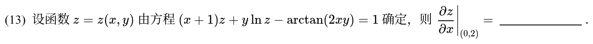

答案与解析

**答案 $1$。** 当 $x=0,y=2$ 时，$z+2\ln z=1$ 在 $z>0$ 上严格递增，唯一解 $z=1$。设 $F=(x+1)z+y\ln z-\arctan(2xy)-1$，代点有 $F_x=1-4=-3$、$F_z=1+2=3$，故 $z_x=-F_x/F_z=1$。

---

### 09 · 2019年

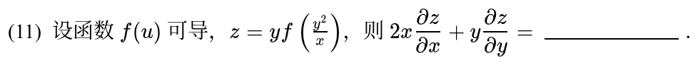

答案与解析

**答案 $z=yf(y^2/x)$。** 令 $u=y^2/x$，则 $2xu_x+yu_y=-2u+2u=0$。所以算子 $2x\partial_x+y\partial_y$ 作用到 $yf(u)$ 时，来自 $f'(u)$ 的项全部抵消，只剩 $yf(u)$。

---

### 10 · 2019年

> *偏微分方程坐标代换化简。做变量代换后，把所有偏导数换为关于新变量 $u, v$ 的导数，代入原方程整理，通常会化为标准的常微分方程形式。*

答案与解析

**答案 $a=-3/4,\ b=3/4$，化为 $2v_{xx}-2v_{yy}=0$。** 提掉指数因子后，一阶系数分别为 $4a+3,-4b+3$，令其为零。常数项 $2a^2-2b^2+3a+3b$ 在该组参数下也为零。

---

### 11 · 2018年

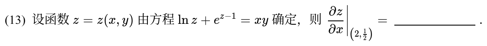

答案与解析

**答案 $1/4$。** 在 $(2,1/2)$，$\ln z+e^{z-1}=1$ 对 $z>0$ 严格递增，故 $z=1$。对 $x$ 求偏导得 $(1/z+e^{z-1})z_x=y$，代入即得。

---

### 12 · 2017年

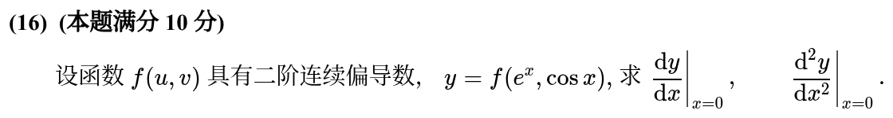

答案与解析

**触发条件与第一步**

二元抽象函数 $f(u,v)$ 复合了一元变量 $x$（$u=e^x, v=\cos x$），且要求在 $x=0$ 处的一阶与二阶导数。第一笔先列出依赖链 $y \to (u,v) \to x$，并算出 $x=0$ 时两个中间变量的值：$u(0)=e^0=1$，$v(0)=\cos 0=1$（防止最后把 $(1,1)$ 误写成 $(0,0)$！）。

**完整推演**

1. **求一阶导数及 $x=0$ 处的值**：
   记 $f'_1, f'_2$ 分别表示 $f$ 对第 1、第 2 个自变量的偏导数。由链式法则：
   $$\frac{\mathrm{d}y}{\mathrm{d}x} = f'_1(e^x, \cos x)\cdot e^x + f'_2(e^x, \cos x)\cdot (-\sin x) = e^x f'_1 - \sin x\, f'_2.$$
   令 $x = 0$，此时 $e^0 = 1$，$\cos 0 = 1$，$\sin 0 = 0$，得
   $$\left.\frac{\mathrm{d}y}{\mathrm{d}x}\right|_{x=0} = 1\cdot f'_1(1,1) - 0\cdot f'_2(1,1) = f'_1(1,1).$$
2. **求二阶导数及 $x=0$ 处的值**：
   对 $\frac{\mathrm{d}y}{\mathrm{d}x} = e^x f'_1(e^x,\cos x) - \sin x\, f'_2(e^x,\cos x)$ 两边再次关于 $x$ 求导（**乘积法则 + 链式法则**）：
   $$\begin{aligned}
   \frac{\mathrm{d}^2 y}{\mathrm{d}x^2} &= e^x f'_1 + e^x\Big(f''_{11}\cdot e^x + f''_{12}\cdot (-\sin x)\Big) \\
   &\quad - \cos x\, f'_2 - \sin x\Big(f''_{21}\cdot e^x + f''_{22}\cdot (-\sin x)\Big).
   \end{aligned}$$
   因为 $f(u,v)$ 具有**二阶连续偏导数**，所以 $f''_{12} = f''_{21}$，整理得
   $$\frac{\mathrm{d}^2 y}{\mathrm{d}x^2} = e^x f'_1 - \cos x\, f'_2 + e^{2x} f''_{11} - 2e^x\sin x\, f''_{12} + \sin^2 x\, f''_{22}.$$
   令 $x = 0$（注意此时 $\cos 0 = 1$，因此 $-f'_2(1,1)$ 项**不会消失**！），得
   $$\left.\frac{\mathrm{d}^2 y}{\mathrm{d}x^2}\right|_{x=0} = f'_1(1,1) - f'_2(1,1) + f''_{11}(1,1).$$

> **高频扣分点警示**：不要因为 $\left.\frac{\mathrm{d}y}{\mathrm{d}x}\right|_{x=0}$ 中 $-\sin x\, f'_2$ 这一项在 $x=0$ 时为 $0$，就在求二阶导前把它删掉！$-\sin x$ 求导后变成 $-\cos x$，在 $x=0$ 处贡献了 $-f'_2(1,1)$。

---

### 13 · 2015年

答案与解析

**题面待核。** 代 $v=y=1$ 后，$u=1$ 要求 $x+1/x=1$，即 $x^2-x+1=0$，没有实解。实际上在 $(1,1)$ 附近也没有这种实数原像，所以当前等式无法决定这里的偏导。不能代入不满足题设的 $(x,y)$ 硬选选项。

---

### 14 · 2015年

答案与解析

**答案 $dz=-(dx+2dy)/3$。** 在 $(x,y)=(0,0)$，有 $z=0$。全微分时 $xyz$ 的一阶贡献为 0，指数因子为 1，所以 $dx+2dy+3dz=0$。

---

### 15 · 2014年

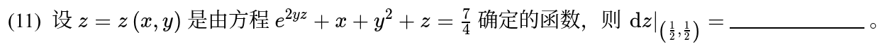

答案与解析

**答案 $dz=-(dx+dy)/2$。** 在 $x=y=1/2$，有 $e^z+z=1$，左侧严格递增，故 $z=0$。全微分在该点给 $dz+dx+dy+dz=0$。

---

### 16 · 2014年

答案与解析

**解。** 令 $u=e^x\cos y$，则 $u_{xx}+u_{yy}=0$ 且 $u_x^2+u_y^2=e^{2x}$。链式法则给 $z_{xx}+z_{yy}=e^{2x}f''(u)$，故 $f''-4f=u$。通解 $C_1e^{2u}+C_2e^{-2u}-u/4$，初值给 $C_1=1/16,C_2=-1/16$，所以 $f=(e^{2u}-e^{-2u})/16-u/4$。

---

### 17 · 2013年

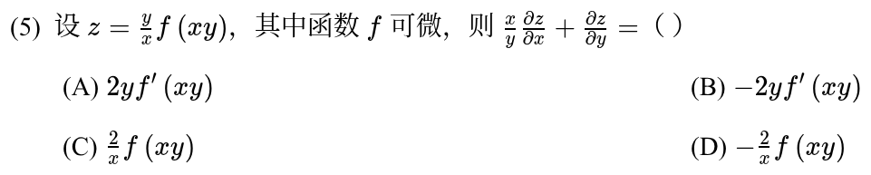

答案与解析

**答案 A。** $z_x=-y f(xy)/x^2+y^2 f'(xy)/x$，$z_y=f(xy)/x+yf'(xy)$。组合中 $f$ 项抵消，两个 $yf'$ 项相加。

---

### 18 · 2012年

答案与解析

**触发条件与第一步**

外层 $f(u)$ 是一元可微函数，内层 $u = \ln x + \frac{1}{y}$。第一笔直接设中间变量 $u = \ln x + \frac{1}{y}$，分别写出 $\frac{\partial z}{\partial x}$ 与 $\frac{\partial z}{\partial y}$。

**完整推演**

1. 令 $u = \ln x + \frac{1}{y}$，由复合函数链式法则：
   $$\frac{\partial z}{\partial x} = f'(u)\cdot \frac{\partial u}{\partial x} = \frac{1}{x}f'(u),$$
   $$\frac{\partial z}{\partial y} = f'(u)\cdot \frac{\partial u}{\partial y} = -\frac{1}{y^2}f'(u).$$
2. 代入所求表达式：
   $$x\frac{\partial z}{\partial x} + y^2\frac{\partial z}{\partial y} = x\cdot\frac{1}{x}f'(u) + y^2\cdot\left(-\frac{1}{y^2}f'(u)\right) = f'(u) - f'(u) = 0.$$

故应填 **$0$**。

---

### 19 · 2011年

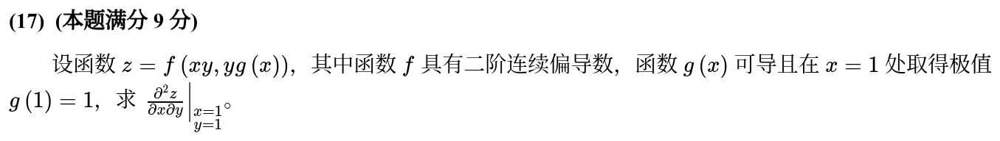

答案与解析

**答案 $f_u(1,1)+f_{uu}(1,1)+f_{uv}(1,1)$。** 令 $u=xy,v=yg(x)$，有 $z_x=yf_u+yg'f_v$。再对 $y$ 求导，$u_y=x,v_y=g(x)$。极值点给 $g'(1)=0$，故含 $g'$ 的项全部消失，其他系数在 $(x,y)=(1,1)$ 都为 1。

---

### 20 · 2010年

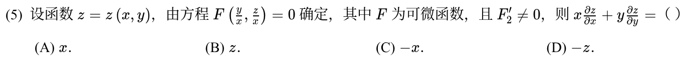

答案与解析

**答案 B，$z$。** 对隐式等式分别求偏导，再按 $x\partial_x+y\partial_y$ 组合。第一个自变量 $y/x$ 的贡献为零，第二个自变量 $z/x$ 的贡献为 $(xz_x+yz_y-z)/x$。因 $F_2'\ne0$，后者为零。

---

### 21 · 2010年

> *二阶偏导方程化简大题。链式法则展开时切记对每个中间变量逐层求导，利用二阶混合偏导连续性合并同类项，耐心整理系数。*

答案与解析

**答案 $(a,b)=(-2,-2/5)$ 或交换。** 因 $\partial_x=\partial_\xi+\partial_\eta,\ \partial_y=a\partial_\xi+b\partial_\eta$，两纯二阶项的系数分别为 $5a^2+12a+4$、$5b^2+12b+4$。两系数都为零，且坐标变换要求 $a\ne b$，故取上述两互异根。此时混合项系数为 $-64/5\ne0$，可除去。

---

[« 多元函数极限、偏导与全微分](16-multivariable-basics.md)　　[多元函数极值与最值 »](18-multivariable-extrema.md)
