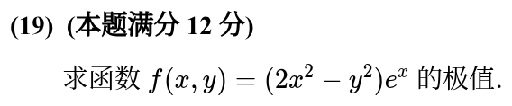
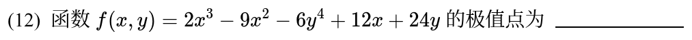
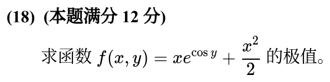
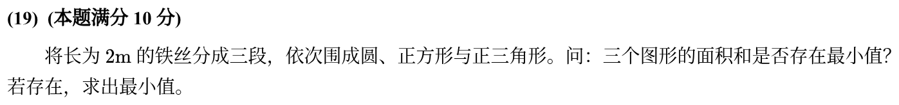
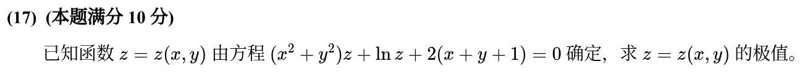
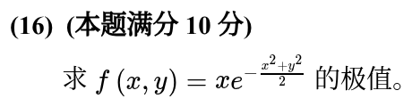

[« 多元复合函数与隐函数求导](17-chain-implicit.md)　　[二重积分 »](19-double-integrals.md)

# 高等数学 · 多元函数极值与最值

> **本章共 13 题**
> 
> - **核心必做（建议按顺序攻克关键方法）**：  
>   [第 06 题](#q06)（驻点与二阶判别） → [第 01 题](#q01)（区分极值与鞍点） → [第 02 题](#q02)（先还原函数再求极值） → [第 07 题](#q07)（带约束的实际最值）
> 
> - **分流与刷题建议**：  
>   - **较难挑战**：[第 08 题](#q08)（隐函数极值）、[第 05 题](#q05)（变量替换接求函数与极值）  
>   - **重在看思路**：[第 11 题](#q11)（隐式约束下距离先改求平方）  
> 
> - **过关目标**：驻点不等于极值；有约束先查范围与边界，不能只解偏导为零。

---

### 01 · 2026年

> *二元极值大题。求一阶偏导令其为 0 解驻点，别漏掉退化点；对每个驻点求二阶偏导算 $AC-B^2$，正负性判断要仔细。*

答案与解析

**触发条件与第一步**

多项式乘以 $e^x$ 的经典结构。求偏导时始终把公因子 $e^x$ 提在外面——因为 $e^x > 0$ 恒成立，解驻点时直接约掉 $e^x$，并且求二阶偏导时也只需套“$(P e^x)' = (P + P')e^x$”口诀，极不易算错。

**完整推演**

1. **求一阶偏导并找驻点**：
   $$\begin{cases} f_x(x,y) = (2x^2 + 4x - y^2)e^x = 0, \\ f_y(x,y) = -2y e^x = 0. \end{cases}$$
   因为 $e^x > 0$ 恒成立，由第二式立刻得 $y = 0$。代入第一式得
   $$2x^2 + 4x = 2x(x+2) = 0 \implies x = 0 \text{ 或 } x = -2.$$
   故共有两个驻点：$P_1(0, 0)$ 与 $P_2(-2, 0)$。
2. **求二阶偏导数**（利用 $(Pe^x)' = (P+P')e^x$）：
   $$f_{xx} = (2x^2 + 8x + 4 - y^2)e^x, \qquad f_{xy} = -2y e^x, \qquad f_{yy} = -2e^x.$$
3. **逐点判别**：
   - 在 $P_1(0,0)$ 处：$A = 4,\; B = 0,\; C = -2$，
     $$AC - B^2 = 4\cdot(-2) - 0 = -8 < 0,$$
     故 $(0,0)$ **不是极值点**。
   - 在 $P_2(-2,0)$ 处：$A = (8 - 16 + 4)e^{-2} = -4e^{-2},\; B = 0,\; C = -2e^{-2}$，
     $$AC - B^2 = (-4e^{-2})(-2e^{-2}) - 0 = 8e^{-4} > 0, \quad \text{且 } A = -4e^{-2} < 0,$$
     故 $(-2, 0)$ 是**极大值点**。
4. **计算极大值**：
   $$f(-2, 0) = \big(2(-2)^2 - 0^2\big)e^{-2} = 8e^{-2}.$$

结论：函数在点 $(-2, 0)$ 处取得极大值 $8e^{-2}$，无极小值。

---

### 02 · 2025年

> *全微分求原函数加极值。全微分条件 $\mathrm{d}f = P\mathrm{d}x + Q\mathrm{d}y$ 积分定出 $f(x,y)$，再按二元极值二阶充分条件检验驻点。*

答案与解析

- **第一步还原 $f(x,y)$**（偏积分法）：
  由 $f_x = -2x e^{-y}$ 对 $x$ 积分得 $f(x,y) = -x^2 e^{-y} + \varphi(y)$。
  再对 $y$ 求偏导与已知 $f_y$ 对照：
  $$x^2 e^{-y} + \varphi'(y) = e^{-y}(x^2 - y - 1) \implies \varphi'(y) = -(y+1)e^{-y}.$$
  分部积分得 $\varphi(y) = (y+2)e^{-y} + C$。由 $f(0,0)=2$ 得 $2 + C = 2 \implies C = 0$，故
  $$f(x,y) = (y + 2 - x^2)e^{-y}.$$
- **第二步求极值**（直接利用题干给定的 $f_x, f_y$ 找驻点）：
  - $f_x = -2x e^{-y} = 0 \implies x = 0$；
  - $f_y = (x^2 - y - 1)e^{-y} = 0 \implies y = -1$。唯一驻点 $(0, -1)$。
  - 二阶偏导：$f_{xx} = -2e^{-y}$，$f_{xy} = 2x e^{-y}$，$f_{yy} = (y - x^2)e^{-y}$。
  - 在 $(0,-1)$ 处：$A = -2e < 0,\; B = 0,\; C = -e < 0$，$AC - B^2 = 2e^2 > 0$，故 $(0,-1)$ 为**极大值点**，极大值 $f(0,-1) = e$。
- **答案**：$f(x,y) = (y + 2 - x^2)e^{-y}$；在 $(0,-1)$ 处取得极大值 $e$，无极小值。

---

### 03 · 2024年

答案与解析

**答案**：$(1,1)$

- **切入点与推演**：多项式函数在 $\mathbb{R}^2$ 上处处光滑，直接求驻点并用二阶充分条件判别：
  1. **求驻点**：
     $$\begin{cases} f_x = 6x^2 - 18x + 12 = 6(x-1)(x-2) = 0, \\ f_y = -24y^3 + 24 = 24(1 - y^3) = 0, \end{cases}$$
     解得唯一实数 $y = 1$ 及 $x = 1$ 或 $x = 2$，驻点为 $(1,1)$ 与 $(2,1)$。
  2. **二阶偏导判别**：$A = f_{xx} = 12x - 18$，$B = f_{xy} = 0$，$C = f_{yy} = -72y^2$。
     - 在 $(1,1)$ 处：$A = -6 < 0,\; B = 0,\; C = -72$，$AC - B^2 = 432 > 0$，故 $(1,1)$ 为**极大值点**；
     - 在 $(2,1)$ 处：$A = 6,\; B = 0,\; C = -72$，$AC - B^2 = -432 < 0$，故 $(2,1)$ 非极值点。
- **易错点**：驻点不一定是极值点，必须逐点算 $AC - B^2$ 排除鞍点 $(2,1)$；同时注意题干问的是“极值点”（坐标）而非极值。

---

### 04 · 2023年

答案与解析

**结论速览**：函数在点 $(-e,\,2k\pi)$（$k\in\mathbb{Z}$）处取得极小值 $-\dfrac{e^2}{2}$，无极大值。

- **完整解答**：
  1. **求驻点**：令一阶偏导数为 $0$，
     $$\begin{cases} f_x(x,y) = e^{\cos y} + x = 0, \\ f_y(x,y) = -x e^{\cos y}\sin y = 0. \end{cases}$$
     由第一式得 $x = -e^{\cos y} \neq 0$，代入第二式并因 $e^{\cos y} > 0$，得 $\sin y = 0$，即 $y = k\pi$（$k\in\mathbb{Z}$）。按 $k$ 的奇偶性分为两族驻点：
     - $P_k(-e,\, 2k\pi)$（此时 $\cos y = 1$）；
     - $Q_k(-e^{-1},\, (2k+1)\pi)$（此时 $\cos y = -1$）。
  2. **求二阶偏导数**：
     $$f_{xx} = 1, \qquad f_{xy} = -e^{\cos y}\sin y, \qquad f_{yy} = -x e^{\cos y}(\cos y - \sin^2 y).$$
  3. **逐族判别**：
     - 在 $P_k(-e,\, 2k\pi)$ 处：$A = 1 > 0,\; B = 0,\; C = -(-e)\cdot e \cdot 1 = e^2$，
       $$AC - B^2 = e^2 > 0,$$
       故 $(-e,\, 2k\pi)$（$k\in\mathbb{Z}$）为**极小值点**，极小值为
       $$f(-e,\, 2k\pi) = -e\cdot e + \frac{(-e)^2}{2} = -\frac{e^2}{2}.$$
     - 在 $Q_k(-e^{-1},\, (2k+1)\pi)$ 处：$A = 1,\; B = 0,\; C = -(-e^{-1})\cdot e^{-1}\cdot (-1) = -e^{-2}$，
       $$AC - B^2 = -e^{-2} < 0,$$
       故 $(-e^{-1},\, (2k+1)\pi)$（$k\in\mathbb{Z}$）不是极值点。
- **核心思路与避坑**：三角函数 $\sin y = 0$ 有无穷多解 $y = k\pi$，务必注明 $k\in\mathbb{Z}$ 并按奇偶分类，切忌漏写周期或只检 $y=0,\pi$ 两点。

---

### 05 · 2022年

> *变量代换与极值综合大题。第一问链式法则求复合偏导；第二问积分恢复出 $f(u,v)$ 的具体表达式，求驻点并算 Hessian 判别式。*

答案与解析

**结论速览**：（I）$\dfrac{\partial g(x,y)}{\partial x} = 2(2x - y)e^{-y}$；（II）$f(u,v) = (u^2 + v^2)e^{-(u+v)}$，在 $(0,0)$ 处取得极小值 $0$，无极大值。

- **（I）利用链式法则求 $\dfrac{\partial g}{\partial x}$**：
  令 $u = x,\; v = y - x$，则 $u - v = 2x - y$，$u + v = y$。由复合函数求导法则及题设偏微分方程，得
  $$\frac{\partial g(x,y)}{\partial x} = \frac{\partial f}{\partial u}\cdot\frac{\partial u}{\partial x} + \frac{\partial f}{\partial v}\cdot\frac{\partial v}{\partial x} = \frac{\partial f}{\partial u} - \frac{\partial f}{\partial v} = 2(2x - y)e^{-y}.$$
- **（II）还原 $f(u,v)$ 并求极值**：
  1. **偏积分求 $g(x,y)$**：对（I）式关于 $x$ 偏积分（将 $y$ 视为常数），得
     $$g(x,y) = (2x^2 - 2xy)e^{-y} + \varphi(y).$$
     由 $g(y,y) = f(y, 0) = y^2 e^{-y}$，令 $x = y$ 代入上式得 $0 + \varphi(y) = y^2 e^{-y}$，故
     $$g(x,y) = (2x^2 - 2xy + y^2)e^{-y} = \big[x^2 + (y - x)^2\big]e^{-y}.$$
     再由逆变换 $x = u,\; y = u + v$（从而 $y - x = v$），还原得
     $$f(u,v) = (u^2 + v^2)e^{-(u+v)}.$$
  2. **求驻点**：
     $$\begin{cases} f_u = (2u - u^2 - v^2)e^{-(u+v)} = 0, \\ f_v = (2v - u^2 - v^2)e^{-(u+v)} = 0. \end{cases}$$
     约去 $e^{-(u+v)} > 0$ 得 $2u = 2v = u^2 + v^2 \implies u = v$ 且 $2u = 2u^2$，解得两个驻点 $(0,0)$ 与 $(1,1)$。
  3. **二阶偏导判别**：
     $$f_{uu} = (2 - 4u + u^2 + v^2)e^{-(u+v)}, \quad f_{uv} = (-2u - 2v + u^2 + v^2)e^{-(u+v)}, \quad f_{vv} = (2 - 4v + u^2 + v^2)e^{-(u+v)}.$$
     - 在 $(0,0)$ 处：$A = 2 > 0,\; B = 0,\; C = 2$，$AC - B^2 = 4 > 0$，故 $(0,0)$ 为**极小值点**，极小值 $f(0,0) = 0$；
     - 在 $(1,1)$ 处：$A = 0,\; B = -2e^{-2},\; C = 0$，$AC - B^2 = -4e^{-4} < 0$，故 $(1,1)$ 非极值点。
     综上，函数在 $(0,0)$ 处取得极小值 $0$，无极大值。
- **核心思路与避坑**：利用初值 $f(u,0) = u^2e^{-u}$ 确定 $\varphi(y)$ 时，关键是找到使第二个自变量 $y - x = 0$ 的条件，即令 $x = y$ 代入 $g(x,y)$。

---

### 06 · 2020年

答案与解析

**触发条件与第一步**

多项式函数在 $\mathbb{R}^2$ 上处处具有任意阶连续偏导数，无边界约束。第一笔直接算 $f_x, f_y$ 并令其为 $0$，利用一次项直接消元解出全部驻点。

**完整推演**

1. **求驻点**：
   $$\begin{cases} f_x(x,y) = 3x^2 - y = 0, \\ f_y(x,y) = 24y^2 - x = 0. \end{cases}$$
   由第一式得 $y = 3x^2$，代入第二式：
   $$24(3x^2)^2 - x = 216x^4 - x = x(216x^3 - 1) = 0.$$
   因为 $216 = 6^3$，解得两个实根：
   - $x = 0 \implies y = 0$，得驻点 $P_1(0, 0)$；
   - $x = \frac{1}{6} \implies y = 3\cdot\frac{1}{36} = \frac{1}{12}$，得驻点 $P_2\left(\frac{1}{6}, \frac{1}{12}\right)$。
2. **求二阶偏导数**：
   $$A = f_{xx} = 6x, \qquad B = f_{xy} = -1, \qquad C = f_{yy} = 48y.$$
3. **逐点判别**：
   - 在 $P_1(0,0)$ 处：$A = 0,\; B = -1,\; C = 0$，
     $$AC - B^2 = 0 - (-1)^2 = -1 < 0,$$
     故 $(0,0)$ **不是极值点**。
   - 在 $P_2\left(\frac{1}{6}, \frac{1}{12}\right)$ 处：$A = 6\cdot\frac{1}{6} = 1,\; B = -1,\; C = 48\cdot\frac{1}{12} = 4$，
     $$AC - B^2 = 1\cdot 4 - (-1)^2 = 3 > 0, \quad \text{且 } A = 1 > 0,$$
     故 $\left(\frac{1}{6}, \frac{1}{12}\right)$ 是**极小值点**。
4. **计算极小值**：
   $$f\left(\frac{1}{6}, \frac{1}{12}\right) = \left(\frac{1}{6}\right)^3 + 8\left(\frac{1}{12}\right)^3 - \frac{1}{6}\cdot\frac{1}{12} = \frac{1}{216} + \frac{1}{216} - \frac{3}{216} = -\frac{1}{216}.$$

结论：函数在点 $\left(\frac{1}{6}, \frac{1}{12}\right)$ 处取得极小值 $-\frac{1}{216}$，无极大值。

---

### 07 · 2018年

> *周长受限的几何面积最值。三个图形边长设为变量，周长和为定值，列出面积目标函数。既可用拉格朗日乘数法，也可用柯西不等式秒杀。*

答案与解析

**结论速览**：存在最小值，最小值为 $\dfrac{1}{\pi + 4 + 3\sqrt{3}}\;\mathrm{m}^2$。

- **完整解答**：
  1. **建立目标函数与约束**：设围成圆、正方形、正三角形的三段铁丝长分别为 $x, y, z$（单位：$\mathrm{m}$），则约束条件为
     $$x + y + z = 2 \qquad (x > 0,\; y > 0,\; z > 0).$$
     三个图形的面积分别为：
     - 圆：半径 $r = \dfrac{x}{2\pi}$，面积 $S_1 = \pi r^2 = \dfrac{x^2}{4\pi}$；
     - 正方形：边长 $a = \dfrac{y}{4}$，面积 $S_2 = a^2 = \dfrac{y^2}{16}$；
     - 正三角形：边长 $b = \dfrac{z}{3}$，面积 $S_3 = \dfrac{\sqrt{3}}{4}b^2 = \dfrac{\sqrt{3}z^2}{36} = \dfrac{z^2}{12\sqrt{3}}$。

     总面积为
     $$S(x,y,z) = \frac{x^2}{4\pi} + \frac{y^2}{16} + \frac{z^2}{12\sqrt{3}}.$$
  2. **求唯一条件驻点（拉格朗日乘数法）**：构造 $L(x,y,z,\lambda) = \dfrac{x^2}{4\pi} + \dfrac{y^2}{16} + \dfrac{z^2}{12\sqrt{3}} + \lambda(x + y + z - 2)$，令偏导数为 $0$：
     $$\begin{cases} L_x = \dfrac{x}{2\pi} + \lambda = 0 \implies x = -2\pi\lambda, \\ L_y = \dfrac{y}{8} + \lambda = 0 \implies y = -8\lambda, \\ L_z = \dfrac{z}{6\sqrt{3}} + \lambda = 0 \implies z = -6\sqrt{3}\lambda, \\ x + y + z = 2. \end{cases}$$
     将前三式代入约束得 $-\lambda(2\pi + 8 + 6\sqrt{3}) = 2 \implies -\lambda = \dfrac{1}{\pi + 4 + 3\sqrt{3}}$，从而唯一驻点为
     $$x_0 = \frac{2\pi}{\pi + 4 + 3\sqrt{3}}, \qquad y_0 = \frac{8}{\pi + 4 + 3\sqrt{3}}, \qquad z_0 = \frac{6\sqrt{3}}{\pi + 4 + 3\sqrt{3}},$$
     且三者均严格大于 $0$。
  3. **论证最小值存在并求值**：由柯西-施瓦茨不等式，对任意满足 $x+y+z=2$ 的正数 $x,y,z$，有
     $$\left(\frac{x^2}{4\pi} + \frac{y^2}{16} + \frac{z^2}{12\sqrt{3}}\right)(4\pi + 16 + 12\sqrt{3}) \ge (x + y + z)^2 = 4,$$
     即
     $$S(x,y,z) \ge \frac{4}{4\pi + 16 + 12\sqrt{3}} = \frac{1}{\pi + 4 + 3\sqrt{3}},$$
     等号当且仅当 $(x,y,z) = (x_0, y_0, z_0)$ 时成立。故面积和存在最小值，且最小值为 $\dfrac{1}{\pi + 4 + 3\sqrt{3}}\;\mathrm{m}^2$。
- **核心思路与避坑**：开区域 $x,y,z>0$ 上不能仅凭“唯一驻点”直接断言存在最小值，必须结合柯西不等式（或消元化为二元正定二次函数）严格证明该驻点确为全局最小值点。

---

### 08 · 2016年

答案与解析

**结论速览**：函数 $z=z(x,y)$ 在点 $(-1,-1)$ 处取得极大值 $1$，无极小值。

- **完整解答**：
  1. **定义域与隐函数一阶偏导**：方程含 $\ln z$，故 $z > 0$。方程两边分别对 $x, y$ 求偏导：
     $$\begin{cases} 2xz + \left(x^2 + y^2 + \dfrac{1}{z}\right)z_x + 2 = 0, \\ 2yz + \left(x^2 + y^2 + \dfrac{1}{z}\right)z_y + 2 = 0. \end{cases}$$
  2. **求驻点**：令 $z_x = 0,\; z_y = 0$，得 $xz + 1 = 0,\; yz + 1 = 0$，即 $x = y = -\dfrac{1}{z}$。代入原方程：
     $$\left(\frac{1}{z^2} + \frac{1}{z^2}\right)z + \ln z + 2\left(-\frac{1}{z} - \frac{1}{z} + 1\right) = 0 \implies \ln z - \frac{2}{z} + 2 = 0.$$
     令 $g(z) = \ln z - \dfrac{2}{z} + 2$（$z > 0$），则 $g'(z) = \dfrac{1}{z} + \dfrac{2}{z^2} > 0$，故 $g(z)$ 在 $(0,+\infty)$ 上严格单调递增。又 $g(1) = 0$，所以 $z = 1$ 是唯一实根，从而唯一驻点为 $(-1,-1)$，对应 $z(-1,-1) = 1$。
  3. **求驻点处的二阶偏导并判别**：将一阶偏导式再分别对 $x, y$ 求偏导，并在驻点 $(-1,-1)$ 处代入 $z = 1,\; z_x = z_y = 0$（注意此时 $x^2 + y^2 + \dfrac{1}{z} = 3$）：
     - $2z + 2xz_x + \left(x^2 + y^2 + \dfrac{1}{z}\right)z_{xx} + \cdots = 0 \implies 2 + 3z_{xx} = 0 \implies A = z_{xx} = -\dfrac{2}{3}$；
     - $2xz_y + \left(x^2 + y^2 + \dfrac{1}{z}\right)z_{xy} + \cdots = 0 \implies 3z_{xy} = 0 \implies B = z_{xy} = 0$；
     - $2z + 2yz_y + \left(x^2 + y^2 + \dfrac{1}{z}\right)z_{yy} + \cdots = 0 \implies 2 + 3z_{yy} = 0 \implies C = z_{yy} = -\dfrac{2}{3}$。

     由此 $AC - B^2 = \dfrac{4}{9} > 0$ 且 $A = -\dfrac{2}{3} < 0$，故 $(-1,-1)$ 为**极大值点**，极大值为 $z(-1,-1) = 1$，无极小值。
- **核心思路与避坑**：隐函数求极值在算驻点二阶偏导时，千万不要把 $z_x, z_y$ 解出来再对分式求导——直接对隐式一阶偏导方程两边求导，再把 $z_x = z_y = 0$ 代入，所有含 $z_x, z_y$ 的项都会立刻归零。

---

### 09 · 2015年

答案与解析

**结论速览**：$f(x,y) = \big(x - 1 + (y+1)^2\big)e^x$，在点 $(0,-1)$ 处取得极小值 $-1$，无极大值。

- **完整解答**：
  1. **两次偏积分还原 $f(x,y)$**：
     - 对 $f_{xy}''(x,y) = 2(y+1)e^x$ 关于 $y$ 偏积分：
       $$f_x'(x,y) = (y+1)^2 e^x + \varphi(x).$$
       代入 $f_x'(x,0) = (x+1)e^x$，得 $e^x + \varphi(x) = (x+1)e^x \implies \varphi(x) = x e^x$，故
       $$f_x'(x,y) = \big(x + (y+1)^2\big)e^x.$$
     - 再对上式关于 $x$ 偏积分（注意 $\int x e^x\,\mathrm{d}x = (x-1)e^x$）：
       $$f(x,y) = \big(x - 1 + (y+1)^2\big)e^x + \psi(y).$$
       代入 $f(0,y) = y^2 + 2y$，得 $-1 + (y+1)^2 + \psi(y) = y^2 + 2y + \psi(y) = y^2 + 2y \implies \psi(y) = 0$，故
       $$f(x,y) = \big(x - 1 + (y+1)^2\big)e^x.$$
  2. **求驻点与二阶判别**：
     $$\begin{cases} f_x(x,y) = \big(x + (y+1)^2\big)e^x = 0, \\ f_y(x,y) = 2(y+1)e^x = 0. \end{cases}$$
     因 $e^x > 0$，解得唯一驻点 $(0,-1)$。二阶偏导数为
     $$f_{xx} = \big(x + 1 + (y+1)^2\big)e^x, \qquad f_{xy} = 2(y+1)e^x, \qquad f_{yy} = 2e^x.$$
     在 $(0,-1)$ 处：$A = 1 > 0,\; B = 0,\; C = 2$，$AC - B^2 = 2 > 0$，故 $(0,-1)$ 为**极小值点**，极小值 $f(0,-1) = -1$，无极大值。
- **核心思路与避坑**：每次偏积分都必须加上关于“另一变量”的任意函数（$\varphi(x)$ 与 $\psi(y)$），并按给定边值条件依次确定，切勿漏写。

---

### 10 · 2014年

答案与解析

**答案**：**（A）** $u(x,y)$ 的最大值点和最小值点必定都在区域 $D$ 的边界上

- **切入点与推演**：利用有界闭区域上连续函数的最值定理，结合内点极值的二阶判别式排除内部极值点。
  1. $u(x,y)$ 在有界闭区域 $D$ 上连续，故 $u$ 在 $D$ 上必能取到最大值和最小值。
  2. 设 $(x_0, y_0)$ 是 $D$ 内部的任意驻点。由拉普拉斯方程 $u_{xx} + u_{yy} = 0$ 得 $u_{yy} = -u_{xx}$，结合 $u_{xy} \neq 0$，计算该点处的判别式：
     $$AC - B^2 = u_{xx}u_{yy} - u_{xy}^2 = -u_{xx}^2 - u_{xy}^2 < 0.$$
     因此 $D$ 内部的任何驻点都不是极值点，从而 $u$ 在 $D$ 内部不存在任何极值点。
  3. 由此，$u(x,y)$ 的最大值点和最小值点必定都在区域 $D$ 的边界上，选 **（A）**。
- **干扰项 / 易错提示**：本题是调和函数“极值原理”的直接体现，若未将 $u_{yy} = -u_{xx}$ 代入 $AC - B^2$，容易误以为需要讨论 $u_{xx}$ 的符号，从而误选（C）或（D）。

---

### 11 · 2013年

> *隐式曲线到原点距离极值。目标函数设为距离平方 $x^2+y^2$，约束条件是隐式方程，拉格朗日乘数法对称性极强，注意端点非负限制。*

答案与解析

**结论速览**：最长距离为 $\sqrt{2}$（在点 $(1,1)$ 处取得），最短距离为 $1$（在点 $(1,0)$ 和 $(0,1)$ 处取得）。

- **完整解答**：
  1. **转化目标与确认最值存在**：求距离 $d = \sqrt{x^2 + y^2}$ 的最值等价于求 $f(x,y) = x^2 + y^2$ 在约束 $x^3 - xy + y^3 = 1$（$x \ge 0,\; y \ge 0$）下的最值。由于 $x, y \ge 0$ 时若 $r = \max\{x,y\} \to +\infty$，则 $x^3 + y^3 - xy \ge r^3 - r^2 \to +\infty$，可见曲线段是有界闭集，故连续函数 $f(x,y)$ 必存在最大值与最小值。
  2. **检查边界端点（$x = 0$ 或 $y = 0$）**：
     - 当 $x = 0$ 时，$y^3 = 1 \implies y = 1$，得端点 $(0,1)$，距离 $d = 1$；
     - 当 $y = 0$ 时，$x^3 = 1 \implies x = 1$，得端点 $(1,0)$，距离 $d = 1$。
  3. **求内部（$x > 0,\; y > 0$）条件驻点**：构造拉格朗日函数 $L(x,y,\lambda) = x^2 + y^2 + \lambda(x^3 - xy + y^3 - 1)$，令偏导数为 $0$：
     $$\begin{cases} L_x = 2x + \lambda(3x^2 - y) = 0, \\ L_y = 2y + \lambda(3y^2 - x) = 0, \\ x^3 - xy + y^3 = 1. \end{cases}$$
     由前两式消去 $\lambda$，得 $2x(3y^2 - x) = 2y(3x^2 - y)$，移项因式分解：
     $$3xy(y - x) + (y^2 - x^2) = (y - x)(x + y + 3xy) = 0.$$
     因 $x > 0,\; y > 0$，恒有 $x + y + 3xy > 0$，故必有 $x = y$。代入约束方程得
     $$2x^3 - x^2 - 1 = (x - 1)(2x^2 + x + 1) = 0.$$
     因 $2x^2 + x + 1 > 0$ 恒成立，唯一实根为 $x = y = 1$，得内部唯一驻点 $(1,1)$，对应距离 $d = \sqrt{1^2 + 1^2} = \sqrt{2}$。
  4. **比较得出最值**：比较 $(0,1),\; (1,0),\; (1,1)$ 三点到原点的距离 $1,\; 1,\; \sqrt{2}$，得最长距离为 $\sqrt{2}$，最短距离为 $1$。
- **核心思路与避坑**：带非负约束 $x \ge 0,\; y \ge 0$ 的条件最值题，拉格朗日乘数法只找内部驻点，**绝对不能漏掉边界端点 $(1,0)$ 与 $(0,1)$**，否则会直接丢失最短距离 $1$。

---

### 12 · 2012年

答案与解析

**结论速览**：函数在 $(1,0)$ 处取得极大值 $e^{-\frac{1}{2}}$，在 $(-1,0)$ 处取得极小值 $-e^{-\frac{1}{2}}$。

- **完整解答**：
  1. **求驻点**：令一阶偏导数为 $0$，
     $$\begin{cases} f_x(x,y) = (1 - x^2)e^{-\frac{x^2+y^2}{2}} = 0, \\ f_y(x,y) = -xy e^{-\frac{x^2+y^2}{2}} = 0. \end{cases}$$
     因 $e^{-\frac{x^2+y^2}{2}} > 0$，由第一式得 $x = \pm 1$，代入第二式得 $y = 0$。故共有两个驻点：$P_1(1,0)$ 与 $P_2(-1,0)$。
  2. **求二阶偏导数**：
     $$f_{xx} = x(x^2 - 3)e^{-\frac{x^2+y^2}{2}}, \qquad f_{xy} = y(x^2 - 1)e^{-\frac{x^2+y^2}{2}}, \qquad f_{yy} = x(y^2 - 1)e^{-\frac{x^2+y^2}{2}}.$$
  3. **逐点判别**：
     - 在 $P_1(1,0)$ 处：$A = -2e^{-\frac{1}{2}} < 0,\; B = 0,\; C = -e^{-\frac{1}{2}}$，
       $$AC - B^2 = 2e^{-1} > 0,$$
       故 $(1,0)$ 为**极大值点**，极大值 $f(1,0) = e^{-\frac{1}{2}}$。
     - 在 $P_2(-1,0)$ 处：$A = 2e^{-\frac{1}{2}} > 0,\; B = 0,\; C = e^{-\frac{1}{2}}$，
       $$AC - B^2 = 2e^{-1} > 0,$$
       故 $(-1,0)$ 为**极小值点**，极小值 $f(-1,0) = -e^{-\frac{1}{2}}$。
- **核心思路与避坑**：因 $f(x,y)$ 关于 $x$ 为奇函数、关于 $y$ 为偶函数，$(1,0)$ 与 $(-1,0)$ 的极值必然互为相反数，可用这一对称性快速复核正负号。

---

### 13 · 2011年

答案与解析

**答案**：**（A）** $f''(0) < 0,\; g''(0) > 0$

- **切入点与推演**：对乘积型函数 $z = f(x)g(y)$ 直接计算 $(0,0)$ 处的一阶与二阶偏导数，套用二元极小值的充分条件（$AC - B^2 > 0$ 且 $A > 0$）：
  1. **检验驻点**：由 $f'(0) = g'(0) = 0$，得
     $$z_x(0,0) = f'(0)g(0) = 0, \qquad z_y(0,0) = f(0)g'(0) = 0,$$
     故 $(0,0)$ 是驻点。
  2. **计算二阶偏导**：
     $$A = z_{xx}(0,0) = f''(0)g(0), \qquad B = z_{xy}(0,0) = f'(0)g'(0) = 0, \qquad C = z_{yy}(0,0) = f(0)g''(0).$$
  3. **应用极小值充分条件**：因 $B = 0$，$AC - B^2 > 0$ 且 $A > 0$ 等价于 $A > 0$ 且 $C > 0$。结合已知 $g(0) < 0$、$f(0) > 0$，得
     $$\begin{cases} f''(0)g(0) > 0 \implies f''(0) < 0, \\ f(0)g''(0) > 0 \implies g''(0) > 0. \end{cases}$$
  故正确选项为 **（A）**。
- **干扰项 / 易错提示**：最易错选（C）$f''(0)>0, g''(0)>0$，原因是忘记 $z_{xx}(0,0)$ 乘了负系数 $g(0) < 0$，误以为“极小值直接要求二阶导都大于 $0$”。

---

[« 多元复合函数与隐函数求导](17-chain-implicit.md)　　[二重积分 »](19-double-integrals.md)
